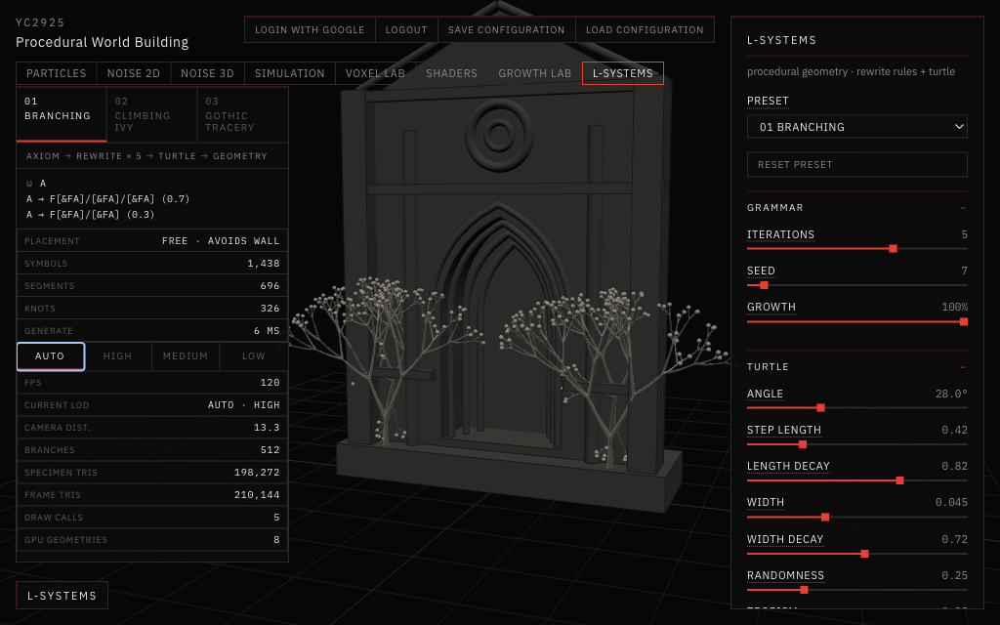
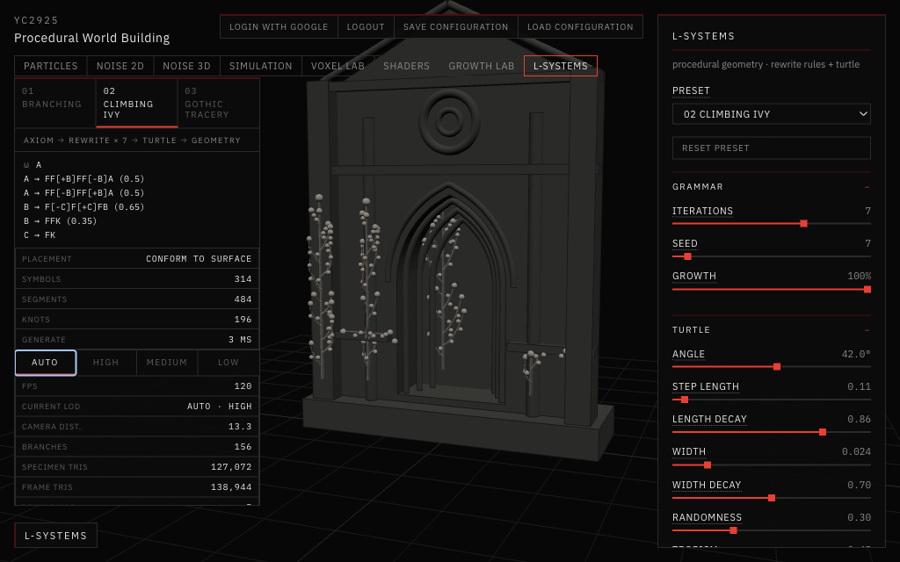
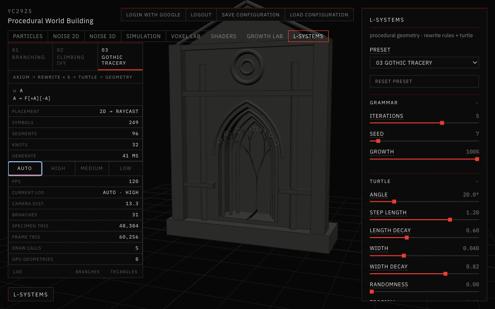
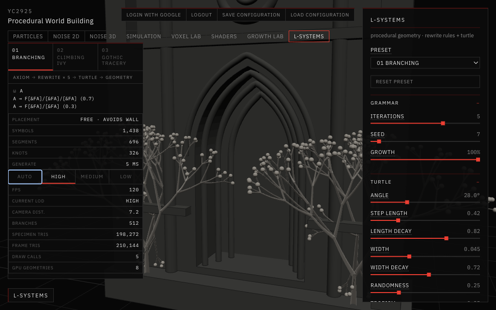
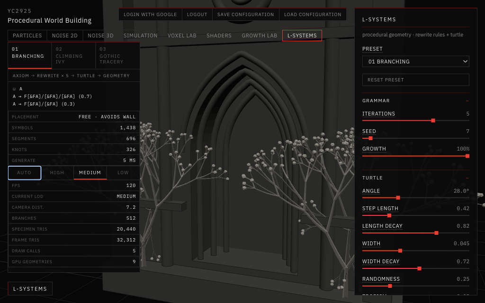
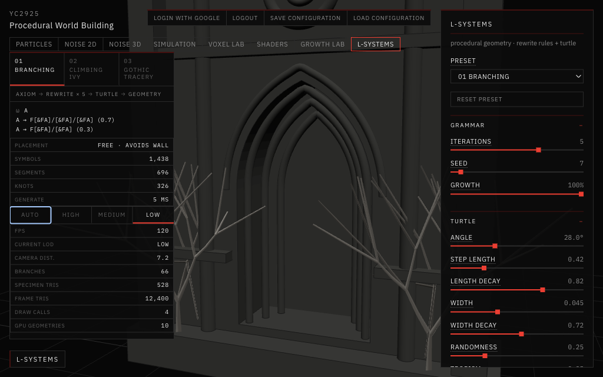

# 10 — L-Systems and Levels of Detail

Session date: **10 October 2026**. Tab: **L-Systems**.

The assignment suggested the title "12 — L-Systems and Levels of Detail". The repository numbers its study folders in order, and the last one was [09 Growth Lab](../09-growth-lab/README.md), so this study is **10**.

This week had two parts, and both live in the same tab:

1. **L-systems.** One rule-based growth engine with three presets: Branching, Climbing Ivy and Gothic Tracery.
2. **Levels of detail (LOD).** The same generated plant can be drawn at High, Medium or Low detail, chosen by hand or by camera distance, with live performance numbers.

L-Systems is its own top-level tab. It does not change Growth Lab. It reuses Growth Lab's test wall, its surface snapping and raycasting, and its random-number generator, so the plants grow on the same Gothic fragment as studies 01–03.

---

## Part 1 — L-systems

### The idea in plain words

An **L-system** (Lindenmayer system) grows a structure in two separate steps:

1. **Rewriting.** Start with a short word, the **axiom**, for example `A`. A set of **production rules** says what each letter turns into, for example `A → F[+A][-A]`. Apply every rule to every letter at once, and repeat. Each pass is one **iteration**, or one generation of growth. The word gets longer each time.
2. **Turtle drawing.** A small imaginary "turtle" reads the final word letter by letter and moves through 3D space. Some letters mean "move forward and draw", some mean "turn", and brackets mean "remember where you are" and "go back there".

The rules contain no geometry. All of the shape comes from reading the word.

### Production rules

Rules can be **stochastic**: one letter can have several possible replacements, each with a probability. A **seed** fixes which replacement is chosen each time, so the same seed always gives the same plant. Rewriting stops early if the word would grow beyond 250,000 letters. Any growth letters still left after the last pass become `K`, a **knot** (a bud, boss or foil) at the tip.

### Turtle interpretation

| Symbol | Meaning |
|---|---|
| `F` | Move forward and draw a segment |
| `f` | Move forward without drawing |
| `+` `-` | Turn left / right |
| `&` `^` | Pitch down / up |
| `\` `/` | Roll around the heading (by the golden angle, 137.5°, so branches spread evenly) |
| `\|` | Turn around |
| `[` `]` | Remember the turtle's state / return to it. A bracket starts a side branch, and each branch is shorter and thinner than its parent |
| `K` | Knot: a terminal ornament point |

**Tropism** gently bends every step towards "up", like a plant reaching for light. **Randomness** adds a little jitter to angles and lengths.

### The three morphological presets

#### 01 Branching

*Branching, default settings (5 iterations, seed 7), Auto LOD showing High.*

- **Rule:** `A → F[&FA]/[&FA]/[&FA]` (70%) or `F[&FA]/[&FA]` (30%).
- Each tip becomes a segment plus two or three pitched and rolled sub-branches.
- Two trees grow up freely in space from the plinth. When a branch runs into the wall, it is pushed back out and turned away, so the trees never pass through the stone.

#### 02 Climbing Ivy

*Climbing Ivy, default settings (7 iterations). Four stems climb the left pilaster, both columns and the door.*

- **Rules:**
  - `A → FF[+B]FF[-B]A` or the mirror image (50% each). The main stem keeps growing at its tip and drops side shoots on alternating sides.
  - `B → F[-C]F[+C]FB` (65%) or `FFK` (35%). A side shoot either grows on or stops with a bud.
  - `C → FK`. The smallest twigs end in a bud.
- **Conform placement:** every step is snapped onto the wall surface. Turns happen around the surface direction, so the plant hugs pilasters, columns and the door instead of floating.

#### 03 Gothic Tracery

*Gothic Tracery, default settings (5 iterations). Y-tracery projected onto the door inside the pointed arch; the tips become small foils (rings).*

- **Rule:** `A → F[+A][-A]`. Each bar splits into two shorter, thinner bars. This is the classic Y-tracery of Gothic windows.
- **Projected placement:** the turtle draws flat, in a plane in front of the portal. Every point of that drawing is then shot straight back onto the wall, the same 2D → 3D projection used in Growth Lab 02, so the tracery follows the door and jambs. It is drawn in stone grey because it represents carved stone rather than a plant.

### Architectural constraints

The wall shapes all three presets, each in a different way:

| Preset | How the architecture constrains it |
|---|---|
| Branching | **Avoidance.** A branch that comes too close to the wall is pushed out and steered away |
| Climbing Ivy | **Adhesion.** Every step is placed on the surface, so the stone guides the growth |
| Gothic Tracery | **Projection.** A flat pattern is mapped onto the wall, and the arch frames it (the defaults were tuned so the tracery stays inside the arch) |

---

## Part 2 — Levels of detail

### Why

A detailed plant can easily reach a million triangles, but up close is the only place that detail can be seen. From far away, a few hundred triangles give the same outline. **Level of detail** means keeping several versions of the same object and drawing the cheapest one that still looks right at the current distance.

### Rule number one: same plant, different mesh

LOD must **not** grow a different plant. So:

- The grammar is rewritten and the turtle walks **once**. Changing the LOD never runs either again.
- The turtle's output is stored as a **branch graph**: each unbroken stroke is one branch, with its points, thickness, generation (0 = trunk, 1 = first side branch, …) and parent.
- All three levels are built from that one graph. They differ only in how finely the branches are turned into triangles.

### The three levels

| | High | Medium | Low |
|---|---|---|---|
| Branch generations | All | All | 0–2 only (trunk, primary, secondary) |
| Curves | Smoothed (Catmull-Rom) | Smoothed | Straight |
| Rings along each segment | 6 | 2 | 1 |
| Sides around each tube | 10 | 5 | 3 |
| Taper towards tips | Yes | Yes | Yes |
| Knots | Full spheres / rings | Low-poly (20-sided ball, coarse ring) | None |

**Keeping the outline at Low.** When Low simply cut off everything above generation 2, the trees looked like bare sticks and lost their crown shape. Now each pruned generation-3 subtree is replaced by **one straight stand-in branch**, running from where that subtree starts to its farthest tip. The stand-ins come from the same branch graph. For Branching that adds 42 thin lines and restores the crown's extent for about 250 extra triangles. Ivy has only generations 0–2, so at Low it keeps every branch and just becomes much coarser.

### The same specimen at three levels

Same preset (Branching, seed 7, 5 iterations), same camera (zoomed in to 7.2 units), same wall and lights. Only the LOD buttons were changed.

*High: 512 branches, 198,272 specimen triangles.*

*Medium: the same 512 branches, 20,440 triangles. Tubes are slightly faceted, and buds are low-poly. Even this close, the difference is subtle.*

*Low: 66 branches (24 real branches from generations 0–2 plus 42 stand-ins), 528 triangles, no knots. Up close it is clearly a skeleton; from 24 units away, where Auto switches to it, it keeps the trees' outline.*

### Manual and automatic switching

The **LOD Mode** setting (in the control panel, and as Auto / High / Medium / Low buttons in the status panel) has four options:

- **High / Medium / Low** fix the level. This is the comparison mode: the camera, seed, architecture and lighting stay exactly as they are, and only the mesh changes. Turning on **Wireframe** shows the triangles directly.
- **Auto** uses `THREE.LOD`. The level follows the camera's distance to the centre of the specimen:

| Camera distance | Level |
|---|---|
| below 16 | High |
| 16 to 24 | Medium |
| 24 and beyond | Low |

**Avoiding flicker.** With 10% **hysteresis**, a level that is showing stays until the camera is 10% closer than its threshold. When zooming out, Medium starts at 16; when zooming back in, High only returns below 14.4. Without this, hovering right at a threshold would make the plant flicker between two levels.

Observed in the browser by zooming out and back in with the mouse wheel:

| Camera distance | Zooming out | Zooming back in |
|---|---|---|
| 13.3 | High | High |
| 14.8 | High | **Medium** (stays, inside the hysteresis band) |
| 16.4 | Medium | Medium |
| 22.3 | Medium | **Low** (stays, inside the hysteresis band) |
| 24.7 | Low | — |

### Geometry management

- **One mesh per level.** All branches of a level are merged into one triangle mesh, so a level is one draw call for the tubes plus one for all its knots (a single instanced mesh).
- **Growth slider without rebuilding.** Triangles are stored in order of distance from the root, so the Growth slider only changes how many triangles are drawn.
- **Caching.** A level is built the first time it is needed, then kept until the plant changes (new preset, seed or rule setting). Auto mode builds all three; manual mode only builds the chosen level.
- **Shared resources.** One branch material and one knot material are shared by all levels. Knot shapes are created once.
- **Cleanup.** When the plant changes, all cached level meshes and knot instances are disposed. When the tab closes, the materials and knot shapes are disposed too. Only one level is visible at a time; the others are hidden and not drawn.

---

## Performance

### What the panel shows

| Row | Source |
|---|---|
| FPS | Frames counted over each half-second, measured in the browser |
| Current LOD | The manual choice, or the level `THREE.LOD` picked in the last frame |
| Camera dist. | Camera to specimen centre, the value Auto LOD uses |
| Branches | Branches in the current level (Low includes the stand-ins) |
| Specimen tris | **Counted exactly** from the built geometry: tube triangles drawn plus knot triangles × visible knots |
| Frame tris | `renderer.info.render.triangles` for the last frame: the whole scene, i.e. specimen plus wall (11,872). The grid is lines, not triangles. With Wireframe on, the renderer counts the specimen as lines, so this row drops to the wall alone |
| Draw calls | `renderer.info.render.calls` for the last frame. The wall and grid account for 3 of them |
| GPU geometries | `renderer.info.memory.geometries`, used to check that switching does not leak |

The table under the rows lists branches and triangles for all three levels. A level shows "—" until it has been built.

None of these numbers are estimated. Frame triangles and draw calls come from the renderer. Specimen triangles are counted from the actual index buffers.

### Observed values

Measured in the browser at the default camera (distance 13.3), 1024 × 640 viewport, on the development Mac.

**Branching, 5 iterations (default), 696 segments, 326 knots:**

| LOD | Branches | Specimen triangles | Frame triangles | Draw calls | FPS |
|---|---|---|---|---|---|
| High | 512 | 198,272 | 210,144 | 5 | 120 |
| Medium | 512 | 20,440 | 32,312 | 5 | 120 |
| Low | 66 | 528 | 12,400 | 4 | 120 |

**Branching, 7 iterations (heaviest setting), 5,238 segments, 2,416 knots:**

| LOD | Branches | Specimen triangles | Frame triangles | Draw calls | FPS |
|---|---|---|---|---|---|
| High | 3,828 | 1,478,992 | 1,490,864 | 5 | 120 |
| Medium | 3,828 | 153,080 | 164,952 | 5 | 120 |
| Low | 66 | 528 | 12,400 | 4 | 120 |

**Other presets at default settings.** High was read in the browser. Medium and Low come from the same code run in Node, because these two presets were not switched level by level in the browser:

| Preset | High | Medium | Low |
|---|---|---|---|
| Climbing Ivy (156 branches) | 127,072 | 13,600 | 2,904 |
| Gothic Tracery (31 branches) | 48,384 | 4,992 | 288 (15 branches incl. 8 stand-ins) |

Generating the grammar and turtle took 5–10 ms for Branching at 5 iterations and about 38 ms at 7. That cost is paid once per plant, never per LOD switch.

### What the numbers say

- **Triangles fall steeply:** Medium has about **10×** fewer than High, and Low about **375×** fewer than High at 5 iterations, or about **2,800×** fewer at 7.
- **Draw calls hardly change** (5 → 4), because every level is already merged into one mesh. Here LOD saves triangles, not draw calls.
- **FPS did not change on this machine.** Every case ran at 120 fps, the display's refresh-rate cap, even 1.5 million triangles at High. This GPU is fast enough that the specimen is not the bottleneck, so the FPS benefit could not be measured here. It would show up on a slower GPU, with many specimens in one scene (a whole facade), or with heavier materials. I did not invent a difference that was not observed.
- **No leak observed.** Two rounds of 15 preset and seed changes, each also cycling all four LOD modes, both ended with the same GPU geometry count (8) in the same state.

---

## Relationship to the final project

The final project asks how vegetal ornament could grow by itself on sacred architecture. This week adds two things to that:

- **A grammar for ornament.** Growth Lab found *where* ornament can start and *how* a path can travel. L-systems add *how it branches*: one compact rule gives a tree, an ivy or a tracery, and the same three ways of meeting the wall (avoid, adhere, project) will apply to the final ornament.
- **A way to afford it.** A real facade would carry hundreds of such specimens. LOD makes that possible: build the plant once, keep a few cheap versions, and spend triangles only where the viewer is close. The stand-in branches at Low are a first step towards the "simplified silhouette" that distant ornament will need.

---

## What was checked

- Manual LOD switching works, and the camera does not move or reset.
- Auto LOD switches High → Medium → Low when zooming out and back when zooming in, with the hysteresis band observed both ways.
- Segments, knots, seed and rules stay identical across levels; only branches (Low) and triangles change.
- Triangles decrease at every lower level.
- FPS, triangles and draw calls update twice a second.
- The GPU geometry count stays flat after repeated switching.
- The Growth slider still works on the merged meshes (Low, 50% growth: 528 → 294 triangles).
- All other tabs still open and render. Simulation still logs its existing `uWaterColor` shader error, which predates this work.
- Lint and the production build pass.

---

## Where the code lives

| File | What it does |
|---|---|
| `app/src/views/LSystemView.jsx` | The tab: generation, status panel, LOD buttons and metrics |
| `app/src/lsystems/lsystem.js` | Rewriting, the turtle, projection, and the branch graph (generation, parent, subtree tips) |
| `app/src/lsystems/presets.js` | The three presets and default settings |
| `app/src/lsystems/lod.js` | LOD levels, tube building, the `THREE.LOD` wrapper, caching and disposal |
| `app/src/lsystems/LSystemScene.jsx` | Puts the LOD object and the wall in the scene; samples renderer statistics |
| `app/src/ui/LSystemPanel.jsx` | The right-hand controls, including LOD Mode and Wireframe |

Growth Lab's `Architecture` component is reused through a named export. Its behaviour is unchanged.
