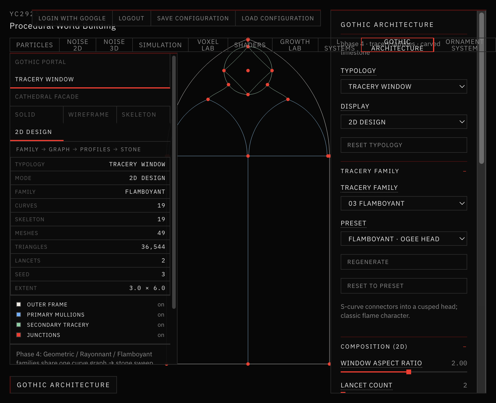
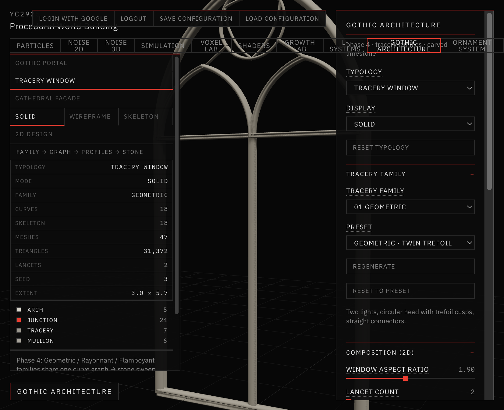
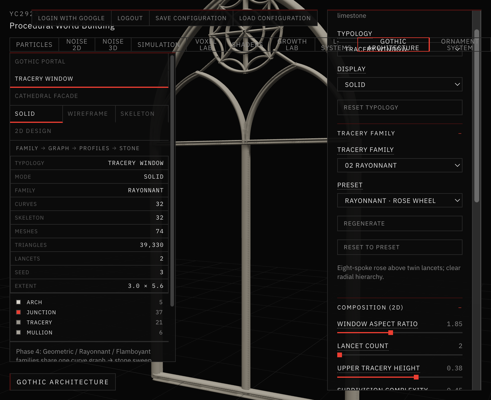
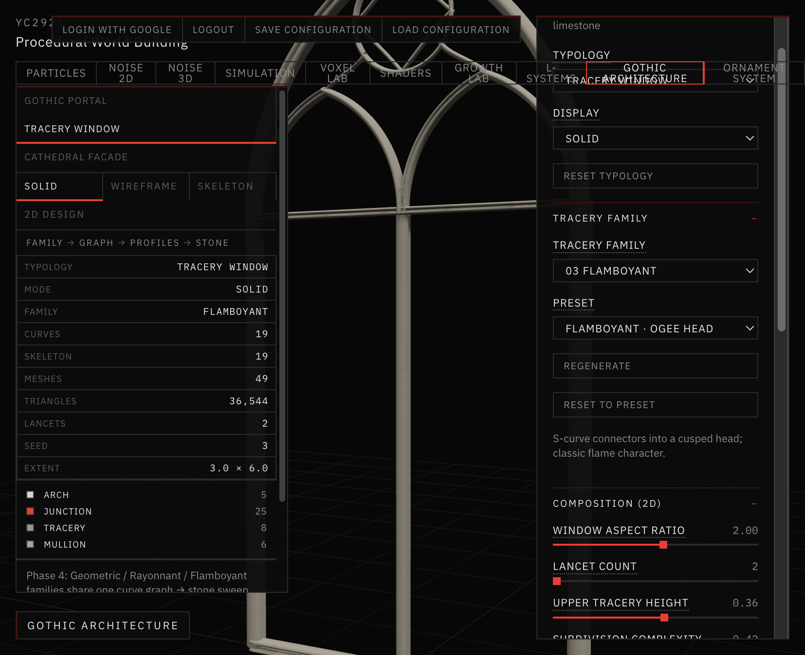
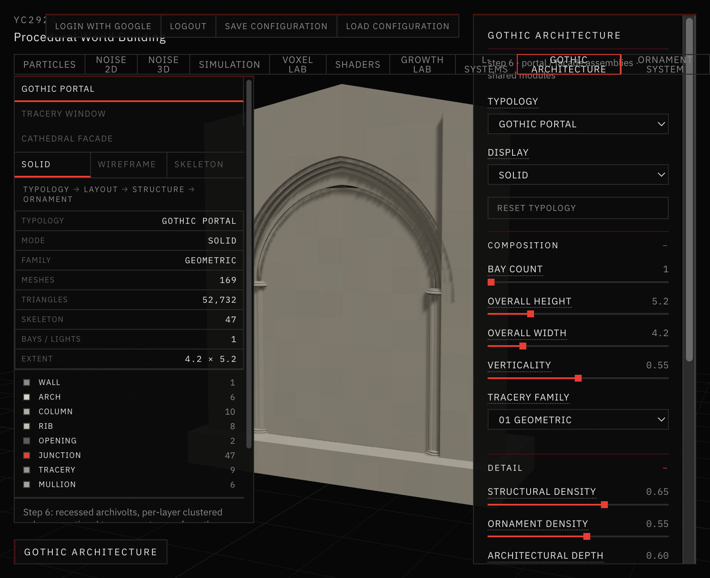
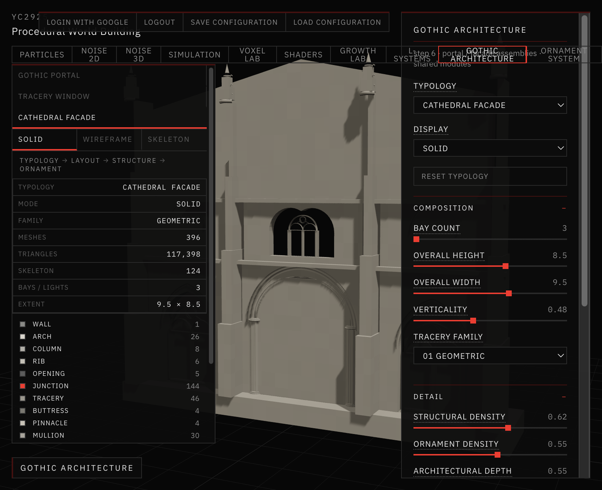

# 11 — Gothic Architecture

Session date: **20 October 2026**. Tab: **Gothic Architecture**.

This study builds the architectural framework for research on procedural vegetal growth interacting with sacred ornament. The generator produces **genuinely different Gothic compositions**, not minor tweaks of one pointed arch.

Phases 1–3 established the 2D curve network, 3D stone sweeps, moldings, and limestone materials. **Phase 4** adds three tracery families with distinct composition grammars, seeded variation, and six curated presets. **Step 6** integrates Portal and Façade assemblies that reuse the shared window generator.

Vegetation, particles, and new typologies are intentionally out of scope here.

---

## Pipeline

```
TRACERY FAMILY
      ↓
COMPOSITION RULES  (families/*.js)
      ↓
2D CURVE GRAPH     (curves, junctions, hierarchy, feature types)
      ↓
PROFILE ASSIGNMENT (profiles.js by role)
      ↓
3D STONE GEOMETRY  (windowSolid3d.js sweeps)
```

The 2D graph is the single source of truth. Display modes (Solid, Wireframe, Skeleton, 2D Design) all show the same composition. Switching modes does not change the seed or regenerate the design.

---

## Shared curve graph

Every family uses `createDesignBuilder` in `app/src/gothic/typologies/designShared.js` for:

- outer pointed frame
- primary mullions and impost
- lancet arches under the head

Upper tracery differs by family, but every design returns the same shape:

| Field | Role |
|---|---|
| `curves[]` | lines, arcs, beziers with `layer`, `hierarchy`, `featureType`, `parent` |
| `junctions[]` | connection points (red in 2D Design) |
| `layout` | dimensions, family, strategy, seed, proportions |
| `meta` | validation, notes, fallback flags |

The 3D builder (`windowSolid3d.js`) sweeps molding profiles along those centerlines. It does not invent independent tracery paths.



*2D Design mode — Flamboyant · Ogee Head. Cyan centerlines with red junctions; same graph drives the solid sweep.*

---

## Three tracery families

Selector: **Tracery Family** in the control panel.

### 01 Geometric

File: `typologies/families/geometric.js`



*Solid · Geometric · Twin Trefoil — two lancets, circular head with trefoil cusps, straight connectors.*

- Pointed lancet subdivisions
- Circular head opening
- Trefoil / quatrefoil / sexfoil cusps (strategy-driven)
- Straight connectors from lancet apices to the head
- Strong bilateral symmetry
- Optional inner ring + spokes at high subdivision

Emphasizes precise geometric construction.

### 02 Rayonnant

File: `typologies/families/rayonnant.js`



*Solid · Rayonnant · Rose Wheel — eight-spoke rose above twin lancets.*

- Radial rose organization
- Concentric rings
- Radiating spokes (8 / 12 / 10 by strategy)
- Rim foils between spokes
- Hierarchical straight links from lancets into the rose
- Optional lattice chords at high subdivision

Emphasizes intricate radiating networks.

### 03 Flamboyant

File: `typologies/families/flamboyant.js`



*Solid · Flamboyant · Ogee Head — S-curve connectors into a cusped head.*

- Ogee (S-curve) connectors
- Flame / mouchette forms
- Interlocking ogee mesh at high complexity
- Controlled asymmetry when Symmetry is off
- Spandrel flames for 3–4 lights

Emphasizes continuous, flowing Gothic curves.

---

## Procedural variation

| Parameter | Effect |
|---|---|
| **Tracery Family** | Switches composition grammar entirely |
| **Lancet Count** (2–4) | Reorganizes lower lights and mullions |
| **Upper Tracery Height** | Head / rose pack size |
| **Subdivision Complexity** | Foil count, rings, mouchettes, mesh density |
| **Curvature** | Arch pointedness and ornamental inflection |
| **Symmetry** | Bilateral vs controlled asymmetry |
| **Variation Seed** | Selects strategy `seed % 3` ∈ {0, 1, 2} within the family |

Variation is architectural, not coordinate jitter. Invalid graphs fall back to Geometric with the same dimensions and seed.

---

## Six curated presets

| Preset | Family | Intent |
|---|---|---|
| Geometric · Twin Trefoil | Geometric | Two lights, trefoil head, straight connectors |
| Geometric · Triple Sexfoil | Geometric | Three lights, dense sexfoil + inner ring |
| Rayonnant · Rose Wheel | Rayonnant | Twin lancets under an 8-spoke rose |
| Rayonnant · Double Ring | Rayonnant | Four lights, dense spokes and concentric rings |
| Flamboyant · Ogee Head | Flamboyant | Classic S-curve connectors into a cusped head |
| Flamboyant · Mouchette Mesh | Flamboyant | Three lights with mouchettes and ogee mesh |

Controls: **Preset** select, **Regenerate** (bump seed), **Reset to Preset**.

---

## Display modes (Tracery Window)

| Mode | What you see |
|---|---|
| Solid | Swept limestone |
| Wireframe | Triangle edges |
| Skeleton | Exact solid centerlines in 3D |
| 2D Design | Flat curve graph (ortho), layer toggles |

FEATURES is not a user-facing mode (metadata remains for future growth).

Portal and Facade keep Solid / Wireframe / Skeleton only.

---

## Source map

| Path | Role |
|---|---|
| `app/src/gothic/typologies/windowDesign2d.js` | Family dispatch + validation |
| `app/src/gothic/typologies/designShared.js` | Shared frame / mullions / helpers |
| `app/src/gothic/typologies/families/*.js` | Family composers |
| `app/src/gothic/typologies/presets.js` | Six curated presets |
| `app/src/gothic/typologies/windowSolid3d.js` | Profile sweep → stone |
| `app/src/gothic/profiles.js` | Molding profile library |
| `app/src/gothic/stoneMaterial.js` | Limestone PBR |
| `app/src/ui/GothicArchitecturePanel.jsx` | Controls |
| `app/src/views/GothicArchitectureView.jsx` | Viewport + telemetry |

---

## Validation (Phase 4)

Automated checks (Node, production builder path):

- All **six presets** produce valid connected graphs, matching solid skeletons, no fallback.
- **Three seeds** (3, 4, 5 → strategies 0, 1, 2) per family validate.
- Families remain structurally distinct at identical window dimensions (Geometric: straight connectors; Rayonnant: spokes + rose rings; Flamboyant: beziers / ogees / mouchettes).
- Portal and Facade builders still return meshes.
- `npm run build` succeeds.

Screenshots in `Images/` were captured from the live Gothic Architecture tab (Solid + 2D Design).

---

## Step 6 — Architectural integration

Portal and Façade now reuse the shared geometry library and the Tracery Window generator:

| Typology | Composition | Reused modules |
|---|---|---|
| **Gothic Portal** | Wall + `buildPortalAssembly` | Archivolts, clustered columns, jamb mullions, optional tympanum via `buildWindow` |
| **Cathedral Facade** | Primary buttresses/bays → middle portal + windows → upper gallery/rose/pinnacles | `buildPortalAssembly`, `buildWindow` (side bays, gallery, rose) |
| **Tracery Window** | Unchanged Phase-4 families | Own 2D graph → solid sweep |

`app/src/gothic/assemble.js` transforms meshes, features, and skeleton centerlines into the parent frame so embedded modules keep valid growth metadata.

Display: Portal and Façade support Solid / Wireframe / Skeleton. 2D Design remains Window-only.



*Solid · Gothic Portal — recessed archivolts, clustered columns, optional tympanum tracery.*



*Solid · Cathedral Facade — three-bay composition with portal, gallery windows, rose, and pinnacles.*

---

## Remaining limitations

- Strategies are a finite set of three per family; not a full historical grammar corpus.
- Self-intersection detection is heuristic (spacing / connectivity), not a full planar arrangement solver.
- Façade embeds several windows — triangle counts rise with bay count and ornament density.
- Vegetation / L-system coupling is deferred to later research phases (see [12 — Ornament System](../12-ornament-system/README.md)).
