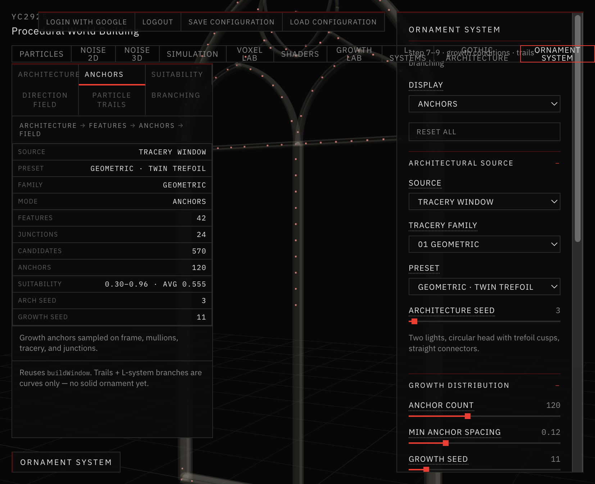
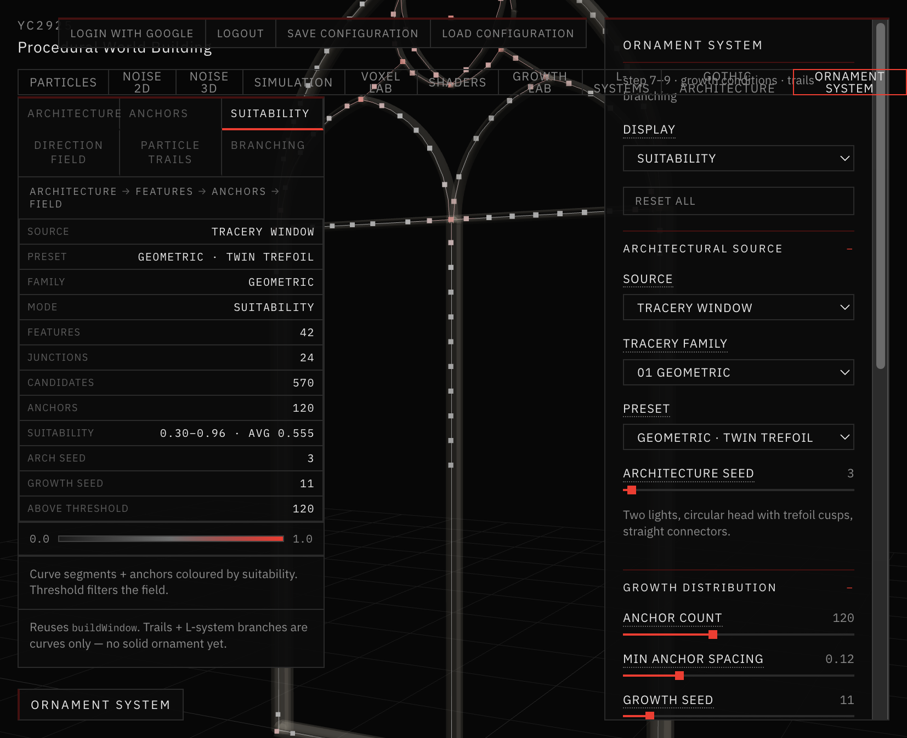
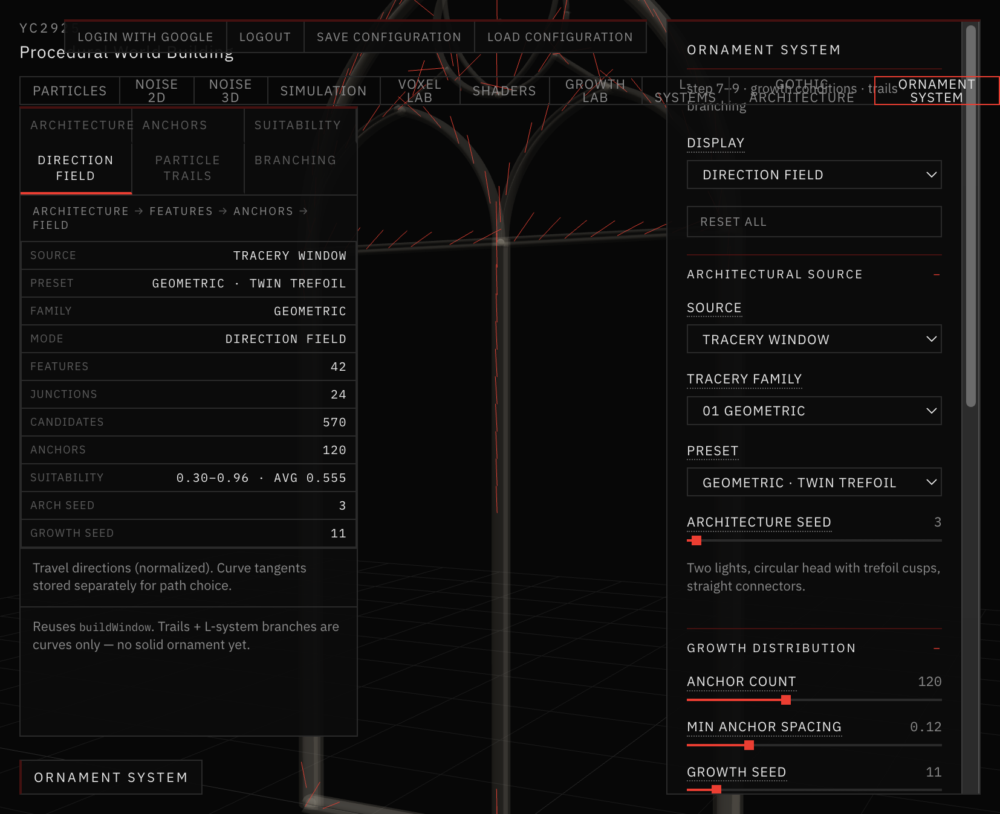
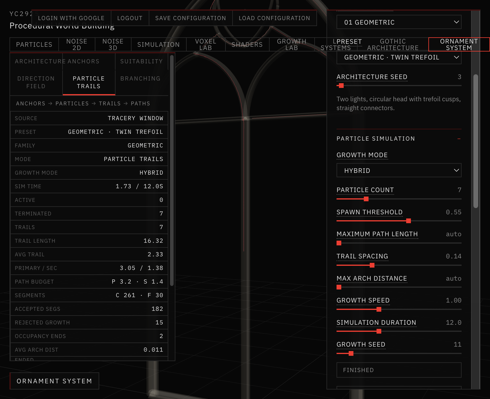
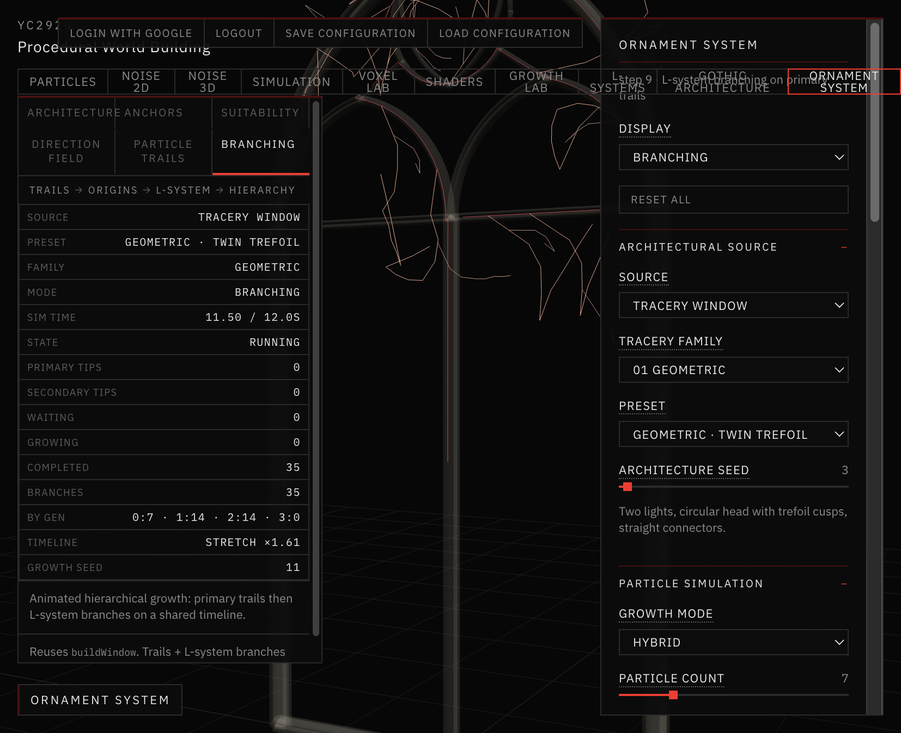
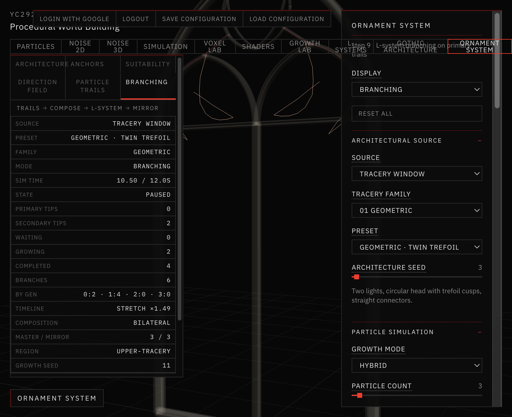
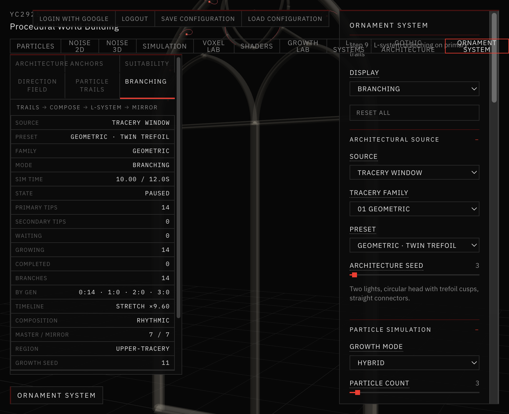
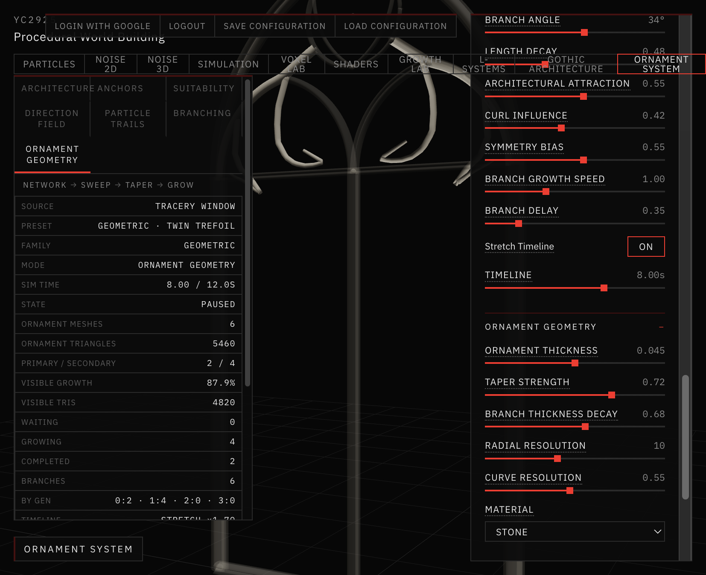
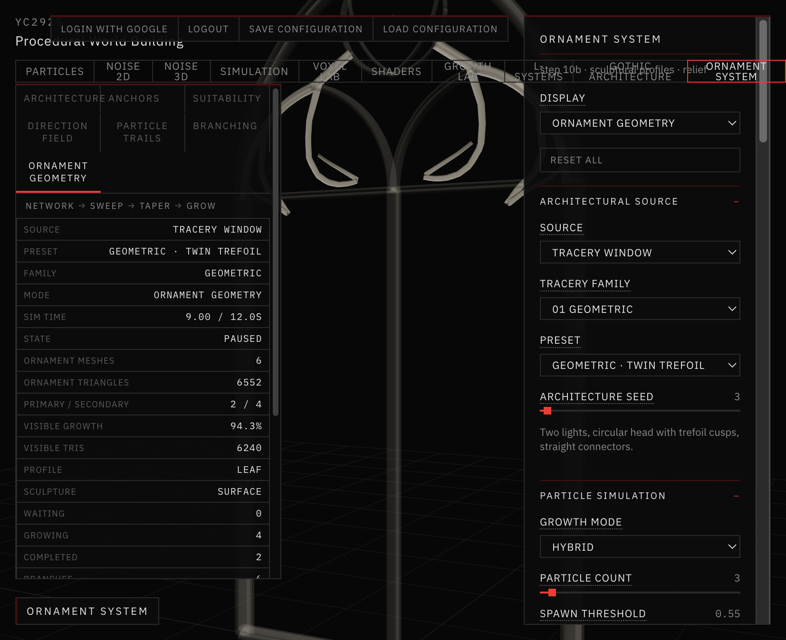
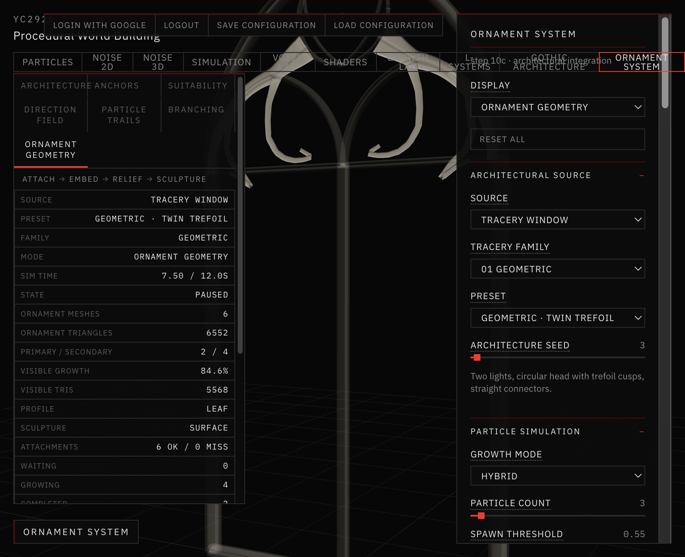

# 12 — Ornament System

Session date: **21 October 2026**. Tab: **Ornament System**.

This tab combines architectural constraints, particle trails, L-system branching, and (later) ornamental geometry.

**Step 7** implemented architectural growth conditions and diagnostics.  
**Step 7.5** refined suitability / direction / openings assessment.  
**Step 8** adds time-based **particle trails** that produce ornamental *curves* (not vegetation meshes).  
**Step 9 / 9.5** add hierarchical L-system branching with a shared animated growth timeline.  
**Step 9.7** adds an ornamental **composition layer**: bilateral symmetry, rhythmic motifs, and growth regions.  
**Step 10A** converts the composed curve network into **tapered swept meshes**.  
**Step 10B** adds **sculptural profiles**, foliate morphing, and architectural relief.  
**Step 10C** attaches ornament to architectural surfaces with root embedding and a relief→sculpture transition.

Not yet: Boolean stone blending, erosion, or equilibrium.

---

## Pipeline

```
GOTHIC WINDOW (shared generator)
      ↓
FEATURE EXTRACTION  (curves, junctions, hierarchy)
      ↓
GROWTH ANCHORS      (arc-length sampling + spacing)
      ↓
SUITABILITY FIELD   (weighted 0–1 scores)
      ↓
DIRECTION FIELD     (tangent / up / junction / outward)
      ↓
PARTICLE TRAILS     (constrained / hybrid curves)
      ↓
L-SYSTEM BRANCHING  (hierarchical post-process + playback)
      ↓
ORNAMENT GEOMETRY   (parallel-transport tapered tubes)
      ↓
SCULPTURAL PROFILES (leaf / fluted / relief + morph)
      ↓
ARCH INTEGRATION    (surface attach · embed · relief→sculpture)
```

Architecture and growth seeds are independent. Switching display mode does not regenerate either.

---

## Architectural source

For Steps 7–9 the only source is **Tracery Window**, via `buildWindow` from the Gothic Architecture module. Family, preset, and architecture seed match the Gothic tab when parameters match.

Portal and Façade are not wired yet. `extractArchFeatures` / `buildOrnamentArchitecture` accept a typology id so those sources can be added later without a second window generator.

---

## Growth conditions

| Concept | Behaviour |
|---|---|
| **Anchors** | Sampled along frame, mullion, and tracery centerlines; junctions included. Min spacing enforced. |
| **Suitability** | Blends frame / mullion / tracery / junction attraction and height preference. |
| **Direction** | Blends architectural tangent, upward bias, junction pull, outward bias. |
| **Openings** | Anchors are stone-only by construction. Reliable opening polygons are not available from the curve graph; `isInOpening()` is a documented stub for later use. |



*Anchors mode — red samples on the Geometric · Twin Trefoil window (seed 11, 120 anchors).*

---

## Display modes

| Mode | Shows |
|---|---|
| Architecture | Stone window |
| Anchors | Anchor points over subdued stone |
| Suitability | Curve segments + anchors coloured dark → signal red |
| Direction Field | Short growth-direction segments |
| Particle Trails | Animated hybrid / constrained trails |
| Branching | Hierarchical L-system network on a shared clock |
| Ornament Geometry | Tapered swept solids along the composed network |



*Suitability — charcoal→signal gradient on curves and anchors, with 0.0–1.0 legend.*



*Direction Field — short travel vectors along the architectural graph.*

---

## Source map

| Path | Role |
|---|---|
| `app/src/ornament/settings.js` | Defaults and display modes |
| `app/src/ornament/source.js` | Builds architecture via Gothic `buildWindow` |
| `app/src/ornament/extract.js` | Feature graph from design2d / skeleton |
| `app/src/ornament/conditions.js` | Anchors, suitability, directions |
| `app/src/ornament/curveGraph.js` | Arc-length graph + location queries |
| `app/src/ornament/particles.js` | Sparse particle trails + occupancy |
| `app/src/ornament/branching.js` | L-system post-process on trails |
| `app/src/ornament/composition.js` | Bilateral / rhythmic composition layer |
| `app/src/ornament/growthPlayback.js` | Shared birth / reveal timeline |
| `app/src/ornament/ornamentGeometry.js` | Parallel-transport sweep, taper, mesh cache |
| `app/src/ornament/OrnamentScene.jsx` | Viewport diagnostics + branching + geometry |
| `app/src/views/OrnamentSystemView.jsx` | Tab shell |
| `app/src/ui/OrnamentSystemPanel.jsx` | Controls |

---

## Step 7.5 refinements

- Suitability mode uses a continuous charcoal→gray→signal gradient on **curve segments and larger anchor points**, with a **0.0–1.0 legend** and a **threshold** filter.
- Scoring is a normalized weight blend so attraction knobs change actual scores (wider min–max range).
- Direction field stores **raw curve tangent**, **opposite tangent**, and a separate normalized **travel direction**; junctions carry **outgoing curve** lists for later path choice.
- Opening assessment: closed planar lights are **not** reliably extractable from the current open-curve graph without a planar face tracer — anchors stay curve-constrained; `isInOpening` remains a stub.

---

## Step 8 — Particle trails

| Mode | Behaviour |
|---|---|
| **Constrained** | Arc-length travel on stone centerlines; junction graph picks outgoing curves |
| **Hybrid** | Starts constrained, blends into curled free motion with architectural return |

Display mode **Particle Trails** shows subdued architecture, crimson trails, and bright heads. Simulation uses a **fixed timestep** (`1/30s`) so results do not depend on frame rate. Trails are ordered polylines stored per particle for later L-system / ornament use.



*Hybrid trails on Geometric · Twin Trefoil — sparse primary paths following stone with limited free curls.*

Sources: `ornament/curveGraph.js`, `ornament/particles.js`.

---

## Step 8.5 — Organic growth refinement

Refines trail behaviour without rewriting the sim or adding L-systems.

| Topic | Change |
|---|---|
| **Early termination** | Path budget was too short vs advance rate. Budget is now `speed · duration · 3.3 · 0.92`. Stats expose `terminationByReason`. |
| **Constrained** | Junction pick uses **exploration bias** + visit counts; avoids immediate backtrack; smooth heading blend at transitions. |
| **Hybrid** | Gradual release, localized curl (variable radius / bounded turn rate), soft **architectural proximity**, growth **envelope** steer (no hard bounce). |
| **Trail data** | Each point stores `mode` (`constrained` \| `free`), `t`, `step`; trails keep particle id, source anchor, features, termination reason. |
| **Viz** | Vertex-coloured segments, opacity fade along path, optional constrained vs free tint, clear heads. |

New parameters: `explorationBias`, `architecturalProximity`, `growthEnvelope`, `distinguishGrowthSegments`.

### Sparse ornamental refinement

Defaults favour a **small number of elegant paths** (not dense spaghetti):

| Control | Default | Role |
|---|---|---|
| Particle count | 3 | Few master trails (composition default) |
| Architectural following | 0.90 | Stay on stone |
| Organic deviation | 0.15 | Limited free leave |
| Curl strength | 0.20 | Localized terminal hooks |
| Max path length | auto (~window scale) | Primary / secondary budgets |
| Trail spacing | 0.14 | Occupancy competition |
| Max arch distance | auto | Soft attachment limit |

Primary vs secondary particles use separate budgets and deviation; optional debug shows envelope, occupancy, and role colours.

---

## Step 9 — L-system branching

Display mode **Branching** post-processes completed particle trails:

1. Run (or reuse) the sparse particle simulation to completion.
2. Treat each trail as a generation-0 parent path.
3. Sample non-uniform branch origins along parents.
4. Expand a small stochastic grammar (`B`, `C`, `K` + turtle `F/+/-/[]`) relative to the local parent tangent.
5. Steer with opening bias + soft architectural attraction; reject via the shared occupancy grid.

| Parameter | Default | Role |
|---|---|---|
| Branch generations | 1 | 0 = primaries only; up to 3 |
| Branch density | 0.40 | Origin sampling rate |
| Branch angle | 34° | From local parent tangent |
| Length decay | 0.48 | Per-generation scale |
| Architectural attraction | 0.55 | Soft pull toward stone after departure |
| Curl influence | 0.42 | Hooks / S-curves / partial spirals |
| Symmetry bias | 0.55 | Left/right preference |
| Stretch timeline | on | Scale growth across Simulation Duration |

Gen-1 branches are scaled to the window (~`1.75 ×` window scale) so ornamental gestures read inside openings instead of clinging as surface scratches.



*Branching · 2 generations near end of stretched timeline — deep primary guides, brighter gen-1 gestures into openings (stretch ×1.61).*

Sources: `ornament/branching.js` (reuses `lsystems/lsystem.js` `rewrite` + `particles.createOccupancy`). Hierarchy stores parent id, generation, points, termination reason for later solid ornament.

### Step 9.5 — Animated hierarchical growth

Branching mode uses a **shared playback clock** (`ornament/growthPlayback.js`):

- Target geometry is generated once (deterministic).
- Primaries reveal by recorded particle timestamps.
- Child branches store `birthTime` / `growthDuration` and appear only after the parent reaches `parentAttachmentS`, then extend by **arc-length reveal**.
- Start / Pause / Reset / timeline scrub share one clock — no independent branch timers.
- Particle primaries often finish in a few seconds; **Stretch Timeline** (default) maps the sequence onto `simulationDuration` while preserving relative order. Turn it off to finish when geometry completes.

---

## Step 9.7 — Symmetry and ornamental composition

Composition is a **post-process layer** on top of existing trails + L-systems (`ornament/composition.js`). It does not replace the particle simulator.

| Mode | Behaviour |
|---|---|
| **Free Growth** | Existing region-filtered trails → L-system branches |
| **Bilateral Symmetry** (default) | Grow master side only, then exact mirror across the architectural vertical axis |
| **Rhythmic Repetition** | Place parametric motifs along curves in the growth region, then mirror |

| Control | Default | Role |
|---|---|---|
| Composition mode | Bilateral | Free / Bilateral / Rhythmic |
| Symmetry strength | 1.0 | Perfect mirror → seeded soft variation on the mirror half |
| Growth region | Upper Tracery | Upper tracery / arch shoulders / vertical mullions |
| Master path count | 3 | Primaries kept on the master half |
| Motif type | Scroll | Scroll / Paired tendril / Terminal flourish |
| Motif spacing / scale / count | 0.55 / 0.55 / 4 | Arc-length placement along stone |

The symmetry axis is taken from window bounds / layout (local centreline), not assumed world `X = 0`. Master and mirror share identical birth times, durations, and reveal ratios. Near-axis geometry is not duplicated.



*Bilateral · Upper Tracery · strength 1 — three master paths mirrored (3 / 3) on Geometric · Twin Trefoil.*



*Rhythmic · Scroll motifs along upper tracery, mirrored (7 / 7).*

Debug toggles: Show Symmetry Axis, Show Master / Mirrored Paths, Show Motif Origins.

---

## Step 10A — Tapered ornamental geometry

Display mode **Ornament Geometry** reuses the composed curve network (no path redesign). Each branch becomes a continuous circular tube via **parallel-transport frames**, with:

- Smooth arc-length **taper** (thicker base → fine tip; tip radius clamped)
- **Hierarchical thickness** by generation + parent radius at attachment
- Growth via **index drawRange** on cached full meshes (shared playback clock)
- Materials: Stone / Clay / Wireframe (warm ivory-gray, restrained)

| Control | Default | Role |
|---|---|---|
| Ornament thickness | 0.028 | Primary stem radius (subtle vs frame) |
| Taper strength | 0.72 | Tip narrowing |
| Branch thickness decay | 0.68 | Per-generation radius scale |
| Radial resolution | 10 | Cross-section segments |
| Curve resolution | 0.55 | Adaptive tubular density |

Toggle **Show Curve Skeleton** to overlay the source curves. Toggle **Show Architecture** off to isolate ornament meshes.



*Ornament Geometry · Bilateral · Twin Trefoil — tapered stone stems at ~88% growth (t = 8s).*

Sources: `ornament/ornamentGeometry.js`. Validation: `app/scripts/validate-ornament-geometry.mjs`.

---

## Step 10B — Sculptural profiles and relief

Extends the 10A sweep without regenerating paths. Cross-sections morph smoothly along each branch:

| Profile | Character |
|---|---|
| Round | Existing tapered circular stem |
| Fluted | Ribbed / grooved stone |
| Leaf-like | Flattened blade + raised central ridge |
| Carved relief | Half-raised section against the window plane |

Stem → sculptural morph is controlled by **Profile Transition**. Foliate tip curl and junction root inset keep forms continuous with their stems. **Relief Depth** + **Sculpture Mode** (Surface Relief default / Free Sculpture) lift geometry from the local window plane without Boolean unions.

| Control | Default | Role |
|---|---|---|
| Profile type | Leaf-like | Round / Fluted / Leaf / Carved relief |
| Sculpture mode | Surface Relief | Hug stone vs freer projection |
| Profile width / depth | 1.4 / 0.58 | Blade span vs carved thickness |
| Fluting strength | 0.48 | Groove amplitude |
| Profile transition | 0.58 | When stem becomes sculptural |
| Relief depth | 0.016 | Lift from support plane |
| Tip curl | 0.55 | Foliate hook at path ends |

Materials: Stone / Clay / Wireframe / **Profile Debug** (section tint + local T/N/B frames).



*Ornament Geometry · Leaf-like · Surface Relief · Bilateral Twin Trefoil — foliate blades mid-growth.*

Validation: `app/scripts/validate-ornament-profiles.mjs`.

---

## Step 10C — Architectural integration

Ornament roots resolve against the existing Gothic feature graph (curves + junctions) with mesh-triangle samples as fallback. Attachments are cached with the mesh pack — not recomputed every animation frame.

Along each path, geometry moves continuously through:

1. **Embedded relief** — wider, flatter base pulled into the stone  
2. **Raised relief** — thicker projection along the surface normal  
3. **Free sculpture** — gradual departure into nearby space (existing envelope / proximity constraints still apply)

Feature types bias the transition (arches/frames follow curved edges; mullions stay elongated; tracery emerges sooner into delicate curls; junctions get broader roots). Bilateral mode mirrors attachment points, frames, and relief directions from the master half.

| Control | Default | Role |
|---|---|---|
| Attachment strength | 0.88 | Snap roots onto valid surfaces |
| Surface conformity | 0.72 | Early path follows stone geometry |
| Root embedding | 0.014 | Penetration into supporting stone |
| Relief projection | 0.018 | Raised-relief lift from the surface |
| Sculptural emergence | 0.52 | How freely tips leave the surface |
| Transition length | 0.55 | Arc-length span of A→C blend |

Debug: attachment points / surface normals / frames / relief transitions. View isolation: Combined (default) / Architecture only / Ornament only.



*Ornament Geometry · Leaf · Bilateral Twin Trefoil — roots attached (6 ok / 0 miss), relief rising into sculpture (~85% growth, t = 7.5s).*

Sources: `ornament/architecturalAttachment.js`, `ornament/ornamentGeometry.js`. Validation: `app/scripts/validate-ornament-integration.mjs`.

---

## Limitations (for later)

- No Boolean unions / volumetric root blending (controlled overlap at junctions only).
- Portal / Façade architectural sources not connected (Tracery Window only).
- Opening polygons still unavailable; envelope is a soft AABB around the specimen.
- Junction links are proximity-based endpoint matches, not a full topological planar map.
- Branching is a deterministic post-process, not simultaneous recursive simulation.
- Line thickness in Branching mode is limited by WebGL `LineBasicMaterial`.
- Motif library remains curve-based; sculptural leaves are swept profiles, not separate meshes.
- No erosion / saturation / equilibrium yet.
