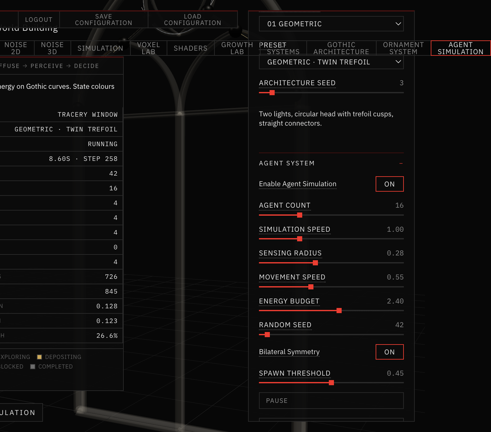
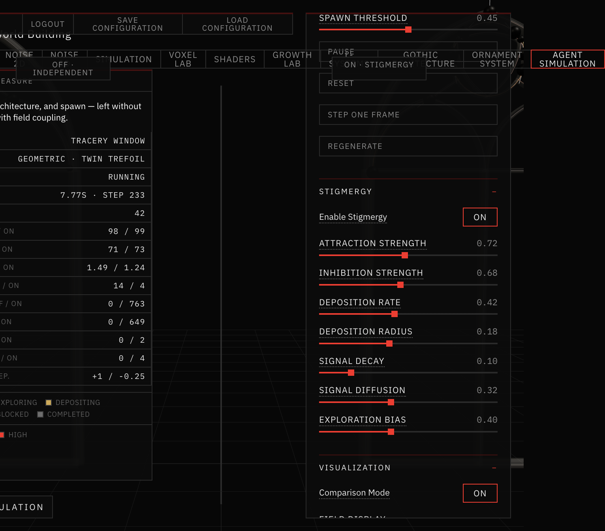
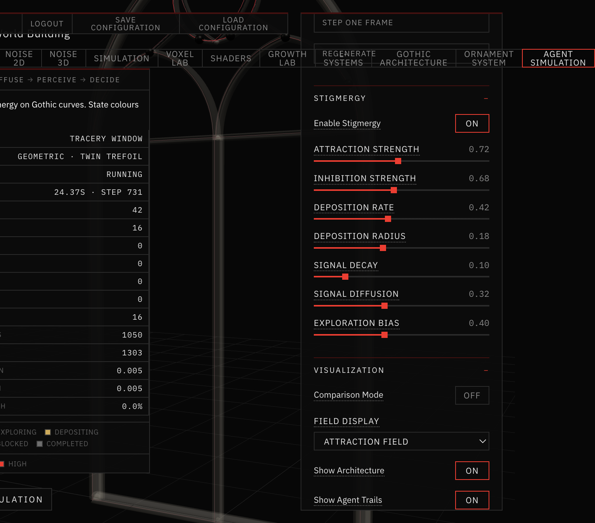

# 13 — Agent Simulation

Session date: **28 October 2026**. Tab: **Agent Simulation**.

**Step 11A** introduces a genuine agent-based layer: individual agents inhabit the Gothic architectural surface, sense locally, and transition through a finite state machine.  
**Step 11B** adds **graph-local stigmergy**: attraction / inhibition fields on the architectural curve graph so agents communicate through the environment.  
**Step 11B.5** makes that coupling **visually and measurably legible**: state-coloured markers, real field heatmaps, and a side-by-side OFF vs ON comparison.  
**Step 11C** turns accepted agent deposit/build paths into **real ornamental geometry** via the existing sweep / attachment pipeline (optional construction mode).

This does **not** replace the Ornament System growth pipeline (particles → branching → sweeps). Construction is an alternate path source into the same geometry stack.

Not yet: competition economies, pheromone volumes, architectural scale LOD, or new agent species.

---

## Pipeline

```
GOTHIC WINDOW (shared generator)
      ↓
FEATURE EXTRACTION  (curves, junctions)
      ↓
GROWTH ANCHORS      (suitability-filtered spawn pool)
      ↓
AGENT SPAWN         (roles + bilateral pairs)
      ↓
FIXED-TIMESTEP SIM  (sense → decide → move on curve graph)
      ↓
FSM TRANSITIONS     (condition-based, not clock-based reveal)
      ↓
STIGMERGY FIELD     (deposit → decay/diffuse → perceive)
```

Architecture reuses `buildOrnamentArchitecture` / `generateGrowthConditions` from the Ornament module. Movement is constrained to the existing curve graph (`buildCurveGraph`).

---

## Agent model

| Field | Role |
|---|---|
| ID | Unique string |
| Role | Explorer / Builder / Regulator |
| Position / velocity | World-space on the stone face |
| Feature | Current curve / feature type |
| State | FSM state |
| Sensing radius | Local re-attach / redirect search |
| Energy budget | Depletes by state; exhaustion → Completed |
| Trail | Short movement history |
| Parent / mirror | Bilateral pairing |
| Seed | Deterministic per-agent RNG |

---

## Finite state machine

States: **Dormant → Exploring → Depositing → Building → Completed**, with **Blocked** as a recoverable side state.

Transitions depend on simulation conditions (valid direction, path availability, trail acceptance, energy), not on scrubbing a precomputed animation.

---

## Controls

| Control | Default | Role |
|---|---|---|
| Enable Agent Simulation | on | Gate stepping |
| Agent Count | 16 | Population (pairs when bilateral) |
| Simulation Speed | 1.0 | Wall-clock multiplier |
| Sensing Radius | 0.28 | Blocked redirect / re-locate |
| Movement Speed | 0.55 | Arc-length rate on curves |
| Energy Budget | 2.4 | Life / growth budget |
| Random Seed | 42 | Deterministic outcomes |
| Bilateral Symmetry | on | Shared decisions, mirrored geometry |

Transport: **Start / Pause / Reset / Step One Frame / Regenerate**.



*Agent Simulation · Twin Trefoil · bilateral — state-coloured markers and trails on subdued Gothic stone.*

Sources: `app/src/agents/`. Validation: `app/scripts/validate-agent-fsm.mjs`.

---

## Step 11B — Perception and stigmergy

A shared **attraction** + **inhibition** (+ occupancy) field is sampled along architectural curve arc length (not a 3D voxel grid). Diffusion travels only along curve neighbours and junction links.

| Behaviour | Mechanism |
|---|---|
| **FOLLOW** | Attraction bias at junction choices and mid-path samples |
| **AVOID** | Inhibition + occupancy pressure can reverse or redirect travel |
| **EXPLORE** | Exploration bias softens pure pheromone following |

Depositing / building agents write into the field (masters only when bilateral; mirrored write to the reflected graph location; centerline deposits once).

| Control | Default | Role |
|---|---|---|
| Enable Stigmergy | on | Gate field updates |
| Attraction Strength | 0.72 | FOLLOW weight |
| Inhibition Strength | 0.68 | AVOID weight |
| Deposition Rate / Radius | 0.42 / 0.18 | Write intensity + graph-local span |
| Signal Decay / Diffusion | 0.10 / 0.32 | Fade + neighbour mixing |
| Exploration Bias | 0.40 | Discover new valid paths |

Field display: **Agents** / **Attraction** / **Inhibition** / **Occupancy** / **Combined** (signals drawn from the live field buffers; intensity legend in the status strip).

Validation: `app/scripts/validate-agent-stigmergy.mjs` (includes ON vs OFF path difference).

---

## Step 11B.5 — Making stigmergy legible

### Visibility

Markers use always-on FSM colours (cream / cool gray / amber / signal-red family) with light emissive lift so they read on dark stone. Short direction segments and recent trails are on by default; **Full Trail History** extends trails for path comparison.

### Real field heatmaps

Heatmap polylines are generated from `stigmergyField.buildVizSegments(mode)` — peak-normalized, gamma-boosted intensity from the actual sample buffers. Modes: attraction (signal red), inhibition (cool slate), occupancy (warm amber), combined (competing mix).

### Side-by-side comparison

**Comparison Mode** runs two isolated simulations (separate field buffers) with the same architecture, spawn, seed, agent count, and fixed timestep:

| Pane | Stigmergy |
|---|---|
| Left | OFF — independent agents |
| Right | ON — field coupling |

Playback (Start / Step / Reset) and camera stay synchronized. Status strip reports unique coverage, repeated occupancy, mean agent separation, completed paths, redirections, and deposits for both sides.

### Lifecycle fix

Earlier runs piled almost everyone into **BUILDING** because explore/deposit quotas were too short. Scout and deposit phases are longer; **BUILDING** now counts real build steps and exits via energy exhaustion, build quota → **COMPLETED**, or high local inhibition → re-scout (**EXPLORING**). States are still condition-driven — no forced equal counts.

### Measured differences (seed 42, 24 agents, ~300 steps)

| Metric | OFF | ON | Notes |
|---|---|---|---|
| Deposits | 0 | ~1270 | Field writes only when enabled |
| Redirected | 0 | ~1676 | Mid-path / junction field pressure |
| Mean separation | ~1.94 | ~1.45 | ON agents cluster on favoured curves |
| Repeated occupancy | ~102 | ~115 | Slightly more trail overlap on ON |
| Unique coverage | ~136 | ~135 | Similar graph span; paths differ |
| Completed | higher | lower mid-run | ON re-scouts under inhibition |

Paths start identical and diverge once deposits accumulate. The difference is **visually significant** in comparison mode (trail density + redirections + heatmap) even when unique coverage stays close.

Validation: `app/scripts/validate-agent-compare.mjs`.



*Comparison mode · same seed — left independent, right stigmergy (combined field).*



*Attraction field overlay · intensity from live sample buffers.*

---

## Step 11C — Agent-driven ornamental construction

Optional **Ornament Construction** mode on the Agent Simulation tab. Deposit/build samples are archived on master agents, extracted into candidates, pruned, classified into a hierarchy, mirrored, then swept with the existing ornament geometry stack.

### Pipeline

```
AGENT DEPOSIT / BUILD ARCHIVE
      ↓
EXTRACT + ARC-LENGTH RESAMPLE   (constructionPath.js)
      ↓
ACCEPT / PRUNE                  (suitability, length, overlap, field)
      ↓
HIERARCHY                       (primary / secondary / tertiary)
      ↓
FOLIATE TIP STUBS (optional)  →  applyBilateralSymmetry
      ↓
buildOrnamentMeshCache          (attach → conform → sculptural sweep)
      ↓
DRAW-RANGE REVEAL               (sim time → visibleFraction)
```

### Controls

| Control | Role |
|---|---|
| Enable Ornament Construction | Gate mesh build |
| Path Acceptance Threshold | Stricter pruning |
| Ornament Density | Cap + overlap tolerance |
| Branch Complexity | Max children per stem |
| Primary / Secondary Thickness | Sweep hierarchy |
| Relief Depth / Sculptural Emergence | Existing attachment params |
| Foliate Detail | Limited tip flourishes |
| Construction Display | Agents / paths / ornament modes |

### Validation notes (seed 42 vs 99, ~300 steps)

- Archives grow only during deposit/build (not exploring).
- Accepted networks differ with stigmergy ON vs OFF when paths diverge (e.g. 4 vs 5 accepted → 12 vs 18 meshes).
- Different agent seeds produce different construction fingerprints and mesh counts.
- Geometry starts hidden; reveal tracks branch `birthTime` / `growthDuration`; dispose clears meshes.
- Existing Ornament System integration checks still pass.

Validation: `app/scripts/validate-agent-construction.mjs`.

---

## Limitations (for later)

- Construction archives are capped (~420 samples); very long lives truncate earliest deposit history.
- Foliate detail is tip stubs with leaf/fluted profiles — not a botanical species grammar.
- No inter-agent competition economies beyond field inhibition.
- Portal / Façade architectural sources not connected.
- Field samples are curve-arc based; no volumetric 3D pheromone grid.
- No architectural scale normalization or camera LOD yet.
