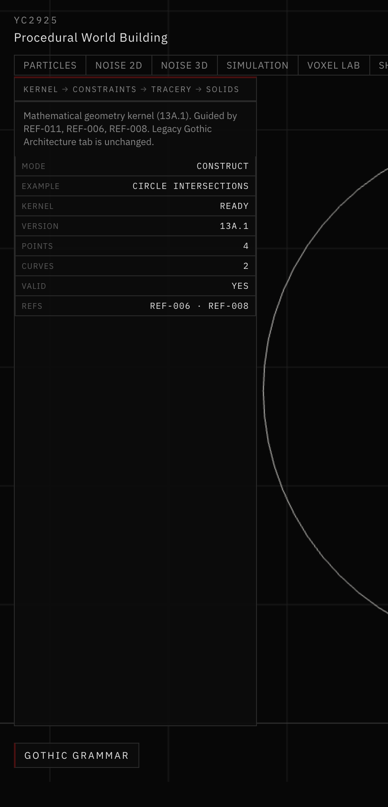
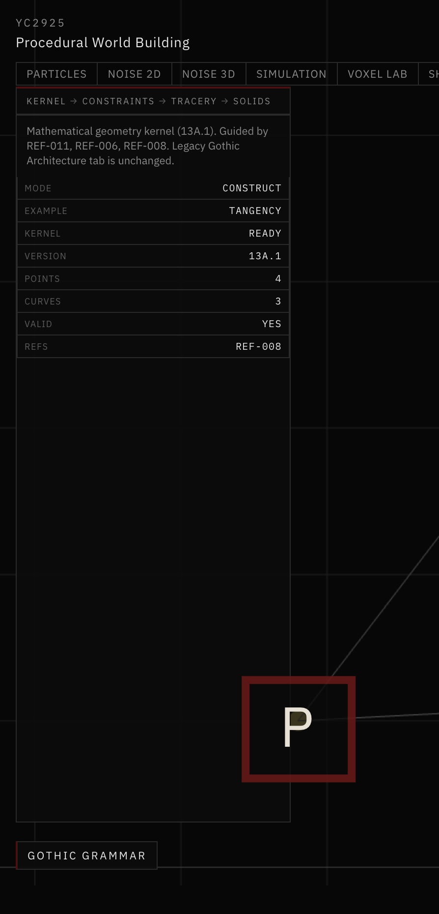
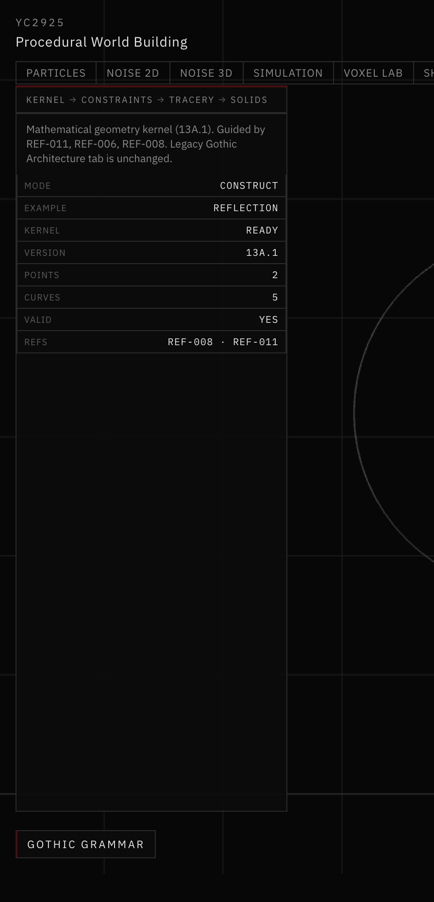
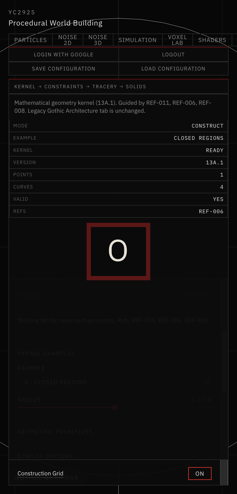

# 16 — Mathematical Geometry Kernel

Session date: **8 November 2026**. Tab: **Gothic Grammar**. Step **13A.1**.

This study documents the reusable 2D geometry kernel under `app/src/geometry/gothicGrammar/kernel/`. It is the mathematical foundation for future Rayonnant Gothic grammar (Step 13B+). It does **not** generate Gothic windows yet, and it does **not** import legacy `app/src/gothic/` builders.

## References reviewed

| ID | Role for this step |
|---|---|
| **REF-006** | Historical circle / foil construction plates — informed circle, arc, and closed-loop requirements |
| **REF-008** | Geometric construction drawings (lines, intersections, subdivisions) — informed intersection / tangency / offset needs |
| **REF-011** | Geometric bar-tracery organization — informed that arcs must be true circles and constructions must be parametric |
| REF-005 / REF-010 | Flamboyant / curvilinear — noted as a **separate** family; not used for this kernel’s default examples |

Images were inspected via the reference index paths. Geometry is **not** traced from those images; the kernel only encodes the mathematical operations those plates imply (circles, arcs, intersections, ordered loops).

## Coordinate conventions

- **X** = horizontal, **Y** = vertical (construction plane)
- **1 world unit = 1 meter** (consistent with Step 12A)
- Angles in **radians**, CCW positive unless noted
- Arc sweep: positive = CCW, negative = CW

## Kernel layout

| Module | Responsibility |
|---|---|
| `vector2.js` | Points / vectors |
| `line2.js` | Lines, rays, segments + line/segment intersections |
| `circle2.js` | Circles + line/circle and circle/circle intersections |
| `arc2.js` | True circular arcs |
| `intersections.js` | Re-exports / arc–arc filter |
| `tangency.js` | Tangents from point, residual checks |
| `offsets.js` | Parallel line offset, concentric circle/arc offset |
| `transforms.js` | Translate, rotate, uniform scale, reflect |
| `planarRegions.js` | Ordered loops, winding, self-intersection, containment |
| `sampling.js` | Visualization sampling (separate from math defs) |
| `result.js` | Standardized construction result |
| `tolerances.js` / `validation.js` | Scale-aware ε, finite checks |

Pure JavaScript. No React. No Three.js.

## Representations

```js
point:   { x, y }
line:    { kind:'line', origin, direction }      // direction unit
ray:     { kind:'ray', origin, direction }
segment: { kind:'segment', a, b, direction, length, degenerate? }
circle:  { center, radius }
arc:     { type:'arc', center, radius, startAngle, sweepAngle }
```

## Numerical tolerances

Scale-aware:

```
ε(scale) = max(ABS_EPS, REL_EPS × max(1, |scale|))
ABS_EPS = REL_EPS = 1e-9
```

Classifications: `INTERSECTING`, `PARALLEL`, `COINCIDENT`, `DEGENERATE`, `NONE`, plus `TANGENT` / `COINCIDENT` for circles. Infinite-line hits are **never** accepted as segment intersections without parameter bounds checks. Outputs must be finite; NaN points are rejected.

## Sampling

Sampling is for display / numerical checks only.

- Fixed segment count
- Max angular step
- Max chord error (`chord = 2 r sin(Δθ/2)`)

Shared endpoints are de-duplicated. Sampling is deterministic for identical inputs.

## Construction result format

```js
{
  id, type, parameters,
  primitives, derivedPoints, constraints,
  validation: { ok, warnings, errors },
  curves: [{ id, role, samples, closed? }],
  metadata
}
```

Used by Grammar tab examples A–G; typology-agnostic.

## Example pipeline (circle → intersection → arc → samples)

```js
import {
  point, createCircle, createArc, intersectCircles, sampleArc,
} from './kernel/index.js'

const c1 = createCircle(point(0, 1.4), 1.1)
const c2 = createCircle(point(1.0, 1.4), 0.95)
const hit = intersectCircles(c1, c2)          // exact points
const I0 = hit.points[0]
const start = Math.atan2(I0.y - c1.center.y, I0.x - c1.center.x)
const arc = createArc(c1.center, c1.radius, start, Math.PI / 3) // true circle arc
const verts = sampleArc(arc, { maxAngularStep: Math.PI / 24, maxChordError: 0.04 })
```

## Visualization examples (Gothic Grammar tab)

| ID | Example | Kernel ops |
|---|---|---|
| A | Points & Lines | segments, segment intersection |
| B | Circle Intersections | `intersectCircles` |
| C | Circular Arcs | `createArc`, chord/angle sampling |
| D | Tangency | `tangentsFromPoint` |
| E | Offsets | `offsetCircle`, `offsetLine` |
| F | Reflection | `reflectionAcrossLine`, `transformArc` |
| G | Closed Regions | `createPlanarRegion`, winding / area |

Toggles: points, construction, centers, labels, dimensions, result. Orthographic pan / zoom / reset / fit.



*Example B · Circle Intersections — two kernel circles, intersection status VALID, orthographic grid.*



*Example D · Tangency — external point P with tangents from `tangentsFromPoint`.*



*Example F · Reflection — circle/arc mirrored across the Y axis via `transformArc`.*



*Example G · Closed Regions — four quarter arcs forming a validated planar loop (REF-006).*

## Validation

```bash
cd app && node scripts/validate-geometry-kernel.mjs
```

Covers vector ops, zero normalize, parallel/coincident lines, segment bounds, circle intersections (incl. nearly tangent), tangency, arc reverse/wrap, reflection, invalid offsets, loop closure/winding/self-intersection, deterministic sampling, tiny/large coordinates, and all seven examples.

## Known limitations

- No general CAD boolean / unrestricted curve offset
- No nonlinear constraint solver (explicit tangency constructions only)
- Planar self-intersection / containment use polyline sampling for checks; exact curve defs are preserved separately
- Labels are HTML overlays; not typographic CAD annotation
- Pointed arches, Rayonnant tracery, stone extrusions, and agent integration are **out of scope** for 13A.1

## Readiness for Step 13B

The kernel API, result format, and Grammar visualization loop are ready for pointed-arch / lancet grammar modules to consume. Next step should add grammar rules on top of this kernel without importing legacy gothic builders.
