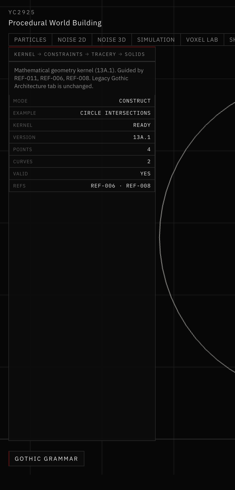
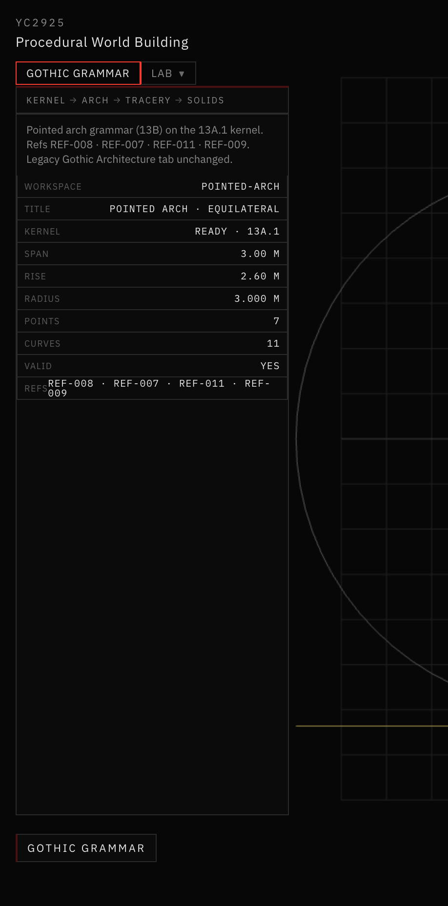
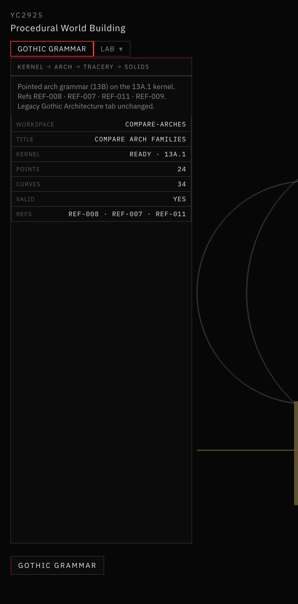

# 16 — Gothic Grammar Foundations

**Sessions:** 8–9 November 2026 · Tab: **Gothic Grammar** · Steps **13A–13B**

Independent 2D math kernel and pointed-arch construction. Does not import legacy `app/src/gothic/`.

## What was built

1. **Geometry kernel** — points, lines, circles, arcs, intersections, tangency, offsets, closed regions (`app/src/geometry/gothicGrammar/kernel/`).
2. **Pointed arches** — two-centered equilateral / lancet / depressed families with locked rise ratios and construction overlays.

## Screenshots

*Kernel example — circle intersections.*

*Pointed Arch · equilateral · presentation.*

*Compare Arch Families.*

## Where it lives

`app/src/geometry/gothicGrammar/` · workspace modes **Pointed Arch** / **Compare Arch Families**.
