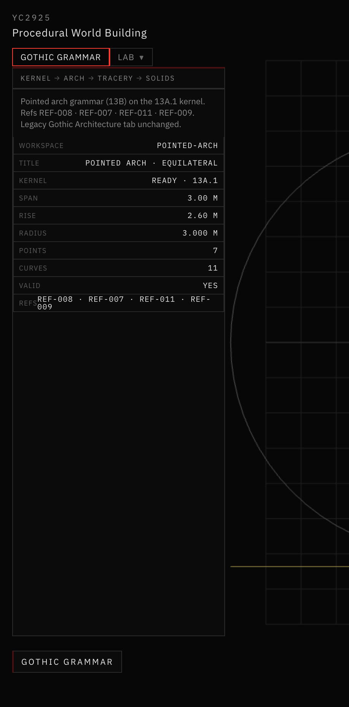
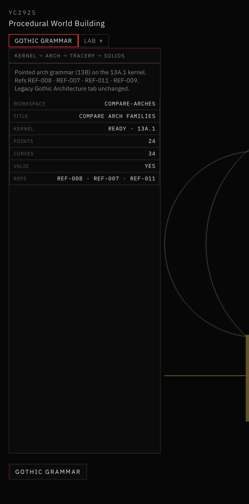

# 17 — Procedural Pointed Arch Grammar

Session date: **8 November 2026**. Tab: **Gothic Grammar**. Step **13B**.

Two-centered Gothic pointed arches generated from the Step 13A.1 geometry kernel. No legacy `app/src/gothic/` imports. Full windows / tracery / stone are out of scope.

## References inspected

| ID | Indexed role | Observations used |
|---|---|---|
| **REF-008** | Tracery window construction plate | Springing line; arc centers on springings for equilateral; hierarchy of pointed envelopes — **primary geometric evidence** |
| **REF-007** | Pinnacled tomb canopy | Nested pointed arches of different rises on one springing line; sharp apex cusps; arcade of lower pointed arches |
| **REF-011** | Geometric bar-tracery window | Clear two-centered outer envelope; springing capitals; nested sub-arches (future 13C) |
| **REF-009** | Monochrome pointed window | Presentation: readable silhouette, springing transition, pointed outer frame |
| **REF-016** | Speculative industrial assemblage | Aesthetic only — vertical pointed openings as mood, **not** dimensional authority |

**Note:** The brief’s informal titles for REF-007 / 009 / 016 differ from the index. Paths used are those in `references/reference-index.json`. Geometry is **not** traced from pixels.

**Design decision (computational):** one parametric two-centered generator with family-specific rise constraints. Depressed two-centered arches are **not** claimed to be four-centered Tudor arches.

## Mathematical construction

Given span \(S\), half-span \(a = S/2\), rise \(h\), springing elevation \(y_0\):

\[
A = (-a,\, y_0),\quad B = (a,\, y_0),\quad P = (0,\, y_0 + h)
\]

\[
c = \frac{h^2 - a^2}{2a},\quad
C_A = (c,\, y_0),\quad
C_B = (-c,\, y_0),\quad
R = \frac{h^2 + a^2}{2a} = a + c
\]

- **Left arc:** \(A \rightarrow P\) about \(C_A\) (minor upper sweep)
- **Right arc:** \(P \rightarrow B\) about \(C_B\) (minor upper sweep)

Constraints verified numerically:

\[
|C_A A| = |C_A P| = |C_B B| = |C_B P| = R
\]

Mirror symmetry about \(x = 0\). The apex is a **cusp** (endpoints meet; tangent continuity is not required).

### Equilateral special case

Centers coincide with opposite springings (\(C_A = B\), \(C_B = A\)) when

\[
h = \frac{\sqrt{3}}{2}\, S
\]

Locked when family = equilateral (matches REF-008 construction reading).

## Families and parameter ranges

| Family | Rise rule | Default \(h/S\) | Allowed \(h/S\) |
|---|---|---|---|
| Equilateral | Locked | \(\sqrt{3}/2 \approx 0.866\) | fixed |
| Lancet | Taller | 1.05 | \((\sqrt{3}/2,\, 1.6]\) |
| Depressed | Lower | 0.55 | \([0.35,\, \sqrt{3}/2)\) |

Default span: **3.0 m**. Units: meters. Changing span/rise **rebuilds** the construction (does not fake-scale a mesh).

## Module layout

```
gothicGrammar/
  primitives/
    archFamilies.js      # family meta + rise resolution
    pointedArch.js       # canonical generator
    archValidation.js
  construction/
    archConstruction.js  # Grammar-tab construction documents
```

UI workspaces: **Pointed Arch** · **Compare Arch Families** · **Kernel Examples** (13A.1).



*Pointed Arch workspace — equilateral family, span 3.00 m, rise ≈ 2.60 m, R = S; VALID.*



*Compare Arch Families — same span, aligned springings; equilateral / lancet / depressed from one generator.*

## Validation

```bash
cd app && npm run validate:pointed-arch
```

Covers equilateral lock, radius equality, apex join, symmetry, minor/upper sweeps, samples on circles, invalid rejection, extremes, determinism, compare mode.

## Known limitations

- 2D skeleton only — no stone thickness, moldings, or extrusions
- Depressed family ≠ Tudor four-centered
- Comparison mode is independent of the editable single-arch session
- Tracery / mullions / foils deferred to Step 13C+

## Readiness for 13C

Exact arcs, centers, springings, apex, and semantic IDs (`LEFT_ARC`, `APEX`, …) are available for tracery subdivisions without re-deriving the envelope.
