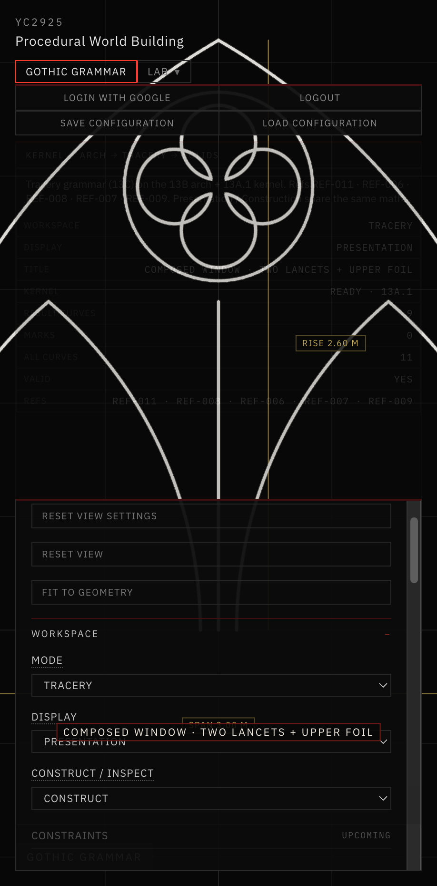
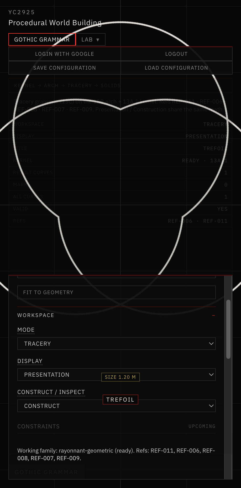
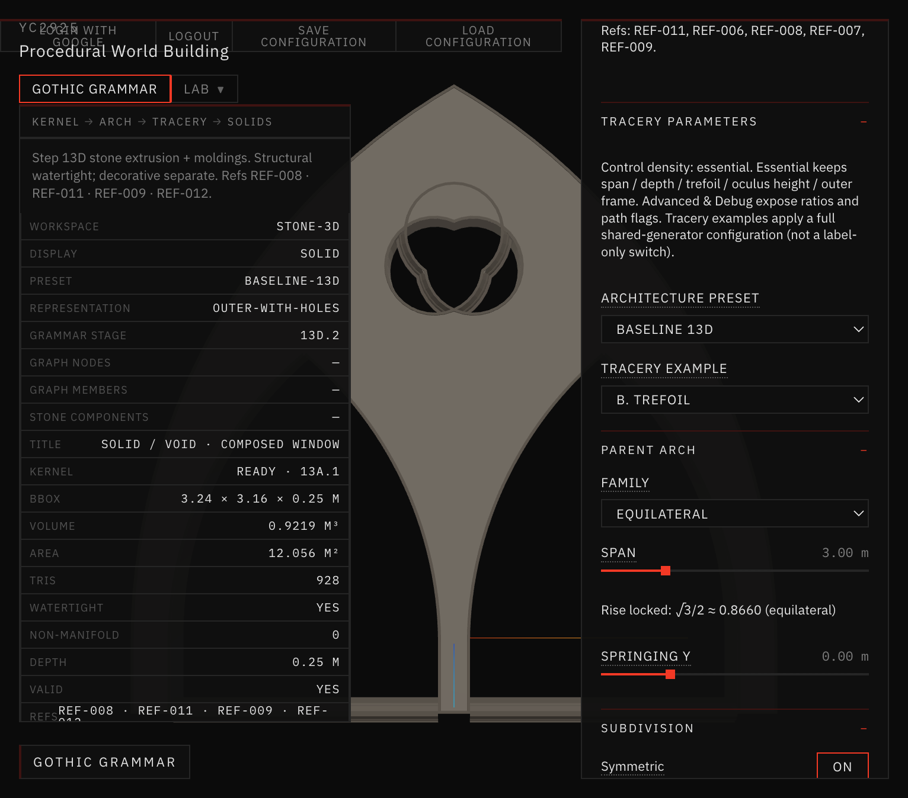
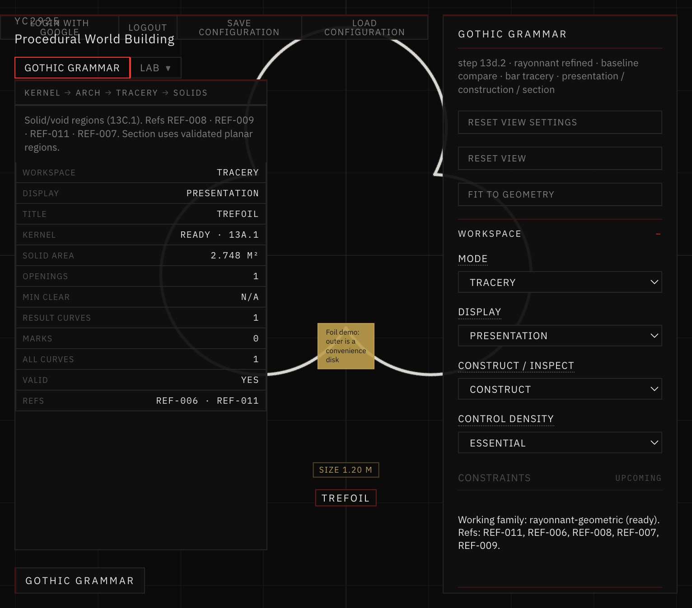

# 17 — Tracery Grammar

**Sessions:** 8–9 November 2026 · Steps **13C / 13C.1** (+ trefoil topology repair)

Parametric window tracery on top of the pointed-arch kernel: lancet subdivision, foils, oculus, composed windows, then solid/void regions for section display.

## What was built

1. **Tracery examples** — A–E (lancet, trefoil, quatrefoil, oculus, composed window).
2. **Solid / void regions** — constructible planar regions and **Section** display.
3. **Trefoil repair** — outer-intersection cusp construction so inner foils stay valid (no self-crossing).

## Screenshots

*Example E · composed window.*

*Trefoil example.*

*Broken trefoil topology (before repair).*

*Repaired 2D tracery after cusp fix.*

## Where it lives

`app/src/geometry/gothicGrammar/tracery/` · workspace mode **Tracery**.
