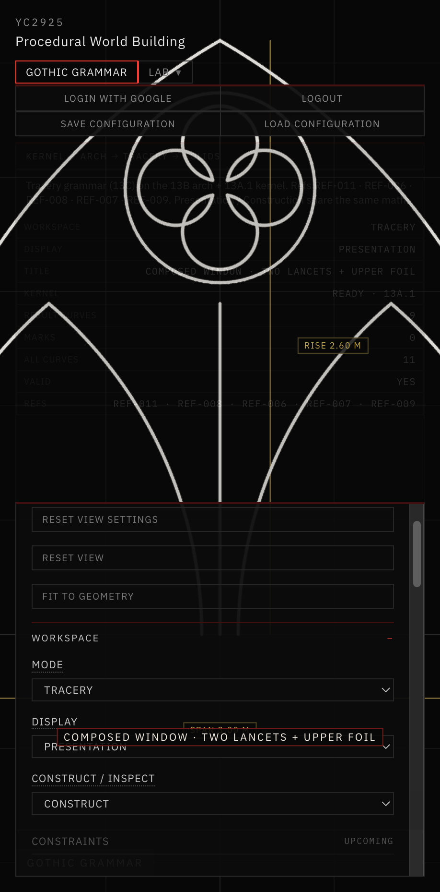
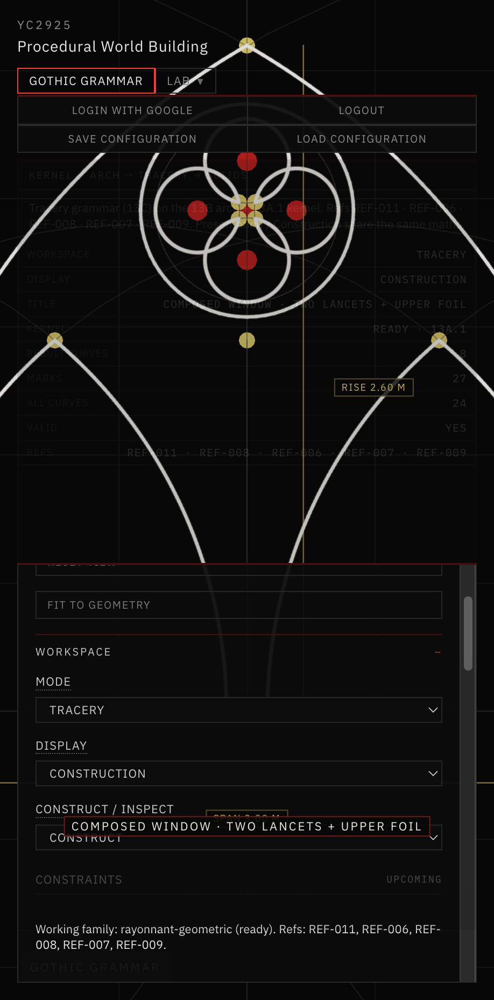
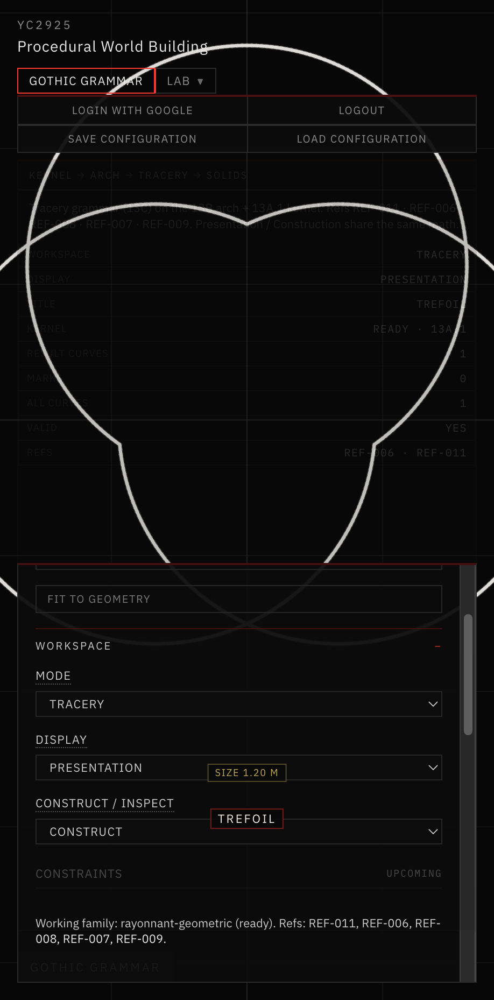

# 18 — Rayonnant Gothic Tracery Grammar

Session date: **8 November 2026**. Tab: **Gothic Grammar**. Step **13C**.

Hierarchical parametric tracery built on the Step 13A.1 kernel and Step 13B pointed-arch generator. 2D geometric grammar only — no stone sweeps, extrusions, or legacy `app/src/gothic/` imports.

## References inspected

| ID | Role | Observations used |
|---|---|---|
| **REF-011** | Geometric bar-tracery window | Pointed envelope, lancet hierarchy, circular foil modules — **primary working grammar** |
| **REF-006** | Circle / foil construction plate | Trefoil & quatrefoil from equal circles, cusps at intersections, nested oculi |
| **REF-008** | Tracery window plate + section | Twin lancets, mullion axes, upper circle packing, construction vs finished elevation |
| **REF-007** | Pinnacled tomb canopy | Nested pointed arches + oculus / quatrefoil in upper residual region |
| **REF-009** | Monochrome pointed window | Presentation silhouette / foil readability |
| **REF-004** | Ribbed vault aisle | Nested pointed hierarchy, bay repetition (assembly context only) |
| **REF-016** | Speculative assemblage | Aesthetic mood only — **not** dimensional authority |

**Historical vs computational:** proportions, cusp-depth mapping, jamb inset, and oculus solve heuristics are **computational design rules** informed by the plates. They are not claimed as authenticated medieval procedures or measured reconstructions.

## Tracery grammar hierarchy

```
PARENT_ARCH
├── PRIMARY_MULLION
├── CHILD_LANCET (left)
├── CHILD_LANCET (right)
└── UPPER_OCULUS
    └── TREFOIL | QUATREFOIL  (OPENING_BOUNDARY)
```

Each graph element stores: stable id, type, role, parent/child ids, **exact** primitives (circles/arcs/segments), input + derived parameters, constraints, and validation — not only sampled polylines.

## Lancet subdivision

1. Parent pointed arch via `buildPointedArch`.
2. Clear width = span − mullion − 2·jambInset.
3. Split clear width by subdivision ratio (locked 0.5 when symmetric).
4. Build two child pointed arches (existing generator) in the bays.
5. Mullion centerline on the division axis.
6. Validate: positive mullion clearance, no child overlap, child outlines inside parent (upper-boundary margin), min child span.

Symmetric mode places the mullion on the parent axis. Asymmetric mode unlocks the division ratio. Equal widths are **not** assumed always valid — containment is checked explicitly.

## Trefoil / quatrefoil

Equal lobe circles with centers on a regular N-gon about a local origin. Pairwise intersections → inward cusps. Closed opening = sequence of circular arcs from cusp to cusp through each outer tip (`arcPreferringPoint`). Cusps are preserved.

- **Trefoil (N=3):** orientation defaults so one lobe points up.
- **Quatrefoil (N=4):** orthogonal (`orientation=0`) or diagonal (`π/4`). Center radius is clamped so opposite circles do not intersect (simple clover).

`cuspDepth ∈ (0,1)` maps center radius within the valid packing range. This is **not** “union three circles and call the silhouette historical.”

## Oculus placement

Center on the symmetry axis. Vertical band = [lowerBound, parent apex − clearance]. Radius solved by binary search for circle-in-arch containment (and above `lowerBoundY` when composing above lancets). Foil scaled inside the oculus with a second containment check. Unsolvable parameters report **constraint failure** — geometry is not forced valid.

## Composed preset — TWO LANCETS + UPPER QUATREFOIL

1. Parent arch → 2. Subdivide → 3. Mullion → 4. Child arches → 5. Upper residual → 6. Solve oculus → 7. Quatrefoil (or trefoil) → 8. Validate → 9. Return graph.

All elements rebuild from parent span/rise. No hardcoded world coordinates for the foil.

## UI examples (Tracery workspace)

| | Example | Module path |
|---|---|---|
| A | Lancet Subdivision | `buildLancetSubdivision` |
| B | Trefoil | `buildFoilExample(trefoil)` |
| C | Quatrefoil | `buildFoilExample(quatrefoil)` |
| D | Oculus Placement | `buildOculusPlacement` |
| E | Composed Window | `buildComposedWindow` |

Display states (Presentation / Construction) change overlays only — same mathematical construction.



*Tracery · E. Composed Window · Presentation — two lancets, mullion, upper oculus with quatrefoil; VALID.*



*Same composition · Construction — parent/child circles, foil lobe centers, cusps, and guides visible; math unchanged.*



*Tracery · B. Trefoil · Presentation — closed cusped boundary from three equal circles (REF-006 method).*

## Validation

```bash
cd app && npm run validate:tracery
```

Covers symmetric/asymmetric subdivision, containment, mullion clearance, foil closure & symmetry, cusp joins, oculus/foil containment, composed window, invalid rejection, determinism, presentation≡construction math.

Also: `npm run validate:pointed-arch`, `npm run validate:geometry-kernel`, `npm run build`.

## Module layout

```
gothicGrammar/tracery/
  roles.js              # semantic roles + example ids
  graph.js              # construction graph helpers
  archContainment.js    # point/circle/outline inside arch
  foils.js              # trefoil / quatrefoil
  lancetSubdivision.js  # parent → two lancets
  oculus.js             # oculus solve + foil container
  composedWindow.js     # hierarchical preset
  traceryConstruction.js# scene construction documents
```

## Known limitations

- 2D centerline grammar only — not stone thickness, moldings, or 3D profiles
- Single mullion / two-lancet composition (no multi-light recursive subdivision yet)
- Foil cusp-depth domain is a design clamp, not a historical module system
- Oculus solve is axis-centered; off-axis packing is out of scope
- Construction circles are guides, not physical bar faces

## Readiness for Step 13D

Semantic graph + exact arcs are preserved for future bar thickness / extrusion. Next candidates: multi-light subdivision, cinquefoil, stone offset profiles — without rewriting the 13C generators.
