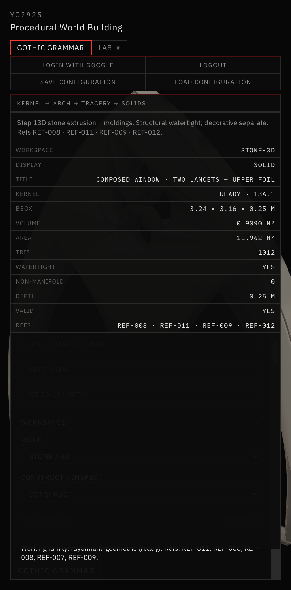
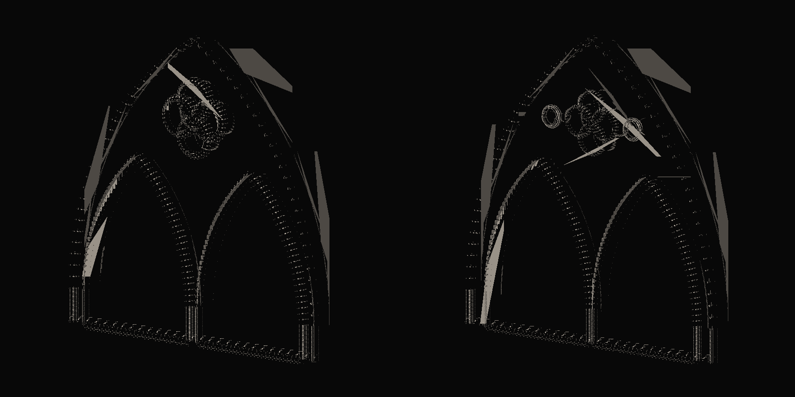
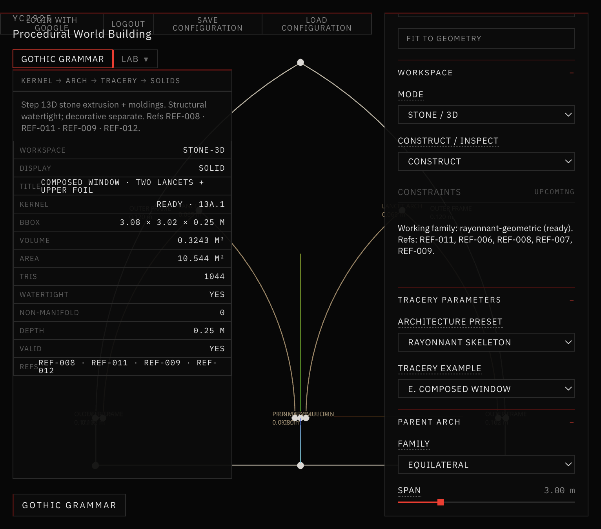
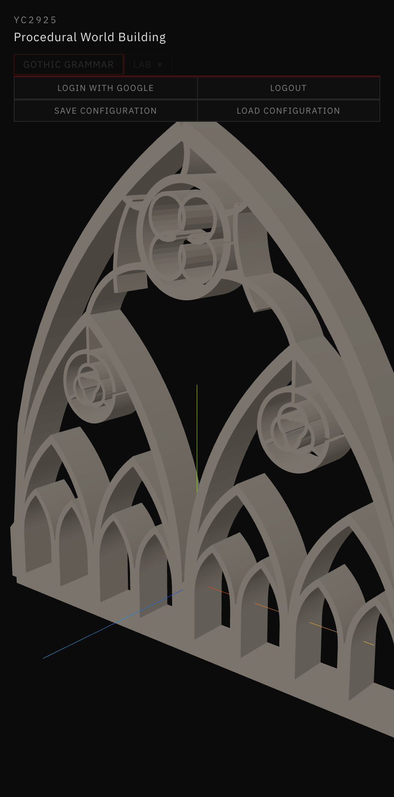
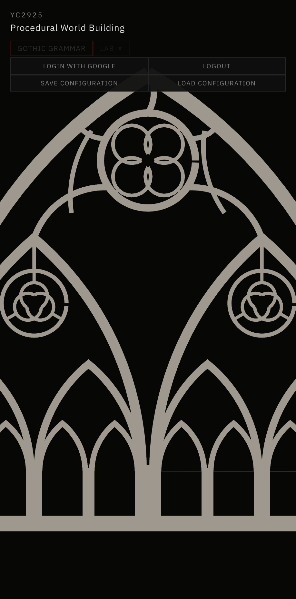

# 18 — Procedural Stone & Rayonnant

**Sessions:** 8–9 November 2026 · Steps **13D – 13D.9**

Extrudes validated tracery regions into 3D stone, then evolves a Rayonnant bar-tracery grammar (refinement → skeleton → oculus → secondary → hierarchical).

## What was built

1. **Stone / 3D** — structural extrusion + separate molding sweeps; inspect layers; hard-edge display vs watertight topology.
2. **Rayonnant presets** — Baseline → Refined → Bar Network → Elaborate → Skeleton → Oculus Network → Secondary → Oculus Refined → Hierarchical.
3. **Skeleton-first path** — centerline graph → strip-union stone; hierarchical depth nests pointed-arch cells.

## Screenshots

*Stone / 3D · composed window.*

*Baseline ↔ Refined comparison.*

*Skeleton-first network.*

*Hierarchical Rayonnant · structural 3D.*

*Hierarchical depth 2 · stone section.*

## Where it lives

`app/src/geometry/gothicGrammar/solids/` + tracery presets · workspace mode **Stone / 3D**.
