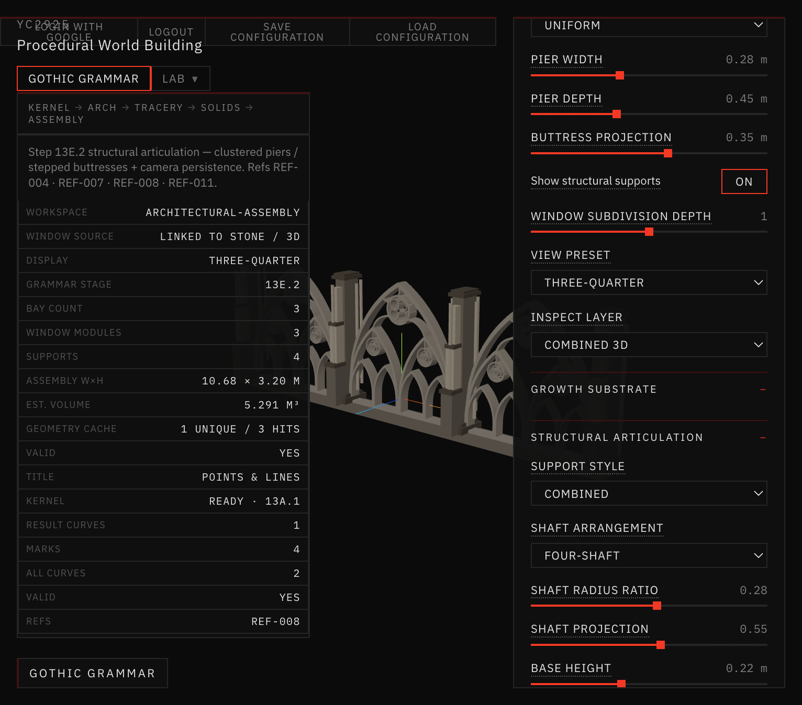
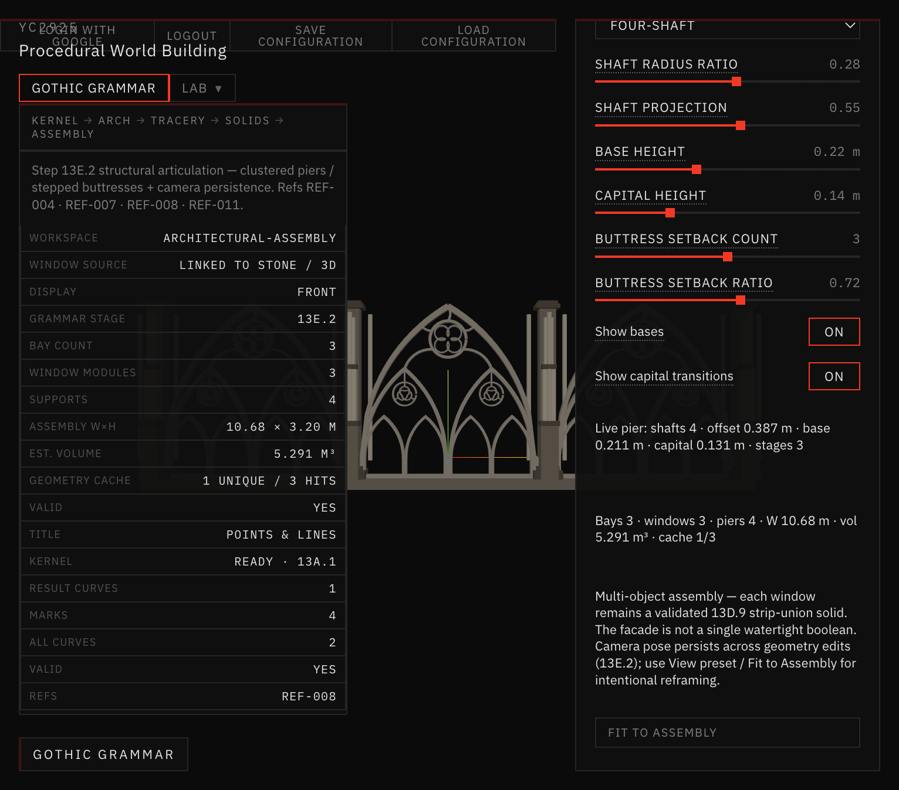
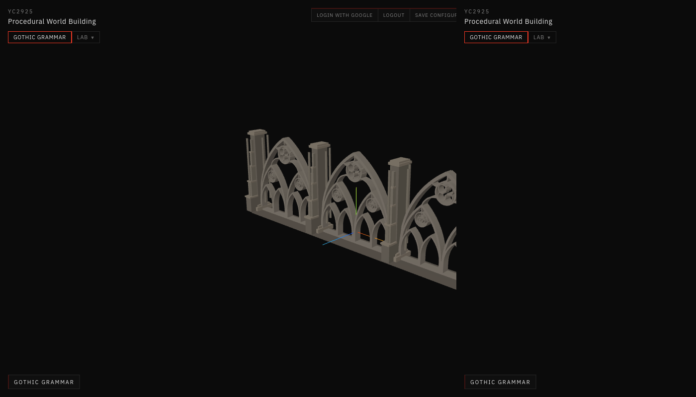

# 19 — Architectural Assemblies

**Sessions:** 9 November 2026 · Steps **13E.1 – 13E.3**

Multi-bay facade from the shared window module: structural articulation, surface semantics (growth substrate), and a consolidated parameter UI.

## What was built

1. **Facade elevation** — repeated bays, piers, buttresses; window geometry linked to Stone / 3D (one module, not a duplicate generator).
2. **Structural articulation** — clustered piers, shaft arrangements, stepped buttresses, bases/capitals.
3. **Surface semantics** — component / surface / patch model with growth eligibility and weights (no vegetation yet).
4. **UI consolidation** — Essential / Advanced / Debug density; shared window edit path.

## Screenshots

*Facade · three bays · linked window module.*

*Front elevation.*

*Clustered pier · four-shaft arrangement.*

*Stepped buttress setbacks.*

## Where it lives

`app/src/geometry/gothicGrammar/assemblies/` · workspace mode **Architectural Assembly**.
