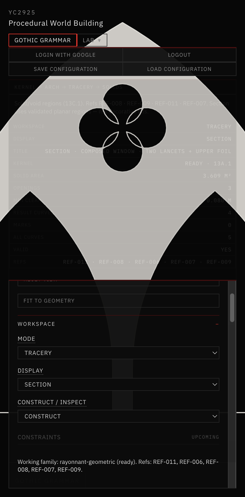

# 19 — Constructible Gothic Tracery Solid / Void

Session date: **8 November 2026**. Tab: **Gothic Grammar**. Step **13C.1**.

Converts Step 13C curve compositions into validated closed 2D architectural regions (solid stone + openings). Foundation for Step 13D extrusion — **no 3D in this step**.

## References inspected

| ID | Path (from index) | Use |
|---|---|---|
| **REF-008** | `01-geometric-foundations/.../REF-008-tracery-window-geometric-layout-and-section.jpg` | Elevation vs construction; mullion thickness in plan; solid/void hierarchy |
| **REF-009** | `05-contemporary-visual-direction/.../REF-009-monochrome-radial-pointed-window.jpg` | Light stone / dark void presentation |
| **REF-007** | `03-architectural-assemblies/.../REF-007-pinnacled-tomb-canopy.jpg` | Nested lancets + upper quatrefoil; connected stone web |
| **REF-004** | `03-architectural-assemblies/.../REF-004-ribbed-vault-aisle-and-clustered-supports.jpg` | Nested arches / pier thickness (assembly context) |
| **REF-016** | `05-contemporary-visual-direction/.../REF-016-speculative-gothic-industrial-structure.jpg` | Aesthetic only — not dimensional |
| **REF-011 / REF-006** | (prior 13C) | Foil / bar-tracery grammar |

Photographs are not treated as calibrated dimensions.

## Pre-change topology (13C)

| Curve | Role before 13C.1 |
|---|---|
| Parent left/right arcs | Open arch edges (not closed) |
| Child lancet arcs | Open arch edges |
| Mullion | Zero-thickness centerline |
| Oculus circle | Construction guide |
| Foil arcs | Already one closed cusped loop |

## Region topology

```
OUTER_BOUNDARY          (closed frame loop)
└── STONE_REGION        = outer with holes
    ├── LEFT_LANCET_VOID
    ├── RIGHT_LANCET_VOID
    ├── UPPER_FOIL_VOID   (quatrefoil/trefoil only — not oculus)
    ├── CENTRAL_MULLION   (measurable polygon ⊂ stone)
    └── TRACERY_WEB       (clearance metrics; subset of stone)
```

**No general boolean engine.** Stone is a constructive `createPlanarRegion(outer, holes)` arrangement. Exact arcs stay on each loop; samples are derived for area / SECTION mesh only.

## Construction rules

### Outer boundary
Parent clear span/rise define the inner light. Outer frame rebuilds a pointed arch with  
`span' = span + 2·outerFrameWidth` (same family rules), closed with jambs to `windowBaseElevation` and a sill.

### Lancet voids
Step 13B/13C child arches are **clear opening edges** (documented — not silent centerline reinterpretation). Each void = left jamb + left arc + right arc + right jamb + sill.

### Quatrefoil
Verified as one ordered closed arc loop (13C generator). Construction circles remain Construction Mode only. Oculus is **not** a second hole.

### Mullion
Polygon between child inner springings with positive width (= bay gap). Joins sill and rises to child apices.

### Clearances
`minStoneWebWidth` warns (does not auto-fix params) when mullion, jambs, stone-above-lancets, or foil–parent clearance fall below the threshold.

## SECTION mode

- Light gray stone fill from validated outer + holes  
- Dark negative space (background) in openings  
- No construction circles, points, or dimension labels  



*Tracery · E. Composed Window · SECTION — solid stone (light) with two lancet voids and upper quatrefoil void; VALID.*

## Validation

```bash
cd app && npm run validate:solid-void
```

Also: `validate:tracery`, `validate:pointed-arch`, `validate:geometry-kernel`, `npm run build`.

## Known limitations

- 2D only — no extrusion, moldings, or materials  
- Constructive holes, not a general CAD boolean  
- Tracery web area not separately meshed (clearances reported)  
- SECTION fill uses sampled polylines; exact arcs preserved on the model  
- Minimum web is a design constraint, not structural proof  

## Readiness for 13D

Closed outer + void loops with exact arcs and stable IDs are ready for sweep/extrusion. Preserve region semantics when adding thickness profiles.
