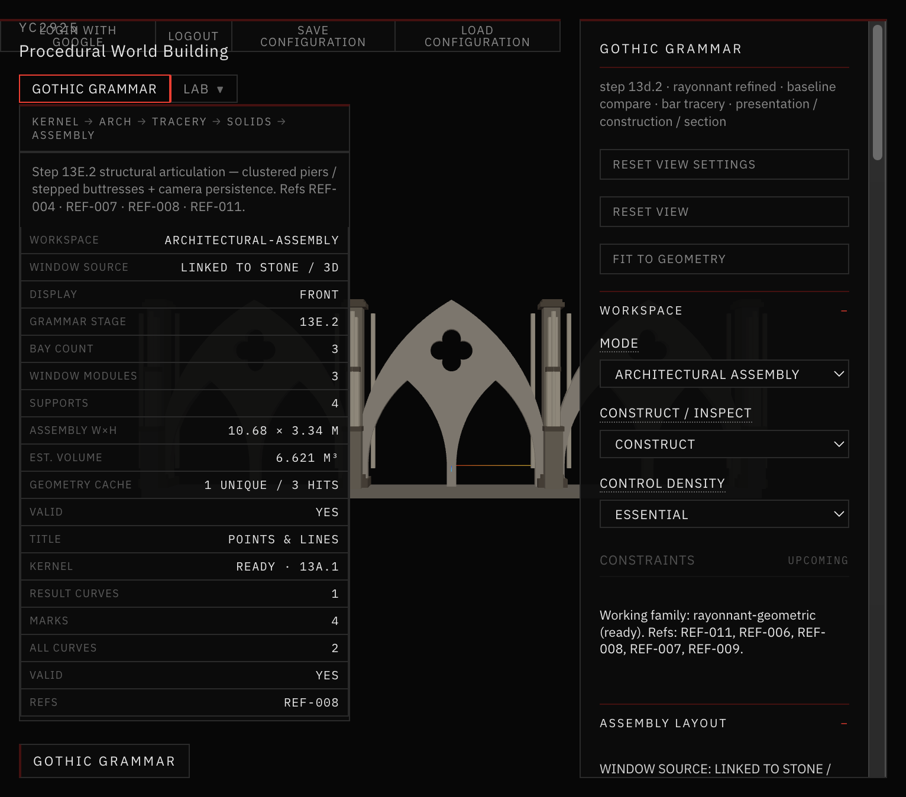
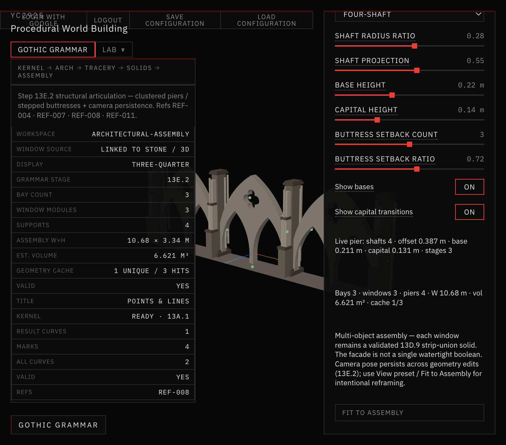
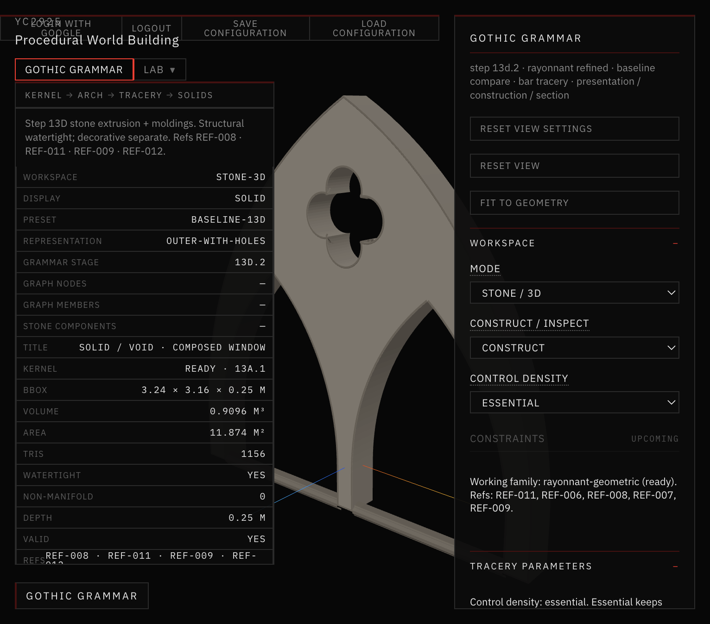

# 20 — Growth Attachment & Viewport Stability

**Sessions:** 9 November 2026 · Steps **13E.4 / 13E.4.1 / 13E.4.2**  
**Next:** 14A Vegetation Growth Engine *(not started)*

Seeds attach to real semantic stone surfaces. Navigation paths follow the facade. Camera framing and anchor lifecycle were repaired so placement stays responsive and every workspace mode loads at a readable scale.

## What was built

1. **Growth anchors** — place / distribute seeds with `VALID` · `REPROJECTED` · `BLOCKED` · `ORPHANED` statuses; orthonormal frames; surface navigation graph.
2. **Placement stability** — raycast click-vs-drag (no per-patch mesh flood); fresh seeds stay **VALID**; reproject only when geometry identity changes.
3. **Viewport init** — world-unit ortho frustum (not canvas pixels); perspective framing owns camera pose (no React prop fight); Fit / Reset intentional; geometry edits preserve camera.

## Screenshots



*Automatic distribution on three bays.*



*After stability repair — seeds remain VALID (green).*



*Pointed Arch after fresh load (world-scale framing).*


*Seed markers + compact inspector.*

## Validate

```bash
npm run validate:growth-attachment
npm run validate:seed-placement
npm run validate:viewport-initialization
```

## Where it lives

`app/src/geometry/gothicGrammar/assemblies/growthAttachment/` · Assembly → **Growth Attachment** controls.
