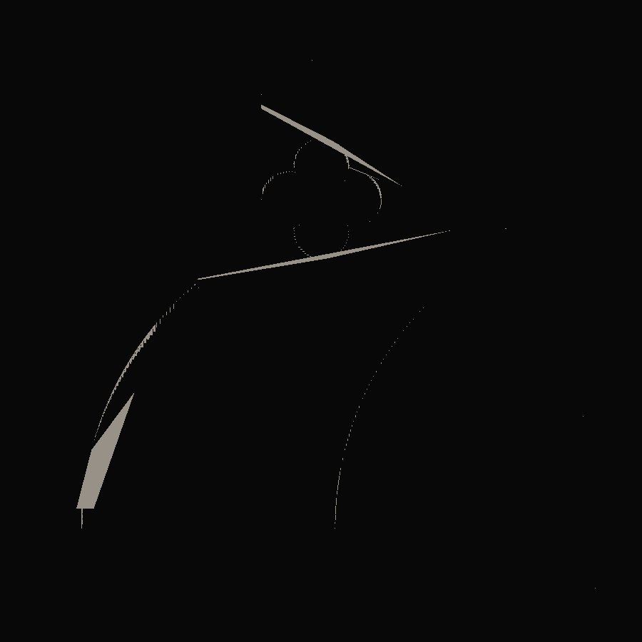
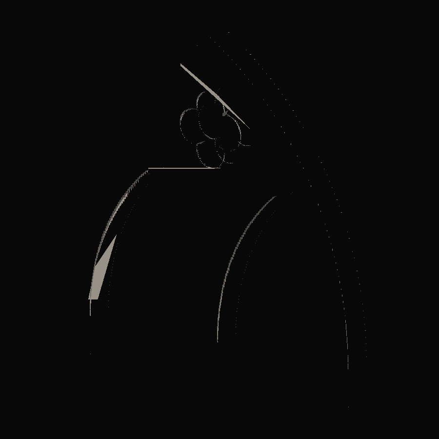
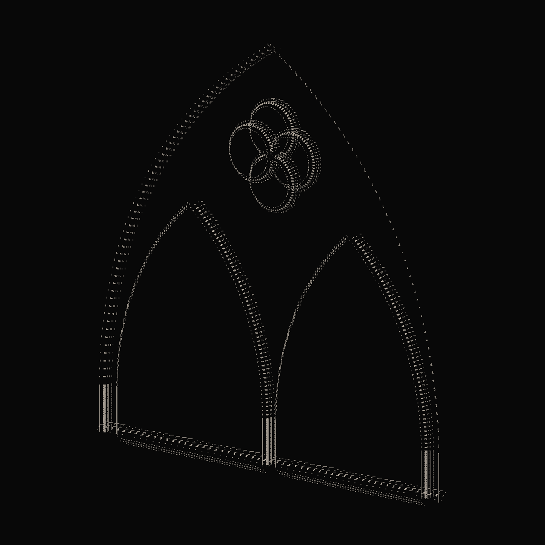
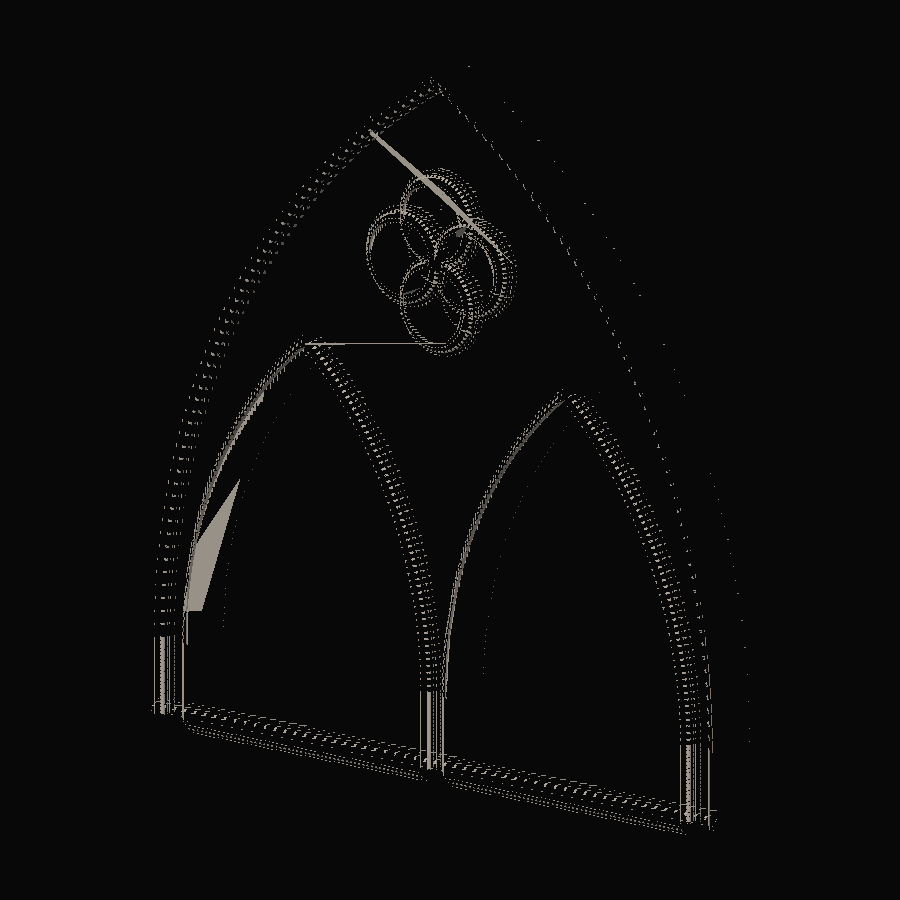
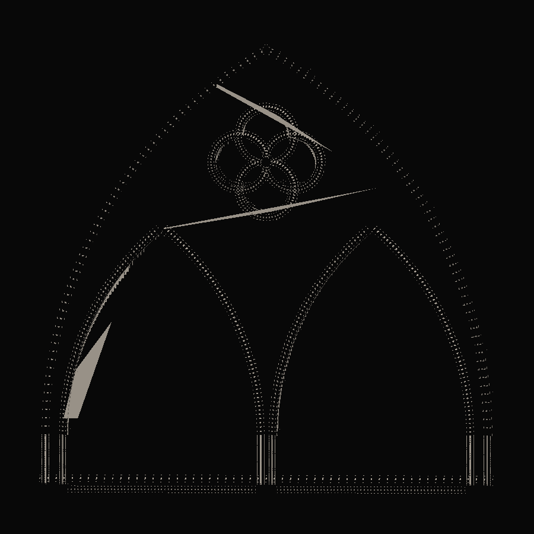
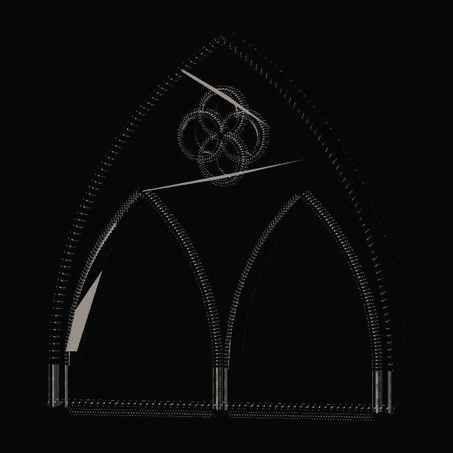

# 20 — Procedural 3D Stone Geometry

Session date: **8–9 November 2026**. Tab: **Gothic Grammar → Stone / 3D**. Steps **13D / 13D.1**.

Converts validated Step 13C.1 solid/void regions into structural stone extrusion plus separate decorative molding sweeps. Exact 2D curves remain the source of truth; meshes are tessellations for display and inspection.

## Step 13D.1 — mesh diagnostics and repair

Visible “shattered” front faces in the original 13D screenshot were **not** a watertight-topology failure. Root causes:

1. **Shared-vertex normal averaging** — front/back planar verts shared with side walls; `computeVertexNormals` blended +Z with outward XY normals → triangular shading folds on a planar web.
2. **Zero-length cusp sweep strips** — dual cusp-in / cusp-out frames at the same origin were bridged, twisting molding rings at foil tips and arch apexes.

Fixes (display vs topology kept separate):

- `toHardEdgeMesh` expands triangles to unique verts with per-face normals for **display**.
- Topology mesh stays indexed/shared for watertight validation.
- Planar front/back faces use consistent face normals; hard edges preserved at front↔side.
- Cusp-in → cusp-out segments are **not** connected; seams stay open (no twist fans).
- Bounded miter on continuous corners; molding Z offset slightly in front of structural face to reduce z-fighting.
- Inspect layers: Combined / Structural Only / Moldings Only / Normals Debug / Wireframe Debug.
- Neutral diagnostic material + softer lighting for geometry vs shading isolation.

Automated checks added: planar front/back normals, hard-edge presence, cusp seam openness, topology still watertight after display expansion.

## References inspected

| ID | Path | Observed (geometry) | Computational use |
|---|---|---|---|
| **REF-008** | `01-geometric-foundations/.../REF-008-tracery-window-geometric-layout-and-section.jpg` | Half presentation / half construction; mullion plan section; layered moldings | Depth convention; mullion thickness; compound profile approximation |
| **REF-011** | `02-tracery-grammar/rayonnant/REF-011-geometric-trefoil-circle-window.jpg` | 3D stone depth, chamfers, recess, mitered arch→mullion junctions | Profile depth layering; junction continuity goal |
| **REF-009** | `05-contemporary-visual-direction/.../REF-009-monochrome-radial-pointed-window.jpg` | Front-to-back hierarchy; bead/scotia edges; sharp cusps | Neutral stone material; cusp handling (no blind smoothing) |
| **REF-012** | `03-architectural-assemblies/.../REF-012-cologne-crossing-spire-and-ornament-plate.jpg` | Compound profile sections; nested foils; crocketed ribs | Compound Gothic profile library (approximation only) |

Photographs and plates are **not** treated as calibrated dimensions. Profile numbers below are computational defaults.

## Coordinate mapping

| 2D | 3D |
|---|---|
| X | X |
| Y | Y |
| — | Z = stone depth |

1 world unit = 1 meter. Default stone depth **0.25 m**. Alignments: `front` (z∈[0,d]), `centered` (z∈[−d/2,d/2]), `back` (z∈[−d,0]).

## Extrusion topology

```
STRUCTURAL_STONE (watertight target)
  front face  — Earcut triangulation of outer ⊕ holes
  back face   — reversed winding
  side walls  — every triangulation-boundary edge (incl. Earcut hole bridges)
```

Openings stay open (no caps on lancet / foil voids).

Exact edges from 13C.1 are resampled only for tessellation (`draft` 16 / `standard` 28 / `high` 56 segments per curve). Some densities produce Earcut pinch artifacts; the assembly retries nearby segment counts and may apply a planar pinch-vertex split, falling back if the split worsens topology.

## Mesh groups

| Group | Role | Watertight claim |
|---|---|---|
| `STRUCTURAL_STONE` | Region extrusion | Validated closed manifold when `ok` |
| `DECORATIVE_MOLDINGS` | Profile sweeps on outer + opening loops | **Not** watertight; not boolean-unioned |

Combined assembly is **not** claimed as one fabrication solid.

## Profile library

Parametric (s, t) sections — s outward from path, t along depth:

| Type | Description |
|---|---|
| `flat` | Rectangular edge |
| `chamfered` | Beveled outer corners |
| `rounded` | Convex bead on outer front |
| `compound_gothic` | Fillet → chamfer → bead → recess (REF-008/012 approximation) |

Parameters: `profileWidth`, `profileDepth`, `chamferSize`, `beadRadius`, `recessDepth`. Invalid self-intersecting sections are rejected.

## Sweep mathematics

Planar XY paths. Local frame: tangent T, in-plane normal N (left of T × `outwardSign`), depth B = +Z. Profile maps as `origin + s·N + t·B`.

Sharp cusps (interior angle below threshold): dual frames with incoming/outgoing tangents — **no fillet**. Cross-path mitering is not implemented; fallback is per-loop continuous sweeps + documented butt joints between separate loops.

## Junction strategy

1. Continuous closed-loop sweeps (outer, each void)  
2. Sharp dual-frame cusps on foils  
3. Butt-joint fallback across independent paths  
4. No decorative oversize meshes to hide gaps  

## Validation metrics

Reported for structural mesh: bounding size, volume (only if watertight), surface area, triangle/vertex counts, watertight flag, non-manifold / boundary / degenerate counts. Decorative triangle count listed separately.

## UI

Workspace **Stone / 3D**: perspective orbit, presets Front / Three-Quarter / Side / Back, **Inspect layer** (13D.1), display Solid / Wireframe / Solid+Edges, toggles for structural / moldings / normals / axes. Upstream tracery parameters still drive the 2D source.



*13D.1 · structural only · front · planar web (uniform face normals).*



*13D.1 · structural only · three-quarter · hard front↔side edges.*



*13D.1 · moldings only · three-quarter · planar-frame sweeps, open cusp seams.*



*13D.1 · combined · three-quarter · structural + decorative (not boolean-unioned).*



*13D.1 · combined · quatrefoil close-up · sharp dual-frame cusps.*



*13D.1 · combined · outer arch close-up · segmented curve sampling (use High tessellation for denser arcs).*

## Known limitations

- Earcut hole bridging is sensitive to sample density; auto-retry mitigates but is not a full constrained Delaunay solver.  
- Decorative moldings do not mitre across intersecting paths (butt fallback).  
- No boolean union; combined assembly is **not** one watertight solid.  
- Geometric self-intersection between structural and decorative layers is not exhaustively detected (manifold/watertight checks cover structural topology).  
- Curve faceting remains visible at Draft/Standard tessellation; High densifies arcs.  
- Compound profiles are computational approximations of REF-008/012 — not surveyed mouldings.  
- Pinch-vertex split is a topology repair, not historically attested stone cutting.

## Tests

```bash
cd app && npm run validate:stone-3d
```

## Files

| Path | Role |
|---|---|
| `app/src/geometry/gothicGrammar/solids/*` | Extrusion, profiles, sweeps, junctions, validation, assembly |
| `app/src/geometry/gothicGrammar/solids/hardEdgeNormals.js` | 13D.1 hard-edge display normals |
| `app/src/geometry/gothicGrammar/solids/StoneMeshes.jsx` | Three.js presentation + inspect layers |
| `app/src/views/GothicGrammarView.jsx` | Stone/3D workspace |
| `app/src/ui/GothicGrammarPanel.jsx` | Stone controls incl. Inspect layer |
| `app/scripts/validate-stone-3d.mjs` | Automated checks (13D + 13D.1) |

## Stop

Step **13D.1** mesh diagnostics complete. Architectural refinement continues in [Step 13D.2](../21-rayonnant-refinement/README.md). Do not begin Step **13E** (facades, vaults, pinnacles, agents) without an explicit next-step brief.
