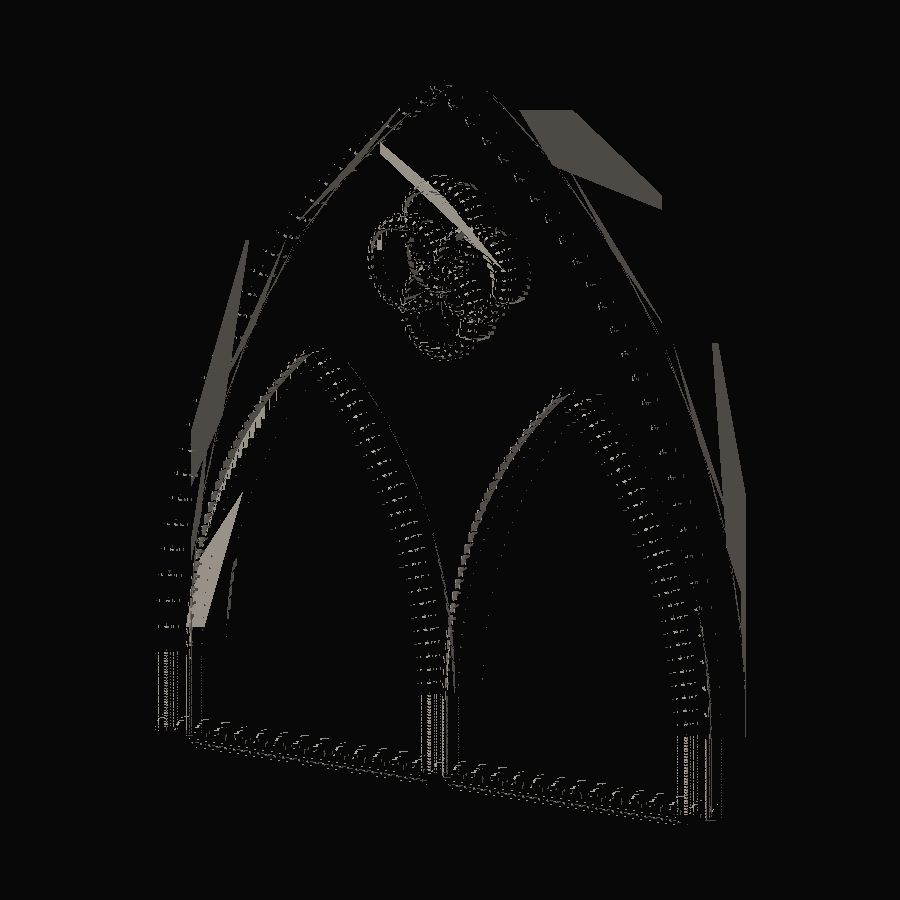
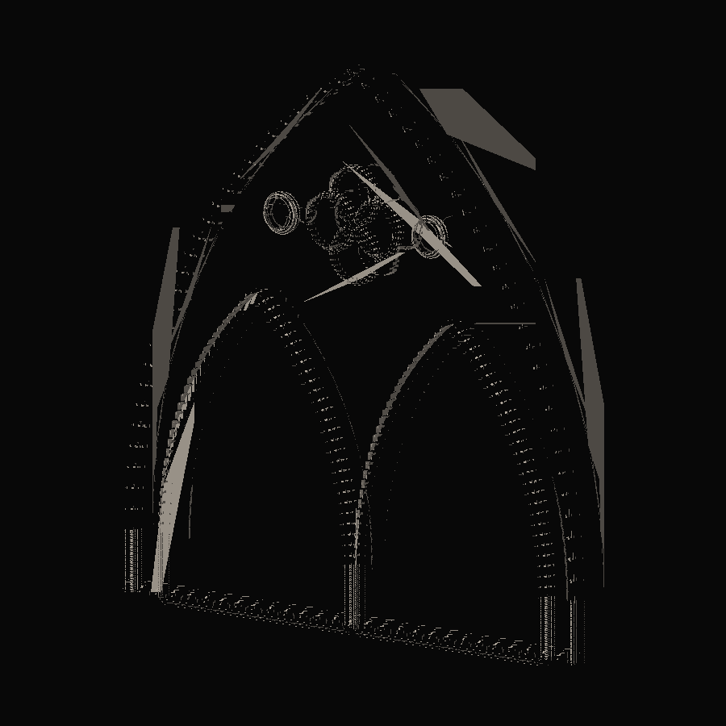
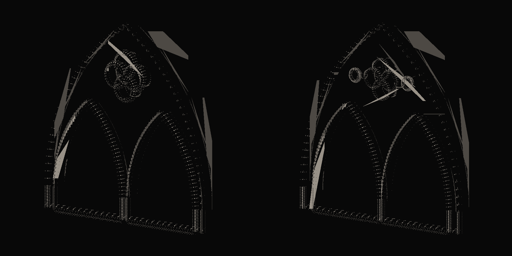
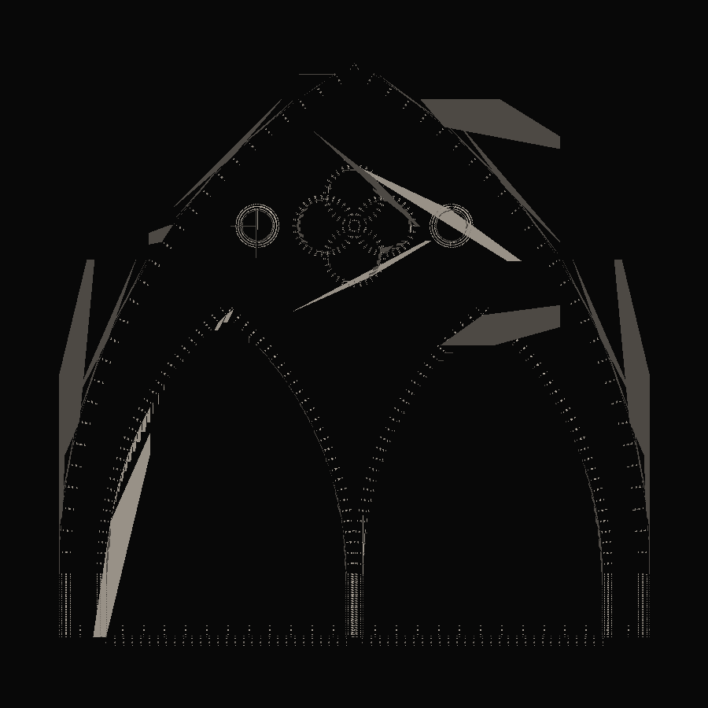

# 21 — Rayonnant Architectural Refinement

Session date: **9 November 2026**. Tab: **Gothic Grammar → Stone / 3D**. Step **13D.2**.

Refines the Step 13D / 13D.1 composed window from a heavy stone panel toward Rayonnant-inspired **bar tracery**: hierarchical member widths, upper spandrel openings, and molding depth differentiation — without discarding 13D.1 hard-edge normals, cusp seam fixes, or the Baseline composition.

## References inspected

| ID | Observed | Computational use |
|---|---|---|
| **REF-011** | Hierarchical bars (outer › mullion › foil); spandrel secondary voids; slender stone web | Member class hierarchy; void/solid porosity goal |
| **REF-007** | Symmetric secondary circles flanking upper oculus/quatrefoil in gable spandrels | Upper spandrel opening construction |
| **REF-012** | Gable/oculus packing; thin consistent webs; trefoil/circle nesting | Tangency / clearance pocket rule for spandrels |
| **REF-009** | Extreme porosity, readable molding depth, monochrome presentation | Presentation-clean compare mode |

Photographs and plates are **not** calibrated drawings. Ratios below are exploratory design defaults.

Also read: `AGENTS.md`, `references/README.md`, `references/VISUAL_DIRECTION.md`, `references/reference-index.json`.

## Presets

| Preset | Behavior |
|---|---|
| **Baseline 13D** | Frozen prior composition: 3 voids (2 lancets + foil), absolute widths, uniform molding profile |
| **Rayonnant Refined** | Span-ratio member widths, symmetric upper spandrel openings, per-class molding hierarchy |

Both remain selectable. Compare mode renders them side-by-side at the same span, camera, lighting, and material.



*Baseline 13D · composed window · three-quarter · 3 openings · uniform moldings.*



*Rayonnant Refined · three-quarter · 5 openings · molding hierarchy.*



*Compare mode · same span / camera / lighting · left Baseline · right Refined.*



*Rayonnant Refined · front · planar hard-edge web with secondary spandrel voids.*

## Member hierarchy

| Class | Role | Width rule (refined) |
|---|---|---|
| `OUTER_FRAME` | Outer clear-span frame | 4–7% of parent span (default ≈ 5.2%) |
| `PRIMARY_MULLION` | Central mullion / lancet members | 45–70% of frame width |
| `SECONDARY_TRACERY` | Spandrel web / secondary openings | 30–55% of frame width |
| `OCULUS_FRAME` | Semantic oculus ring thickness | ~40% of frame (construction cue; oculus is not a hole) |
| `FOIL_BAR` | Finest foil members | ~26% of frame |

Hierarchy is enforced descending: outer ≥ primary ≥ secondary ≥ foil. Clearances remain validated; invalid openings are reported, not forced.

## Upper spandrel construction

Symmetric circular voids at oculus height:

1. Pocket between oculus exterior (+ secondary web) and parent arch side wall (− secondary web).
2. Radius = `upperOpeningScale × pocket / 2`, clamped.
3. Centers placed geometrically in each pocket (not freehand).
4. Validate: inside parent arch, clear of oculus / foil / lancets, positive web.
5. On failure: **omit** openings and warn — do not force invalid holes.

Exact representation: four clockwise quarter-arcs per circle (hole winding). Regenerated into the same outer-with-holes solid/void model, then extruded with the existing 13D pipeline.

## Molding hierarchy

When `moldingHierarchy` is on, each sweep role scales the compound Gothic profile:

- Outer frame — heaviest width/depth  
- Lancet openings — intermediate (primary)  
- Spandrel openings — lighter secondary  
- Foil — finest  

13D.1 cusp dual-frames, open cusp seams, planar sweep frames, and hard-edge display normals are unchanged.

## Topology / mesh validation

- Baseline: 3 openings, watertight structural mesh (1012 tris at standard composed defaults).  
- Refined: 5 openings when spandrels succeed, watertight structural mesh, planar front/back normals.  
- Combined assembly is still **not** a single boolean-union solid.  
- Deterministic regeneration for both presets.

## Parameters (UI groups)

- **Architectural Proportions** — span ratios, use-ratios toggle  
- **Tracery Hierarchy** — spandrel enable, upper opening scale, oculus/foil ratios  
- **Stone Profiles** — molding hierarchy toggle + existing profile scalars  
- **Compare mode** — Single / Baseline ↔ Refined  
- **Presentation clean** — hide debug overlays for architectural comparison  

## Tests

```bash
cd app && npm run validate:stone-3d && npm run validate:solid-void && npm run build
```

## Files

| Path | Role |
|---|---|
| `tracery/memberHierarchy.js` | Member classes, ratios, profile scales |
| `tracery/spandrelOpenings.js` | Upper spandrel circle construction |
| `tracery/presets.js` | Baseline / Rayonnant Refined presets |
| `tracery/regionRoles.js` | Spandrel region types + hole key helper |
| `tracery/solidVoid.js` | Integrate optional spandrel holes |
| `solids/stoneAssembly.js` | Dynamic holes + molding hierarchy |
| `settings.js` / Panel / View | Preset UI, proportions, compare mode |
| `scripts/validate-stone-3d.mjs` | 13D.2 automated checks |

## Known limitations

- Spandrel openings are circular modules — not full nested trefoils as in REF-011/012 detail plates.  
- Cross-path molding miters remain butt joints.  
- Member widths for oculus/foil are semantic hierarchy cues; oculus is still construction-only (not a second hole around the foil).  
- Bar-tracery “network” reading is achieved via additional voids + slender proportions, not a separate disconnected bar graph.  
- Geometric self-intersection between decorative and structural layers is not exhaustively detected.

## Stop

Step **13D.2** complete. Do not begin Step **13E** (assemblies, facades, vaults, pinnacles, agents) in this step.
