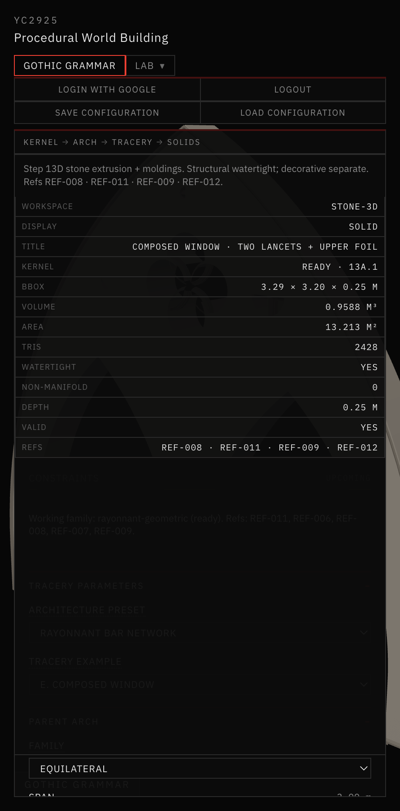
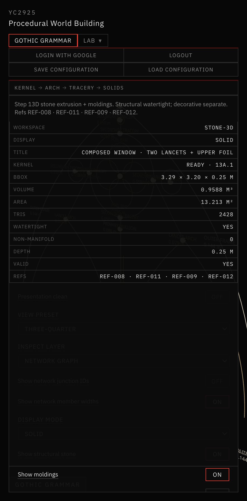
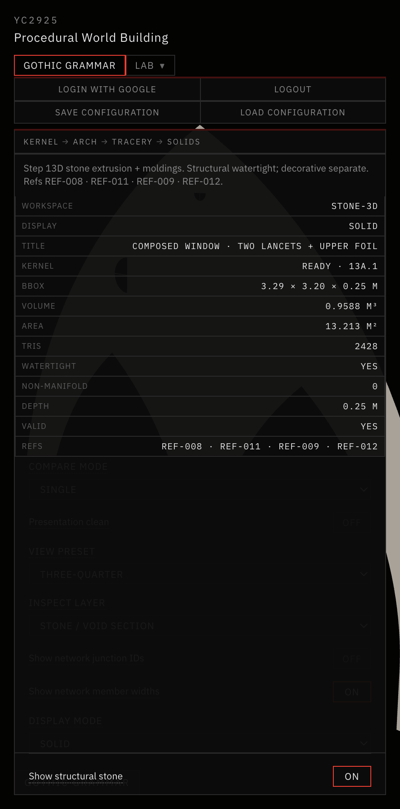

# 22 — Rayonnant Bar-Tracery Grammar & Topology Repair

Session date: **9 November 2026**. Tab: **Gothic Grammar → Stone / 3D**. Step **13D.3**.

Adds a third architectural preset — **Rayonnant Bar Network** — that derives stone from a connected semantic member graph, plus a diagnosis of the “clipped” spandrel openings in Rayonnant Refined. Does **not** begin Step 13E.

## References inspected

| ID | Observed | Computational use |
|---|---|---|
| **REF-006** | Circle/foil packing, nested spandrel circles, double-lancet + oculus plate | Upper cell packing; foil/circle construction grammar |
| **REF-008** | Elevation + section; lancets + oculus + foil; mullion profiles | Bar hierarchy; oculus ring as member; section inspect mode |
| **REF-011** | Hierarchical bars; upper oculus/trefoil; triangular spandrels | Primary/secondary members; negative-space hierarchy |
| **REF-007** | Gable oculus + secondary spandrel piercings | Side-cell flanking construction |
| **REF-009** | Extreme porosity; molded bar network; monochrome presentation | Presentation density goal; network readability |
| **REF-016** | Speculative skeletal frames (aesthetic only) | Optional vertical/bar reading — not structural evidence |

Also read: `AGENTS.md`, `references/README.md`, `references/VISUAL_DIRECTION.md`, `references/reference-index.json`.

Attached user image of current Rayonnant Refined was used for the clipped-spandrel diagnosis below.

## Clipped-spandrel diagnosis (Rayonnant Refined)

**Verdict: not a 2D clipping / triangulation bug.** Openings are intentionally nestled and appear partially obstructed in Combined 3D.

Checked (coordinates, not only pixels):

| Layer | Result |
|---|---|
| **A. 2D section** | Full CW quarter-arc circles; inside parent arch; min gap to wall ≈ 0.11 m |
| **B. Structural only** | 5 holes, watertight extrusion; holes fully open |
| **C. Moldings only** | Secondary profile ~0.030 m into void (r ≈ 0.088 → clear r ≈ 0.058) |
| **D. Combined 3D** | Moldings + three-quarter foreshortening deepen the “clipped” reading |

Root causes (documented, not arbitrarily “fixed” by enlarging holes):

1. **Intended pocket placement** — centers sit so the circle is tangent to the oculus + `secondaryWeb` clearance (nestled against the oculus stone mass).
2. **Small absolute radius** — `upperOpeningScale × pocket / 2` in a narrow horizontal pocket (r ≈ 0.088 m at span 3).
3. **Molding occlusion** — hierarchy-scaled profiles consume a substantial fraction of the aperture.
4. **Perspective** — three-quarter view foreshortens small side voids.

No shared 2D boolean/containment bug was found. Baseline / Refined generators were left unchanged. Bar Network uses a **balanced pocket center** for side cells (clearer aperture) on its own path only.

## Presets

| Preset | Openings (default span 3) | Notes |
|---|---|---|
| **Baseline 13D** | 3 | Unchanged |
| **Rayonnant Refined** | 5 | Unchanged (spandrels nestled as above) |
| **Rayonnant Bar Network** | 6+ | Connected graph + side + apex cells (shoulders when clearance allows) |



*Rayonnant Bar Network · Combined 3D · three-quarter · 6 openings · watertight · bar-network path.*



*Inspect = Network Graph · color-coded members + width labels · exact centerlines.*



*Inspect = Stone / Void Section · gray solid · dark openings · no moldings · 6 voids.*

## Bar-network graph schema

**Nodes:** `ARCH_APEX`, `SPRINGING_POINT`, `MULLION_JUNCTION`, `TRACERY_JUNCTION`, `OCULUS_JUNCTION`, `BOUNDARY_CONNECTION`  
Each: stable ID, exact position, member IDs, parent construction ID, constraints.

**Members:** `OUTER_FRAME`, `PRIMARY_MULLION`, `LANCET_ARCH`, `SECONDARY_TRACERY`, `OCULUS_RING`, `FOIL_BAR`  
Each: stable ID, start/end nodes, **exact** arc/segment path, class, width, depth, profile, parent/child.

Derived from parent pointed arch → two lancets → mullion → oculus → quatrefoil, plus secondary connectors (lancet apex ↔ oculus, apex ↔ oculus, mullion ↔ oculus).

## Upper tracery construction

Region between parent arch, lancet apexes, and oculus:

1. **Side cells** — symmetric circles in balanced horizontal pockets at oculus height  
2. **Apex cell** — axial circle between oculus crown and parent apex  
3. **Shoulder cells** — optional packing between lancet apex and oculus underside (omitted when vertical pocket < clearance)

All from tangency / clearance constraints. Failure omits cells (not forced).

## Member width hierarchy

Master frame width × exploratory ratios:

| Member | Ratio |
|---|---|
| OUTER_FRAME | 1.00 |
| PRIMARY_MULLION | 0.60 |
| LANCET_ARCH | 0.55 |
| OCULUS_RING | 0.40 |
| SECONDARY_TRACERY | 0.35 |
| FOIL_BAR | 0.25 |

## Stone region derivation

1. Build semantic network (exact paths preserved).  
2. Opening **cells** = network-derived voids (lancets, foil, upper cells).  
3. Stone for extrusion = constructive **outer-with-holes** (existing 13D Earcut path).  
4. **Validation:** offset each non-foil member to a mitered strip → `polygon-clipping` union → must be a **single** component inside the outer envelope.

Junction strategy: averaged-normal miter strips (clamped miter limit); no decorative meshes hiding broken joints.

## Inspection modes

- **Network Graph** — color-coded members, nodes, optional IDs / widths  
- **Stone / Void Section** — gray solid, dark openings, no moldings  
- **Structural 3D** / **Combined 3D** — existing 13D.1 layers  

## Comparison (measured, span 3 equilateral)

| Metric | Baseline | Refined | Bar Network |
|---|---|---|---|
| Openings | 3 | 5 | 6 |
| Solid area (m²) | 3.609 | 3.911 | 3.742 |
| Opening area (m²) | 3.970 | 3.982 | 4.046 |
| Structural volume (m³) | 0.909 | 0.990 | 0.959 |

Bar Network has the highest opening area of the three at this span.

## Validation

```bash
cd app && npm run validate:solid-void && npm run validate:stone-3d && npm run build
```

All passed (9 Nov 2026). Bar assembly watertight (2428 tris at standard defaults; tessellation may promote to 40 segments when apex cells are present).

## Files

| Path | Role |
|---|---|
| `tracery/barNetworkTypes.js` | Node/member vocabulary |
| `tracery/barNetwork.js` | Graph from composed geometry |
| `tracery/upperBarSubdivision.js` | Side / apex / shoulder cells |
| `tracery/barNetworkStone.js` | Strip union + solid/void from network |
| `tracery/presets.js` | `RAYONNANT_BAR_NETWORK` preset |
| `tracery/memberHierarchy.js` | LANCET_ARCH / OCULUS_RING classes |
| `tracery/regionRoles.js` | New void region types |
| `solids/NetworkGraphOverlay.jsx` | Network inspect mode |
| `solids/SectionOverlay.jsx` | Section inspect mode |
| `scripts/validate-stone-3d.mjs` | 13D.3 checks |
| Panel / View / settings | Preset, params, compare all-three |

Dependency: `polygon-clipping` (Martinez) for strip union validation.

## Known limitations

- Shoulder cells often omit at default clearances (vertical pocket too small).  
- Foil bars are semantic path members; structural strip union skips them so the foil void is not filled.  
- Apex cells can require elevated tessellation segment counts for Earcut manifold results.  
- Strip union is a connectivity check — extrusion still uses constructive outer-with-holes.  
- Full curved-triangle (non-circular) upper cells are not yet generated.  
- Cross-path molding miters remain butt joints.

## Stop

Step **13D.3** complete. Do **not** begin Step **13E** (bays, facades, vaults, pinnacles, agents, new LOD).
