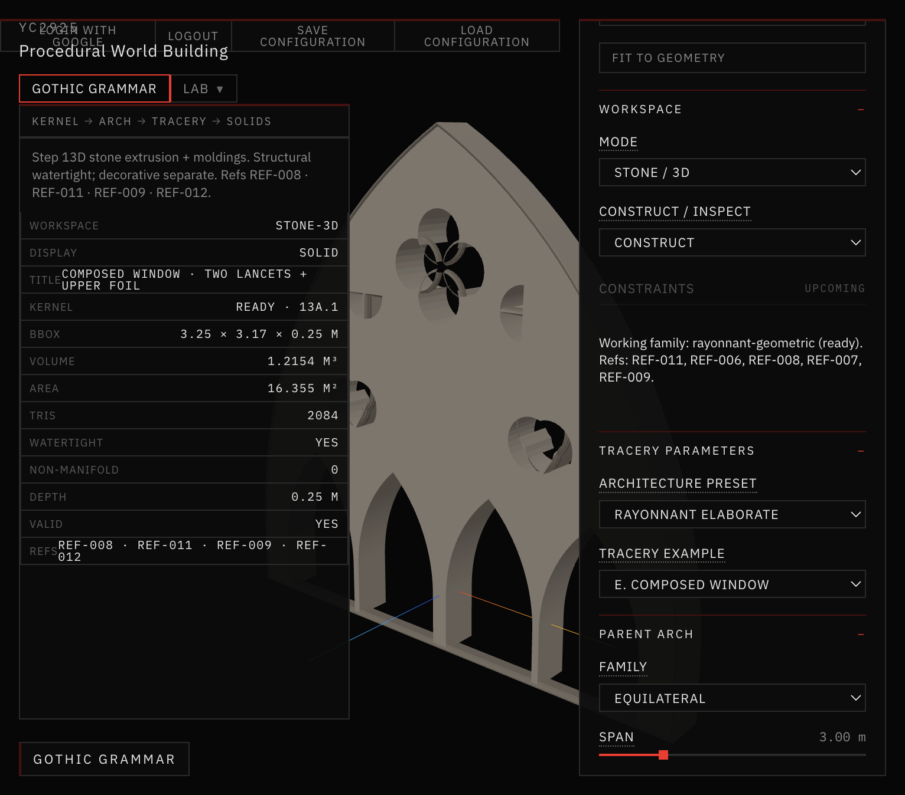
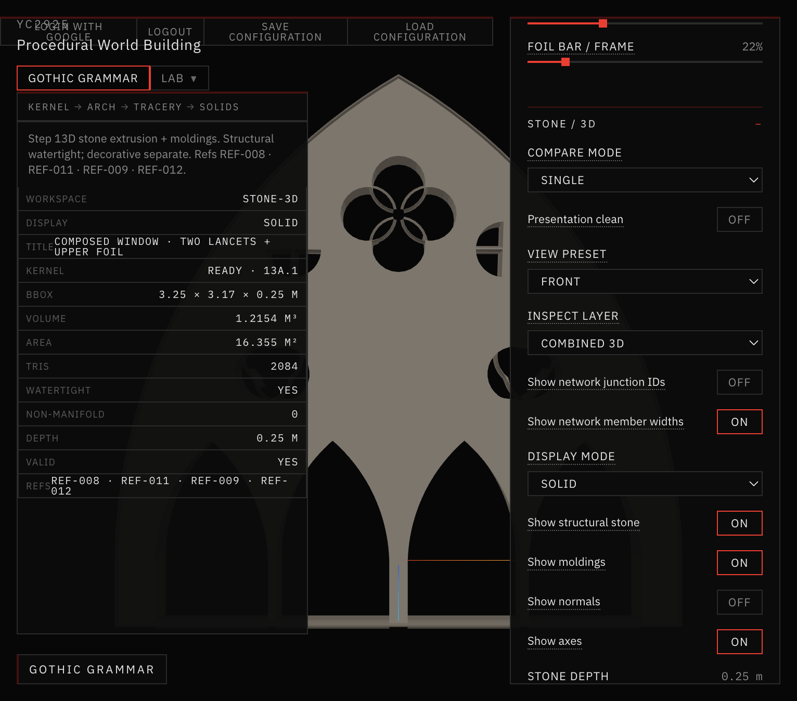
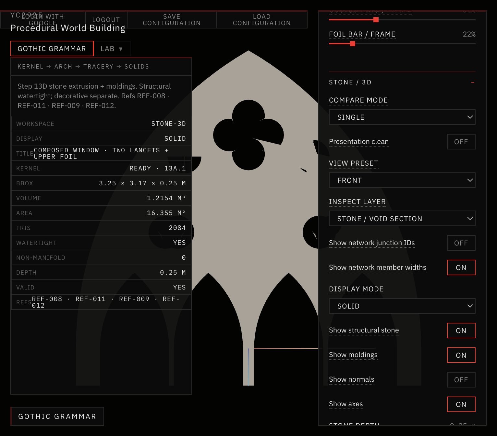

# 23 — Rayonnant Elaborate Grammar

Session date: **9 November 2026**. Tab: **Gothic Grammar → Stone / 3D**. Step **13D.4**.

Adds a fourth architectural preset — **Rayonnant Elaborate** — with zone-based hierarchical composition (nested lancets, dominant oculus foil, curved spandrels). Does **not** begin Step 13E.

## References inspected

| ID | Geometric principle | Architectural feature | Historical observation vs computational use |
|---|---|---|---|
| **REF-004** | Pointed arches; member-width hierarchy; vertical continuity pier→rib | Molding hierarchy; slender secondary vs primary | Observed: clustered shafts, rib hierarchy. Computational: width ratios / molding scales only — not vaults/bays (13E) |
| **REF-007** | Nested lancets under pointed envelope; gable oculus; secondary spandrel piercings | Zone B oculus + Zone D secondary openings | Observed: canopy hierarchy. Computational: zone allocation + foil-in-head, not pinnacles |
| **REF-008** | Four-light nested subdivision; tangent oculus; foil-in-lancet-head; section profiles | Nesting depth 2; primary-head openings; member profiles | Observed: construction plate geometry. Computational: `subdivideArchField` + head foils; no traced silhouette |
| **REF-009** | Radial bar network; high void/solid; molded members | Porosity / presentation target | Observed: monochrome porous rose. Computational: density goal — not radial rose grammar (partial B path only) |
| **REF-011** | Three-light bar tracery; dominant upper circles; pierced spandrels; slender bars | Zone A/B/D organization; outer spandrels | Observed: continuous bar network. Computational: constructive outer⊕holes + Zone D packing (not full strip-union bars) |
| **REF-016** | Speculative skeletal frames; vertical porosity | Aesthetic porosity cue | Speculative only — not structural evidence |

Also read: `AGENTS.md`, `references/README.md`, `references/VISUAL_DIRECTION.md`, `references/reference-index.json`.

## Presets (preserved + new)

| Preset | Openings (span 3) | Opening/envelope | Structural vol | Path |
|---|---|---|---|---|
| **Baseline 13D** | 3 | ~0.524 | 0.909 m³ | Unchanged |
| **Rayonnant Refined** | 5 | ~0.505 | 0.990 m³ | Unchanged |
| **Rayonnant Bar Network** | 6 | ~0.520 | 0.959 m³ | Unchanged |
| **Rayonnant Elaborate** | 9 | ~0.400 | 1.215 m³ | New `enableElaborate` |



*Rayonnant Elaborate · Combined 3D · three-quarter · 9 openings · watertight · nesting depth 2.*



*Front elevation · Combined 3D · nested lower field + dominant quatrefoil + Zone D spandrels.*



*Inspect = Stone / Void Section · gray solid · dark openings · 9 voids · no decorative slits.*

## Grammar architecture

Dedicated module: `app/src/geometry/gothicGrammar/tracery/elaborate/`

| Module | Role |
|---|---|
| `architecturalConstraints.js` | Zones A–D IDs; arch half-width; circle validation; porosity metrics |
| `hierarchicalLancets.js` | Primary subdivision + nesting depth 1–2; primary-head foils (REF-008) |
| `oculusComposition.js` | Dominant central foil oculus (A); constrained N-foil path (B when foilCount>4) |
| `curvedSpandrels.js` | Zone D outer packing (preferred); Zone C transitions as fallback; apex when meaningful |
| `openingArrangement.js` | Deterministic solver sequence + scoring note |
| `elaborateSolidVoid.js` | Constructive outer⊕holes; member width hierarchy; 13D extrusion input |

Reuse: kernel 13A.1, pointed arches 13B, foils/oculus/lancets 13C, regions 13C.1, extrusion/profiles 13D–13D.1. Prior presets untouched (`enableElaborate` early-branch only).

## Construction sequence

1. Parent pointed envelope  
2. Zone A — two primary fields; nesting depth 2 → four secondary lights + head openings  
3. Zone B — large oculus; **foil is the sole upper hole** (no overlapping circle+foil)  
4. Zone D — symmetric outer spandrel cells (clearance-packed, iterative shrink)  
5. Zone C — only if Zone D fails (foil/transition proximity caused Earcut non-manifold when combined)  
6. Validate containment / overlap / webs → extrude via existing `buildStoneAssembly`

## Parameter groups (UI)

- **Composition:** nesting depth, secondary mullion, secondary lancet rise, oculus scale, upper subdivision complexity  
- **Foil:** type, scale, cusp depth, rotation  
- **Proportions:** outer / primary / secondary / oculus / foil width ratios  
- **Stone / 3D:** depth, profile, molding hierarchy (existing)

## Validation results

```text
npm run validate:stone-3d   # includes Step 13D.4 suite — PASSED
npm run validate:solid-void # PASSED
npm run build               # PASSED
```

Elaborate defaults: watertight, 0 non-manifold, positive volume, planar normals OK, spans 2.4 / 3.0 / 4.5 OK. Baseline/Refined/Bar opening counts unchanged.

## Architectural acceptance

**FAILED** against the critical visual condition.

The preset is mathematically hierarchical (9 openings, nested secondaries, head foils, dominant oculus, Zone D cells) and mesh-valid, but the silhouette still reads as a **thick plate with punched openings**, not a slender connected Rayonnant bar network. Opening/envelope ratio (~0.40) is **lower** than Bar Network (~0.52) because nesting replaces two large primary voids with four smaller lights plus webs.

Honest limitations:

1. Stone is still constructive outer⊕holes, not member-strip union → webs between openings remain broad plate.  
2. Zone C + foil together pinch Earcut; Zone C deferred when Zone D succeeds.  
3. Apex cell often omitted (pocket too small under dominant oculus).  
4. Porosity target (+15% vs 13D.3) not met — report, do not game with tiny holes.  
5. Overlay title still says “two lancets + upper foil” (composed-window metadata); metrics correctly list elaborate / 9 openings.

## Known next work (not 13E)

- Member-strip stone derivation for elaborate (reuse 13D.3 strip union with hierarchical members)  
- Safe Zone C + foil co-existence (larger reserved band / simplified foil tessellation)  
- Visual title / inspect colors for opening hierarchy  

## Stop

Step **13D.4** complete as an implemented preset + docs. Do **not** begin Step **13E**.
