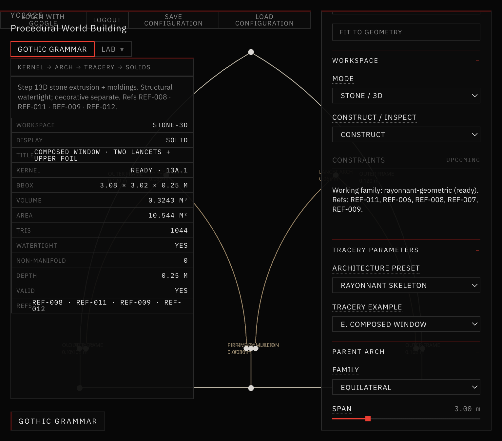
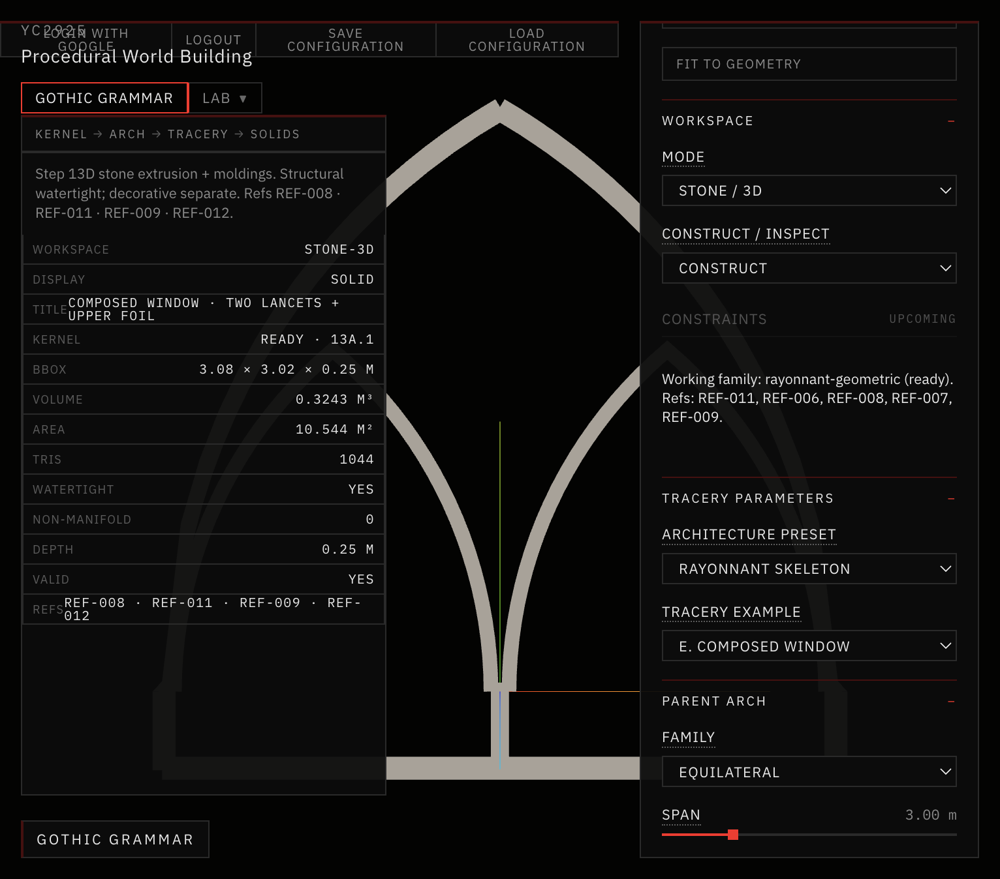
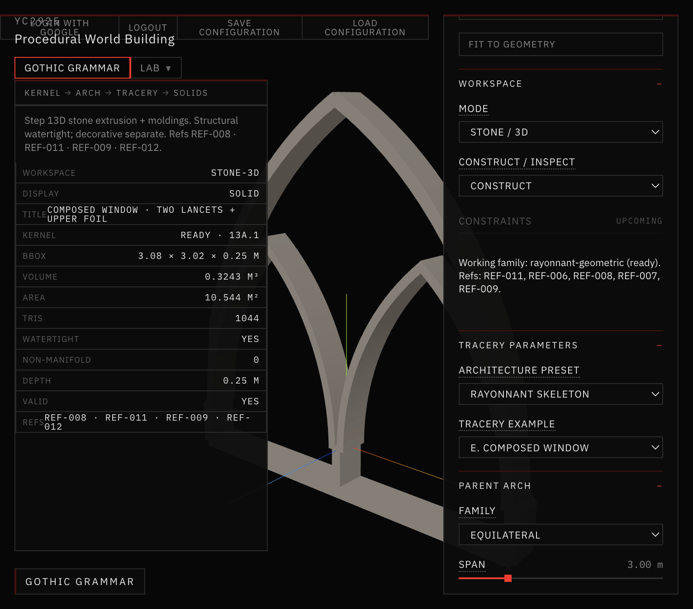

# 24 — Skeleton-First Rayonnant Construction

Session date: **9 November 2026**. Tab: **Gothic Grammar → Stone / 3D**. Step **13D.5**.

Adds a fifth architectural preset — **Rayonnant Skeleton** — with stone generated from an exact centerline network (parent arch + two lancets + mullion + sill/jambs), unioned as planar strips. Does **not** begin Step 13E.

## References inspected

| ID | Geometric principle | Architectural feature | Historical observation vs computational use |
|---|---|---|---|
| **REF-007** | Slender vertical members under a pointed envelope; hierarchical voids | Skeleton reading of canopy bars (not plate) | Observed: continuous bars + open upper zones. Computational: parent + lancets + mullion only — no pinnacles / oculus / foliage |
| **REF-008** | Two-centered construction; nested lancets; centerline circles | Exact arcs + member-width hierarchy in section | Observed: construction plate + molded profiles. Computational: kernel arcs + strip offsets; moldings deferred |
| **REF-009** | High void/solid; continuous bar network | Porosity / silhouette target | Observed: monochrome radial rose. Computational: density cue only — not radial rose grammar |
| **REF-011** | Three-/four-light bar tracery; slender connected members | Continuous junctions; open upper field | Observed: stone as network. Computational: strip-union skeleton (no foils / nested lights yet) |

Also read: `AGENTS.md`, `references/README.md`, `references/VISUAL_DIRECTION.md`, `references/reference-index.json`. All four reference images were readable on disk.

## 13D.3 diagnosis (why prior stone still read as a slab)

Step 13D.3 built a bar-network graph and strip unions for **connectivity inspection**, but structural extrusion still received the classic **outer envelope ⊕ independent holes** region set. The unioned strips were not the geometry passed into `buildStoneAssembly` / Earcut extrusion. Result: watertight mesh with panel-like volume (~0.96 m³ vs baseline ~0.91 m³) and an architecturally filled silhouette.

13D.5 fixes this: when `enableSkeleton` is true, extrusion `outer` / `holes` come from the **strip-union multipolygon** (`representation: strip-union-skeleton`). Volume drops to **~0.32 m³**.

## Presets (preserved + new)

| Preset | Openings (span 3) | Structural vol | Path |
|---|---|---|---|
| **Baseline 13D** | 3 | 0.909 m³ | Unchanged |
| **Rayonnant Refined** | 5 | ~0.99 m³ | Unchanged |
| **Rayonnant Bar Network** | 6 | 0.959 m³ | Unchanged |
| **Rayonnant Elaborate** | 9 | 1.215 m³ | Unchanged |
| **Rayonnant Skeleton** | 3 emergent voids | **0.324 m³** | New `enableSkeleton` |



*Inspect = Network Graph (SKELETON GRAPH) · Rayonnant Skeleton · front · centerlines, nodes, member classes.*



*Inspect = Stone / Void Section (STONE SECTION) · light gray stone · dark voids · slender connected members · open upper region.*



*Inspect = Structural 3D · three-quarter · strip-union extrusion · watertight · vol 0.3243 m³ · 1044 tris · no moldings.*

## Centerline graph schema

Module: `app/src/geometry/gothicGrammar/tracery/skeleton/`

| Field | Role |
|---|---|
| Stable semantic ID | Per member / node |
| Exact centerline | Kernel arcs + segments (not hardcoded silhouettes) |
| Member class | Outer frame, lancet arch, primary mullion, sill / jamb |
| Width / depth | Hierarchy from master frame + ratios |
| Junction refs | Shared node IDs at springings / apex / sill |
| Construction metadata | Source curve refs, sampling quality |

Members only: **A** parent pointed arch · **B** two child lancets · **C** central mullion · **D** bottom + side connections. No oculus, foils, spandrels, or nested lights.

## Strip construction + union

1. Sample each exact centerline at controlled tolerance  
2. Offset to width → closed strip polygon (`polylineToStrip`)  
3. `polygon-clipping` **union** of all strips → one connected planar region  
4. Clip to parent envelope  
5. Emergent voids become holes for extrusion / section (not independently placed decorative openings)

Member semantic IDs stay on the graph; the unioned polygon is the stone solid.

## Region topology

- **Connected stone:** one strip-union component  
- **Interior openings:** two lancet voids + open upper field between parent and child heads  
- **Exterior empty space:** outside the parent envelope (not filled)

## Width parameters (UI)

| Control | Default |
|---|---|
| Master frame width | 0.12 m |
| Primary arch / frame | 1.0 → 0.12 m |
| Mullion / frame | 0.67 → 0.08 m |
| Child arch / frame | 0.54 → 0.065 m |

All widths clamped positive; junction overlap validated in the skeleton graph suite.

## Inspect modes (same geometry)

| Mode | Inspect layer |
|---|---|
| **SKELETON GRAPH** | `network-graph` |
| **STONE SECTION** | `section` |
| **STRUCTURAL 3D** | `structural` |

## 2D acceptance

Front stone section reads as a **network of slender members** with an open upper region (compare REF-007 / REF-008). Gate **passed** — proceeded to 3D.

## 3D validation

```text
npm run validate:stone-3d   # includes Step 13D.5 suite — PASSED
npm run validate:solid-void # PASSED
npm run build               # PASSED
```

Skeleton defaults: watertight, 0 non-manifold, positive volume 0.3243 m³, planar hard-edge normals OK, spans 2.4 / 3.0 / 4.5 OK. Prior presets unchanged.

## Known limitations

- Minimal skeleton only — no oculus, foils, nested lancets, or curved spandrels (deferred past 13D.5)  
- Solid/panel proxy ratio warning can still fire (envelope-area heuristic; not a slab extrusion path)  
- No decorative moldings on this preset  
- Junction fillets are boolean-union overlaps, not carved masonry nodes  
- Not yet a full Rayonnant rose / multi-light grammar (13E+)
