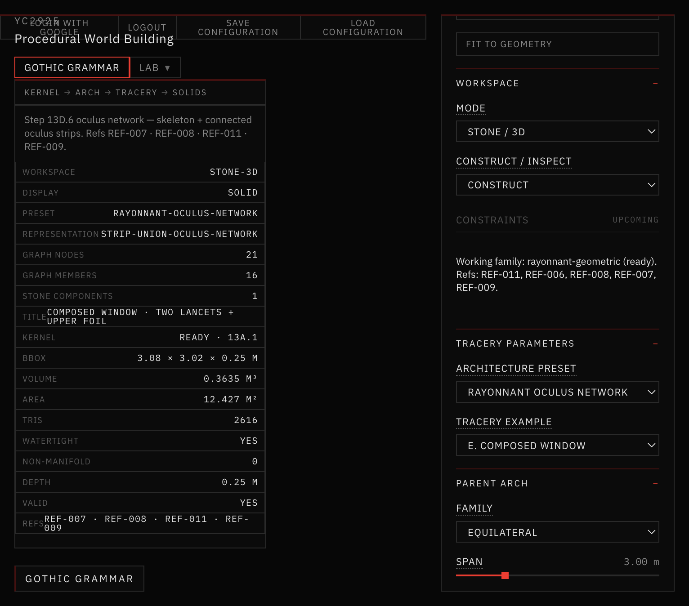
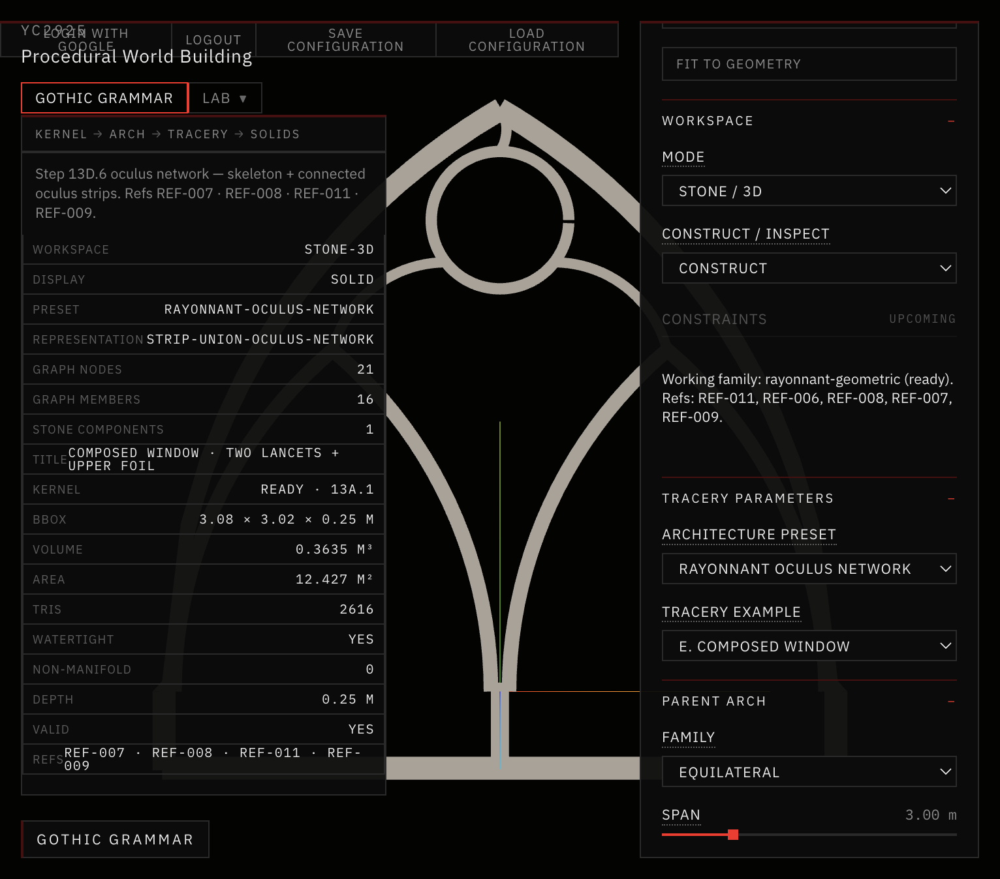
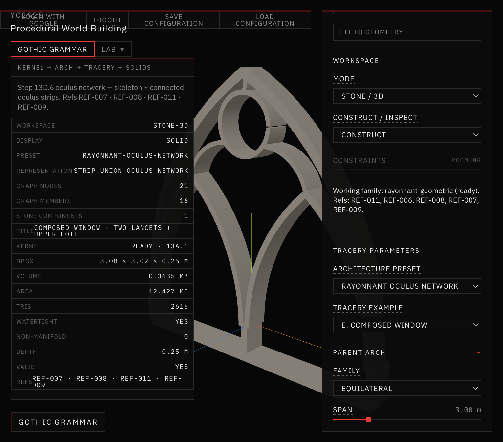

# 25 — Connected Oculus & Upper Tracery

Session date: **9 November 2026**. Tab: **Gothic Grammar → Stone / 3D**. Step **13D.6**.

Extends the validated Step **13D.5** Rayonnant Skeleton with a central oculus ring and connected upper tracery members. New preset: **Rayonnant Oculus Network**. Does **not** begin Step 13E. Prior presets including **Rayonnant Skeleton** remain unchanged.

## References inspected

| ID | Geometric principle | Architectural feature | Historical observation vs computational use |
|---|---|---|---|
| **REF-007** | Slender continuous bars under a pointed envelope; open upper field | Skeleton reading of canopy bars (not plate) | Observed: continuous members + voids. Computational: skeleton + oculus ring + three connectors — no pinnacles / foliage |
| **REF-008** | Two-centered construction; nested lancets; centerline circles | Exact arcs + member-width hierarchy | Observed: construction plate + molded profiles. Computational: kernel arcs + strip offsets; moldings deferred |
| **REF-009** | High void/solid; continuous bar network | Porosity / silhouette target | Observed: monochrome radial rose. Computational: density cue only — not radial rose grammar |
| **REF-011** | Three-/four-light bar tracery; slender connected members | Continuous junctions; upper oculus zone | Observed: stone as network. Computational: strip-union oculus network (optional foil bars) |

Also read: `AGENTS.md`, `references/README.md`, `references/VISUAL_DIRECTION.md`, `references/reference-index.json`, `Docs/24-skeleton-first-rayonnant/README.md`. All four reference images were readable on disk.

## Construction representation

Preserve skeleton-first:

**Exact centerlines → variable-width stone strips → polygon-clipping union → planar stone region → existing 13D extrusion.**

Representation id: `strip-union-oculus-network`. Never outer-panel-minus-holes for this preset.

## Presets (preserved + new)

| Preset | Openings (span 3) | Structural vol | Path |
|---|---|---|---|
| **Baseline 13D** | 3 | 0.909 m³ | Unchanged |
| **Rayonnant Refined** | 5 | ~0.99 m³ | Unchanged |
| **Rayonnant Bar Network** | 6 | 0.959 m³ | Unchanged |
| **Rayonnant Elaborate** | 9 | 1.215 m³ | Unchanged |
| **Rayonnant Skeleton** | 3 emergent voids | 0.324 m³ | Unchanged (`enableSkeleton`) |
| **Rayonnant Oculus Network** | 5 emergent voids | **0.3635 m³** | New `enableOculusNetwork` |



*Inspect = Network Graph · Rayonnant Oculus Network · front · centerlines, junctions, oculus ring + connectors.*



*Inspect = Stone / Void Section · light gray stone · dark voids · slender connected oculus · open upper negative spaces.*



*Inspect = Structural 3D · three-quarter · strip-union extrusion · watertight · vol 0.3635 m³ · 2616 tris · no moldings.*

## Oculus containment

Module: `app/src/geometry/gothicGrammar/tracery/skeleton/skeletonOculus.js`

1. Lower bound = max(left, right) lancet apex Y + clearance  
2. `solveOculusCenterY` + `maxOculusRadiusAtHeight` against the **actual parent arch** (not bbox)  
3. Radius = `maxR × oculusRadiusRatio`  
4. `circleInsideArch` + apex clearance gate  
5. Constraint failures surface as validation errors (no silent substitute geometry)

## Connector construction

Three members terminate at ring attachment nodes (true circle–ray intersections):

| Member | From → To | Geometry |
|---|---|---|
| `member-oculus-connector-left` | Left lancet apex → oculus attach-left | Circular arc via `arcThroughThreePoints` (or segment at low curvature) |
| `member-oculus-connector-right` | Right lancet apex → oculus attach-right | Symmetric mirror |
| `member-oculus-connector-parent` | Parent apex → oculus attach-parent | Milder arc toward apex |

No floating spokes; no arbitrary radial fan. Left/right attachments checked for mirror symmetry.

## Graph architecture

Extends 13D.5 skeleton graph in place:

| Additions | Count (defaults) |
|---|---|
| Oculus center + cardinal + attach nodes | +8 nodes → **21** total |
| Oculus ring (four quarter arcs) | +1 closed member |
| Three connectors | +3 members → **16** total |
| Optional quatrefoil foil bars | +4 when subdivision = QUATREFOIL |

All new members share the same connected semantic graph (`oculusNetworkGraph`).

## Strip union

Same 13D.5 path (`skeletonStone`): sample centerlines → `polylineToStrip` → `polygon-clipping` union → one connected planar component. Emergent holes = extrusion voids. Upper field stays open (ring + connectors only — not a filled disk).

## Optional quatrefoil

`OCULUS SUBDIVISION`: **NONE** (default) | **QUATREFOIL**. Foil bars reuse `buildQuatrefoil` and attach as strip members inside the ring — not a quatrefoil hole cut from a solid disk.

## Upper Tracery UI

Collapsible **Upper Tracery** section:

| Control | Default |
|---|---|
| Oculus radius ratio | 0.78 |
| Oculus vertical position | 0.55 |
| Oculus ring / frame | 0.42 |
| Connector / frame | 0.38 |
| Upper connector curvature | 0.45 |
| Oculus subdivision | None |

## Inspect modes (same geometry)

| Mode | Inspect layer |
|---|---|
| **NETWORK GRAPH** | `network-graph` |
| **STONE SECTION** | `section` |
| **STRUCTURAL 3D** | `structural` |

Left info panel: preset name, `strip-union-oculus-network`, graph node/member counts, stone components, structural volume, watertight status. Brief text: “Step 13D.6 oculus network…” (no stale “Step 13D stone extrusion”).

## 2D acceptance

Front stone section: thin outer pointed arch · two lancets · central mullion · connected oculus ring · symmetric upper connectors · open upper negatives. Gate **passed** (slender, connected, no filled upper slab, no floating oculus) → proceeded to 3D.

## 3D validation

```text
npm run validate:solid-void   # PASSED
npm run validate:stone-3d     # includes Step 13D.6 suite — PASSED
npm run build                 # PASSED
```

Defaults: watertight, 0 non-manifold, volume 0.3635 m³, 2616 tris, planar hard-edge normals OK, spans 2.4 / 3.0 / 4.5 OK. Prior presets unchanged.

## Known limitations

- Plain oculus network by default — quatrefoil optional; no nested lancets / multiple oculi / elaborate spandrels  
- Solid/panel proxy ratio warning can still fire (envelope-area heuristic; not a slab extrusion path)  
- No decorative moldings on this preset  
- Junction fillets are boolean-union overlaps, not carved masonry nodes  
- Connector curvature extremes can fall back to segments when three-point arcs degenerate  
- Not yet a full Rayonnant rose / multi-light grammar (13E+)
