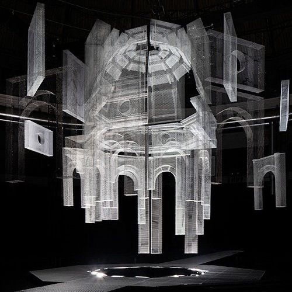
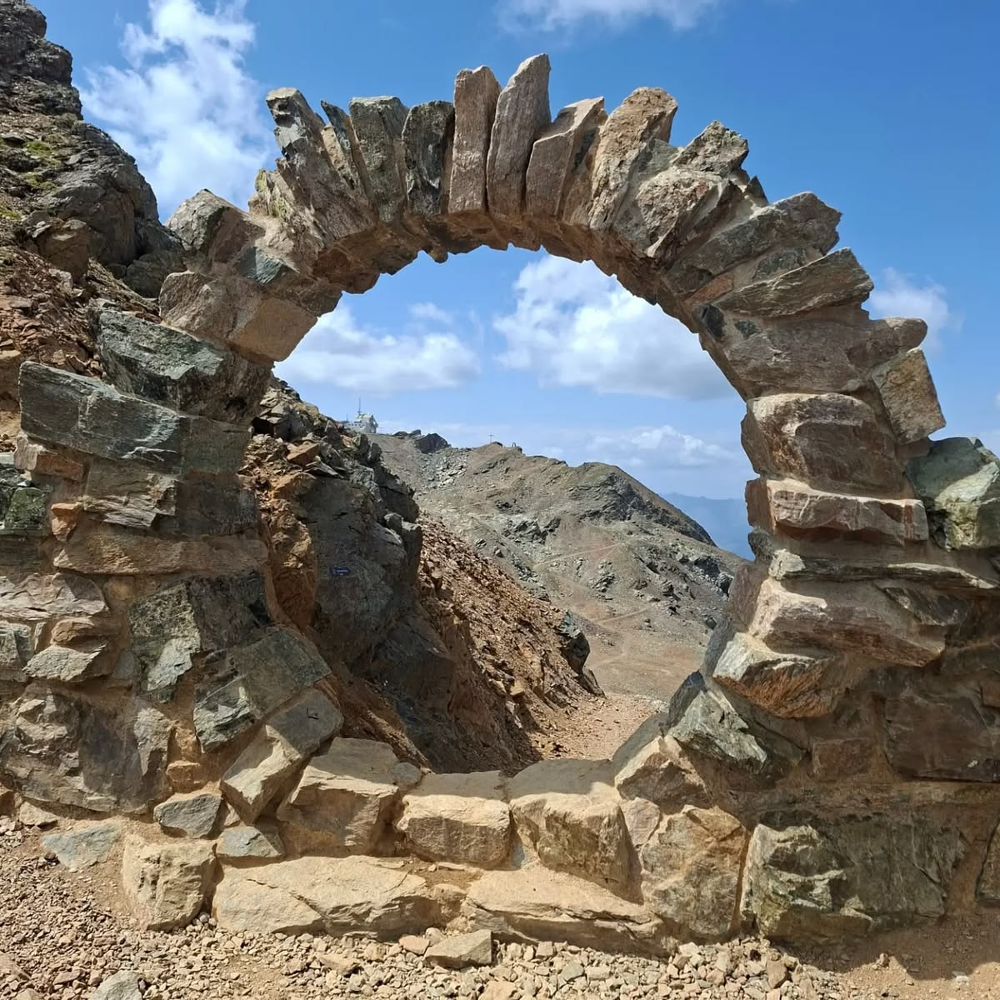

# Session log: 16 November 2026, PIVOT-curve-driven Gothic world 

A record of one working session between yc2925 and Claude Code. It covers:

- the first edit to the app (Curve Sandbox)
- the Step 47 plan and its vertical slice
- the first round of design feedback
- the Firebase deploy
- the open design problem (branching that looks like plants)

Every screenshot here was taken from the running app in headless Chrome. The demo scenes are built by a script through the project's own command API (`addCurve`, `liftToPointedArch`, curve links). Nothing in them was drawn by hand or made by AI.

|             |                                                                                          |
| ----------- | ---------------------------------------------------------------------------------------- |
| Live build  | https://pwb-yc2925-project-64c07.web.app → **Lab → Curve World (Step 47)**               |
| Commits     | `c3fc887` Curve Sandbox · `f52f23e` references + Step 47 plan · `af7f2b8` vertical slice |
| Uncommitted | Feedback round 1 (everything in [section 4](#4-feedback-round-1)), pending review        |
| Validation  | `npm run validate:world`: **61 / 61 checks pass**                                        |

---

## 1. Setup and ground rules

Three things were settled at the start of the session:

1. **Repo access.** Claude can read and change the yc2925 repo.
2. **Procedural-only rule.** Everything must be built from explicit geometric rules: points, arcs, sweeps, recursion and noise. No AI-generated meshes or images.
3. **Visual references.** Before any geometry work, read `references/README.md`, `VISUAL_DIRECTION.md` and `reference-index.json`, and open the reference images.

Both rules are also saved in Claude's project memory so they carry over to later sessions.

## 2. Curve Sandbox: proving the edit loop (`c3fc887`)

The first change was a small test: a new **Lab → Curve Sandbox** tab. It shows a cubic Bézier curve built by de Casteljau construction. You can drag P0–P3, change *t* and the segment count, and show or hide the construction lines.

*De Casteljau levels: control polygon (grey), first lerp (blue), second lerp (green), point B(t) (red).*

Other small fixes in the same session:

- The project was opened in VS Code and run on a local dev server.
- A narrow-window bug was fixed: the side panel overlapped the canvas at small widths.

## 3. Step 47 plan and vertical slice (`f52f23e`, `af7f2b8`)

### 3.1 Brief

You draw spatial curves. Each curve generates a Gothic skeleton. Stone (lithic) material then forms on that skeleton. Together these make a persistent world you can keep adding to.

### 3.2 References registered

Nine new images were added as **REF-021 to REF-029** in `references/futuristic-gothic-world/`. Each has an analysis entry and a reference group (A–E) in `reference-index.json`. Examples:

- CT-scanned armature
- sliced contour wireframes
- rock accretion on towers
- wire-mesh columns
- stratified spires
- suspended wireframe fragments

### 3.3 Plan

The architecture audit is in `README.md`. The phased plan is in `IMPLEMENTATION_ROADMAP.md`. The plan was presented for approval before any major code was written, and you approved it.

### 3.4 Vertical slice as first built

- **Model.** A project document with undo/redo, drag coalescing and localStorage autosave.
- **Curves.** Centripetal Catmull-Rom splines with rotation-minimising frames.
- **Skeleton.** Each curve was a *spine* that repeated a bay module along its length: pier, pointed arch, rib and buttress.
- **Lithic.** A signed-distance field built in a web worker, then meshed. The parameters were thickness, density, cohesion, gravity drip, layering and erosion.

| Curves | Gothic skeleton: bay array |
|---|---|
|  |  |

*The vertical slice at `af7f2b8`: curves, skeleton (top) and SDF lithic formation (bottom), from one S-curve. One curve becomes 16 repeated bays. The rock reads as one melted mass, not as built stone.*

## 4. Feedback round 1

You kept the UI layout and the Draw / Edit / Pan modes, and asked for six revisions. All six are implemented and validated, but not yet committed.

### 4.1 Drawing tools

| Feature | How it works |
|---|---|
| Freehand drawing | A "lazy-string" stabilizer smooths the stroke. The Stabilizer slider sets its radius. |
| Fitting the stroke | The stroke is simplified with the Ramer–Douglas–Peucker (RDP) algorithm to at most 24 control points. It ends exactly where you release. |
| Point editing | Drag points to move them. Double-click to insert a point. Delete removes one. |
| Height | Front view, the Z↑ field in the point inspector, and Shift-drag all edit height. |
| Lift to pointed arch | Uses the same two-centred construction as Step 13B: c = (h² − a²) / 2a, R = a + c. |
| Connected curves | Drag from one curve's point to another's. The two curves then share that endpoint through a link (`links.start` / `links.end`). Moving the shared point moves every curve attached to it. |

*The demo world: two bays of column, arch and column (each arch linked to both column tops), a buttress linked to a column top, a ground wall and a tracery curve. The outliner lists role, members, branches, stones and linked ends for each curve.*

### 4.2 Each curve becomes a structural member (no array)

`skeleton/spine.js` (the bay array) was deleted. Each curve now becomes **one** structural member. Its **role** sets its radius and how it can branch:

- **rib:** a curved structural member, such as an arch rib
- **column:** a vertical support
- **buttress:** a support that leans against a column or wall
- **tracery:** thin decorative stone bars

Variation comes from seeded recursive branching:

- Branches start at chosen sites along the member.
- Each branch is rotated off the member's frame (Rodrigues rotation) and curled.
- **Symmetry** controls whether branches come in mirrored pairs.
- **Joints** are added where curves are linked, and footings where a member touches the ground.

| X-ray skeleton (UI)                        | X-ray skeleton (close-up)                     |
| ------------------------------------------ | --------------------------------------------- |
|  |  |

### 4.3 X-ray wire-mesh look (REF-026)

A custom shader (`compose/scrimMaterial.js`) gives every surface the look of fine wire mesh on pure black:

- **Additive blending.** Overlapping layers stack brighter, so you can see the skeleton through the stones.
- **Fresnel edges.** Silhouettes glow; surfaces facing the camera stay faint.
- **Mesh lines.** Tubes and terrain use a mesh grid measured in metres. Each stone outlines its own facets.
- **Light rings** on the ground plane.
- **Explode.** Stones and members are offset outward, in groups, from the centre of the scene.

| Reference: REF-026 | X-ray lithic | X-ray with explode = 5 m |
|---|---|---|
|  |  |  |

### 4.4 Dry-stone stacking (REF-030)

The SDF rock was replaced by `lithic/stones.js`, which places individual stones:

- **Stone slots along each member.** A stone's thin side follows the curve, and its long side follows the member's "up" direction. This gives voussoirs (wedge-shaped arch stones) on arches and flat courses on piers.
- **Wedge cut.** Stones are wedged in proportion to how sharply the curve bends.
- **Staggered rows**, with stone size graded from base to top.
- **Small random tilt** on each stone.
- **No overlaps.** A spatial-hash check rejects stones that would collide.
- **Base details.** Low runs get coursed footings, ground contacts get plinths, and loose gravel is scattered around.
- **Stone shapes.** 24 procedurally generated convex hulls, rendered with instancing.

| Reference: REF-030 | Stacked stone (solid) |
|---|---|
|  |  |

*The Lithic Formation stage. Every slider has a tooltip and visibly changes the result. Each curve can override the world defaults (↺ resets it).*

### 4.5 Brighter world and procedural terrain

- **Terrain:** simplex fBm noise with a flat building plateau in the middle.
- **Lighting:** brighter, with hemisphere, key and under-fill lights.
- **Exposure:** ACES tone mapping, adjustable from the Exposure slider.

### 4.6 Every parameter does something

Each parameter group has tooltips (`help` strings in its specs). Parameters that had no effect were removed. `validate-world.mjs` checks every parameter: changing it must change the output.

| Group | Parameters |
|---|---|
| Skeleton | thickness, taper, branch depth, branch angle, split probability, branch length, curl, symmetry, joint size |
| Lithic | density, stone size, size grading, size variation, thickness, irregularity, gap, course regularity, tilt jitter, formation width, wall depth, gravel |
| Terrain | scale, height, roughness, plateau, seed |
| Presentation | explode, exposure, light rings |

**Removed** along with the SDF and the array:

- Skeleton: height, nave span, bay spacing, arch rise, spire intensity, verticality, rib density, buttress depth, curvature response
- Lithic: cohesion, gravity/drip, layering, erosion, porosity, elongation, adherence

## 5. Deploy

`npm run build`, then `firebase deploy --only hosting` to project `pwb-yc2925-project-64c07`. The live bundle hash matched the local build.

## 6. Open problem: branching looks like plants

With branching on (the default branch depth of 2), the members sprout fronds that read as **trees, roots or seaweed** (the typical L-system look), not as Gothic ribs, vaults, tracery or buttresses. This conflicts with the project rule that ornament must stay architectural, never vegetal.

The same scene with **branch depth = 0** is much closer to the intent. It shows clean masonry piers, arches, a wall and a buttress, but it has no variation beyond the drawn curves:

| Branch depth 2 (default) | Branch depth 0 |
|---|---|
|  |  |

*Branch depth 0, X-ray. The skeleton is clean and legible.*

An email asking Eric for input on this problem was drafted in chat. It was not sent.

Possible directions for the next session, all still procedural:

- **Grammar instead of growth.** Replace free branching with Gothic subdivision rules. For example, an arch splits into two sub-arches with a mouchette or circle in the spandrel (as in Step 13 tracery). A rib springs from a column capital only along vault diagonals.
- **Constrain branching to architecture.** Allow branches only at joints and capitals. Snap branch angles to vault geometry (diagonal, tierceron, lierne). End every branch on another member or on the ground, never in open air.
- **Variation by structure.** Vary bay rhythm, arch family (equilateral, lancet, drop), moulding profile and stone coursing instead of adding limbs.

## 7. Known limitations

- Stone stacking is purely geometric; there is no physics or settling.
- Tall arches can read as plain ribs. In the demo, the lifted arches look flat when seen from above.
- Shift-drag for height is untested in the test browser. Front view and the Z↑ field are verified.
- The branching problem in section 6.

## 8. Files touched (feedback round 1)

- **New:**
  - `world/curves/strokeFit.js`, `world/curves/archLift.js`
  - `world/skeleton/members.js`
  - `world/lithic/stones.js`
  - `world/compose/geometry.js`, `scrimMaterial.js`, `terrain.js`, `worldParams.js`
  - `references/futuristic-gothic-world/REF-030-dry-stone-voussoir-arch.jpg`
- **Deleted:** `world/skeleton/spine.js`, `world/lithic/field.js`, `mesh.js`, `lithic.worker.js`
- **Modified:**
  - `world/model/project.js`: schema v2, links, roles; v1 projects are migrated
  - `world/model/signature.js`
  - `world/skeleton/params.js`, `world/lithic/params.js`
  - `world/editor/CurveEditor.jsx`, `world/compose/WorldViewport.jsx`, `world/ui/WorldPanels.jsx`, `world/ui/useStructureGeneration.js`
  - `views/WorldView.jsx`, `App.css`
  - `scripts/validate-world.mjs`
  - `references/README.md`, `VISUAL_DIRECTION.md`, `reference-index.json`
  - `IMPLEMENTATION_ROADMAP.md`
