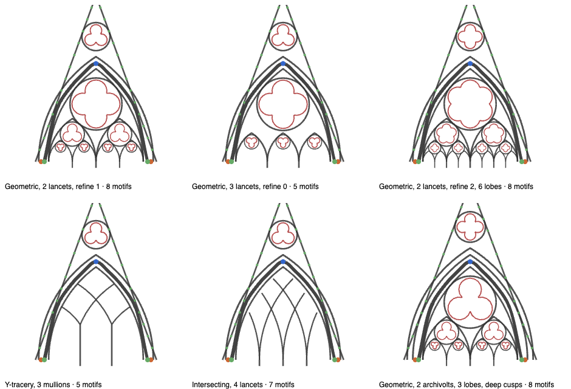
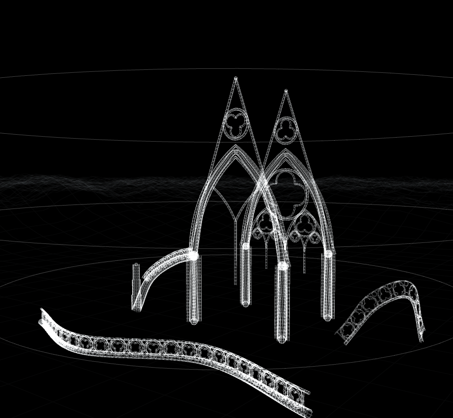
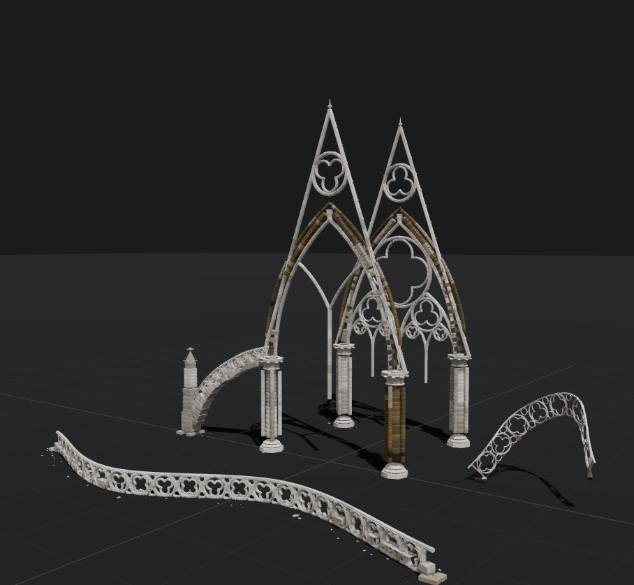
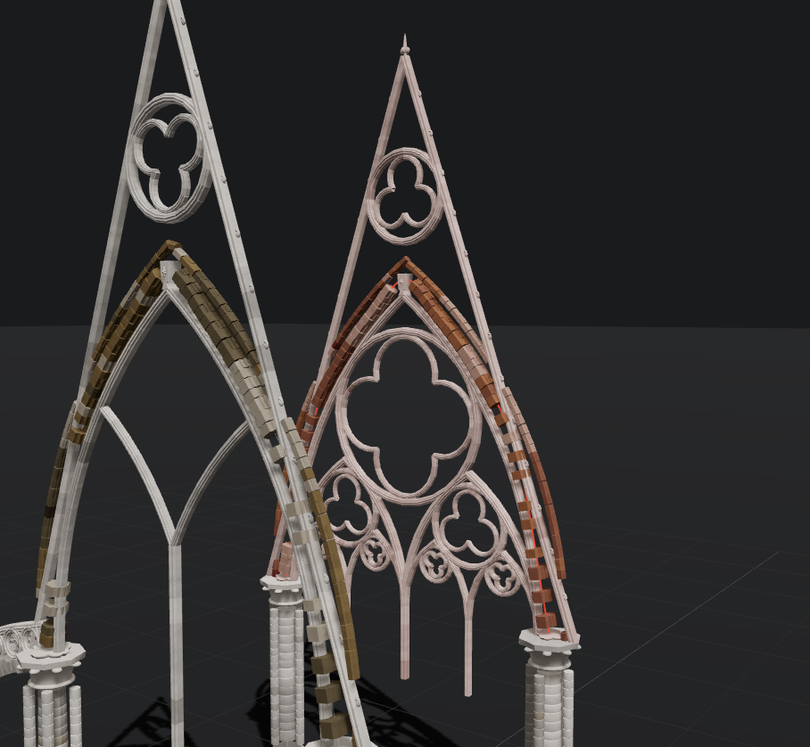
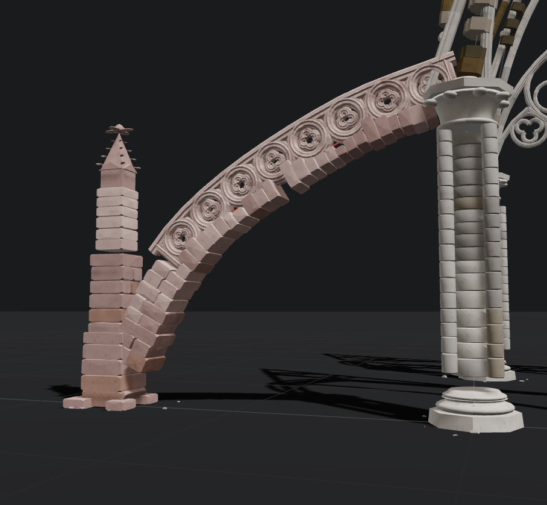
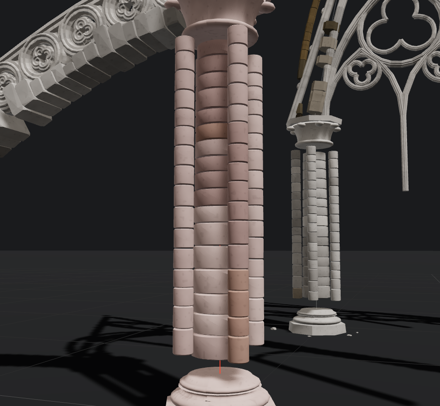
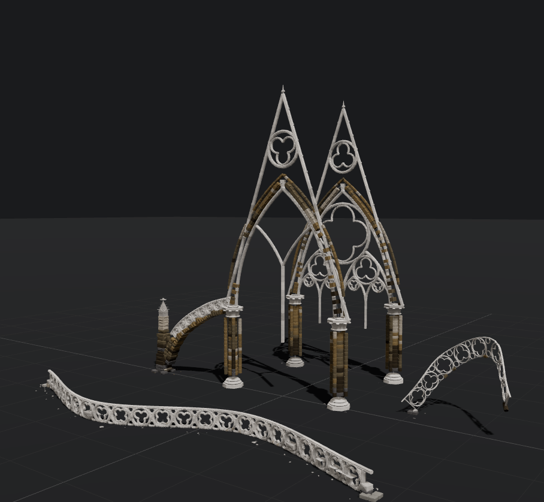
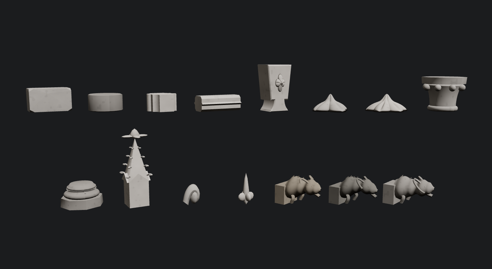
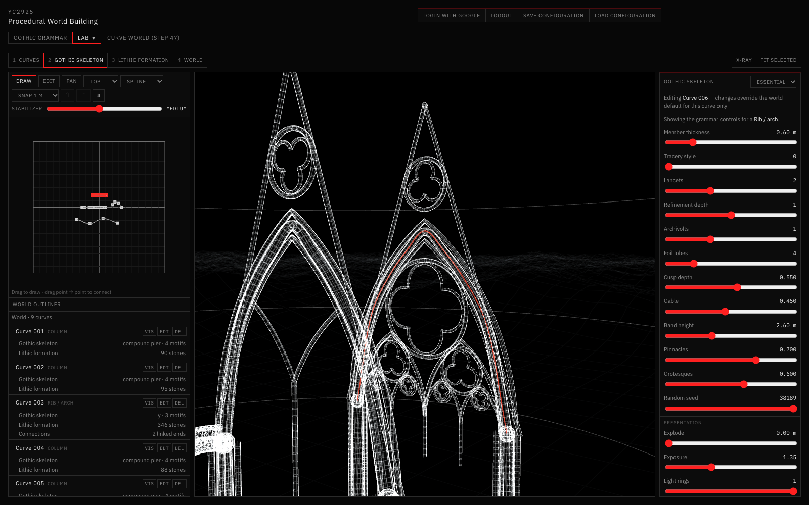
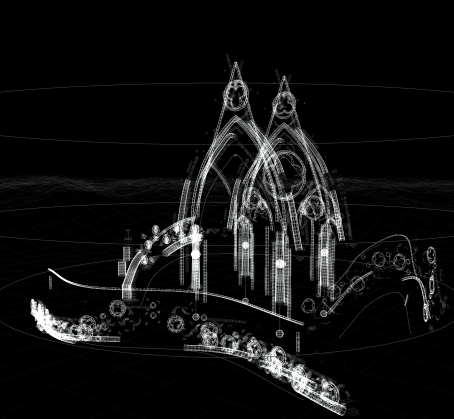

# Feedback round 2: tracery grammar and carved stone

This round makes two changes:

1. **Variation from Gothic geometry.** Each curve now varies through a compass-and-straightedge shape grammar instead of procedural (L-system-like) branching.
2. **Carved stone.** The masonry now uses dressed ashlar, moulded ribs and tracery bars, and carved elements (bosses, keystones, pinnacles, capitals, crockets, finials and grotesques). Colours come from a fixed ten-colour limestone and sandstone palette.

Source analysis: `gothic_tracery_mathematics_analysis.md` (yc2925, sections 2–11). The section numbers (§) below refer to that analysis.

## References used (opened before implementation)

| Ref | Used for |
|---|---|
| REF-006 | Foils from equal lobe circles on a regular polygon; circles tangent to arcs and lines (§4, §5) |
| REF-008, REF-001, REF-011 | Lancet subdivision, the oculus between lancets, mullion sections |
| REF-013 | A band of tangent circles between two rails, each filled with a foil, plus spandrel circles |
| REF-004 | Compound piers (shafts around a core), capitals, ribs springing from capitals, bosses at rib crossings |
| REF-007, REF-012 | Gables with crockets and a finial; pinnacles; a foil in the gable field (tympanum) |
| REF-003 | Bracket and corbel profiles: mouldings built from circular arcs |
| REF-018, REF-020 | Grotesques: bilaterally symmetric, skeletal and creature-like, carved in stone |
| REF-030 | Coursing logic for voussoirs and footings (kept) |

## 1. Construction kernel: `world/skeleton/construct2d.js`

The kernel uses only exact circles, lines and circular arcs. Bézier curves and noise are not used.

- **Two-centred arch** (§3).
  - Half-span `a`, centre offset `c = k·a`, radius `R = a + c`, rise `h = √(a² + 2ac)`.
  - The left arc is centred at `(+c, 0)` and the right arc at `(−c, 0)`.
  - Setting `k = 1` gives the equilateral arch (`h = √3·a`).
- **Offset arc** (concentric, §2): same centres, radius `R ± δ`. Used for archivolts and to inset the inner tracery from the arch.
- **Oculus between two lancets** (§5, §7).
  - The circle centre sits on the shared mullion axis `x = xₒ`.
  - It is internally tangent to the parent arch: `|O − C_parent| = R − r`.
  - It is externally tangent to both lancets: `|O − C_child| = R_child + r`.
  - Adding the two equations eliminates `r`: `f(y) = d₁(y) + d₂(y) − (R + R_child) = 0`. Both distances increase with `y`, so the root is found by bisection. Each tangency residual is stored.
- **Inscribed circle in an arch head**, sitting on a transom at height `yₜ`: `r = (R² − c² − yₜ²) / (2(R + yₜ))`. This is exact.
- **N-foil** (§4, §6).
  - `L` lobe circles of radius `λ·r` have centres `ρ = (1 − λ)·r` from the foil centre, at angles `θᵢ = φ₀ + 2πi/L`. Each lobe tip touches the enclosing circle, because `ρ + λr = r`.
  - The lower bound on `λ` is `sin(π/L) / (1 + sin(π/L))`, the value at which adjacent lobes touch. Above it they overlap; the cusp-depth control sets how far above.
  - The cusp is the outer intersection of adjacent lobe circles. Each lobe arc runs from cusp to cusp through its tip.
- **Spandrel circle on a rail**: given band circles of radius `ρ` spaced `2d` apart, the circle tangent to both band circles and to the rail has `r_s = d² / (4ρ)`. This is exact.
- **Gable foil**: a circle on the axis, tangent to both gable lines (distance to each line = `r`) and externally tangent to the arch extrados. Found by bisection.
- **Y-tracery and intersecting tracery** use the same arcs as the main arch:
  - **Y-tracery:** branches are concentric with the opposite main arc. Each branch ends at its circle–circle intersection with the main arch.
  - **Intersecting tracery:** each mullion foot carries both main-arch circles, translated to that foot. The arcs are clipped to the arch region (the intersection of the two arch discs).

## 2. Shape grammar per role: `world/skeleton/grammar.js`

| Role | Rule (exact geometry, mirror- or rotation-symmetric) |
|---|---|
| **Rib** that reads as an arch (`h/a ≥ 0.35`, rising) | An arch frame is fitted to the chord and apex. It adds archivolts (offset arcs) and subdivides the inset arch with one of three tracery styles: **Geometric** (lancets plus oculus plus foil, refined recursively), **Y-tracery**, or **Intersecting**. Optional extras: a foil in each lancet head, mullions dropping toward the ground (`screen`), and a gable with crockets, a finial and a tangent foil. A keystone sits at the apex. |
| **Rib** that does not read as an arch, and **Tracery** | **Tracery band** (REF-013): a top rail offset from the curve; tangent circles of diameter equal to the band height, each holding an n-foil; and spandrel circles from `d²/4ρ` against both rails. |
| **Column** | **Compound pier** (REF-004): `n` shafts at `2πk/n` around the core; a capital and a moulded base; `m` vault springers, which are quarter arcs leaving the capital vertically at `2πk/m`. A free top with no springers gets a pinnacle. |
| **Buttress** | **Pier** at the ground end with stepped setbacks, topped by a pinnacle, with a gargoyle (grotesque) facing outward; the flyer carries a tracery band. |
| **All roles** | Linked ends get a **boss**. Ground contacts get plinths (kept). |

Seed variation chooses only among symmetric grammar alternatives: the tracery style (in Auto), the lobe count per hierarchy level, the foil orientation, and the grotesque variant. There is no random growth.

## 3. Carved stone: `world/lithic/stones.js` and `world/compose/carving.js`

- **Ashlar:** chamfered hulls whose "dressing" goes from rough-hewn to finely dressed. Course heights and block lengths vary, so the blocks don't read as bricks.
- **Columns and shafts:** built of drums.
- **Ribs and archivolts:** moulded voussoirs (an extruded rib section).
- **Tracery:** each tracery member becomes a series of carved bar segments with a hollow-chamfered mullion section.
- **Carved prototypes**, each built from explicit geometry:
  - **Boss:** an n-foil rosette surface. Its outline is the foil boundary and its height is a domed profile with grooves at the cusps.
  - **Keystone:** an extruded wedge with a pendant drop and boss relief.
  - **Pinnacle:** a shaft with gablets, a square spire, crockets (tube sweeps along arcs) and a finial.
  - **Capital:** a lathe profile (astragal, a bell made of a concave circular arc, an octagonal abacus) with crocket hooks.
  - **Base:** an attic profile built from arcs.
  - **Grotesque:** a lofted body along a parametric spine, with jaw, eyes, swept horns and dorsal spines, mirror-symmetric.
- **Palette:** exactly the ten requested colours, assigned by material.
  - Limestone: `#b7b2ad`, `#a8a4a0`, `#928e8a`, `#8f867a`, `#7a7772`.
  - Sandstone: `#8f867a`, `#6f5d3f`, `#5b513f`, `#372e20`.
  - Weathered and dark: `#525050`, `#363331`.
  - **Stone mix** blends limestone with sandstone. **Weathering** darkens stones toward the ground. Carved pieces use fine limestone.
- **Material grain:** world-space value-noise fBm with bedding bands, added in the shader.

## Parameters

See the tooltips in the app. Every parameter is covered by the "changes the output" check in `npm run validate:world`. In the panel, skeleton parameters are filtered to the selected curve's role.

---

## Results

### Tracery systems (exact 2D construction, one drawn arch)

*All six variants come from the same drawn arch with different grammar parameters. They range from Geometric with 2–3 lancets and recursive refinement, to Y-tracery, to Intersecting tracery, and up to an octofoil. Each also gets a gable with a tangent foil, crockets, a keystone (blue) and grotesque corbels (orange). Every circle shown is solved from tangency constraints: the oculus is tangent to the parent arch and to both lancets, the head roundels to both arcs and the transom, and the gable foil to both gable lines and the extrados.*

### In the world

| Gothic skeleton (X-ray) | Lithic formation |
|---|---|
|  |  |

*This is the same demo world as the 11/16 session log: two bays of linked column–arch–column, a buttress, a ground wall and a tracery curve. It now reads as Gothic architecture: gabled arches carrying tracery, compound piers with capitals and moulded bases, a pinnacled buttress with a pierced flyer, and a pierced tracery parapet (REF-013).*

| Geometric arch (selected) | Buttress and compound pier |
|---|---|
|  |  |

| Column: drums, shafts, capital, base | Sandstone mix 0.85, weathering 1, dressing 0.15 |
|---|---|
|  |  |

### Carved stone prototypes (all procedural)

*Top row, left to right: ashlar, drum, moulded rib voussoir, hollow-chamfered tracery bar, keystone with rosette relief, quatrefoil boss, sexfoil boss, capital. Bottom row: attic base, pinnacle with crockets and finial, crocket, finial, three grotesques.*

### Panel and X-ray

| Skeleton panel (filtered to the selected curve's role) | X-ray with explode |
|---|---|
|  |  |

## Validation

`npm run validate:world`: **94 / 94 checks pass**. The new checks include:

- **Exact tangency.** Every oculus, foil, spandrel, head roundel and Y-branch has a residual of at most about 4·10⁻¹⁵ m. `validateSkeleton` rejects any residual of 10⁻⁶ or more.
- **Mirror symmetry.** Geometric tracery is symmetric about the arch axis to within 2·10⁻¹⁴ m.
- **No branching.** Every member is a named grammar element.
- **Each style builds its own system.** Geometric has an oculus and a foil; Y-tracery's branches end exactly on the main arch; Intersecting has six or more arcs. In Auto, the seed chooses between styles.
- **Role grammars.**
  - Band: rail, circles and spandrels.
  - Compound pier: 6 shafts on one ring, plus springers.
  - Buttress: a 3-stage pier, pinnacle and gargoyle.
  - Joints: a boss; the apex: a keystone.
- **Every skeleton and stone parameter changes the output.** Skeleton parameters are tested for their own roles. Dressing and irregularity change the render prototypes.
- **Palette.** Every stone colour is one of the ten requested colours (within ±3 % tone). Weathering darkens stones toward the ground. A stone mix of 1 builds in sandstone.
- **Masonry.** Carved tracery bars sit within 0.1 m of the construction curves. Crown voussoirs stand on end. Rib stones are graded larger at the base than at the top. Footings use varied block lengths. All 37 prototypes build.

## Files

- **New:** `world/skeleton/construct2d.js`, `world/skeleton/grammar.js`, `world/lithic/palette.js`, `world/lithic/protos.js`, `world/compose/carving.js`, `world/compose/stoneMaterial.js`
- **Rewritten:** `world/skeleton/members.js` (branching removed), `world/skeleton/params.js`, `world/lithic/stones.js`, `world/lithic/params.js`
- **Updated:**
  - `world/compose/geometry.js`, `world/compose/WorldViewport.jsx`, `world/compose/worldParams.js`
  - `world/editor/CurveEditor.jsx`, `world/ui/WorldPanels.jsx`, `world/ui/useStructureGeneration.js` (incoming links)
  - `world/model/project.js`: `PARAMS_REVISION` resets old masonry values; "Lift to pointed arch" now works on two-point curves
  - `world/curves/archLift.js`, `scripts/validate-world.mjs`

## Limitations

- **The grammar only knows the base vocabulary.** It does not yet build curvilinear or flamboyant tracery (mouchettes, daggers; analysis §5), rose windows, or vaults spanning several curves.
- **Bands follow curves approximately.** On strongly curved paths, the band circles are tangent to the rails only to first order. They are exact on straight runs.
- **Grotesques are simple.** They are lofted creatures built from simple primitives. They read as crouching beasts, but have none of the deep undercut detail of REF-018 or REF-020.
- **Stacking is geometric.** Stones are placed by rules, with no physics. Stones whose bounding spheres would overlap are dropped, and some joints are open.
- **Stone tones can still look patchy.** The sandstone tones contrast strongly, so sandstone members can look patchy at a high stone mix.
- **Saved projects reset some values.** Saved projects from before this round reset their masonry scale and taper to the new defaults (`PARAMS_REVISION` 2).
