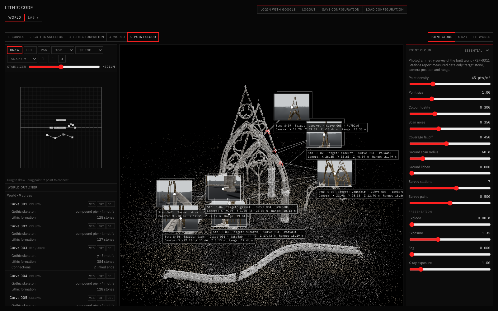
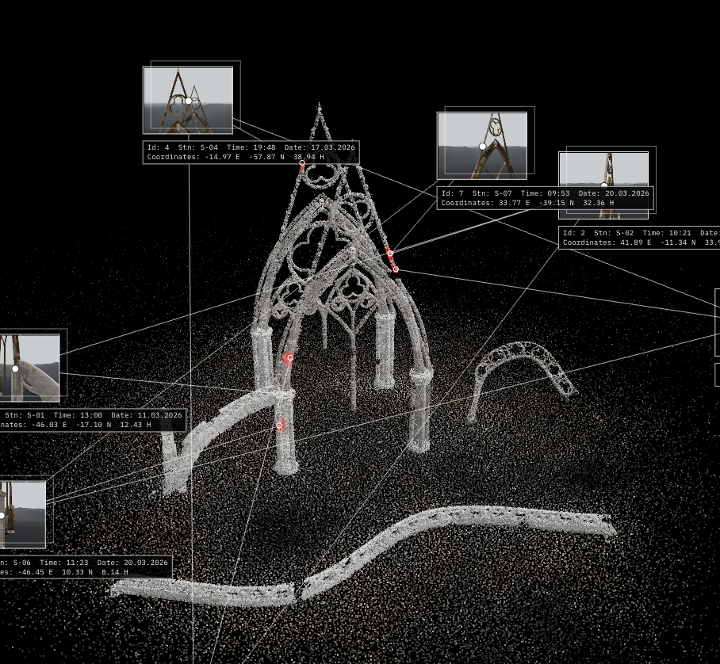
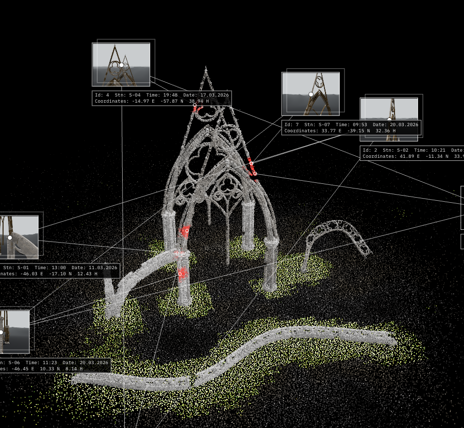
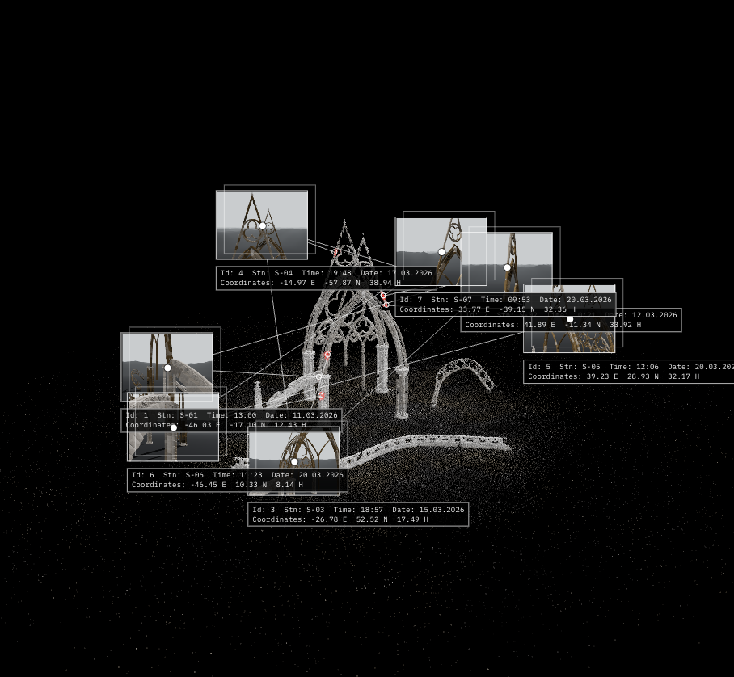

# Point Cloud view: photogrammetry survey (REF-031)

**Revision 2:** World (stage 4) is back to the solid stone view. The point
cloud is a World-only view mode: the **Point cloud** toggle next to **X-ray**
(both appear only in stage 4, and are mutually exclusive). While it is on,
the right panel shows the point-cloud sliders. **Fit world** is available in
every stage.

## Reference and mood (REF-031)

- Pure black void, no sky: nocturnal, forensic, archival.
- The subject is dense pale-grey points with daylight baked in. Colour survives only where it is strong (moss, red survey paint).
- The ground is a ragged scan patch that dissolves into sparse dust.
- The overlay is the only graphic language: photo frames, white dots, thin straight traverse lines, and monospace id / time / date / coordinate labels.

## Construction

| Element | Rule |
|---|---|
| Stone points | Each of the 37 carved prototypes gets 2000 area-weighted surface samples (triangle area CDF + √u barycentrics). For each placed stone, n = density × prototype area × (sxsy + sysz + szsx)/3; the samples are transformed by the stone's scale, rotation and position (plus explode offset). |
| Colour | Palette colour → linear, desaturated toward scan grey by `Colour fidelity`; × baked Lambert from the scene sun + sky term; × value-noise grain. |
| Coverage | Drop probability = coverage × smoothstep(0.25, 1.05, y / top) × 0.9, plus 3D-noise holes. |
| Scan noise | Depth jitter along the normal; floaters with probability 0.08 × noise, pushed out by an exponential distance at 55 % brightness. |
| Ground | Jittered grid (cell = 1/√density). Keep-probability is 1 inside 0.4 R and falls to 0 at R, with a 5 % dust tail to 1.8 R; the radius wobbles with fBm for a ragged edge. Earth tones are a continuous blend of #363331 → #525050 → #5b513f → #7a7772, with slope Lambert and speckle. |
| Lichen (opt-in) | fBm patches plus proximity to low stones (2 m grid). Defaults to 0 because VISUAL_DIRECTION's "no moss" negative still applies. |
| Stations | Golden-angle azimuths (2.39996 rad), heights by the golden ratio, ring distance 1.05–1.6 × the scene radius. Each station aims at the stone nearest a point 30 % of the way from the centre toward it. The camera (and the label coordinates) stands 42 % of the way from that stone back toward the ring. |
| Labels (measured only) | Station code; target stone kind, its curve, its palette colour; camera X / Y / Z in world metres; camera → target range. No invented times, dates or names. |
| Photographs | The solid stones and ground stay on render layer 1 (hidden from the main camera). Each station camera renders them into a 320×240 HDR target, only when the stations or the built world change (one per frame), shown as a fixed-size sprite. |
| Survey paint | Points within r = 0.5 + 1.8 × paint of each target, with a noisy edge, are blended to #ff2a2a. |

## Parameters (World → Scan & survey)

Point density, Point size, Colour fidelity, Scan noise, Coverage falloff, Ground scan radius, Ground density, Ground lichen, Survey stations, Survey paint, Photo size, Survey seed.

## Validation

`npm run validate:world` adds checks for:

- Surface-pool size and bounds.
- Point count proportional to density, finite values, and determinism.
- Every point lies on a stone when noise is 0.
- Coverage thins the cloud, and thins the top more than the base.
- Station metadata, and that each target is a real stone.
- Red paint at the targets.
- Ground density: dense centre, sparse beyond the radius, points on the terrain.
- Lichen is off by default.
- Every control has a default and a tooltip.

## Performance (revision 2)

The first version could crash the tab: every structure built up to 900k points, all were rebuilt on every edit, and the inner loop allocated arrays per point. It also re-rendered a photo every frame with 4× MSAA.

- **Point budget:** 1.5M stone points across the whole world (density drops, quantised, when the surface is large), at most 600k per structure, and 300k ground points.
- **Inner loop:** no allocations; the quaternion becomes a 3×3 matrix and points are written straight into preallocated Float32Arrays. Paint markers are pre-filtered per stone, and base proximity is a precomputed grid instead of string-keyed map lookups.
- **Off the render path:** clouds are built after edits settle (debounced, staggered per structure), and the previous cloud stays on screen meanwhile. Clouds are freed as soon as you leave the view.
- **Stable stations:** stations, and therefore paint and rebuilds, only change when the scene bounds, stone count, station count or seed change.
- **Photos:** rendered only when needed, without MSAA.

Measured in node on a 300 m arch: 243 ms → 95 ms per structure, 197 MB → 27 MB heap. Ground at maximum radius and density: 1.09 s → 0.35 s.

## Limitations

- Points are rebuilt on the CPU when stones or scan parameters change. Each structure is capped at 900k stone points; the ground at 2.5M grid cells.
- The photographs show only the solid model under a fixed overcast sky and get no post-processing.
- Labels have a fixed screen size, so they crowd when zoomed far out (reduce Photo size or Survey stations).
- Coordinates are local metres (E / N / H), not geodetic.
