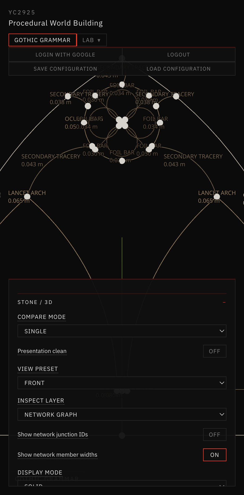
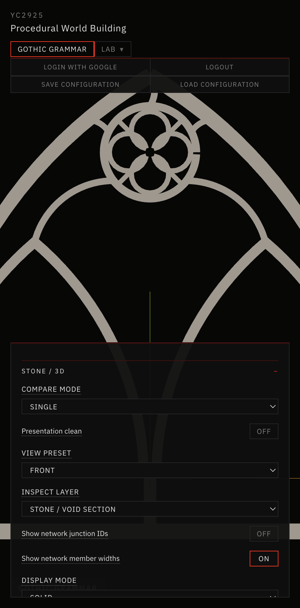
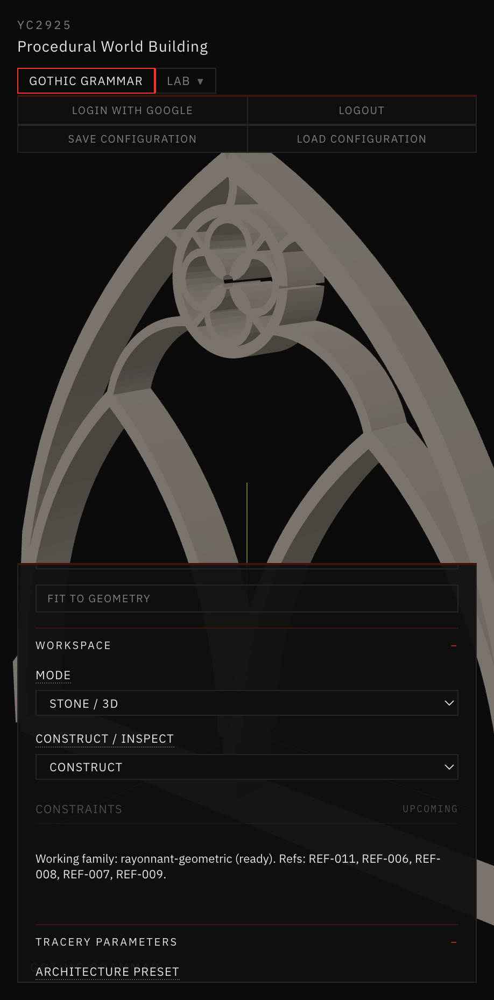
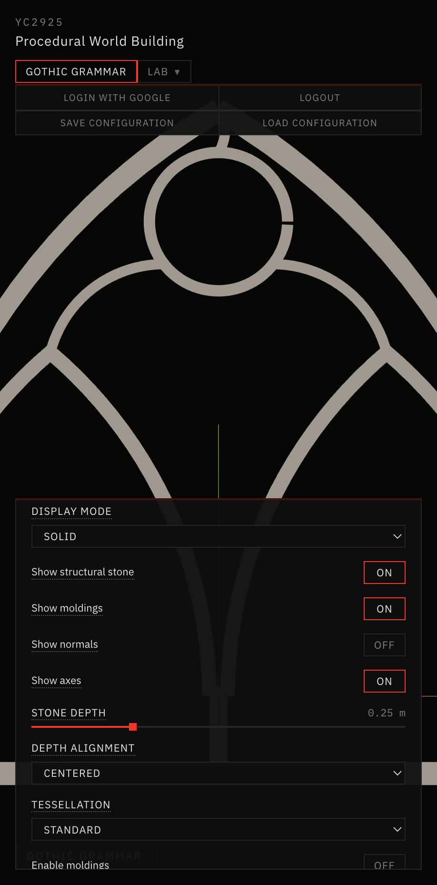

# 26 — Rayonnant Secondary Tracery & Foil Subdivision

Session date: **9 November 2026**. Tab: **Gothic Grammar → Stone / 3D**. Step **13D.7**.

Extends the validated Step **13D.6** connected oculus network with a geometrically constructed quatrefoil inside the oculus and symmetric secondary members in the upper side compartments. New preset: **Rayonnant Secondary Tracery**. Does **not** begin Step 13E. Prior presets including **Rayonnant Oculus Network** remain unchanged.

## References inspected

| ID | Geometric principle | Architectural feature | Historical observation vs computational use |
|---|---|---|---|
| **REF-007** | Continuous slender bars; open upper field | Skeleton reading of canopy bars | Observed: continuous members + voids. Computational: secondary side arcs + foil bars on strip-union skeleton |
| **REF-008** | Two-centered construction; nested arcs; centerline circles | Exact arcs + member-width hierarchy | Observed: construction plate. Computational: kernel arcs + foil grammar + strip offsets (REF-004 in the brief maps to vault aisle; geometric plate used is REF-008) |
| **REF-009** | High void/solid; continuous bar network | Porosity / silhouette target | Observed: radial rose density. Computational: density cue only — not rose grammar |
| **REF-011** | Bar tracery junctions; slender connected members | Continuous junctions; foil-to-ring | Observed: stone as network. Computational: strip-union secondary + foil radials |

Also read: `AGENTS.md`, `references/README.md`, `references/VISUAL_DIRECTION.md`, `references/reference-index.json`, `Docs/24-skeleton-first-rayonnant/README.md`, `Docs/25-connected-oculus-tracery/README.md`. Reference images REF-007 / REF-008 / REF-009 / REF-011 were readable on disk.

## Construction representation

Preserve skeleton-first:

**Exact centerlines → variable-width stone strips → polygon-clipping union → planar stone region → existing 13D extrusion.**

Representation id: `strip-union-secondary-tracery`. Never outer-panel-minus-holes for this preset.

## Presets (preserved + new)

| Preset | Openings (span 3) | Structural vol | Path |
|---|---|---|---|
| **Baseline 13D** | 3 | 0.909 m³ | Unchanged |
| **Rayonnant Refined** | 5 | ~0.99 m³ | Unchanged |
| **Rayonnant Bar Network** | 6 | 0.959 m³ | Unchanged |
| **Rayonnant Elaborate** | 9 | 1.215 m³ | Unchanged |
| **Rayonnant Skeleton** | 3 emergent voids | 0.324 m³ | Unchanged |
| **Rayonnant Oculus Network** | 5 emergent voids | 0.3635 m³ | Unchanged (`enableOculusNetwork`) |
| **Rayonnant Secondary Tracery** | 16 emergent voids | **0.3875 m³** | New `enableSecondaryTracery` |



*Inspect = Network Graph · Rayonnant Secondary Tracery · front · centerlines, foil bars, side secondaries, width labels.*



*Inspect = Stone / Void Section · light gray stone · dark voids · quatrefoil in oculus · symmetric upper side members · open negatives.*



*Inspect = Structural 3D · three-quarter · strip-union extrusion · watertight · vol 0.3875 m³ · 3272 tris · no moldings.*



*Step 13D.6 Rayonnant Oculus Network · stone section · ring + connectors only (no quatrefoil / no side secondaries). Compare against stone-section above.*

## Quatrefoil construction

Module: `app/src/geometry/gothicGrammar/tracery/skeleton/skeletonSecondary.js` (LEVEL ≥ 1 forces quatrefoil via `buildOculusNetworkGraph` + Step 13C foil grammar).

1. Quatrefoil constructed from explicit circular arcs, intersections, and proportional constraints (`buildQuatrefoil`)  
2. Four foil-bar members + four radial connectors to the oculus ring  
3. Each foil member carries stable ID, parent oculus ID, exact source curve, width, junction refs, construction metadata  
4. Foil-to-ring junctions resolve through the existing strip-union pipeline — not floating closed loops  

Parameters: **FOIL SCALE**, **FOIL CUSP DEPTH**, **FOIL ROTATION**, **FOIL BAR WIDTH RATIO**.

## Secondary subdivision rules

| Level | Geometry |
|---|---|
| **0** | Original 13D.6 oculus network only |
| **1** (default) | Quatrefoil + one curved secondary member per upper side compartment |
| **2** | Additional side bridges when mid-gap clears `MINIMUM WEB CLEARANCE` — otherwise reports constraint warning and keeps L1 |

Side compartments are derived from parent pointed arch, central oculus, and existing lancet-head connector angles (`midAngleCCW` between attach angles + `rayHitParentArch`). No rectangular bounding-box domain.

Each side member:

- Connects ring attach node ↔ parent-arch hit  
- Uses `buildConnectorPath` (exact arc or constrained segment)  
- Shares semantic graph with oculus ring (junction link to `member-oculus-ring`)

## Junction strategy

| Class | Handling |
|---|---|
| Structural | Positive strip overlap + polygon-clipping union; secondary ring nodes linked to oculus ring member |
| Decorative moldings | Deferred — not claimed mitered |
| Display / tessellation | Hard-edge normals from validated 13D extrusion; no kernel change for shading seams |

Do not claim cross-path moldings are perfectly mitered — that operation is not implemented.

## Stone strip union

Same 13D.5/13D.6 path (`skeletonStone`): sample centerlines → `polylineToStrip` → `polygon-clipping` union → one connected planar component. Emergent holes = extrusion voids.

Preserves original skeleton members, oculus ring, connectors, semantic hierarchy, stable member IDs.

## Parameter dependencies

Collapsible **Secondary Tracery** UI (Upper Tracery preserved):

| Control | Default |
|---|---|
| Subdivision level | 1 |
| Foil scale | 0.88 |
| Foil cusp depth | 0.55 |
| Foil rotation | 0° |
| Foil bar / frame | 28% |
| Secondary member / frame | 32% |
| Minimum clearance | 0.040 m |
| Side compartment subdivision | On (LEVEL 2 gate) |

Width hierarchy: OUTER FRAME › PRIMARY LANCET / MULLION › OCULUS RING › SECONDARY › FOIL.

## Graph connectivity (defaults, LEVEL 1)

| Metric | Value |
|---|---|
| Nodes | **33** |
| Members | **26** |
| Stone components | **1** |
| Emergent voids | **16** |
| Grammar stage | `13D.7-L1` |
| Representation | `strip-union-secondary-tracery` |

## Inspect modes (same geometry)

| Mode | Inspect layer |
|---|---|
| **NETWORK GRAPH** | `network-graph` |
| **STONE SECTION** | `section` |
| **STRUCTURAL 3D** | `structural` |
| **COMBINED 3D** | `combined` |

Left info panel: active preset **RAYONNANT-SECONDARY-TRACERY**, representation, grammar stage, graph node/member counts, stone components, structural volume, mesh validation. No stale **BASELINE 13D** when this preset is selected. Title: **Solid / Void · Rayonnant Secondary Tracery**.

## 2D acceptance

Front stone section: thin outer pointed arch · two primary lancets · central mullion · connected oculus · quatrefoil subdivision · symmetric secondary side tracery · open negative spaces. Gate **passed** (slender connected bars, no filled upper slab, quatrefoil attached to ring) → proceeded to 3D.

## 3D validation

```text
npm run validate:solid-void   # PASSED
npm run validate:stone-3d     # includes Step 13D.7 suite — PASSED
npm run build                 # PASSED
```

Defaults: watertight, 0 non-manifold, volume **0.3875 m³**, **3272** tris, planar hard-edge normals OK, spans 2.4 / 3.0 / 4.5 OK. LEVEL 2 bridges validate. Prior presets unchanged.

## Known limitations

- LEVEL 2 only adds clearance-gated side bridges — not nested lancets / multiple oculi / full rose grammar  
- Solid/panel proxy ratio warning can still fire (envelope-area heuristic; not a slab extrusion path)  
- No decorative moldings on this preset; junctions are boolean-union overlaps, not carved masonry nodes  
- Extreme foil scale / cusp / clearance can fail with explicit constraint errors (no silent tiny voids)  
- Not yet Step 13E assemblies, facade repetition, vaults, or pinnacles

## Readiness

Ready for further Rayonnant development on the same strip-union skeleton. Stop after **13D.7**.
