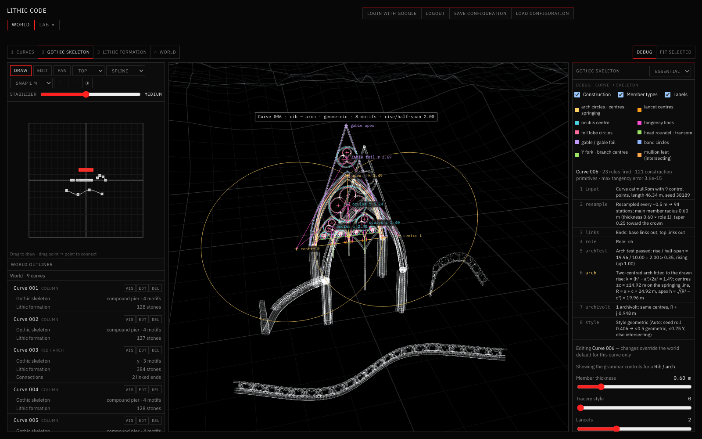
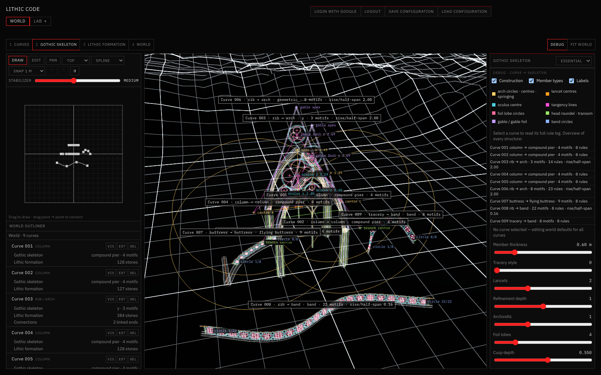
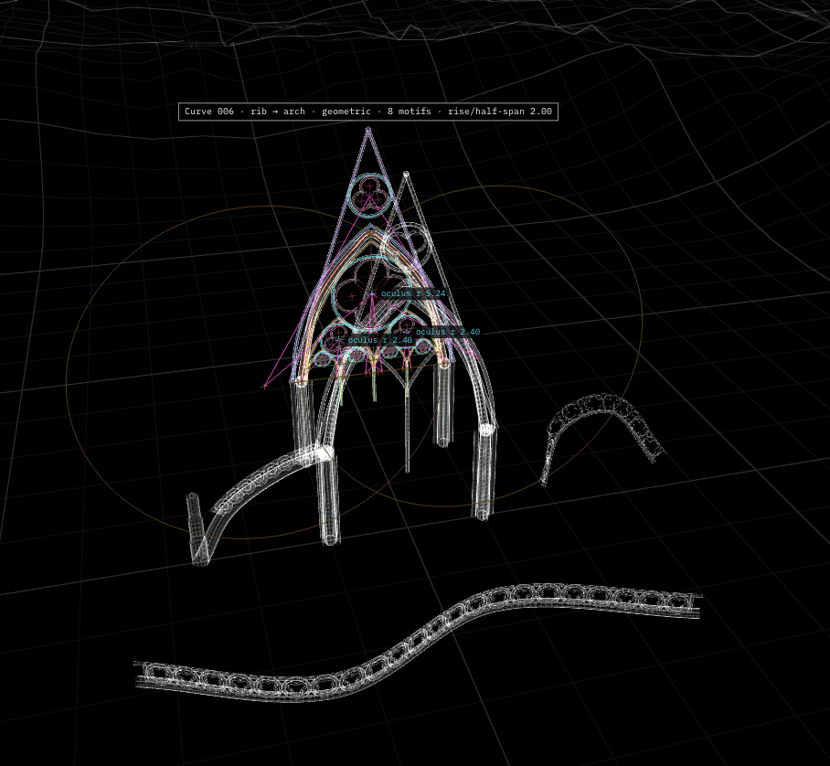
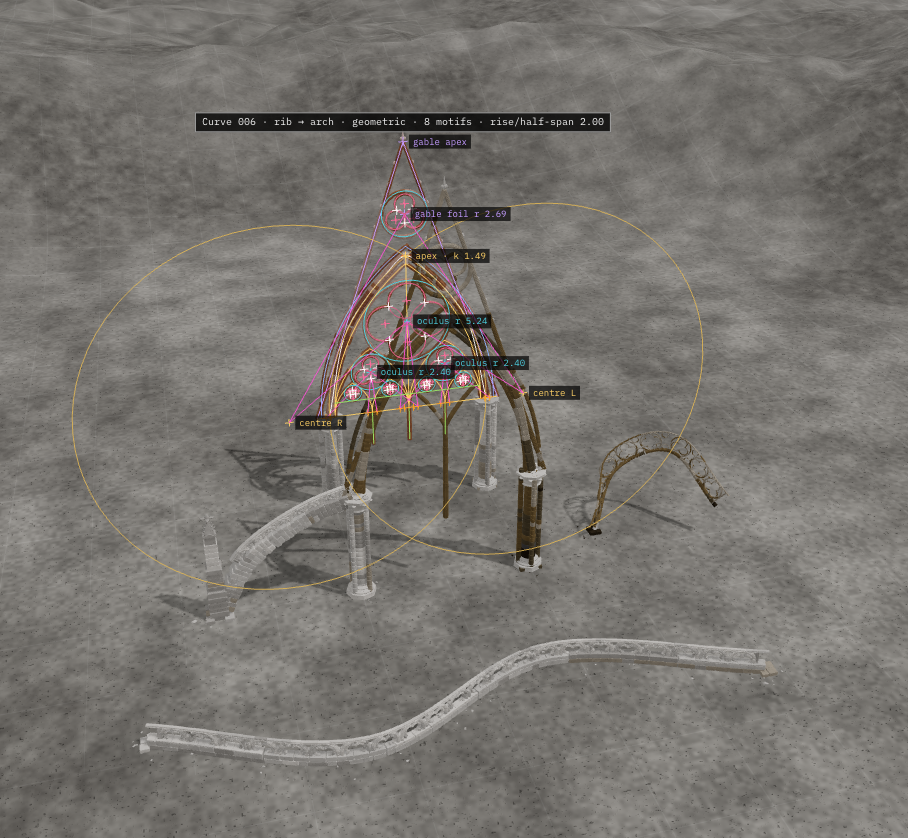
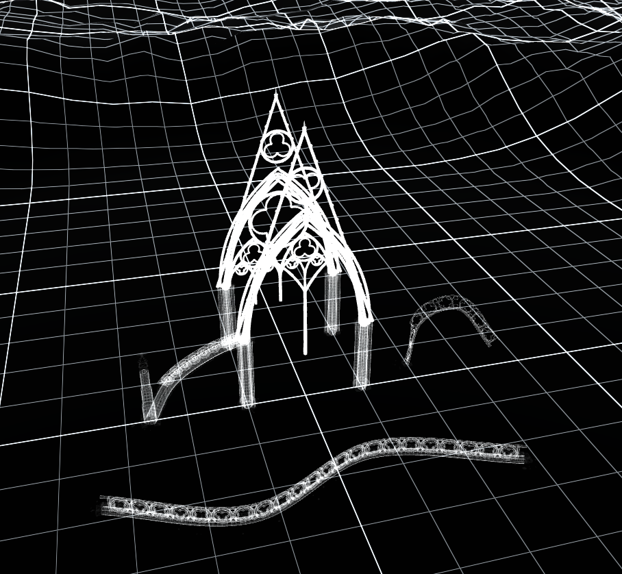
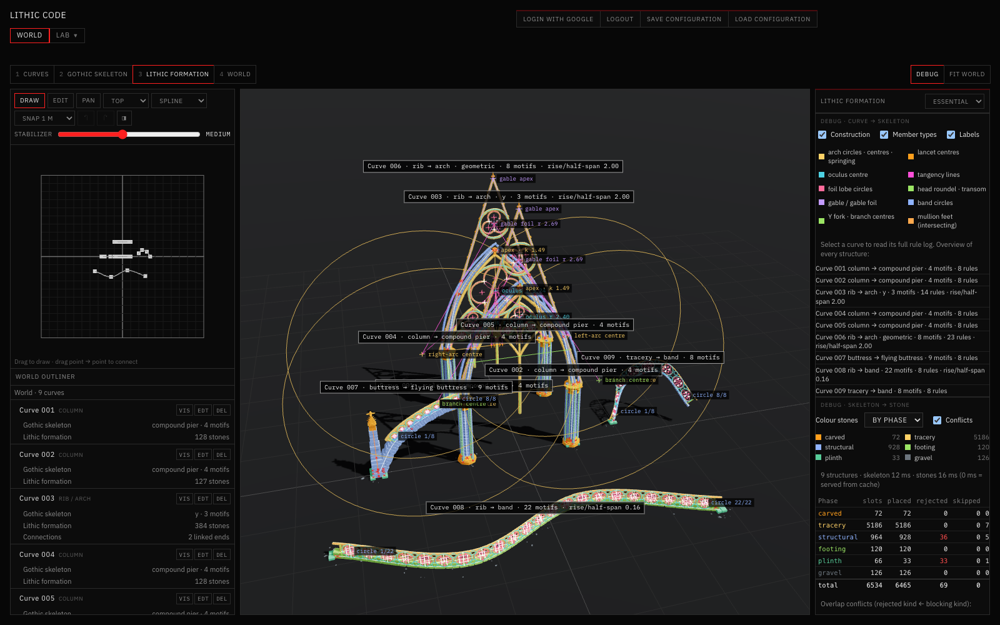
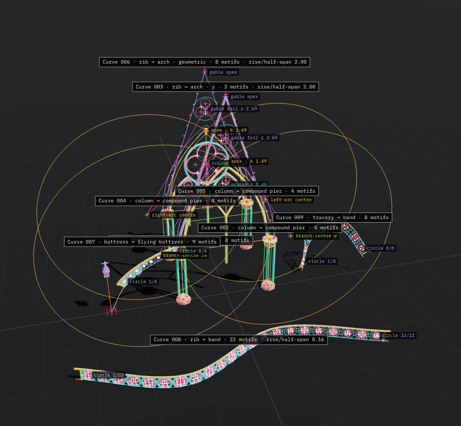
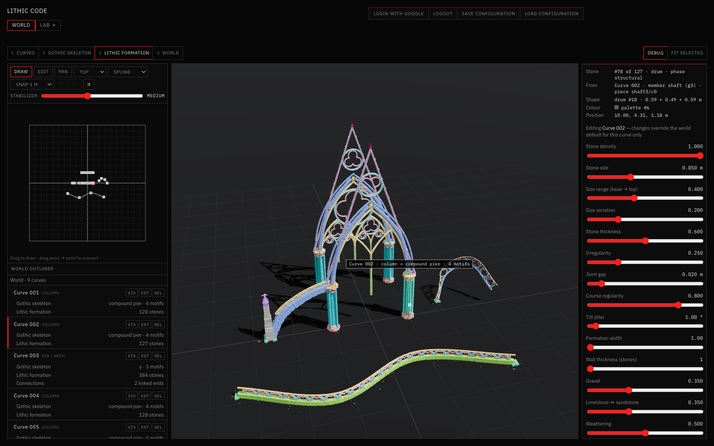

# 27 — Debug layers: curve → skeleton → stone

Session date: **20 November 2026**. Tab: **World**, with the **Debug** button (all stages).
These layers answer the Class 11 assignment, "visual debugging layers": reveal the internal data, the algorithms that drive the system, and the challenges that remain (performance, conflicts in logic). There is one layer per boundary of the pipeline:
- **Curve → skeleton**, where the decisions are made;
- **Skeleton → stone**, where conflicts and cost show up.

Both appear in the right panel when **Debug** is on.

## Part 1 — curve → skeleton

The curve → skeleton boundary is where Lithic Code makes its decisions. A drawn curve is read as an arch or as a band. A tracery style is chosen. Arcs, oculi and foils are constructed by tangency. Until now none of that was visible, only its result. The debug layer shows the rules that fired and the compass-and-straightedge construction behind every arch.

## What it shows

| Class 11 technique | In Lithic Code |
|---|---|
| Print to console → **event log overlay** | A **rule log** in the right panel for the selected curve, one numbered line per rule that fired, with its numbers. For example: "Arch test passed: rise / half-span = 19.96 / 10.00 = 2.00 ≥ 0.35", "Style geometric (Auto: seed roll 0.406 …)", "Oculus r = 5.24 m, 4-foil, tangency error 3.6e-15". |
| **Demonstrate procedural content** (rules, not only results) | The construction geometry drawn in 3D on the arch plane: <ul><li>full circles of both arcs of the two-centred arch, with their centres;</li><li>the springing line and the rise;</li><li>lancet centres at every subdivision depth;</li><li>each oculus centre and its tangency lines to the parent and lancet arc centres;</li><li>foil lobe circles and cusps;</li><li>the transom line and inscribed roundel of each lancet head;</li><li>the gable apex and gable foil;</li><li>band circles;</li><li>the Y-tracery fork and branch centres, and the mullion feet of intersecting tracery.</li></ul> |
| **Highlight entities by type** | **Member types**: every skeleton member's centre line coloured by kind (main, archivolt, subarch, mullion, oculus, foil, gable, rail, shaft, springer, pier). |
| **Data structure visualization** | The construction primitives are the data structure: every circle, centre and line that the 2D kernel (`construct2d.js`) solved. |
| **World-space labels** | A one-line summary above each structure (role → reading · style · motifs · rise/half-span) and labels on the key points (apex and k, arc centres, oculus radius, gable foil). |
| **Turn layers on and off** | Construction / Member types / Labels checkboxes. |
| **Select / inspect** | Selecting a curve, in the outliner or in 3D, limits the overlay to that structure and opens its full rule log. With nothing selected, an overview lists every structure. |
| **Focus** | Clicking a rule in the log or the legend keeps that rule's geometry bright and dims the rest. Focusing *oculus* also keeps its tangency lines. |
| **Deterministic seeds** | The log header line shows each curve's seed, and every seed roll is logged next to its threshold: tracery style, grotesques. |

## How it is built

- **Recording.** The trace is recorded where the decisions are made. `skeleton/grammar.js` returns `trace = { steps, geom }`:
  - `steps` is the ordered rule log (`{ n, rule, text, data }`).
  - `geom` is the construction geometry in world space, tagged by rule. It holds circles with centre and radius, points with optional labels, and lines.
  - Every 2D construction is mapped into the arch plane with the same map the members use (`W`), so the debug geometry lies exactly on the built structure.
- **Input facts.** `skeleton/members.js` adds the input facts first: control points, length, seed, resampling and radius, and which ends are linked.
- **Pure data.** The trace never changes what is generated. It is recorded every time, cached with the skeleton, and costs well under a millisecond per curve.
- **Rendering and panel.**
  - `compose/DebugLayer.jsx` draws the trace with depth testing off, so it shows through stone, X-ray and fog.
  - `ui/WorldPanels.jsx` shows the toggles, the legend and the rule log.
  - The debug state is UI-only and never saved in the project.

## Validation (`npm run validate:world`)

- The rule log is ordered and complete for an arch, a flat rib (it records *why* the arch test failed) and a column (shafts, springers).
- All construction geometry is finite.
- The drawn arch circles pass exactly through the apex (R = a + c, error < 1e-6). The debug drawing is the same math as the build.
- Every oculus has its tangency lines.

## Also in this session: X-ray terrain

In X-ray the terrain now glows: slopes catch light in relief, and it carries a 10 m grid and a brighter 50 m grid. A new **X-ray terrain** slider (0–4) controls it. The **Grid** button hides only the lines. The Gothic Skeleton stage keeps a quiet ground so the debug overlay stays readable.

## Part 2 — skeleton → stone

Stone placement is where the system's real challenges show:
- stones that want the same space where curves meet;
- density gaps;
- the time each phase costs.

| Class 11 technique | In Lithic Code |
|---|---|
| **Highlight entities by type** | *Colour stones*: **by kind** or **by phase**. Kinds: carved pieces are warm, structural stones cool, tracery pale, ground stones green and grey. The phases follow placement order: carved → tracery → structural → footing → plinth → gravel. The legend counts every kind or phase. |
| **Reveal conflicts in logic** | *Conflicts*: every slot rejected by the overlap test is marked with a red cross, plus a line to the stone that blocked it. Slots skipped by stone density get a grey cross. The panel lists the most common conflict pairs. In the demo scene: voussoir ← voussoir, voussoir ← crocket (the gable crockets crowd the arch ring), and plinth ← plinth where ground contacts sit close together. |
| **Performance overlay** | A per-phase table: slots, placed, rejected, skipped and ms, plus the total skeleton and stone build times. A time of 0 ms means the result came from the generation cache, because nothing upstream changed. |
| **Build the level step by step (timelapse)** | *Play build* or the slider reveals the stones in the exact order they were placed. Stones are stored in placement order, so the timelapse is the algorithm itself. |
| **Select objects / inspect data** | Click any stone to outline it and see its index and kind, its phase, the curve and skeleton member it came from, its piece, its carved shape and size, its palette colour and its position. |

**How it is recorded.**
- `lithic/stones.js` returns `trace = { slots, phases }`:
  - `slots` holds every placement attempt that did not become a stone: its outcome (skipped or rejected), phase, kind and piece. A rejected slot also stores the index and kind of the stone that blocked it; the overlap test now returns the stone it hit.
  - `phases` holds the per-phase counts and milliseconds.
- Placed stones carry their `phase`.
- Recording uses no random numbers, so placement is identical with or without it; a validator check confirms this.

**Validation.**
- The phase counts add up: slots = placed + rejected + skipped.
- Every unplaced slot is recorded.
- Every rejected slot names a real, nearby blocking stone.
- Stones are stored in placement order.
- Recording does not change placement.

## Limitations and next step

- The construction overlay follows the unexploded structure. With **Explode** above 0 the members move away from their construction.
- Labels are capped at 14 per structure. In the all-structures overview they can overlap; select a curve to read one cleanly.
- Stone colour modes apply to the solid views. In X-ray the stones are wire-mesh, so use the conflict marks there.
- Clicking a stone selects its curve. The curve → skeleton overlay then narrows to that structure; clear the selection to see every structure again.
- **Next ideas:**
  - a heatmap of conflicts on the ground plane;
  - a fix pass that trims voussoirs before crockets instead of rejecting them;
  - an event log of edits and rebuilds.
