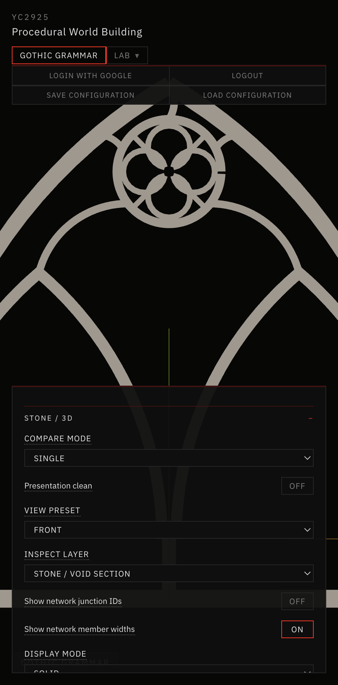
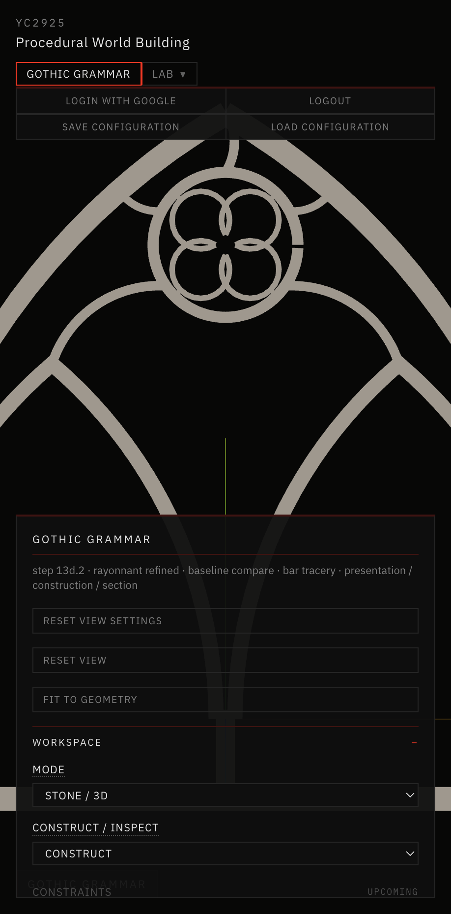
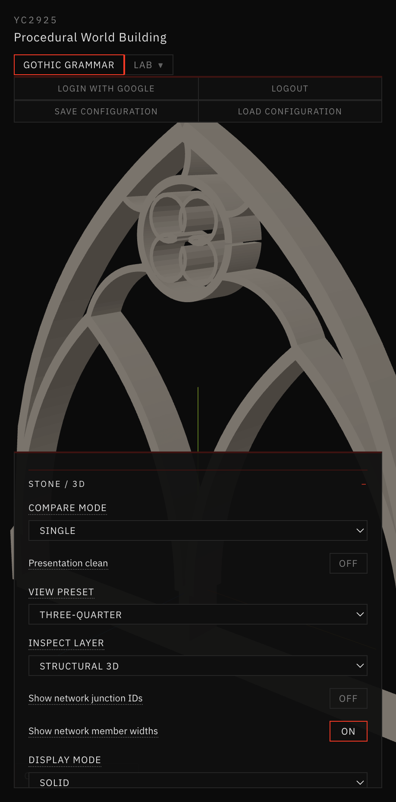
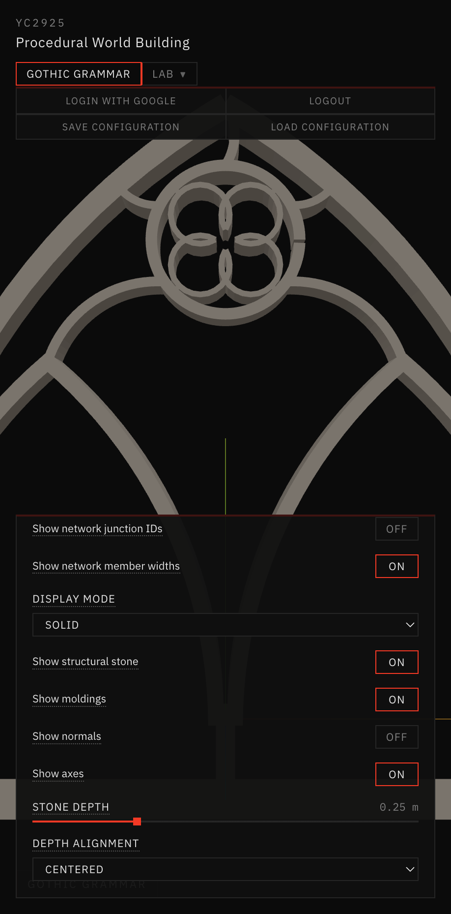

# 27 — Oculus & Junction Refinement

Session date: **9 November 2026**. Tab: **Gothic Grammar → Stone / 3D**. Step **13D.8**.

Refines the validated Step **13D.7** Rayonnant Secondary Tracery composition without adding lancets, openings, vaults, or pinnacles. New preset: **Rayonnant Oculus Refined**. **Rayonnant Secondary Tracery** remains an unchanged comparison preset. Does **not** begin Step 13E / 13D.9.

## References inspected

| ID | Role in this step | Index mapping (verified) |
|---|---|---|
| **REF-006** | Circle / foil construction plate — cusps, lobe centers, readable foils | `01-geometric-foundations/.../REF-006-plate-79-...` |
| **REF-007** | Slender canopy bars; assembly hierarchy (not facade modules) | `03-architectural-assemblies/pinnacles-and-facades/...` |
| **REF-009** | Monochrome porosity / silhouette presentation | `05-contemporary-visual-direction/monochromatic-gothic/...` |
| **REF-011** | Geometric bar tracery; foil-in-circle readability; apex clearance cue | `02-tracery-grammar/rayonnant/...` |
| **REF-013** | Junction / cusp relief detail (molding seams vs structural) | `04-three-dimensional-details/tracery-junctions/...` |

Also read: `AGENTS.md`, `references/README.md`, `references/VISUAL_DIRECTION.md`, `references/reference-index.json`, Docs 24–26. Attached 13D.7 screenshots inspected. All listed reference images were readable on disk.

## Root-cause diagnosis (13D.7)

| Symptom | Class | Cause |
|---|---|---|
| Uncontrolled central “knot” | **Structural geometry** | Foil-to-ring radials ran **cusp → ring**, crossing the cusp diamond and stacking four thick strips through the center |
| Bulky foil–ring joins | Structural + strip overlap | Same cusp radials + foil bar width ≈ cusp radius |
| Tight oculus–apex squeeze | Placement constraint | Apex gate used only `clearance × 0.5`; large radius ratios packed the oculus into the apex |
| Combined-3D seams / end caps | **Decorative moldings** | Per-void profile sweeps on tiny foil holes (not structural strip defects) |

## Construction representation

Unchanged skeleton-first path:

**Exact centerlines → variable-width strips → polygon-clipping union → planar stone → validated 13D extrusion.**

Representation id: `strip-union-oculus-refined`. Never outer⊕holes.

## Presets

| Preset | Flag | Notes |
|---|---|---|
| **Rayonnant Secondary Tracery** | `enableSecondaryTracery` | **Unchanged 13D.7** (`foilRadialMode: cusp-to-ring`) |
| **Rayonnant Oculus Refined** | `enableOculusRefinement` + secondary | Tip-to-ring foils, junction scale, apex clearance |

## Geometric construction changes

### Quatrefoil readability
- Tip-to-ring radials replace cusp-to-ring spokes (`foilRadialMode: tip-to-ring`)
- `centralJunctionScale` caps foil half-width vs min cusp radius → open central diamond
- Defaults: foil scale 0.88, cusp depth 0.65, foil bar / frame 20%

### Foil-to-ring junctions
- Stubs start outside the cusp diamond, length ≥ member width (avoids degenerate strips)
- Tip nodes linked to foil bars + ring; strip union remains the structural join
- No duplicate decorative caps on the structural mesh

### Oculus apex clearance
- `oculusApexClearance` (default 0.09 m) with ring-width floor
- On violation under refinement: **documented radius shrink** (warning), never silent arch distortion
- Defaults also lower vertical position (0.48) and radius ratio (0.70)

### Moldings
- Structural and decorative remain separate
- Tiny foil voids skipped for molding sweeps when refinement/secondary is active (area gate)
- Cross-path miters **not** claimed

## Parameters (Oculus Refinement UI)

| Control | Default |
|---|---|
| Oculus apex clearance | 0.090 m |
| Central junction scale | 0.55 |
| Foil-to-ring width | 82% of foil bar |

Existing foil scale / cusp / rotation / member-width controls preserved.

## Before / after



*13D.7 Rayonnant Secondary Tracery · stone section — cusp radials create a dense central knot.*



*13D.8 Rayonnant Oculus Refined · stone section — open central diamond, tip-to-ring stubs, deliberate apex gap.*


*Structural 3D · front · oculus / foil close reading.*



*Structural 3D · three-quarter · watertight strip-union · vol 0.3791 m³ · 3648 tris.*



*Close-up of oculus, quatrefoil lobes, and foil–ring junctions.*

## Validation

```text
npm run validate:solid-void   # PASSED
npm run validate:stone-3d     # includes Step 13D.8 suite — PASSED
npm run build                 # PASSED
```

Defaults: watertight, 0 non-manifold, vol **0.3791 m³**, **3648** tris, tip radials outside cusp diamond, foilW/2 < cuspR, apex clearance OK, spans 2.4 / 3.0 / 4.5 OK. 13D.7 preset regression OK.

## Known limitations

- Cusp meetings still thicken locally (intentional Gothic cusps) — not a radial knot, but not carved masonry nodes either  
- Extreme radius/vertical packing can still produce degenerate triangles; clearance gates report or shrink radius  
- No true mitered moldings across paths  
- Not Step 13E (assemblies / vaults / pinnacles)

## Readiness

Ready for further refinement or 13E planning. **Stopped after 13D.8.**
