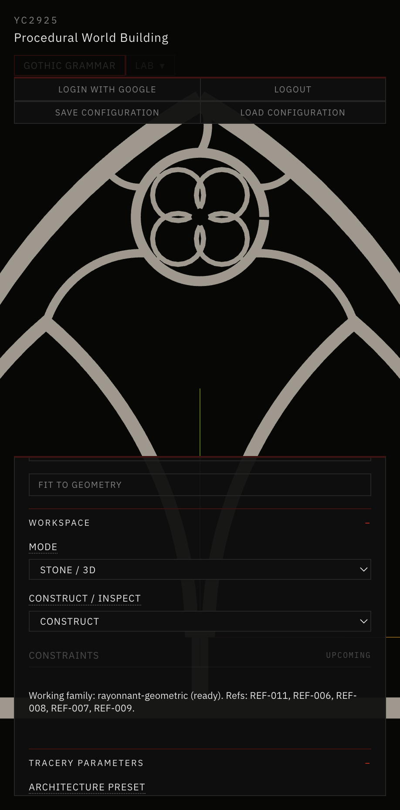
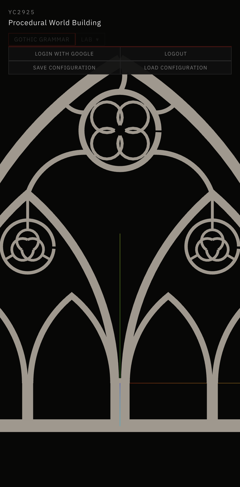
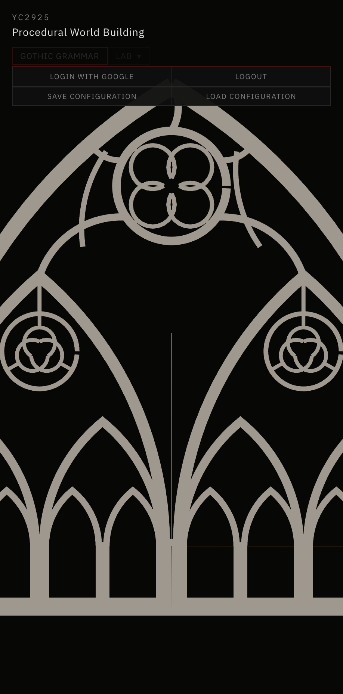
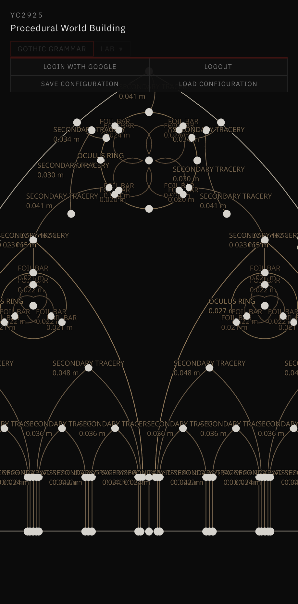
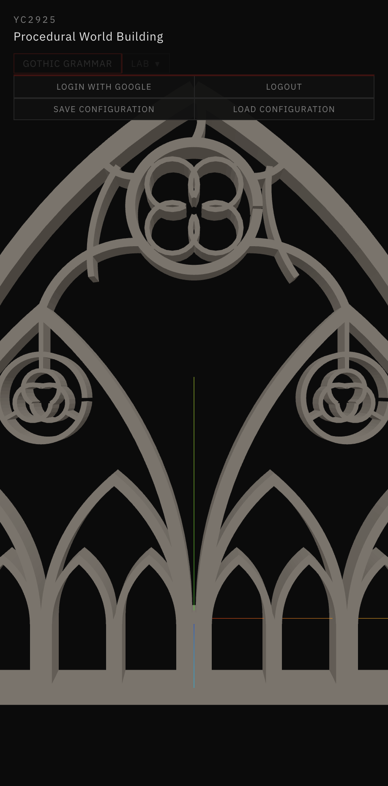
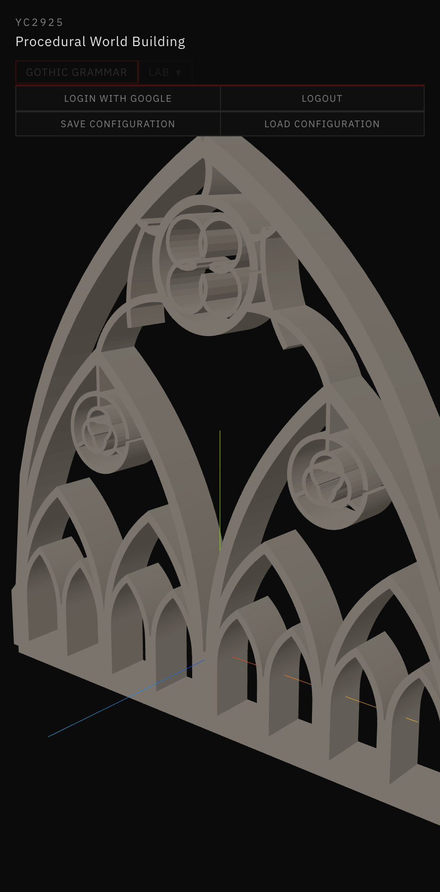

# 28 — Hierarchical Rayonnant Tracery Subdivision

Session date: **9 November 2026**. Tab: **Gothic Grammar → Stone / 3D**. Step **13D.9**.

Extends validated Step **13D.8** Rayonnant Oculus Refined into a recursive pointed-arch cell grammar. New preset: **Rayonnant Hierarchical**. All prior presets, including **Rayonnant Oculus Refined**, remain unchanged. Does **not** begin Step 13E.

## References inspected

| ID | Role in this step | Index mapping (verified) |
|---|---|---|
| **REF-007** | Slender member hierarchy / canopy bars | `03-architectural-assemblies/pinnacles-and-facades/...` |
| **REF-008** | Nested lancet / multi-light bar tracery | `02-tracery-grammar/rayonnant/...` (index-confirmed) |
| **REF-009** | Monochrome porosity / silhouette | `05-contemporary-visual-direction/...` |
| **REF-011** | Geometric Rayonnant bar tracery; junctions | `02-tracery-grammar/rayonnant/...` |
| **REF-016** | Tracery junction / cusp detail (index relevance) | `04-three-dimensional-details/...` |
| **REF-006** | Circle / foil construction plate (trefoil heads) | `01-geometric-foundations/...` |

Also read: `AGENTS.md`, `references/README.md`, `references/VISUAL_DIRECTION.md`, `references/reference-index.json`, Docs 24–27. REF-008 and REF-011 images were inspected on disk during preflight.

## Grammar rules

| Rule | Name | Behavior |
|---|---|---|
| **A** | Pointed arch subdivision | Field arch → two child pointed arches + shared mullion (`subdivideArchField` / 13B constructors) |
| **B** | Trefoil head | Eligible primary-bay head → enclosing ring + 13C trefoil + tip→ring stubs |
| **C** | Quatrefoil head | Optional; when trefoils OFF and `secondaryQuatrefoils` ON |
| **D** | Terminal | Clearance failure → preserve parent cell; record reason |

Maximum recursion depth: **2**. Depth 0 ≡ 13D.8 composition.

## Architectural cell

Each `ARCHITECTURAL_CELL` stores: stable id, parent id, hierarchy level, field arch / boundary, local origin, width/height, allowed rules, child ids, member ids, member class, constraint status/reason.

Kinds: `PARENT_ARCH`, `PRIMARY_LANCET`, `SECONDARY_ARCH`, `TERTIARY_ARCH`, `FOIL_HEAD`, `TERMINAL`.

## Recursive algorithm

1. Build 13D.8 refined secondary graph (base).
2. Seed parent + two primary lancet cells (level 0).
3. If depth ≥ 1 and nested arches ON: RULE A on each primary bay; optional RULE B/C in bay heads.
4. If depth ≥ 2: RULE A on accepted secondary arches only (foil heads deferred — tertiary clearance unreliable for tip stubs).
5. Strip-union stone via existing pipeline.

## Width hierarchy

`OUTER_FRAME` › primary lancets › `SECONDARY_ARCH` › `TERTIARY_ARCH` › `HIER_FOIL`, derived from master frame × ratios (`secondaryArchWidthRatio`, `tertiaryArchWidthRatio`, `hierarchicalFoilWidthRatio`, …). Child widths never exceed parent class.

## Clearance solver

Before accepting a subdivision: span vs mullion + jamb + `minOpeningClearance` / `minChildSpan`; containment of child arches; foil-in-circle; positive widths. Failures mark the cell terminal with a specific reason (no silent collapse).

## Construction representation

**Exact centerlines → variable-width strips → polygon-clipping union → planar stone → validated 13D extrusion.**

Representation id: `strip-union-hierarchical`. Never outer⊕holes.

## Preset defaults (Rayonnant Hierarchical)

| Control | Default |
|---|---|
| Subdivision depth | 1 |
| Nested arches | ON |
| Trefoil heads | ON |
| Secondary quatrefoils | OFF |
| Child arch span ratio | 0.5 |
| Child arch rise ratio | 1.05 |
| Secondary member / frame | 40% |
| Minimum opening clearance | 0.05 m |

## Validation results (default span 3.0 m)

| Depth | Members | Cells | Structural volume | Components | Watertight |
|---|---|---|---|---|---|
| 0 | 26 | 3 | 0.379 m³ | 1 | yes |
| 1 | 58 | 9 | 0.503 m³ | 1 | yes |
| 2 | 90 | 17 | 0.574 m³ | 1 | yes |

Spans 2.4 / 3.0 / 4.5 m, equilateral & lancet parents, trefoils ON/OFF, secondary quatrefoils ON: watertight. Existing presets regress clean. `npm run validate:stone-3d`, `validate:solid-void`, `npm run build` pass.

## Screenshots

*Depth 0 · Stone Section — 13D.8 oculus-refined baseline (no nested arches).*

*Depth 1 · Stone Section — nested pointed arches + trefoil bay heads.*

*Depth 2 · Stone Section — tertiary arches where clearance permits.*

*Network Graph · hierarchy coloring — L0 parent / L1 secondary / L2 tertiary / foil.*

*Structural 3D · front — slender open tracery, not a punched plate.*

*Structural 3D · three-quarter — watertight strip-union extrusion.*

*Comparison baseline · 13D.8 / Hierarchical depth 0 stone section (no nested arches). Compare with depth1-stone-section.png above for 13D.9 nested arches + trefoil heads.*

## Known limitations

- Tertiary (depth 2) foil heads deferred — tip→ring stubs at that scale floated or produced degenerate faces; RULE A only at L2.
- Depressed parent arches force lancet children; tertiary may terminate early.
- Junction blobs / strip overlaps at complex meetings inherit 13D.8 limitations.
- Solid-area metric now approximates outer − holes (more accurate for strip unions than outer-ring alone).
- Decorative moldings remain separate from structural stone.

## Architectural acceptance

Depth 1 visibly introduces nested pointed arches and trefoil heads connected to the centerline graph. Depth 2 adds further bay subdivision. Stone remains a single connected slender strip-union — not a solid plate with punched openings. **Accepted for 13D.9.** Stop before 13E.
