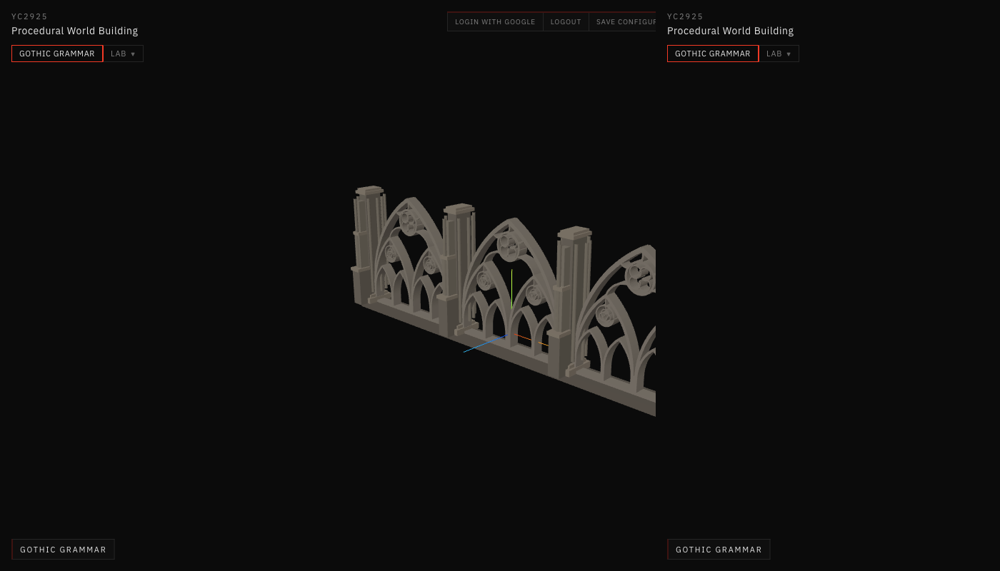
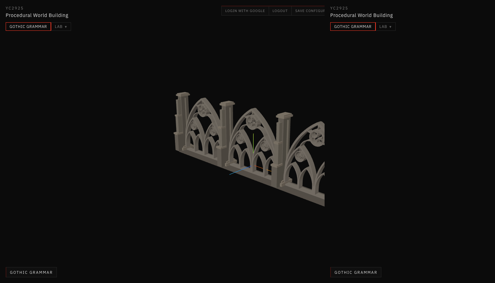
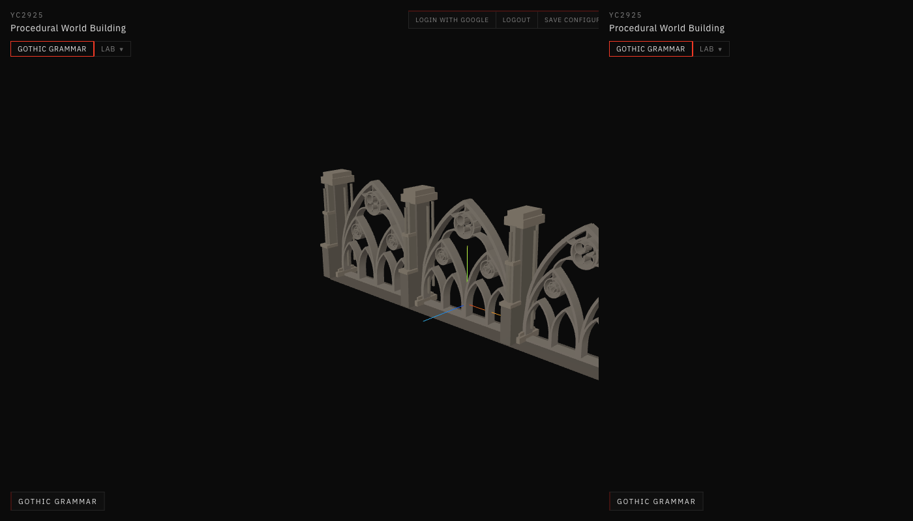

# 31 — Structural Controls Debug (13E.2.1)

Session date: **9 November 2026**. Correction pass only — **not** Step 13E.3.

## Problem

In Gothic Grammar → Architectural Assembly, these 13E.2 controls appeared to do nothing:

- Shaft Arrangement
- Shaft Projection
- Base Height
- Capital Height
- Buttress Setback Count
- Buttress Setback Ratio

## Pipeline audit

For each control the path is:

`AssemblyControls onChange` → `settings.assembly` → `facadeAssembly` `useMemo` deps → `buildGothicFacadeElevation` → `buildArticulatedSupport` / clustered pier / stepped buttress → `AssemblyMeshes` → viewport.

| Stage | Status before fix |
|---|---|
| UI onChange | Wired correctly |
| React state | Updated correctly |
| useMemo deps | Present for all six params |
| Generator args | Passed through |
| Generator math | **Responded**, but deltas were below facade-scale visibility |
| Mesh remount | Risk of stale BufferGeometry when part ids stayed similar |
| Style applicability | Controls looked active even for Simple supports |

**Root cause (shared):** the parameter pipeline was largely intact. The failures were **visual non-reactivity** (too-weak dimensional levers + low contrast) plus **UI applicability** (active-looking controls when the support style omitted those parts). Not a missing `onChange`.

## Per-control root causes and fixes

| Control | Root cause | Fix |
|---|---|---|
| Shaft Arrangement | Counts already changed (1/4/8) but shafts were thin, low-contrast, and hard to read at facade framing | Larger default shaft radius; hierarchy tint for SECONDARY; live `shafts N` readout |
| Shaft Projection | Offset used `halfExtent * t + 0.35·r` → only ~9 cm across the slider | New `shaftCenterOffset`: clear face + proud lever (~0.25→0.49 m mean offset) |
| Base Height | Height changed, but footprint barely moved — looked like no edit | Base footprint scales with height (`1.35 + 1.8·h`) |
| Capital Height | Same subtlety at pier head | Capital overshoot scales with height; darker TERTIARY tint |
| Setback Count | Stage count already changed; stages were short and depth-only | Equalized stage heights; live `stages N` readout |
| Setback Ratio | Width used `√ratio` (weak); depth-only steps hard to see from front | Each stage multiplies **projection and width** by the ratio |

Additional hardening:

- Mesh keys include bounding fingerprints so BufferGeometry always remounts on param edits.
- Shaft / buttress / base–capital controls **disable** with an explicit hint when Support Style is Simple (or otherwise inapplicable).
- Live pier diagnostics in the panel: `shafts · offset · base · capital · stages`.

## Camera regression

Orbited to a custom pose, then swept all six controls.

| Check | Result |
|---|---|
| Camera position delta | **0** |
| Orbit target | Unchanged |
| Geometry metrics | Updated each edit |

Camera persistence from 13E.2 was not reintroduced (`fitToken` is not bumped on assembly patches).

## Reactivity validation

```bash
npm run validate:structural-controls
```

Measured (Combined, 3 bays):

| Control | Value A → B | Measured delta |
|---|---|---|
| Shaft Arrangement | simple / four / multi | shaft counts **1 / 4 / 8** |
| Shaft Projection | 0.1 → 0.9 | mean offset **0.252 → 0.493 m** |
| Base Height | 0.1 → 0.4 | base extent **0.096 → 0.384 m** |
| Capital Height | 0.08 → 0.32 | capital extent **0.075 → 0.299 m** |
| Setback Count | 2 → 5 | stages **2 → 5** |
| Setback Ratio | 0.55 → 0.88 | stage-2 proj **0.106 → 0.271**, width **0.089 → 0.228** |

Also: `validate:architectural-assembly`, `validate:camera-persistence`, `validate:solid-void`, `validate:stone-3d`, `npm run build` — all pass.

## Screenshots

Same three-quarter camera for each pair (Architectural Assembly · 3 bays · Combined).


*Shaft Arrangement = Four-Shaft (4 engaged shafts).*



*Shaft Arrangement = Multi-Shaft (8 engaged shafts).*



*Shaft Projection ≈ 0.05 — shafts near core.*


*Shaft Projection ≈ 0.95 — shafts proud of core.*


*Base Height = 0.10 m.*


*Base Height = 0.42 m — taller and wider plinth.*


*Capital Height = 0.08 m.*



*Capital Height = 0.34 m.*


*Buttress Setback Count = 2.*


*Buttress Setback Count = 5.*


*Buttress Setback Ratio = 0.55 — aggressive taper.*


*Buttress Setback Ratio = 0.88 — shallow taper.*

## Files modified

- `app/src/geometry/gothicGrammar/assemblies/articulatedSupport.js` — amplified rules + semantic measures
- `app/src/geometry/gothicGrammar/assemblies/assemblyTypes.js` — stronger defaults
- `app/src/geometry/gothicGrammar/assemblies/facadeElevation.js` — live articulation metrics
- `app/src/geometry/gothicGrammar/assemblies/AssemblyMeshes.jsx` — hierarchy contrast + remount keys
- `app/src/geometry/gothicGrammar/assemblies/index.js` — exports
- `app/src/ui/GothicGrammarPanel.jsx` — applicability gating + live readout
- `app/src/ui/Controls.jsx` — Select `disabled`
- `app/scripts/validate-structural-controls.mjs` — reactivity tests
- `app/package.json` — `validate:structural-controls`

## Remaining limitations

- At full-facade distance, shaft cylinders remain thinner than pier cores; close-up / three-quarter still needed for fine judgment.
- Buttress setbacks are clearest in three-quarter / side; front elevation under-reports depth.
- Supports remain multi-object placeholders — not carved moldings or flying buttresses.
- Docs/30 was not authored in the prior truncated session; this folder is the 13E.2.1 correction record.
