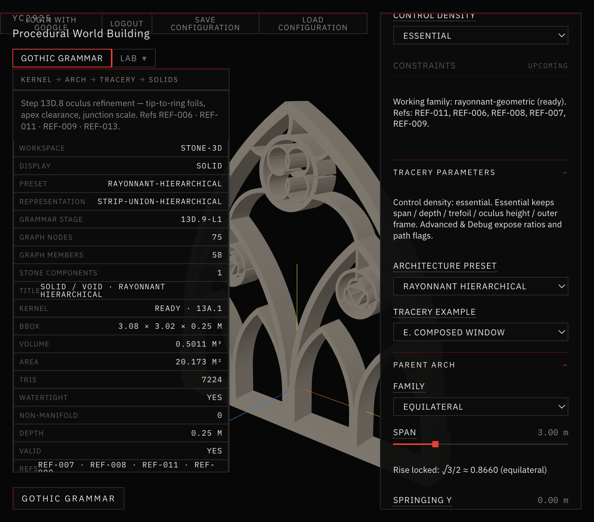
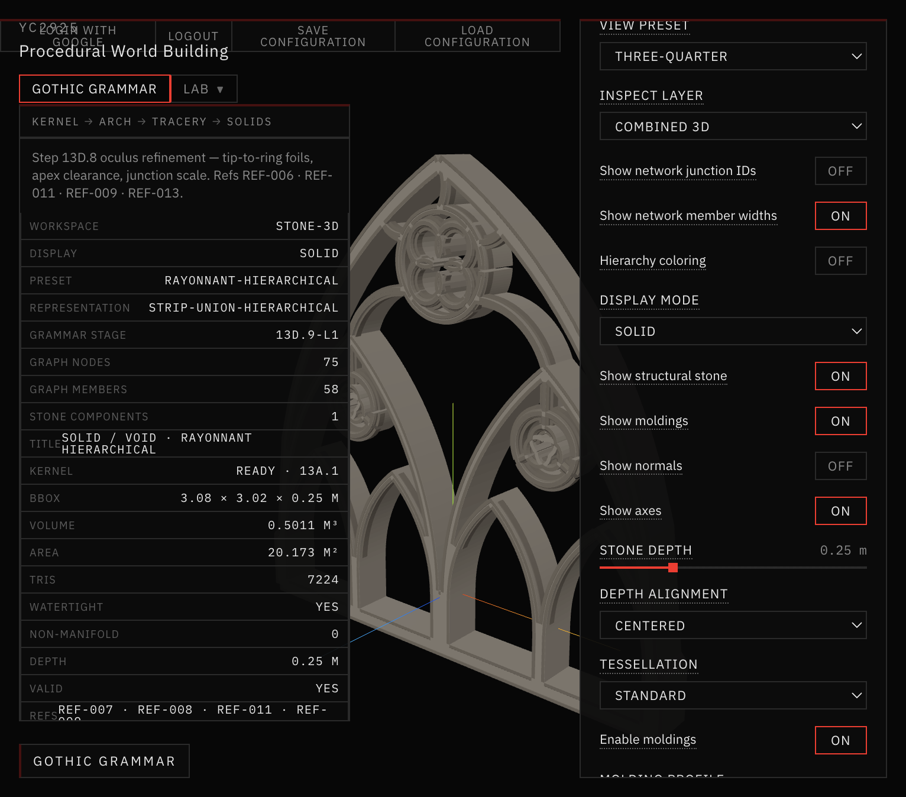

# 33 — Parameter Audit & UI Consolidation (13E.3.1)

Session date: **9 November 2026**. Correction pass only — **not** Step 13E.4 / 14A.

## Mission

System-wide audit of Gothic Grammar controls: find parameters that do not affect geometry, fix the five user-reported bugs, consolidate the UI into Essential / Advanced / Debug, preserve camera persistence.

## References inspected

| REF | Role |
|---|---|
| REF-008 | Tracery construction / section — frame width, oculus band |
| REF-011 | Rayonnant bar tracery — foil / mullion hierarchy |
| REF-006 | Foil constructions — trefoil vs quatrefoil |
| REF-004 | Clustered supports (assembly controls) |
| REF-013 | Junctions / relief (molding visibility) |

Mapped through `references/reference-index.json`. Images were read.

## Priority bug outcomes

| Control | Verdict | Root cause | Fix |
|---|---|---|---|
| **Trefoil** | Fixed | `foilType` ignored on hierarchical; live key is `trefoilHeads` | Bridge foilType ↔ trefoilHeads; depth-0 hint |
| **Oculus height** | Fixed (skeleton) | Parallel key + radius-max solver ignored slider | Alias keys; `honorHeightRatio` on skeleton path |
| **Outer frame width** | Fixed | Wrote `outerFrameWidth` only; skeleton reads `masterFrameWidth` | Sync both; normalize prefers outer |
| **Min stone web** | Clarified + wired | Warning-only / unused on hierarchical | Clearance floor via normalize; active/inactive diagnostics |
| **Molding** | Fixed (wiring) | Hierarchical presets force OFF; Enable did not force Show | Toggle enables + showMoldings + readable profile defaults |

## Validation

```bash
npm run validate:parameter-audit
npm run validate:solid-void
npm run validate:stone-3d
npm run validate:architectural-assembly
npm run validate:structural-controls
npm run validate:camera-persistence
npm run validate:surface-semantics
npm run build
```

All passed after the oculus dual-mode fix (composed keeps legacy placement; skeleton honors height).

## Screenshots



*Rayonnant Hierarchical · Essential density · moldings off (preset default).*



*Same camera · Enable moldings ON → 46650 decorative tris; profile width bumped for readability.*

## Companion docs

- [PARAMETER_REGISTRY.md](PARAMETER_REGISTRY.md)
- [BUG_FIXES.md](BUG_FIXES.md)
- [UI_CONSOLIDATION.md](UI_CONSOLIDATION.md)
- [TEST_RESULTS.md](TEST_RESULTS.md)

## Stop

No vegetation. No 13E.4 / 14A.
