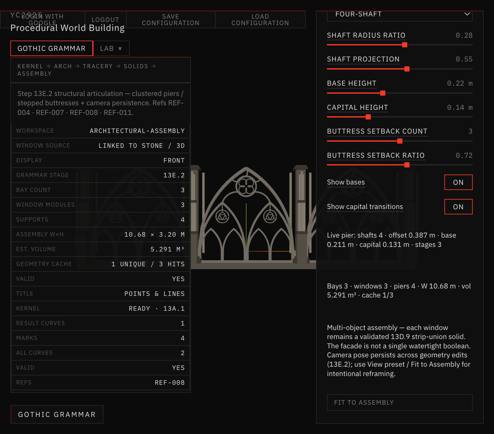

# Docs/34 — Unified Gothic Window Module (13E.3.2)

Stone / 3D and Architectural Assembly now share one procedural window generator and one window-design parameter object.

References: REF-008, REF-011, REF-004, REF-007, REF-006, REF-009.

## Problem

Assembly previously forced Rayonnant Hierarchical defaults and ignored Stone / 3D edits (only `hierarchicalDepth` was forwarded).

## Solution

- `generateGothicWindowModule` — authoritative entry (wraps validated `buildStoneAssembly` / 13D.9).
- `resolveWindowDesignParams(settings)` — shared `tracery` + `stone`.
- Assembly bays consume that design when **Linked to Master** (default).
- Preset **Rayonnant Facade Module** recreates the preferred Assembly window as editable Stone / 3D geometry.
- Frozen **Assembly Rayonnant — Legacy Snapshot** documents the pre-sync appearance.

## Docs in this folder

| File | Contents |
| --- | --- |
| [GENERATOR_AUDIT.md](GENERATOR_AUDIT.md) | Pre-refactor pipeline split |
| [PARAMETER_MAPPING.md](PARAMETER_MAPPING.md) | Ownership + mapping table |
| [SYNC_TESTS.md](SYNC_TESTS.md) | `validate:shared-window-module` |
| [VISUAL_COMPARISON.md](VISUAL_COMPARISON.md) | Screenshots |

## Quick visual

*Linked to Stone / 3D · Facade Module · Front · 1 unique geometry / 3 cache hits.*

## How to use

1. Stone / 3D → Architecture preset → **Rayonnant Facade Module**.
2. Edit oculus / foil / frame / depth / moldings as usual.
3. Switch to Architectural Assembly — windows update automatically.
4. Or use **Edit Window Module** from Assembly Layout (no camera reframe Stone↔Assembly).

## Limits

- Custom Override is stubbed (falls back to legacy snapshot; no per-bay editor yet).
- Bay width still scales the shared module to fit the clear bay.
- Default Stone preset remains Baseline 13D until the user selects Facade Module / Hierarchical.
