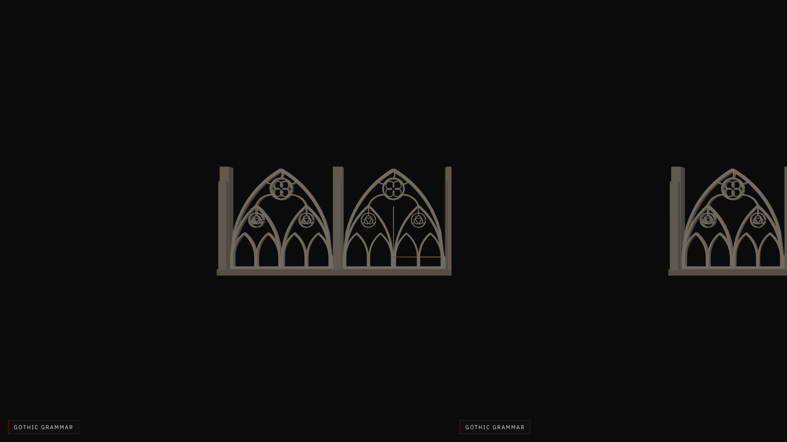
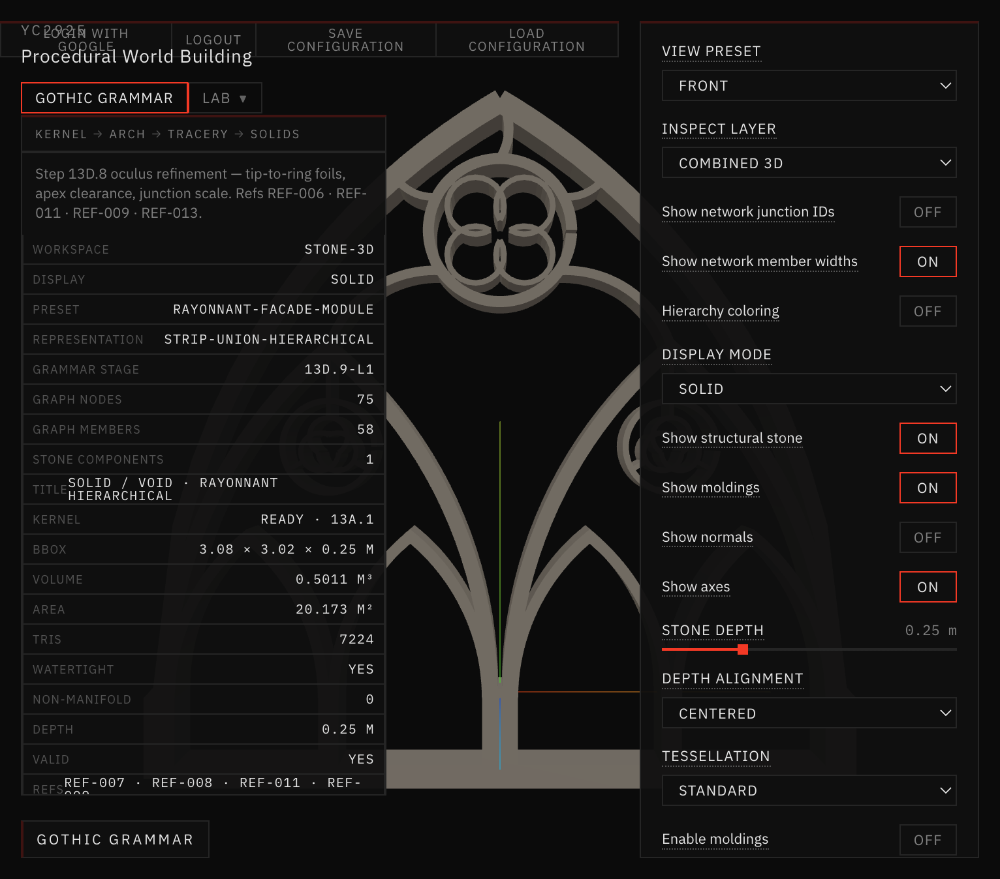
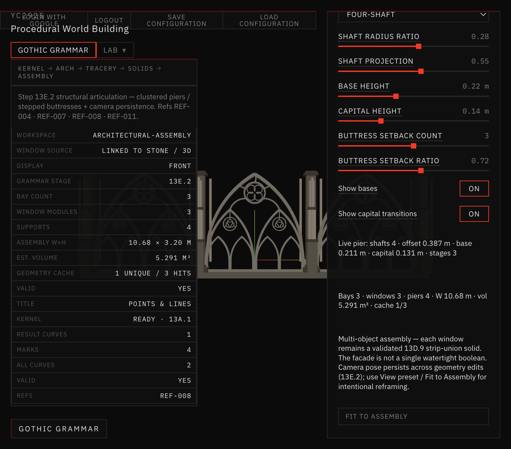
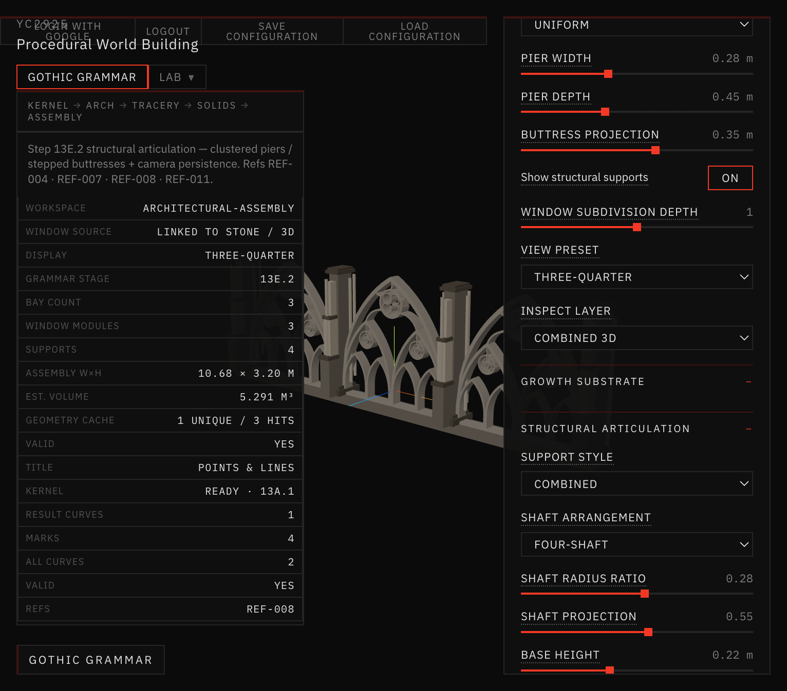
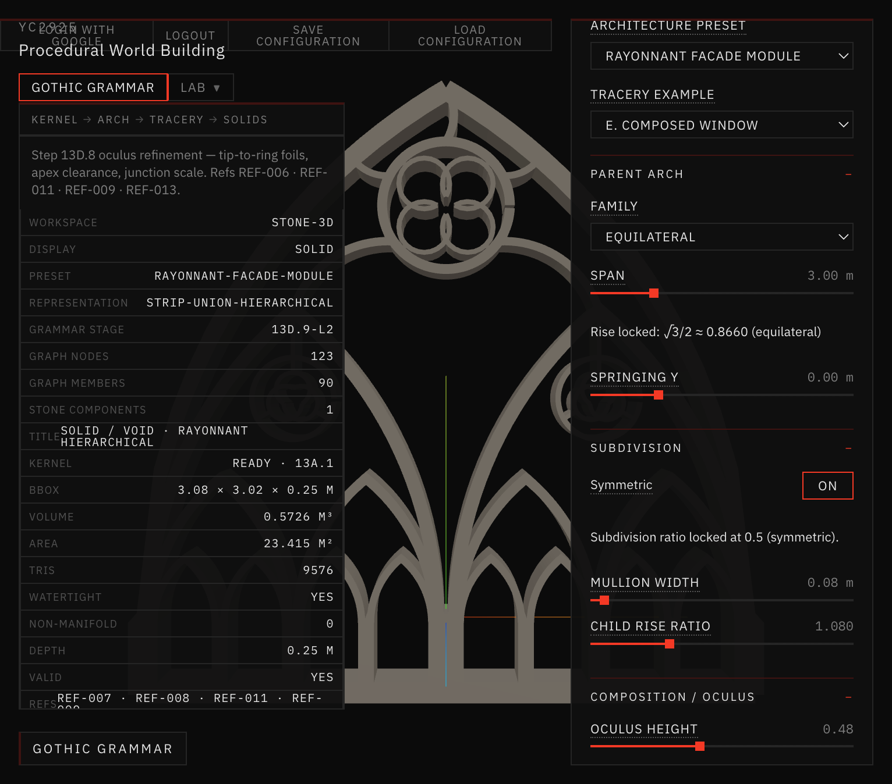
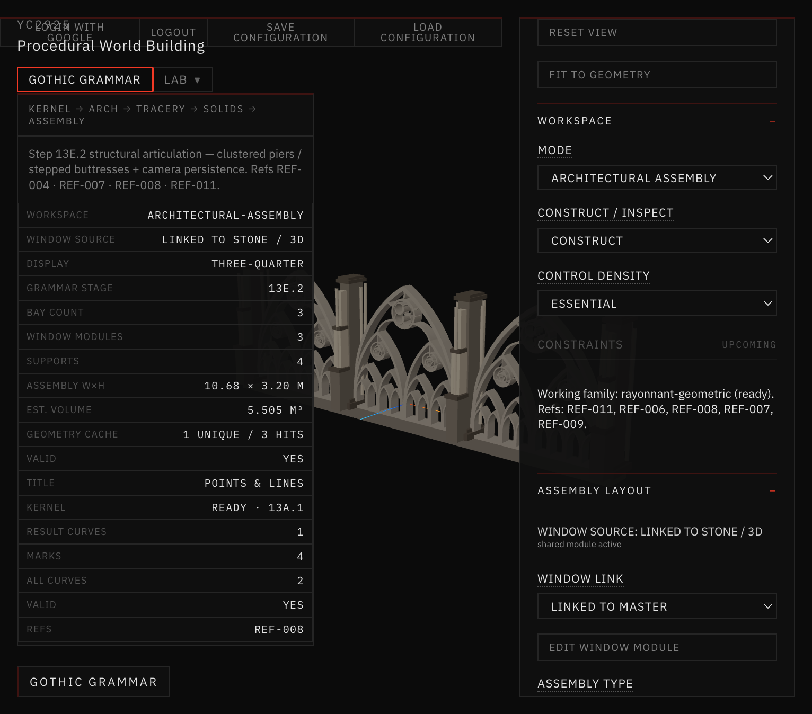

# Visual comparison — unified module

References: REF-008, REF-011, REF-004.

## Shots

*Pre-sync preferred Assembly front elevation (Docs/29).*

*Stone / 3D · Rayonnant Facade Module · Front · hierarchical L1 · moldings off.*

*Architectural Assembly · WINDOW SOURCE linked · Front · cache 1 unique / 3 hits.*

*Same linked design · Three-Quarter · Combined supports.*

*Stone / 3D · depth 2 · 13D.9-L2 · 9576 tris · vol 0.5726.*

*Assembly subdivision depth mirrors Stone (2) · components 344 · vol 5.505 · still linked.*

## Notes

- Linked Assembly windows match the Facade Module silhouette (quatrefoil oculus + nested heads).
- Geometry cache shows one unique module instanced across uniform bays.
- Full oculus / trefoil / molding browser pairs are covered by `validate:shared-window-module` lockstep key tests; depth-2 pair shown above for live sync.
