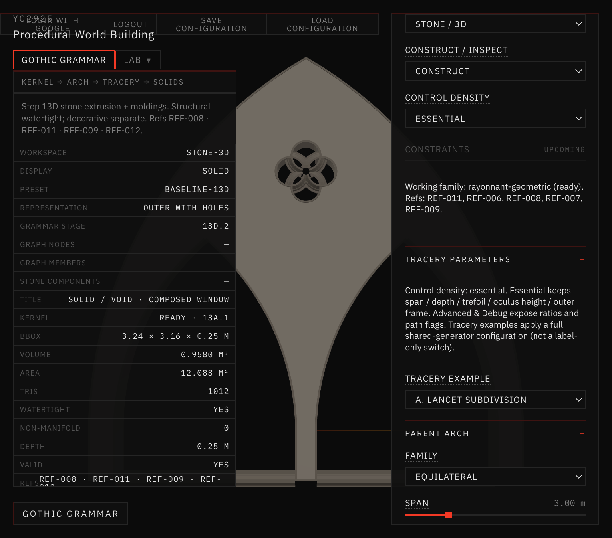
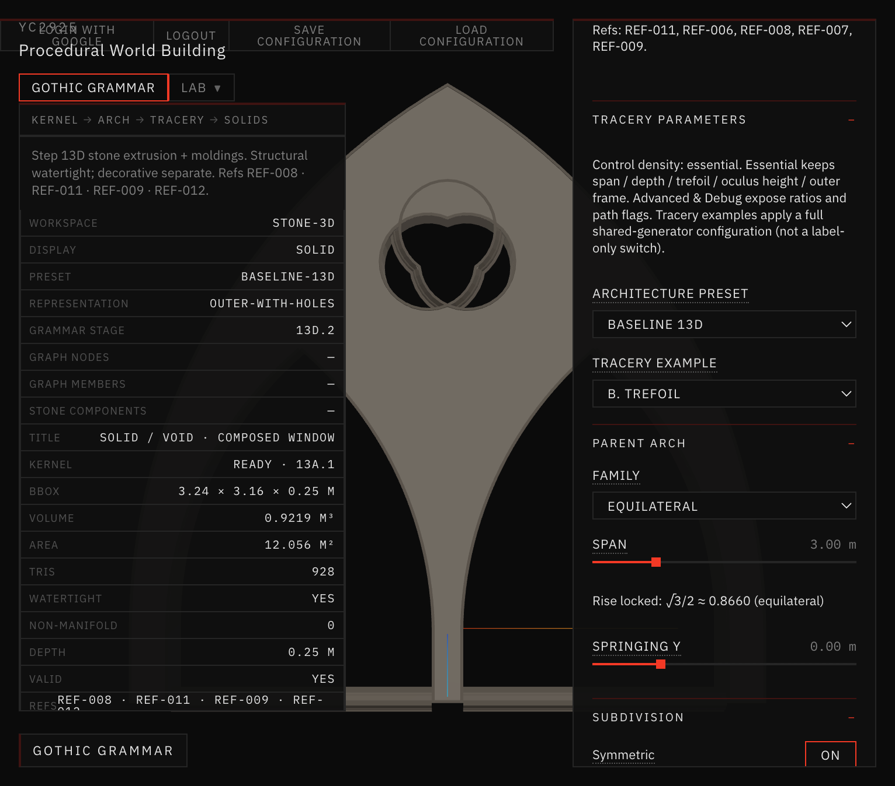
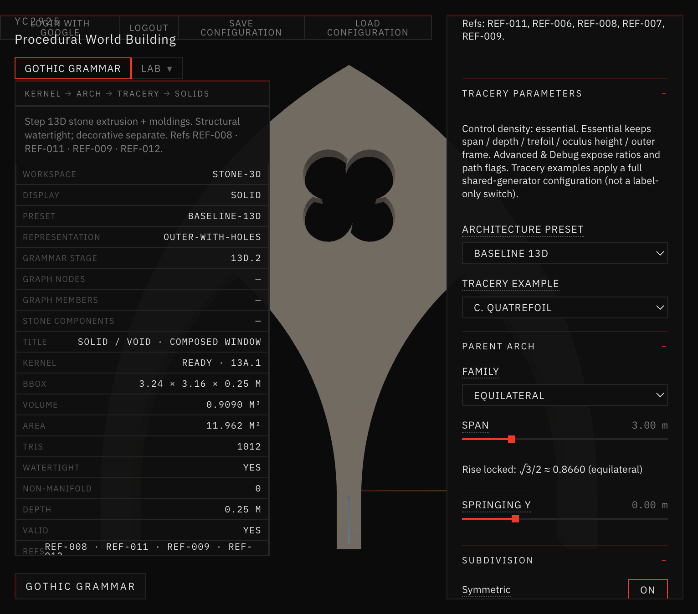
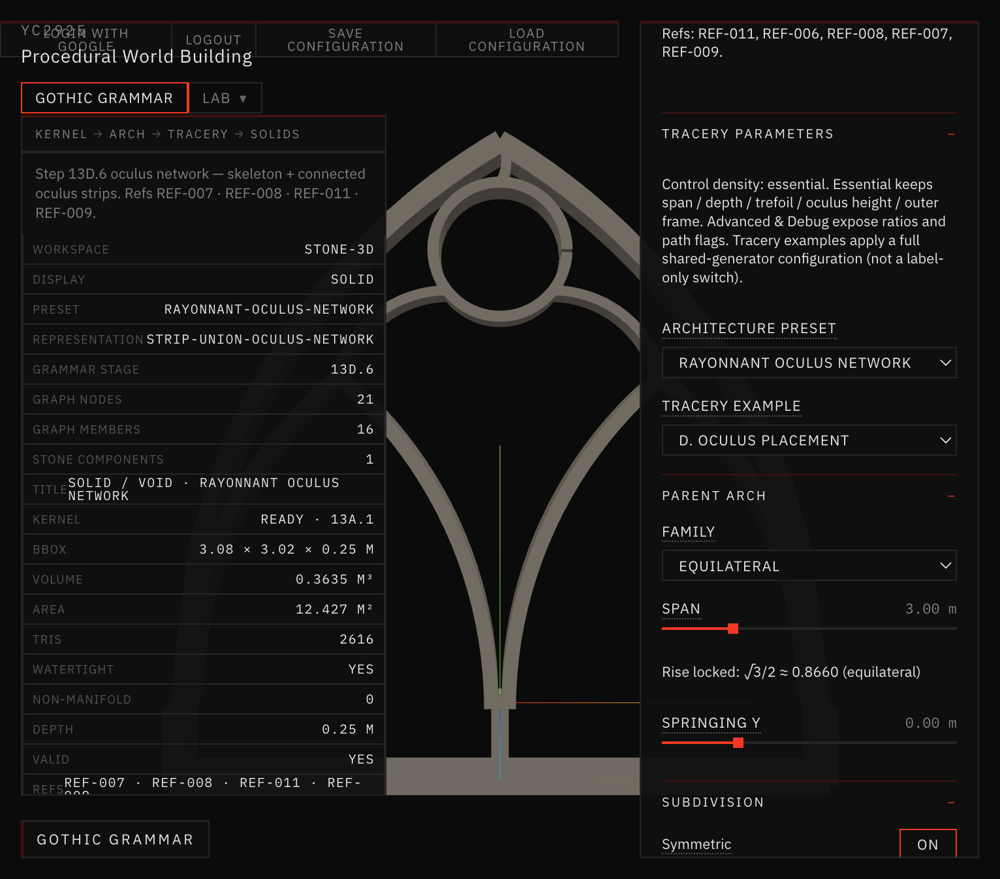
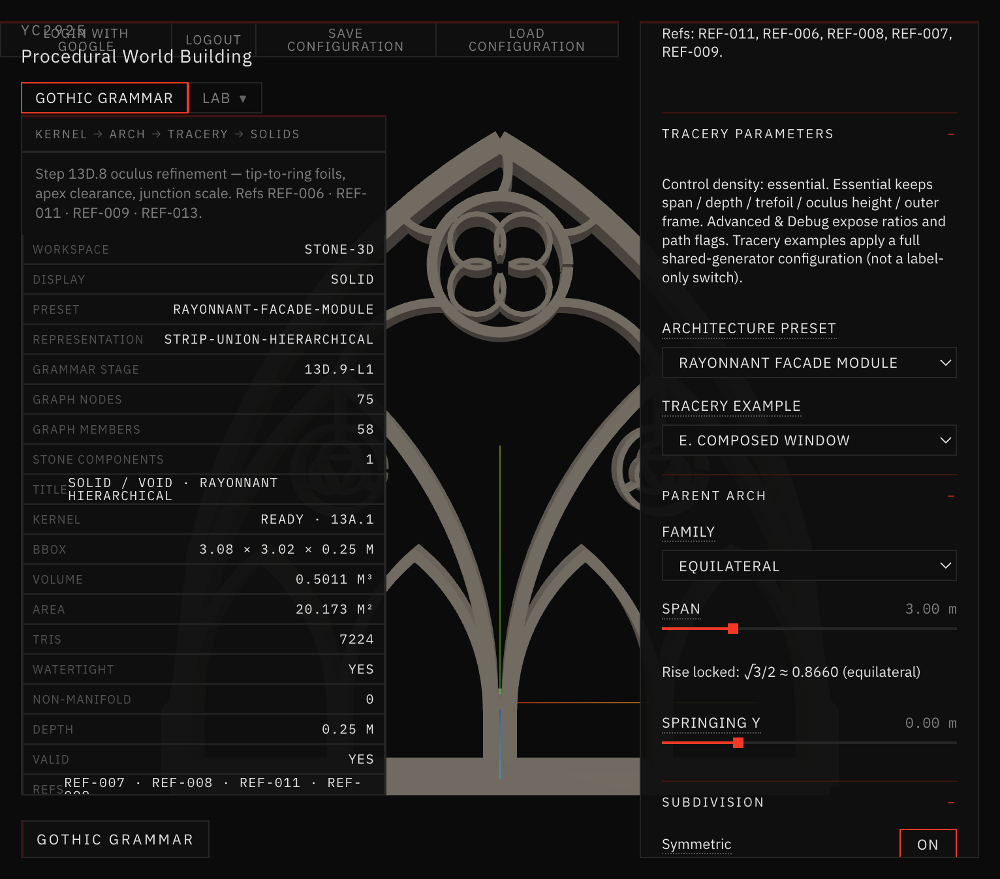
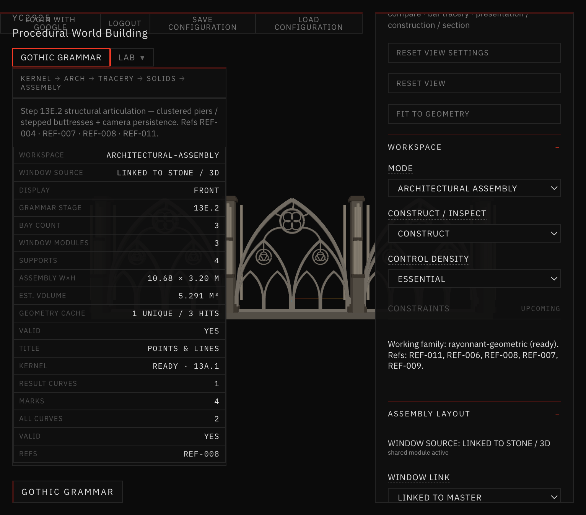

# Docs/35 — Tracery Example Dropdown Debug (13E.3.2.1)

User report: under **Tracery Parameters**, the **Tracery Example** dropdown did not produce visible changes.

References: REF-008, REF-011, REF-006, REF-007, REF-009.

## Verdict

Fixed. All five options now apply a **complete shared-generator configuration** via `applyTraceryExample` → `buildStoneAssembly` / `generateGothicWindowModule`. No separate example-only geometry pipeline.

| Option | Preset path | Stone vol (span 3) | Distinct |
| --- | --- | --- | --- |
| A. Lancet Subdivision | Baseline 13D (lancet-emphasized) | 0.9580 m³ | yes |
| B. Trefoil | Baseline 13D + trefoil foil | 0.9219 m³ | yes |
| C. Quatrefoil | Baseline 13D + diagonal quatrefoil | 0.9090 m³ | yes |
| D. Oculus Placement | Rayonnant Oculus Network (subdivision none) | 0.3635 m³ | yes |
| E. Composed Window | Rayonnant Facade Module (hierarchical) | 0.5011 m³ | yes |

## Root cause

Selecting an example previously wrote only `exampleId` (and sometimes `foilType`). Hierarchical / skeleton / oculus-network flags from the **active architecture preset** continued to drive Stone / 3D, so A–E regenerated the same mesh.

Secondary issue: in Stone / 3D, B/C used a foil-only control strip that hid Parent Arch / Oculus / Subdivision — fixed by showing full-window controls whenever `workspaceMode !== 'tracery'`.

## Fix

- `app/src/geometry/gothicGrammar/tracery/traceryExamples.js` — `applyTraceryExample`, `TRACERY_EXAMPLE_META`, `clearAdvancedGrammarFlags`
- `GothicGrammarPanel.jsx` — example `onChange` applies full config + updates controls; Stone/Assembly always get full-window UI
- Geometry cache keys include `exampleId` / foil / oculus ratios (from 13E.3.2)

## Visual matrix (Stone / 3D · Front · same camera)



*A · Baseline · lancet-emphasized composed window · vol 0.9580.*



*B · Baseline · trefoil upper foil · vol 0.9219.*



*C · Baseline · diagonal quatrefoil · vol 0.9090.*



*D · Oculus Network · empty oculus ring · vol 0.3635.*



*E · Facade Module · hierarchical 13D.9-L1 · vol 0.5011.*

## Assembly synchronization



*Architectural Assembly · Linked to Master · 3 bays · shared module cache 1/3.*

## Docs in this folder

| File | Contents |
| --- | --- |
| [OPTION_INVENTORY.md](OPTION_INVENTORY.md) | Complete option audit |
| [ROOT_CAUSES.md](ROOT_CAUSES.md) | Per-option root causes |
| [GEOMETRY_COMPARISON.md](GEOMETRY_COMPARISON.md) | Signatures / volumes / Assembly sync |
| [KNOWN_CONDITIONAL.md](KNOWN_CONDITIONAL.md) | Mode-conditional UI behaviors |

## Validation

```bash
cd app && npm run validate:tracery-examples
```

Confirms: 5 distinct geometry keys, Stone ≡ Assembly keys, post-example edits persist, trefoil / frame / depth / molding regressions, surface semantics valid.

## Limits

- A–C share the Baseline solid/void path; distinction is foil / oculus emphasis, not separate generators.
- 2D Tracery workspace still uses a foil-only control strip for B/C (standalone foil demos).
- Architecture Preset remains independently editable after an example; choosing a new preset can override example flags (expected).
