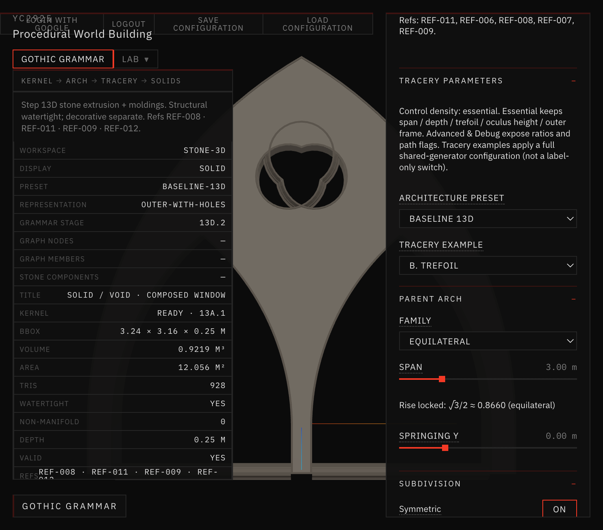
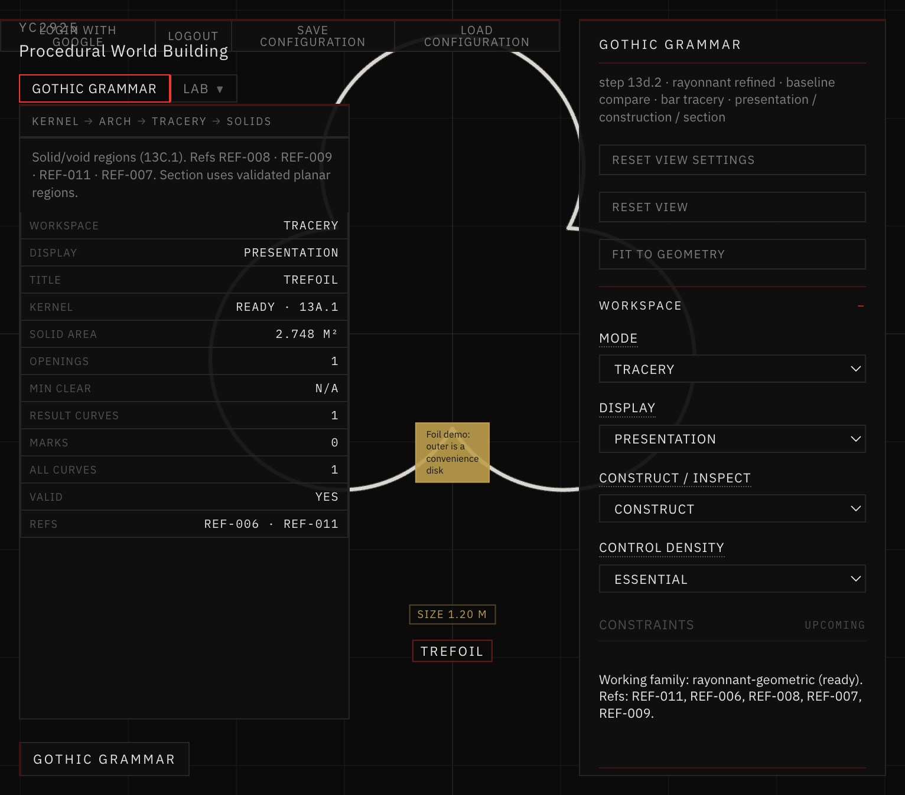
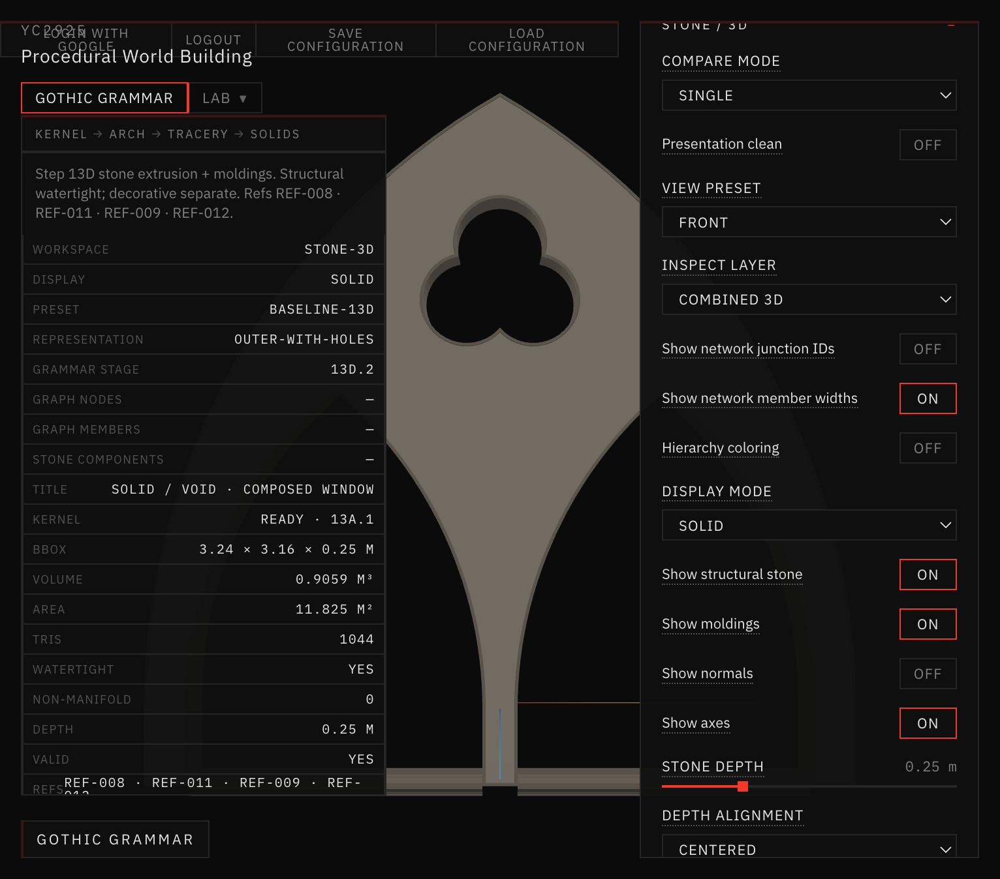

# 36 — Trefoil Topology and Stone Mesh Repair

**Step:** 13E.3.2.2  
**Workspace:** Gothic Grammar  
**Refs:** REF-006 · REF-011  

## Verdict

Example **B. Trefoil** now builds a closed, non-self-intersecting three-lobed opening from **outer** pairwise circle intersections. The same `buildTrefoil` kernel feeds Tracery, Stone / 3D (Outer-with-Holes + strip-union skeleton), and Architectural Assembly. `npm run validate:trefoil-topology` passes.

## Bug (user-reported)

Stone / 3D · Outer-with-Holes · Baseline 13D · B. Trefoil looked like stacked circles with triangular stone inside the void, yet reported Watertight: YES.

## Root cause

Inner cusp selection produced a self-intersecting 2D foil. N=3 skipped the non-adjacent-arc guard; earcut filled crossed regions. See [ROOT_CAUSE.md](./ROOT_CAUSE.md).

## Repair

| Change | Location |
| --- | --- |
| Outer-intersection cusps (`fartherFrom`) | `foils.js` → `buildNFoil` |
| Sampled-loop self-intersection reject | `foils.js` + kernel `detectSelfIntersections` |
| Trefoil min center radius + default cuspDepth 0.7 | `foils.js` / `composedWindow.js` |
| Example B cuspDepth 0.85 + post-preset foil overrides | `traceryExamples.js` |
| Topology regression suite | `scripts/validate-trefoil-topology.mjs` |

Boolean / extrusion pipelines were not rewritten: fixing the void contour before subtraction removes the need for post-extrusion triangle cleanup.

## Representations

- **Outer-with-Holes (B):** parent solid minus one valid trefoil hole.  
- **Connected skeleton (E / Facade Module):** strip-union network using the same foil construction for trefoil heads / foil bars — different massing, shared proportions.

## Validation & visuals

- [GEOMETRY_VALIDATION.md](./GEOMETRY_VALIDATION.md)  
- [VISUAL_COMPARISON.md](./VISUAL_COMPARISON.md)  

```bash
cd app && npm run validate:trefoil-topology
```

## Screenshots



*Broken Outer-with-Holes front (pre-repair).*



*Tracery Presentation · B. Trefoil · three clear lobes.*



*Repaired Outer-with-Holes front.*

## Stop boundary

Repair complete. Do **not** start 13E.4 or 14A from this doc.
