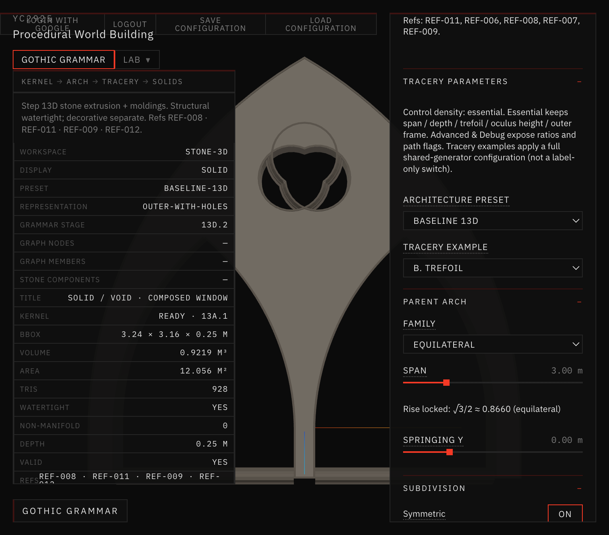
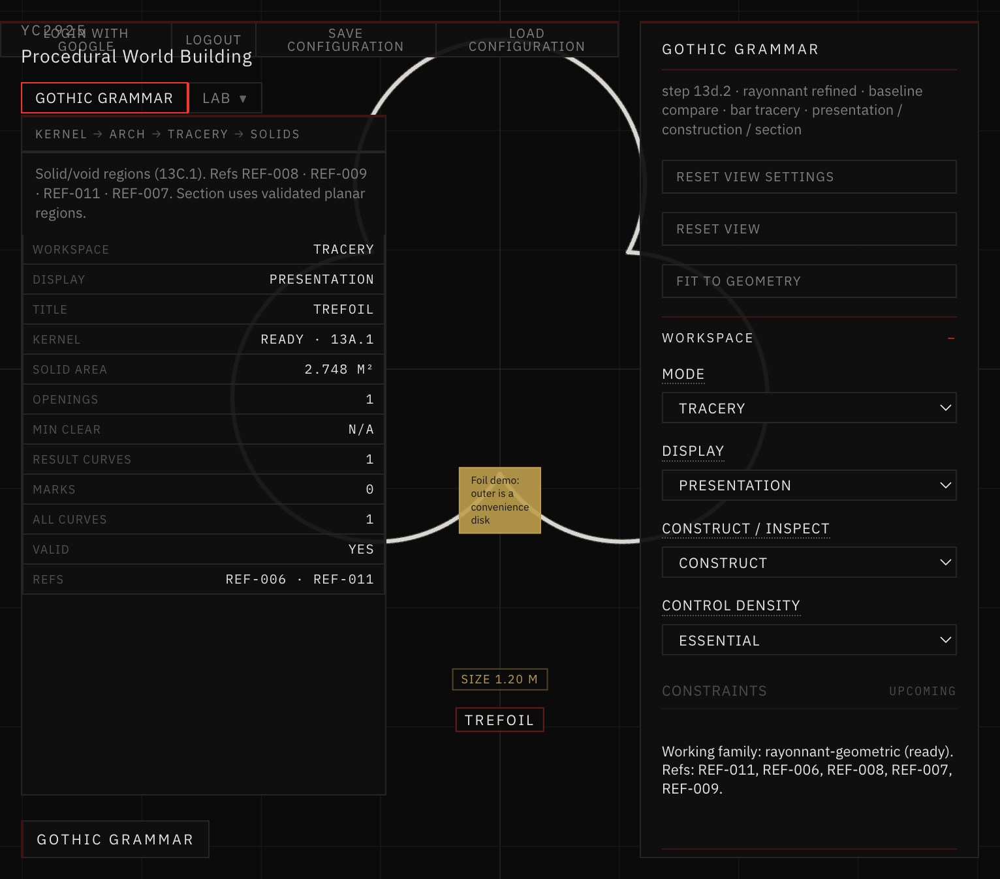
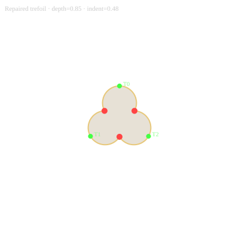
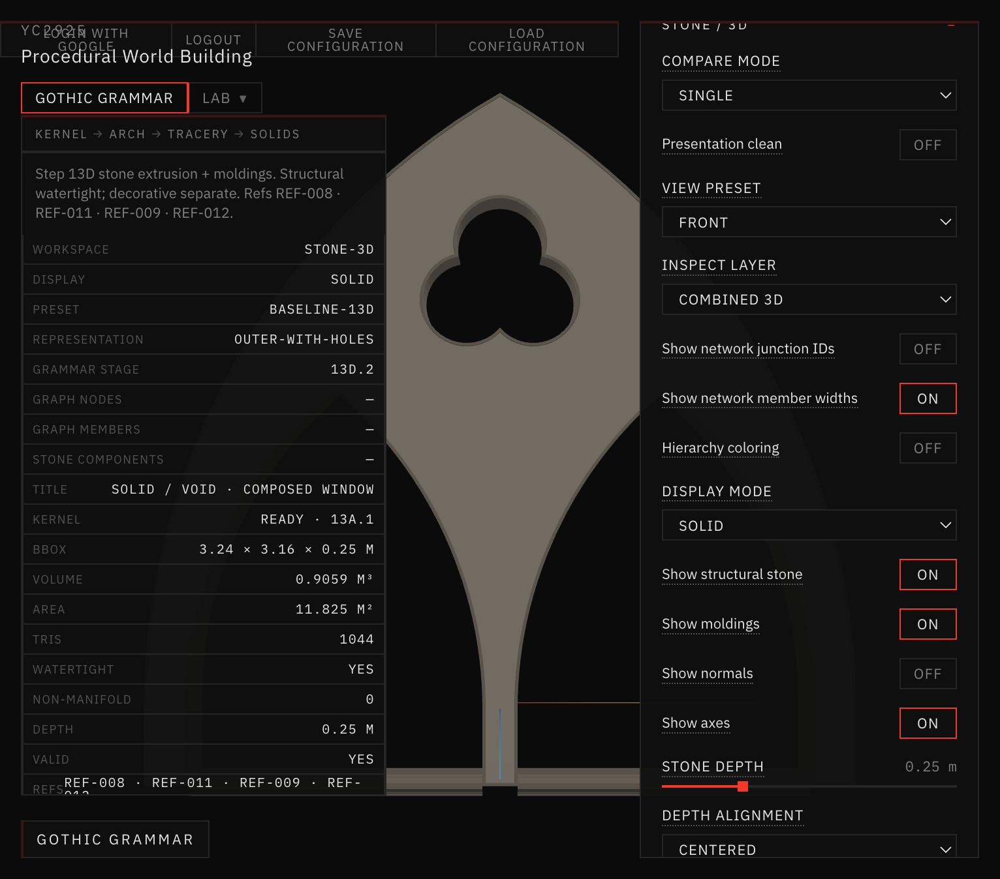
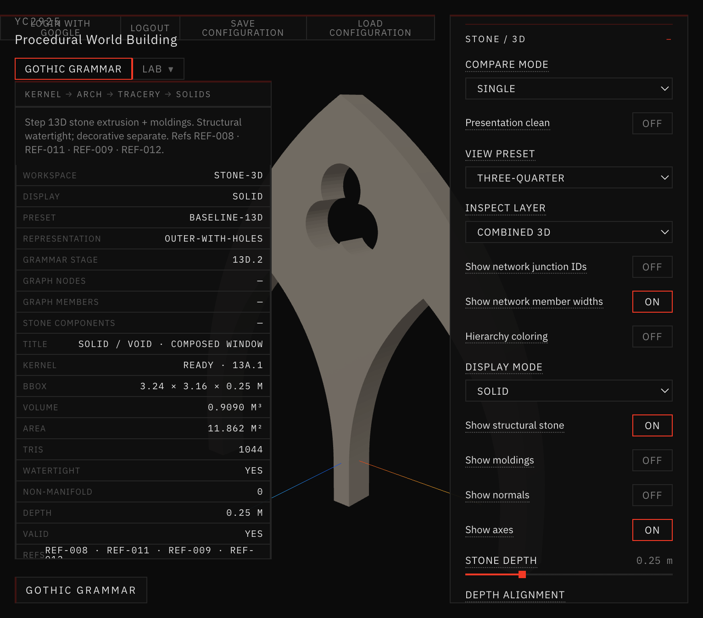
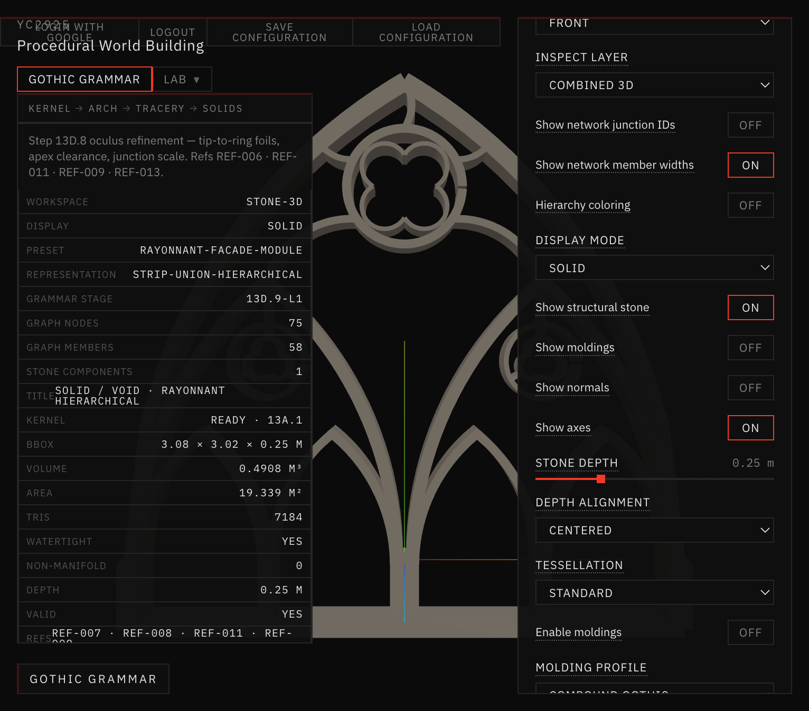
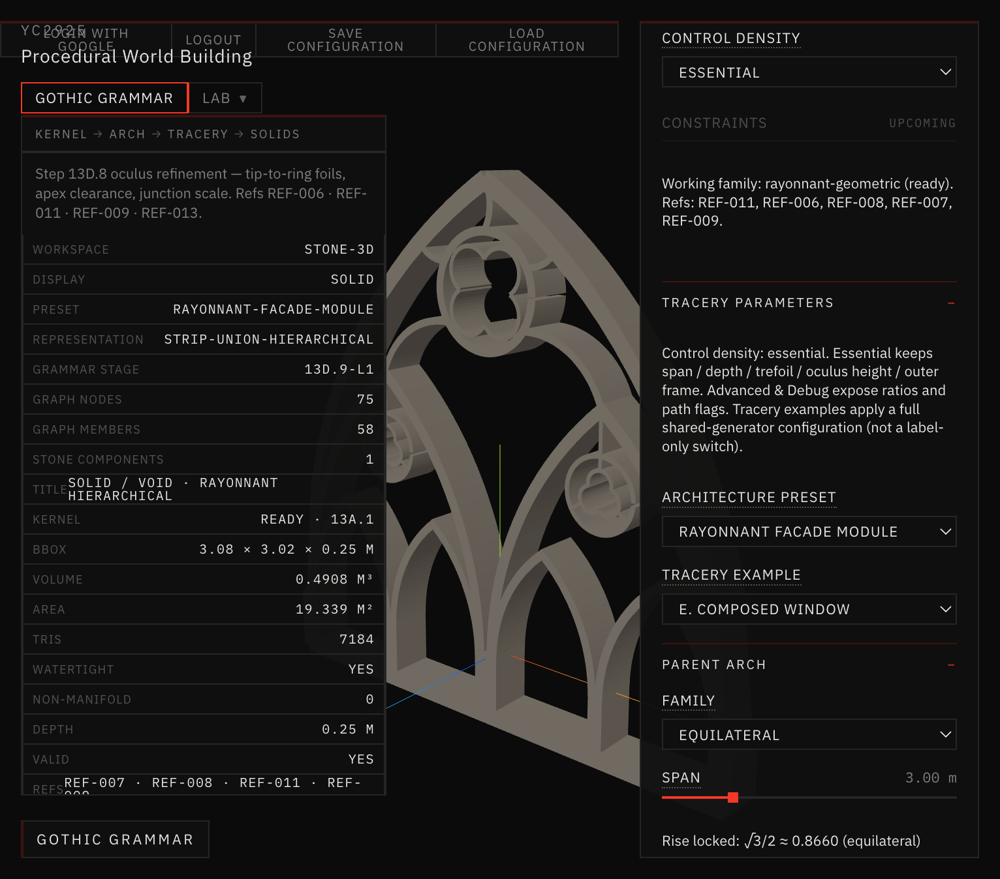
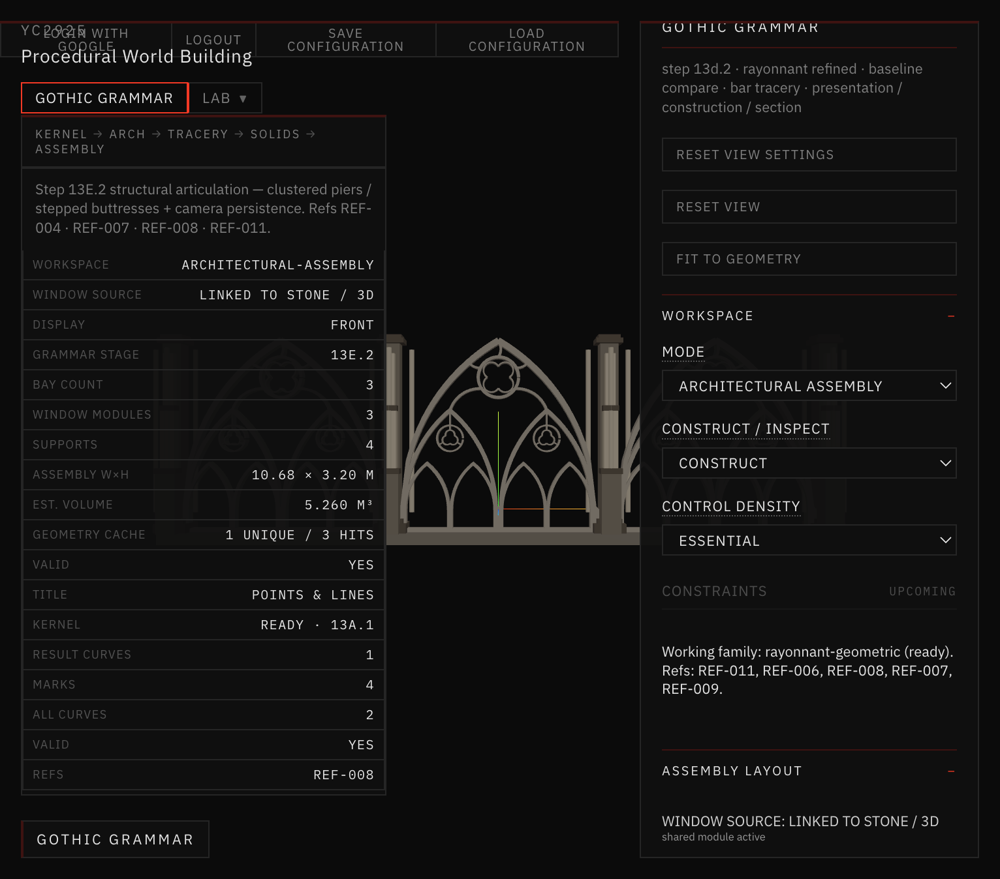

# Visual Comparison — Trefoil Repair

Camera notes: Outer-with-Holes before/after use the same Front / Three-Quarter presets. Skeleton shots use Rayonnant Facade Module (strip-union hierarchical). Assembly uses Linked-to-Master facade elevation.

## 1. Before (broken Outer-with-Holes)

*Stone / 3D · Baseline 13D · Outer-with-Holes · B. Trefoil · Front — pre-repair: inner cusps → self-intersecting void, stray shards, vol ≈ 0.922 m³ / 928 tris.*

## 2. Repaired 2D Trefoil (Tracery)

*Tracery · Presentation · B. Trefoil · size 1.20 m · cuspDepth 0.85 — clear three-lobed club (one tip up, two down), Valid: YES.*

SVG contour dump (same kernel):

*Sampled outer-cusp trefoil boundary used for docs regression.*

## 3. Repaired Outer-with-Holes — Front

*Stone / 3D · Baseline 13D · Outer-with-Holes · B. Trefoil · Front · moldings Off — single coherent trefoil void; vol 0.9090 m³ / 1044 tris; watertight; nm=0.*

## 4. Repaired Outer-with-Holes — Three-Quarter

*Same settings · Three-Quarter — extruded void keeps three lobes; no internal triangular stone islands.*

## 5. Connected Skeleton — Front

*Stone / 3D · Rayonnant Facade Module · strip-union hierarchical · Front — shared foil kernel in connected bar network (oculus subdivision remains quatrefoil per E; foil type Trefoil for heads).*

## 6. Connected Skeleton — Three-Quarter

*Same hierarchical module · Three-Quarter — continuous strip-union stone; no floating foil fragments.*

## 7. Assembly integration

*Architectural Assembly · Linked to Master · Facade Elevation · 3 bays — windows inherit the shared repaired module.*

## Reading the silhouette

An upright Gothic trefoil (orientation π/2) is a **club**: one lobe toward the apex, two toward the springing. That can be mistaken for “stacked circles” in casual viewing; the diagnostic is cusp indent and the absence of crossed internal edges. Programmatic checks: `indentRatio ≈ 0.484` at cuspDepth 0.85, `selfIntersecting === false`, three tips at 120°.
