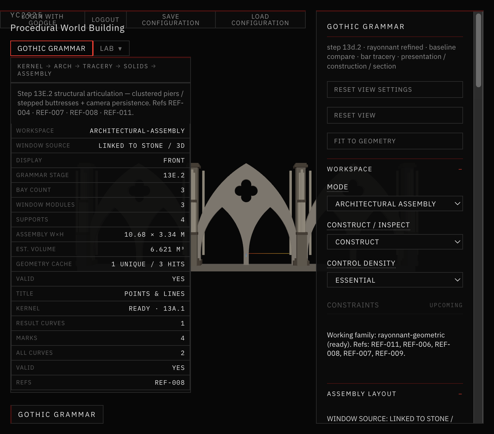
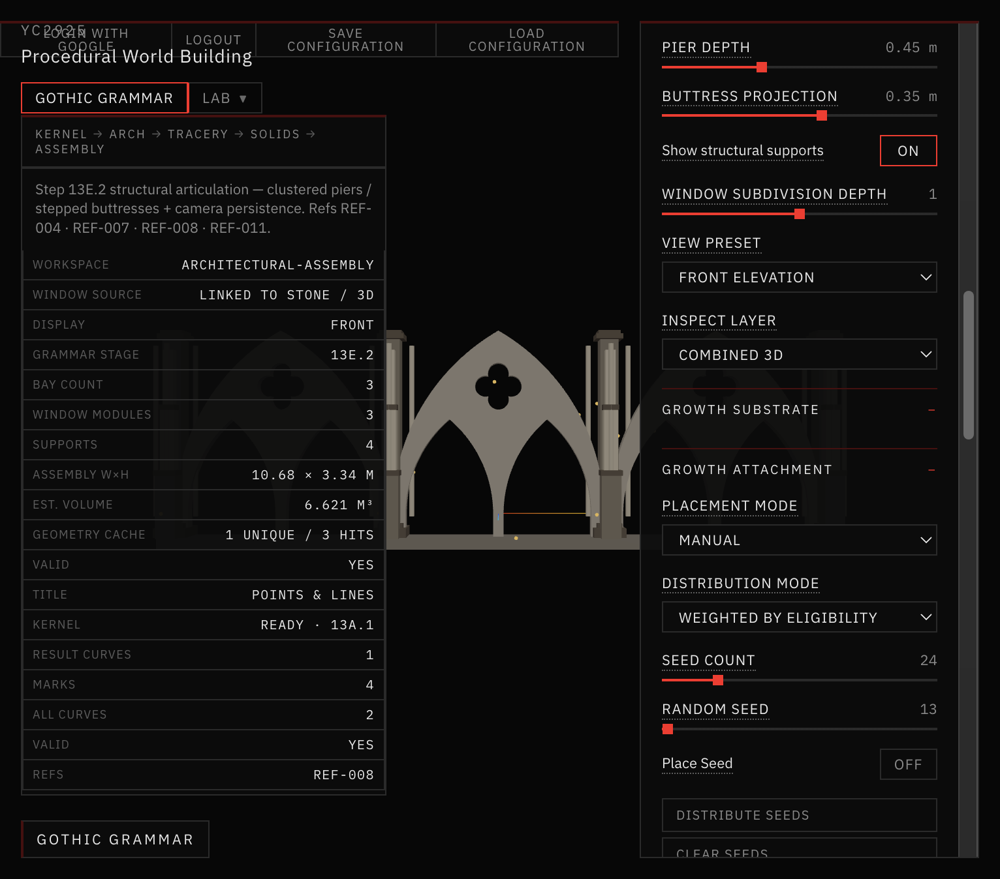

# 37 — Growth Attachment and Architectural Navigation

**Step:** 13E.4  
**Workspace:** Gothic Grammar → Architectural Assembly  
**Next:** 14A Vegetation Growth Engine (not started)  
**Refs:** REF-004 · REF-007 · REF-008 · REF-011 · REF-013  

## Verdict

Users can place and distribute seeds on real Gothic semantic stone surfaces, inspect orthonormal frames, preview surface-following navigation paths, and keep anchors through compatible geometry edits with explicit `VALID` / `REPROJECTED` / `BLOCKED` / `ORPHANED` statuses.

No vegetation geometry is generated.

## Prerequisites

| Doc | Status |
| --- | --- |
| 28 hierarchical Rayonnant | present |
| 29 architectural assemblies | present |
| 30 structural articulation | **missing folder** (articulation lives in 31 + code) |
| 31–36 | present |
| 13E.3 surface semantics | present — reused as substrate |

## Architecture

```
extractFacadeSurfaceSemantics / applyGrowthPolicy   (13E.3)
        ↓
growthAttachment/*  anchors · frames · sampling · nav · paths · persistence
        ↓
GrowthAttachmentOverlay + Assembly panel controls
        ↓
(future) 14A vegetation engine consumes queries API
```

Shared window module + Assembly remain the only architectural sources — no approximate duplicate facade.

## Docs in this folder

- [ANCHOR_SCHEMA.md](./ANCHOR_SCHEMA.md)
- [SURFACE_NAVIGATION.md](./SURFACE_NAVIGATION.md)
- [PERSISTENCE_RULES.md](./PERSISTENCE_RULES.md)
- [VALIDATION.md](./VALIDATION.md)

## UI

**Growth Attachment** (Essential / Advanced / Debug tiers):

- Placement mode, seed count, distribution mode, random seed
- Place Seed / Distribute / Clear / Delete Selected
- Show Seeds / Show Navigation Paths
- Advanced: spacing, restricted override, prefer vertical/recess/junctions, molding attach
- Debug: normals, tangents, nav graph, invalid anchors, collision diagnostics, tolerances

Reuses 13E.3 growth-zone weights under Growth Substrate.

## Screenshots



*Assembly · 3 bays · Weighted distribution · 24 seeds on stone (amber = REPROJECTED after signature remap).*


*Three-quarter assembly — seeds sit on piers / arches, not in openings.*



*Debug: seed markers + surface normals enabled.*

## 14A integration contract

Vegetation should call only:

`projectToEligibleSurface`, `getSurfaceFrame`, `findNearestValidAnchor`, `checkGrowthClearance`, `isInsideProtectedOpening`, `findSurfacePath`, `distributeGrowthSeeds`, `rebindGrowthAnchors`.

Do not invent new surface metadata outside the semantic extractor.

## Stop

13E.4 complete. Do **not** implement vegetation meshes here.
