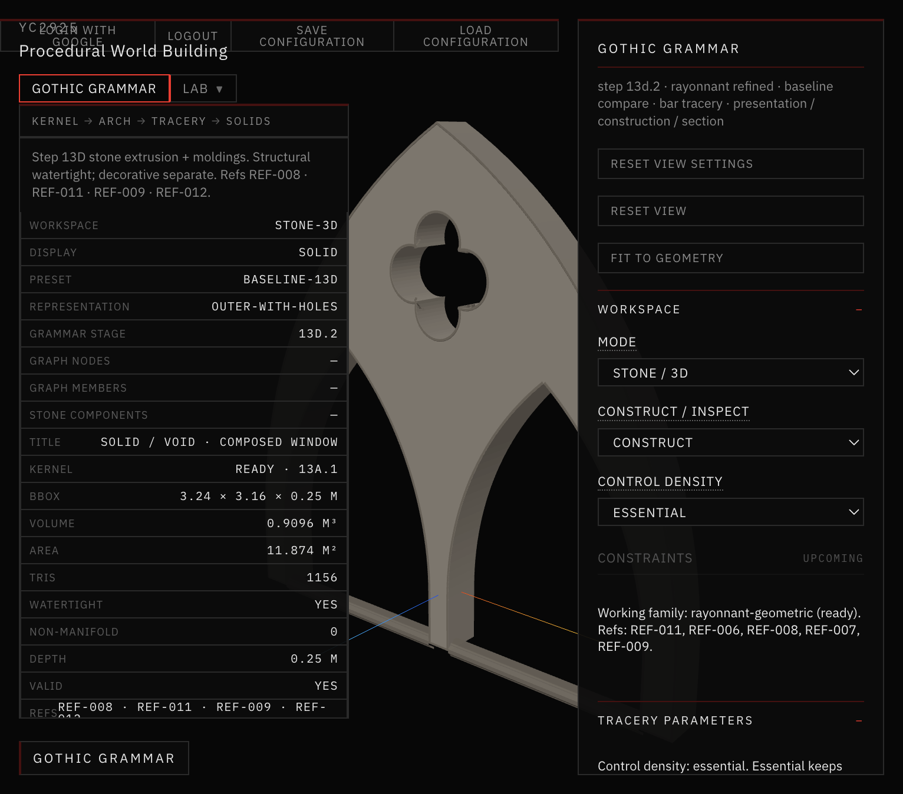
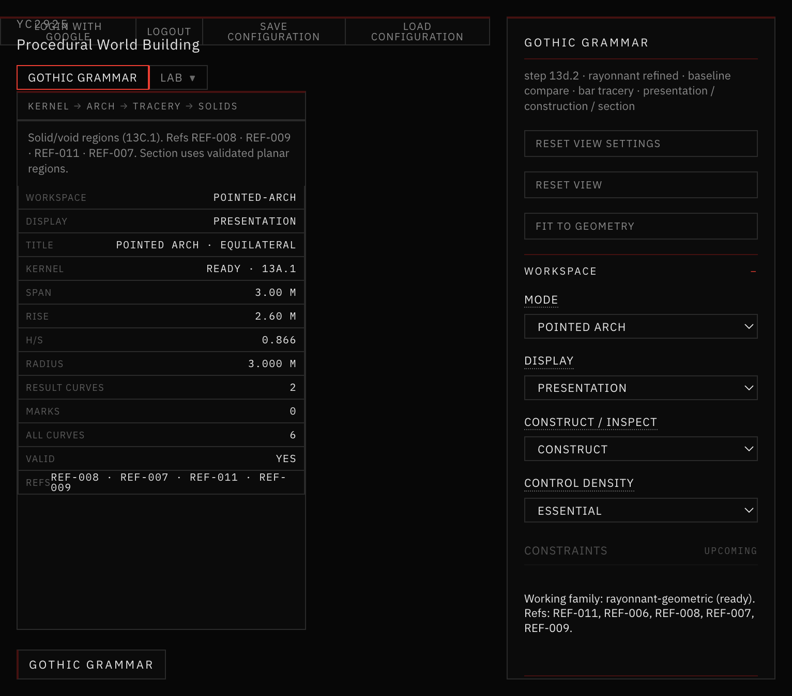
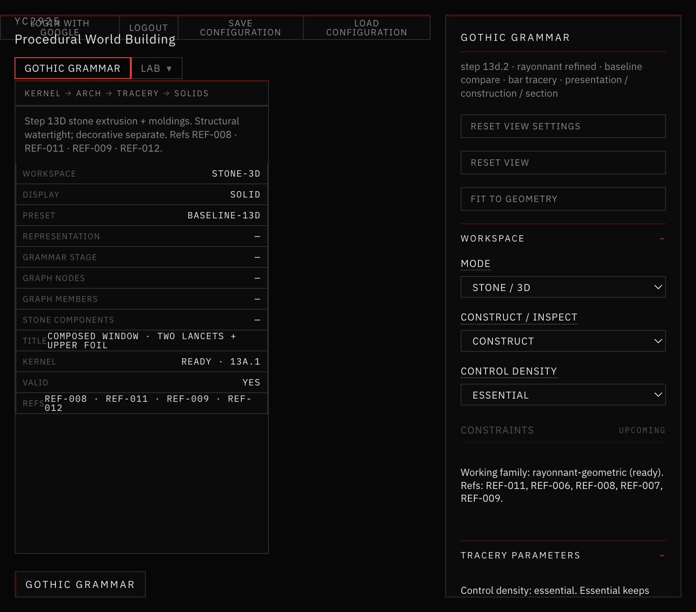
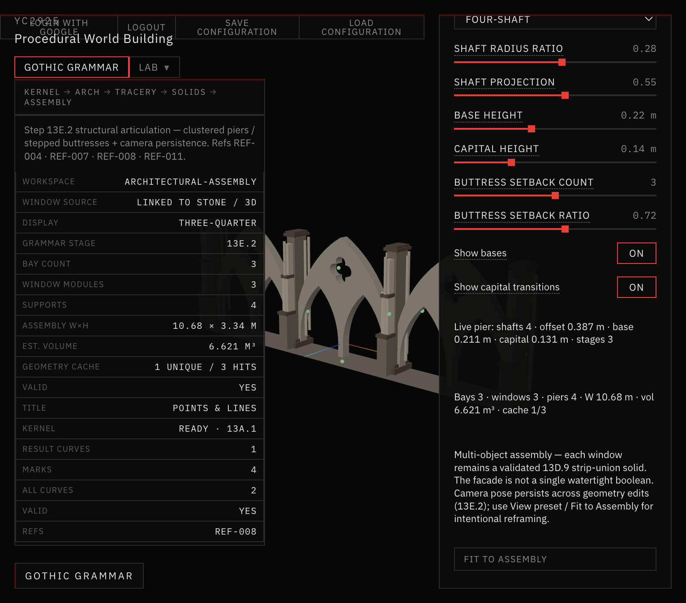

# 38–39 — Growth Attachment Stability & Viewport Initialization

**Steps:** 13E.4.1 + 13E.4.2  
**Workspace:** Gothic Grammar  
**Next:** 14A Vegetation Growth Engine (not started)  
**Refs:** REF-004 · REF-007 · REF-008 · REF-011  

## Verdict

Two blocking bugs are repaired:

| Bug | Symptom | Fix |
| --- | --- | --- |
| **A** Seed freeze / REPROJECTED flood | Manual placement froze; fresh seeds showed REPROJECTED; auto 45/0/45 | Stable geometry signatures + raycast placement (no 1334 pickers) + rebind skip |
| **B** Invisible / tiny initial view | Ortho modes collapsed to speck; perspective fought React camera props | Manual world-unit ortho frustum + framing owns camera/target (no prop fight) |

Do **not** start Step 14A from this repair.

## Prerequisites

| Doc | Status |
| --- | --- |
| 30 structural articulation | **missing folder** (articulation in 31 + code) |
| 31–37 | present |
| 37 growth attachment | present — substrate for this repair |

## Docs in this folder

- [ROOT_CAUSE.md](./ROOT_CAUSE.md)
- [CAMERA_LIFECYCLE.md](./CAMERA_LIFECYCLE.md)
- [ANCHOR_LIFECYCLE.md](./ANCHOR_LIFECYCLE.md)
- [PERFORMANCE.md](./PERFORMANCE.md)
- [REGRESSION_TESTS.md](./REGRESSION_TESTS.md)

## Screenshots



*Pointed Arch · Presentation · world-unit ortho frustum after load.*



*Tracery mode after mode switch / load.*



*Stone / 3D · framing owned by StoneFraming (no position prop fight).*



*Architectural Assembly · three-quarter · automatic seeds status VALID (green).*


*Compact seed markers; inspector is bounded with Debug collapsed by default.*

## Validation

```bash
npm run validate:seed-placement
npm run validate:viewport-initialization
npm run validate:growth-attachment
npm run validate:camera-persistence
npm run build
```
