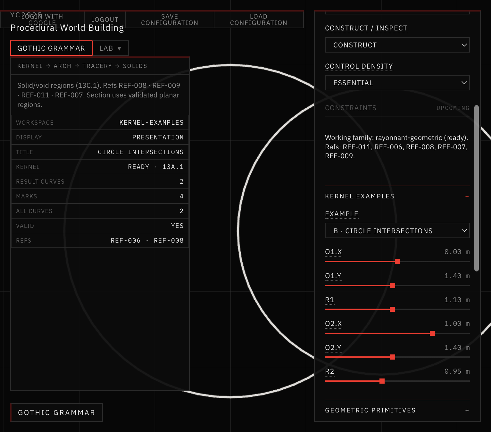
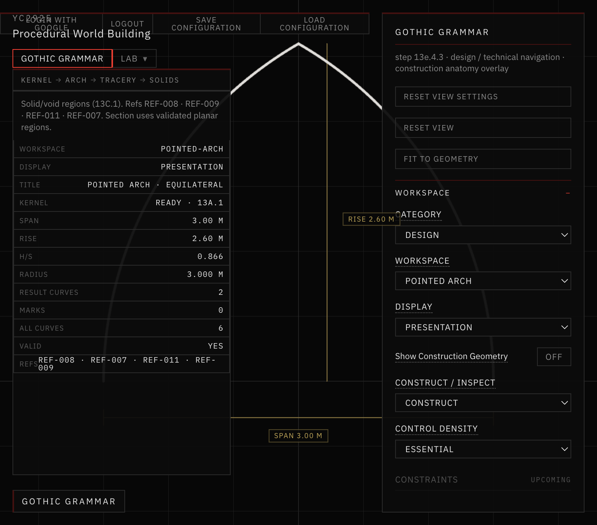
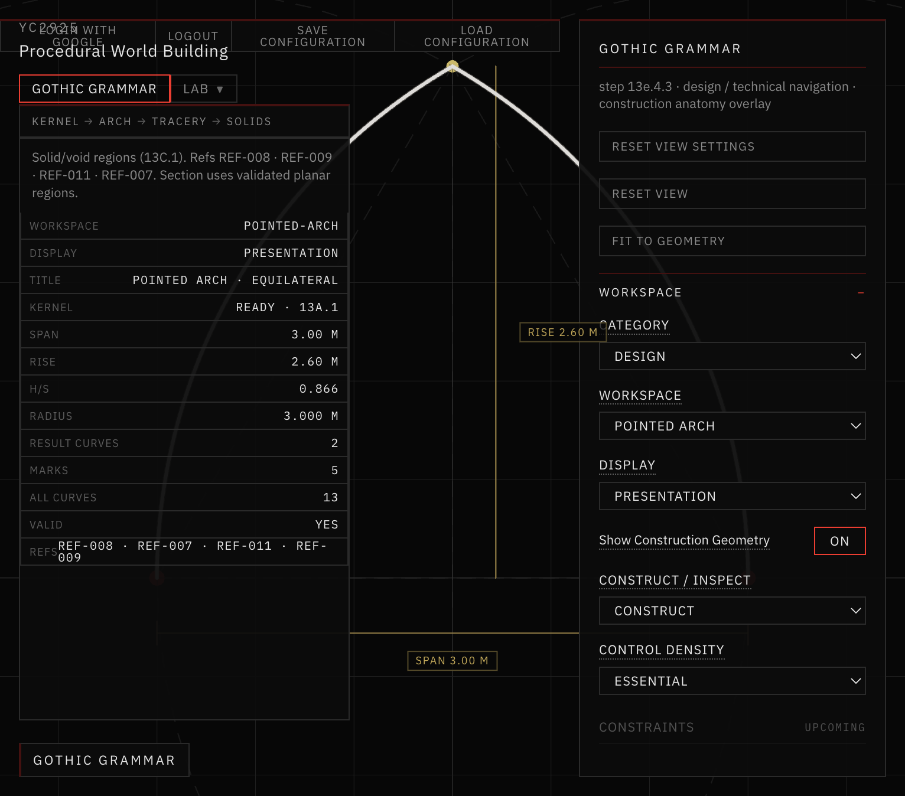
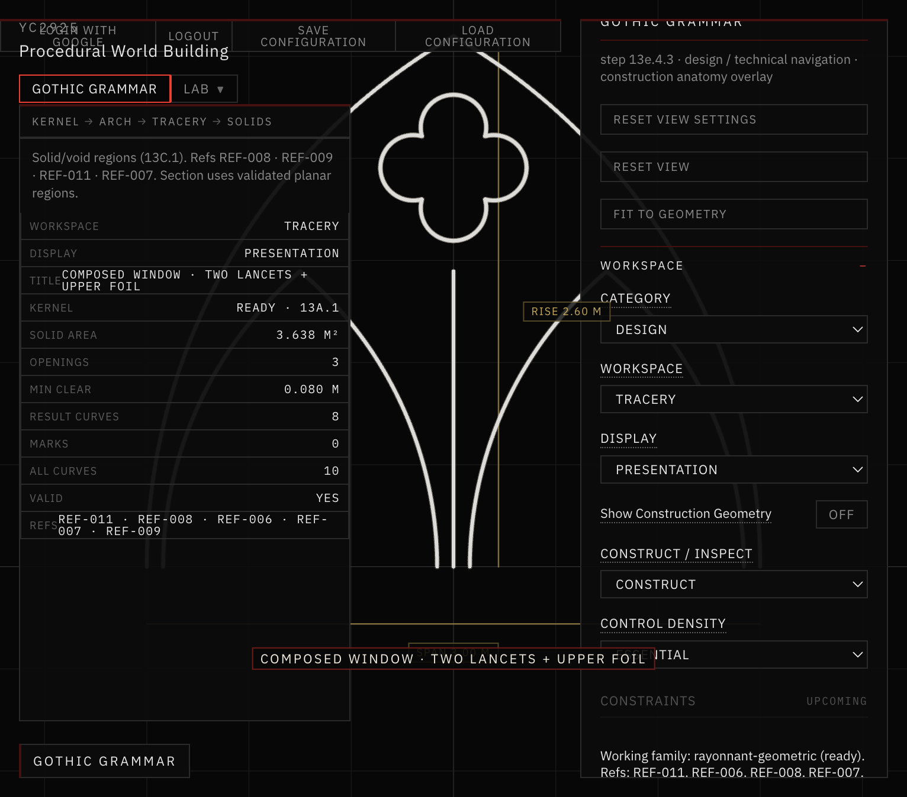
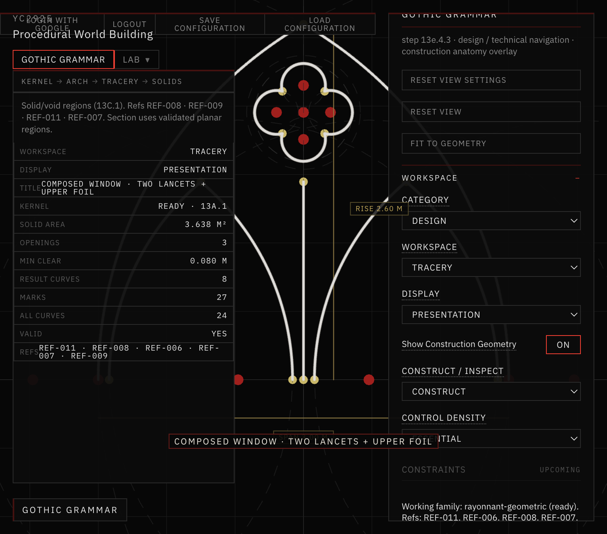
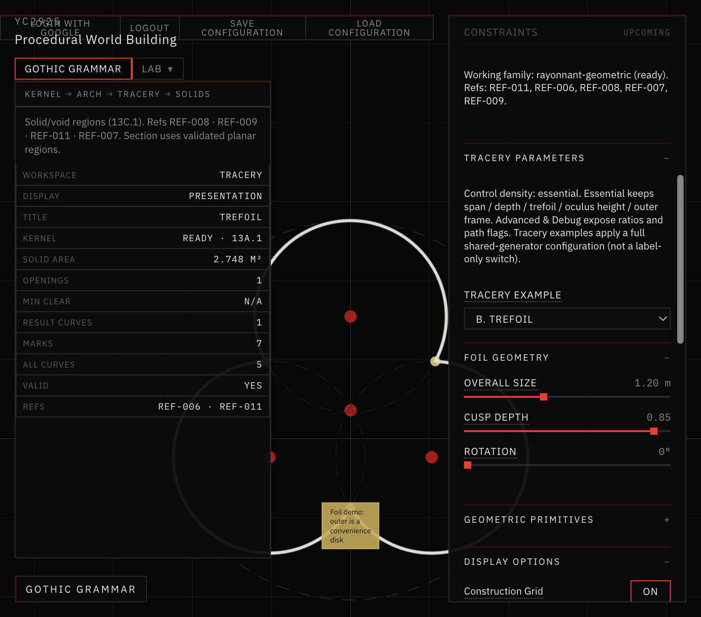
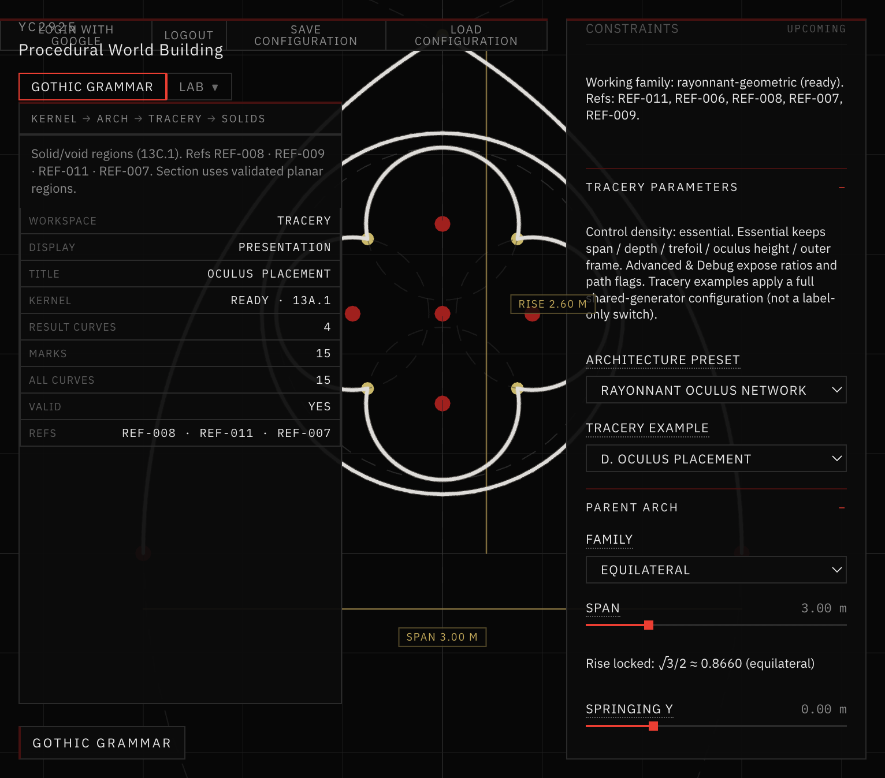
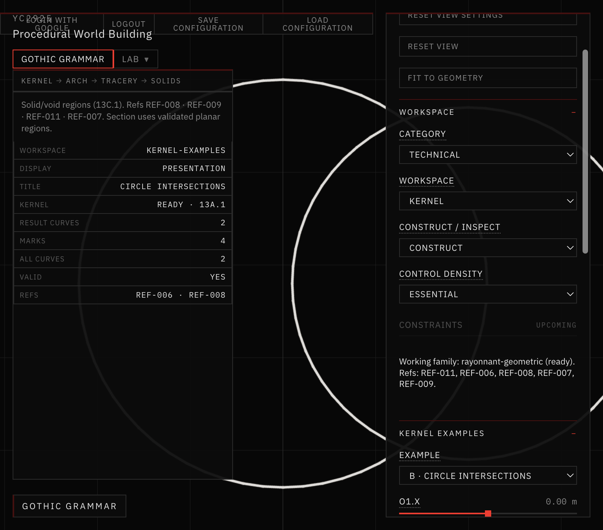
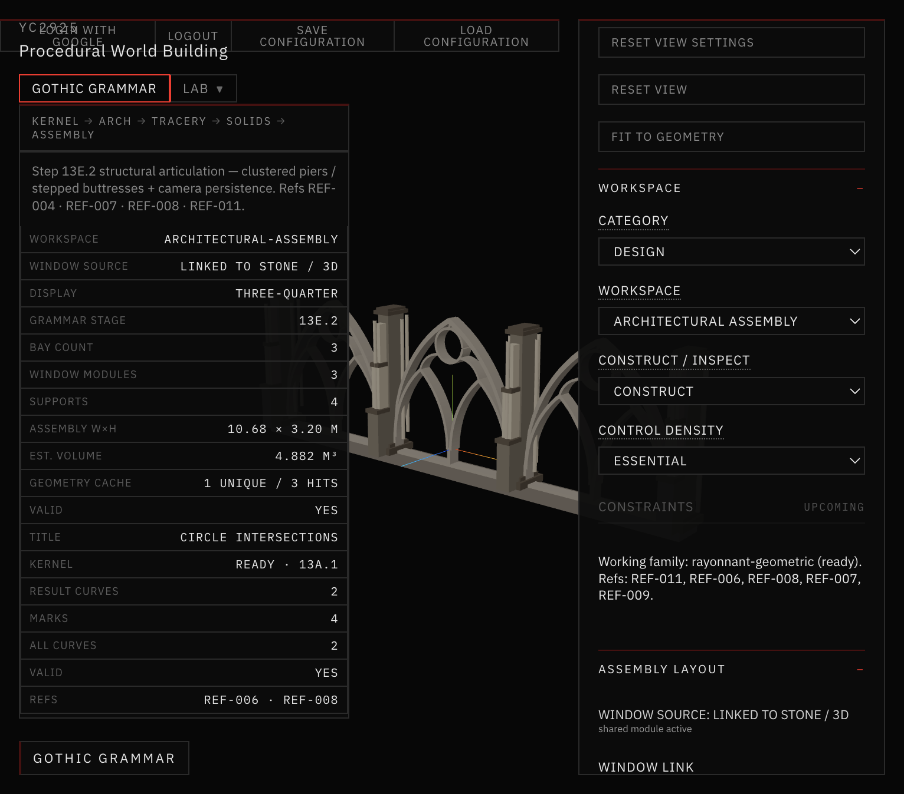

# 40 — Workspace Reorganization & Construction Anatomy

Session date: **10 November 2026**. Tab: **Gothic Grammar**. Step **13E.4.3**.

Gothic Grammar now separates **Design** authoring from **Technical / Inspection** navigation, and exposes a toggleable **Show Construction Geometry** overlay on Pointed Arch and Tracery. Overlays visualize generator construction data — they do not invent circles or regenerate stone.

Vegetation Growth remains reserved and is **not** exposed as a working mode.

References used: REF-006, REF-008, REF-011 (construction plates / pointed arch / foils).

---

## What changed

1. **Two-level navigation** — Category (Design / Technical) + Workspace.
2. **Construction anatomy overlay** — Essential master toggle + Advanced sub-flags.
3. **CONSTRUCTION_GEOMETRY contract** — structured metadata attached to generator results.
4. **Technical hosts reuse** existing Stone / Assembly inspect layers (no duplicate renderers).

See also: [NAVIGATION_STRUCTURE.md](NAVIGATION_STRUCTURE.md) · [CONSTRUCTION_DATA.md](CONSTRUCTION_DATA.md) · [OVERLAY_CONTROLS.md](OVERLAY_CONTROLS.md) · [VALIDATION.md](VALIDATION.md).

---

## Screenshots

*Design · Pointed Arch · Presentation · construction overlay OFF.*

*Technical category · Kernel workspace list (Geometry Graph / Semantics / Growth / Diagnostics).*

*Pointed Arch presentation — result arcs + span/rise dimensions only.*

*Same arch with construction circles, radii, centers, axis and springings from the generator.*

*Composed window presentation (two lancets + upper foil).*

*Composed window with parent/child circles, mullion guide, oculus and foil construction.*

*Standalone trefoil example — lobe circles, centers and cusps.*

*Oculus placement — parent arch + oculus / foil construction guides.*

*Technical · Kernel · Circle Intersections example.*

*Design · Architectural Assembly three-quarter — preferred appearance preserved.*

---

## Pipeline (unchanged)

Kernel → Pointed Arch → Tracery → Stone / 3D → Architectural Assembly

Construction overlays sit on the 2D generator documents only. They do not enter growth attachment raycasts or stone mesh topology.
