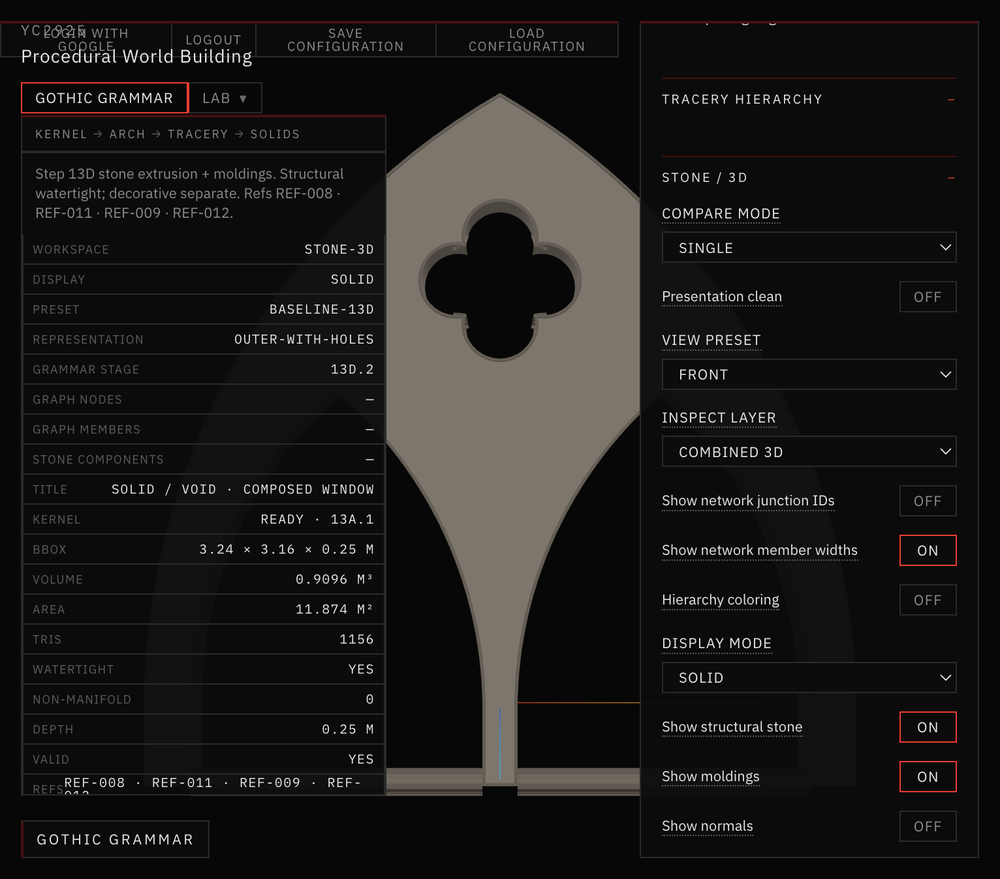
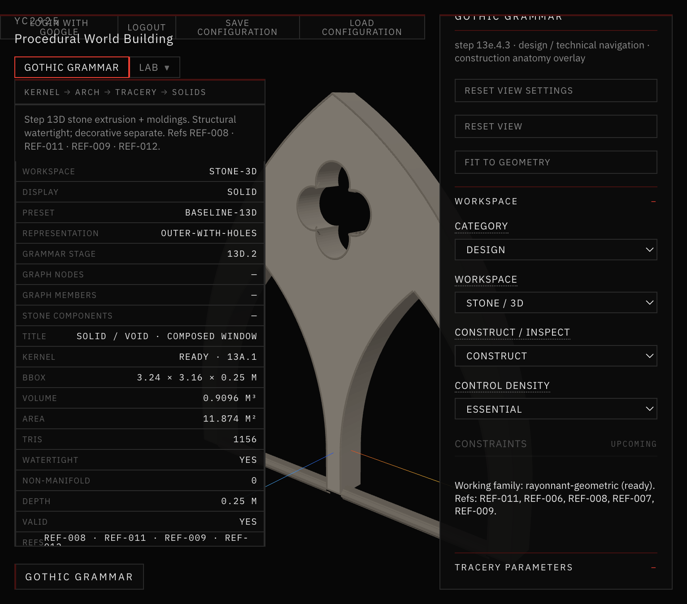
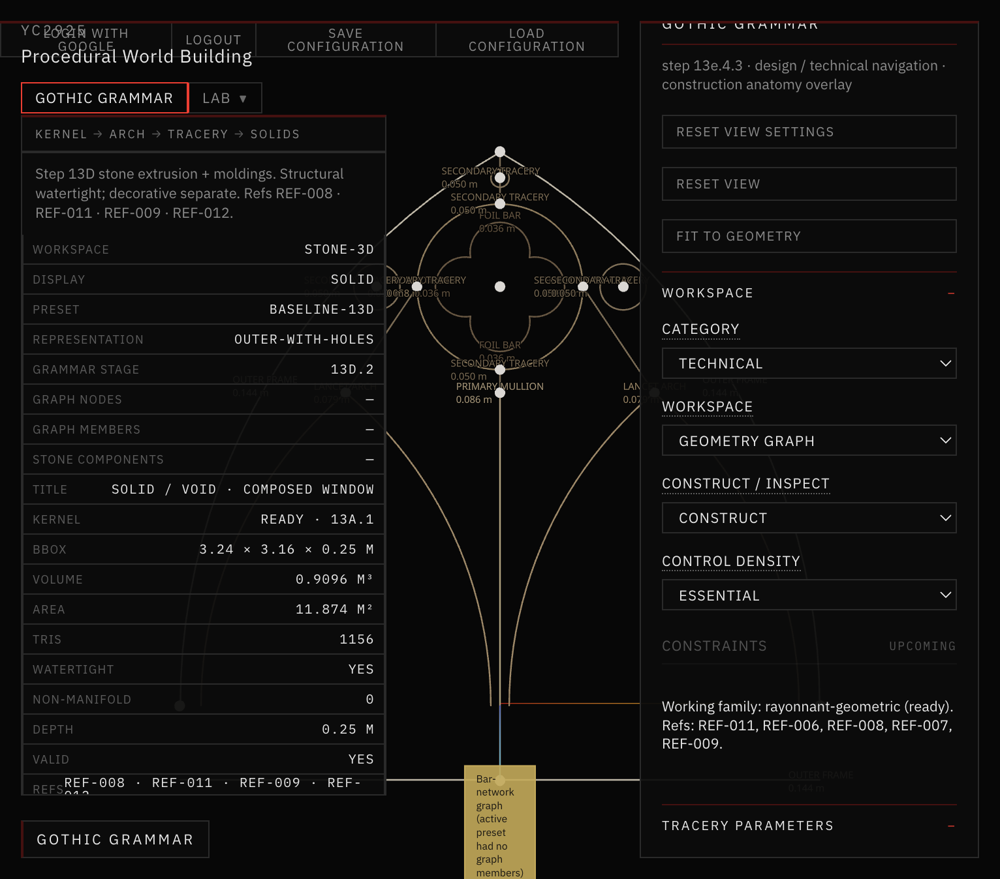
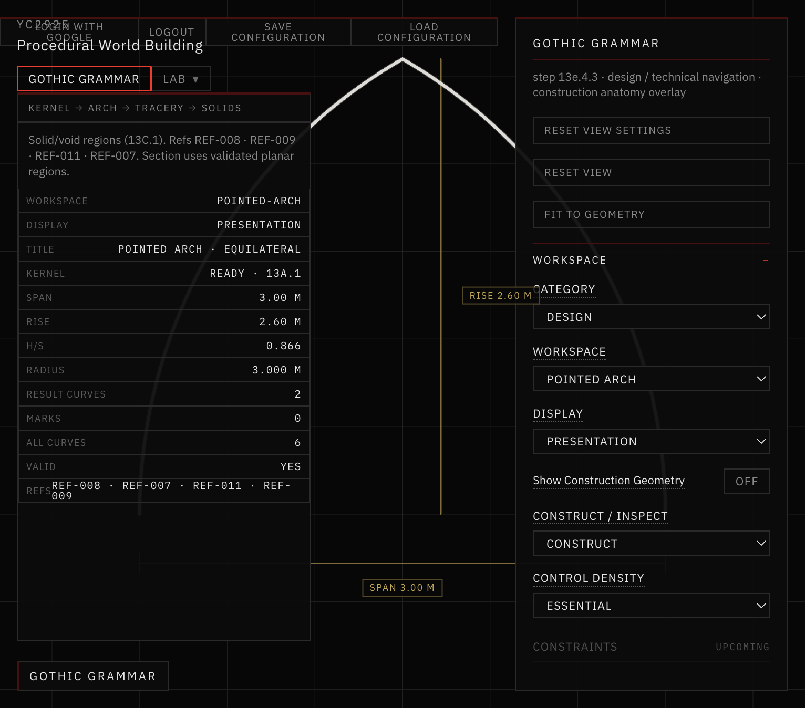
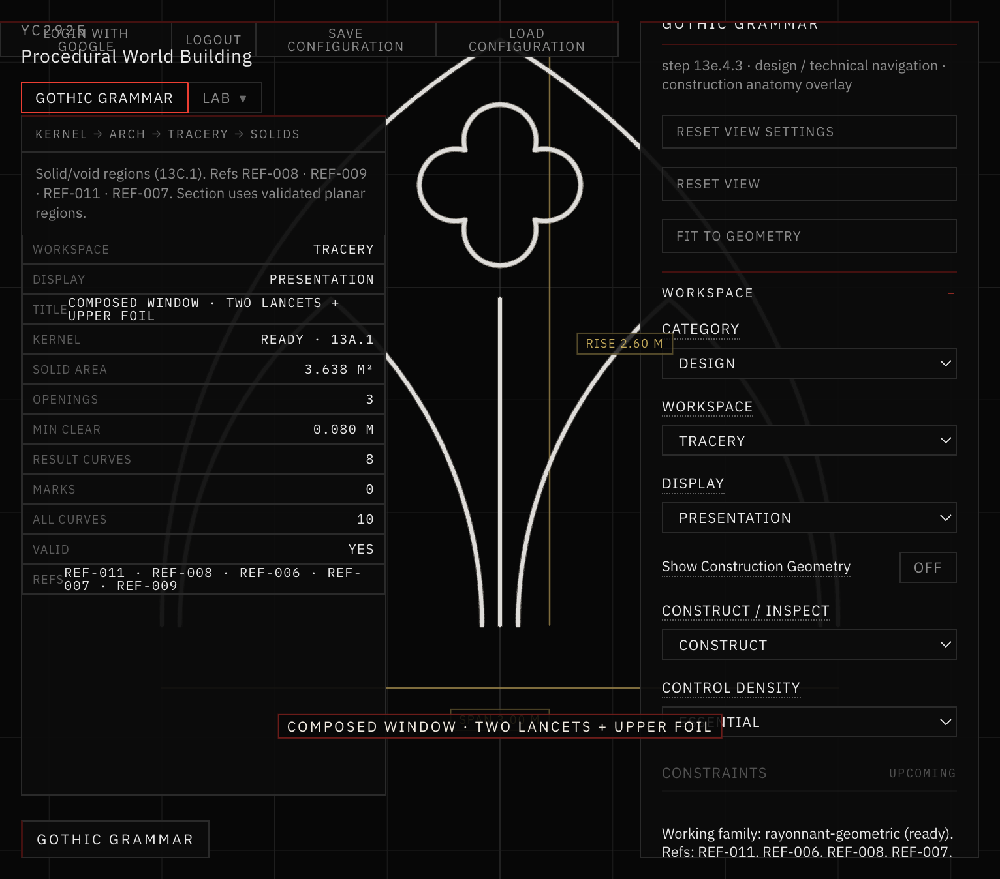
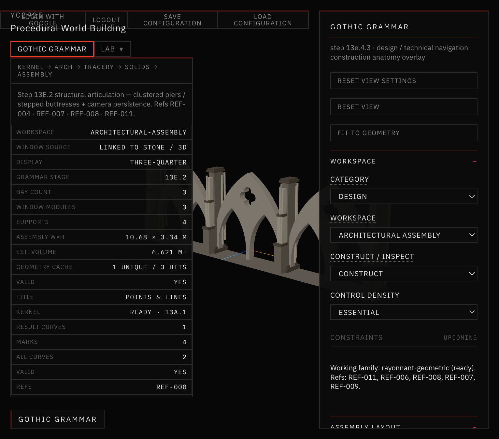
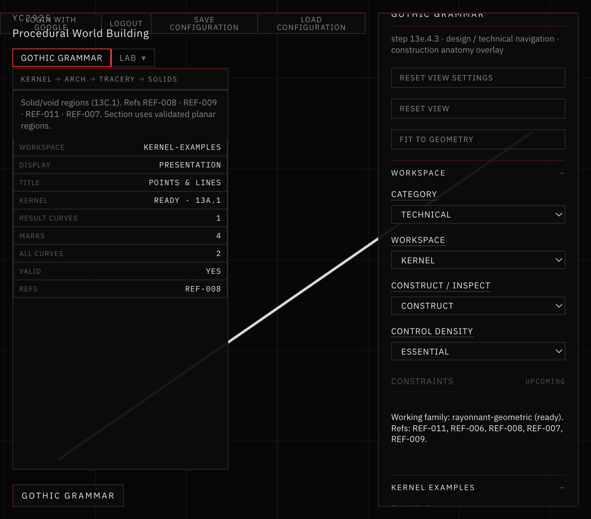

# 41 — Workspace rendering regression (13E.4.3.1)

Blocking repair after the Step 13E.4.3 Design / Technical navigation reorganization left **Design → Stone / 3D** and **Technical → Geometry Graph** blank.

## Verdict

Both viewports were blank because `stoneAssembly` `useMemo` cached `null` while `stoneMode` was false, then failed to regenerate when navigation switched into the `stone-3d` host (unchanged `geomKey`). Shared root cause. Fixed by depending on `stoneMode`; Geometry Graph continues to host Stone / 3D + Network Graph inspect layer.

Two-level navigation is intact. No replacement generators. No vegetation / Step 14A.

## After screenshots



*Design → Stone / 3D · Front · Baseline 13D outer-with-holes, 1156 tris.*



*Design → Stone / 3D · Three-Quarter · solid structural + moldings.*


*Technical → Geometry Graph · Network Graph inspect on stone host; bar-network fallback when Baseline has no members.*



*Same graph after Fit to Geometry — member width labels visible.*



*Design → Pointed Arch · Presentation equilateral.*



*Design → Tracery · Composed window.*



*Design → Architectural Assembly · 3-bay facade, linked window module.*



*Technical → Kernel · Points & Lines example.*

## Docs in this folder

| File | Contents |
|---|---|
| [ROOT_CAUSE.md](ROOT_CAUSE.md) | Blank viewport mechanism |
| [MODE_MAPPING.md](MODE_MAPPING.md) | Design / Technical → host mode → renderer |
| [REGRESSION_TESTS.md](REGRESSION_TESTS.md) | `validate:workspace-rendering` |

## Validation

```bash
cd app
npm run validate:workspace-rendering
npm run validate:viewport-initialization
npm run validate:construction-overlay
npm run validate:shared-window-module
npm run validate:camera-persistence
npm run build
```

All of the above passed for this repair.

## STOP

Do not start Step 14A from this repair.
