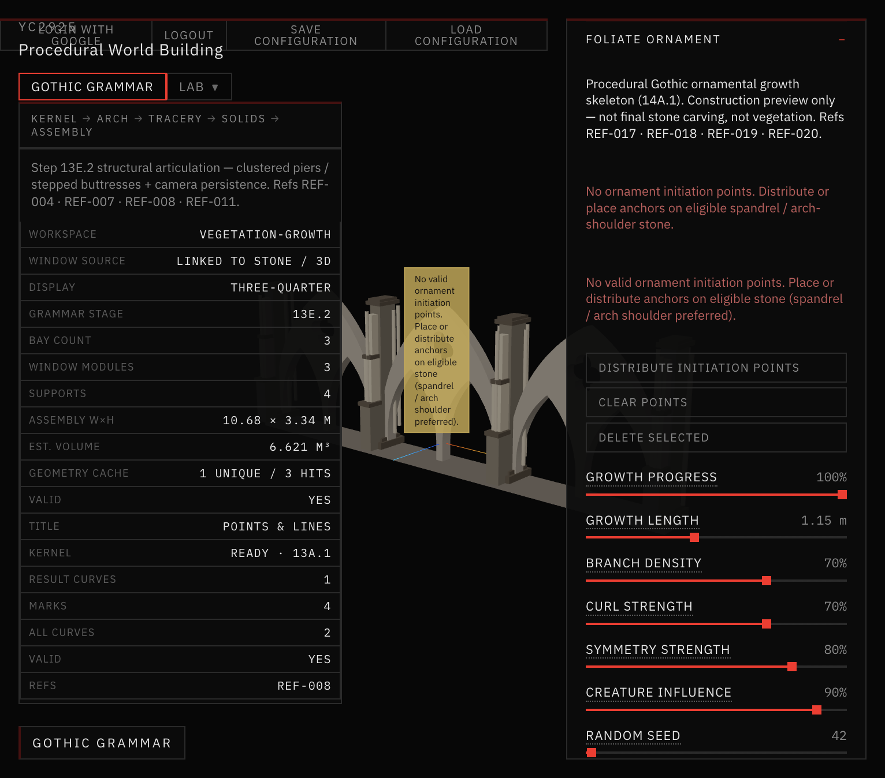
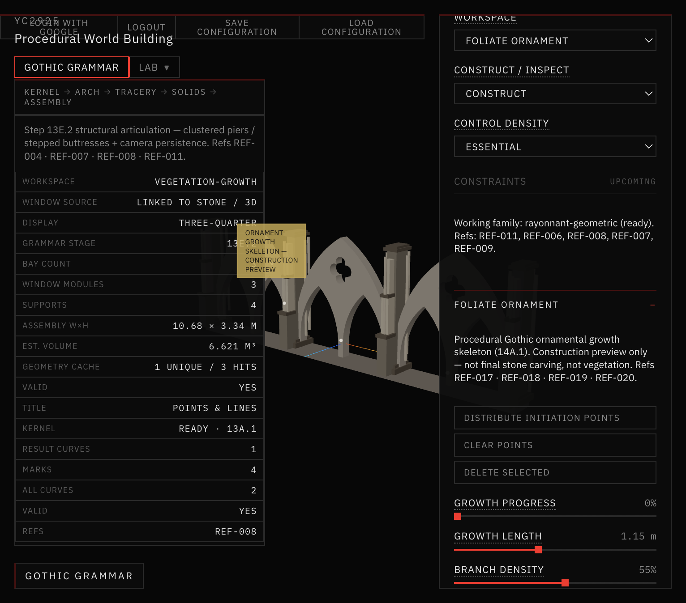
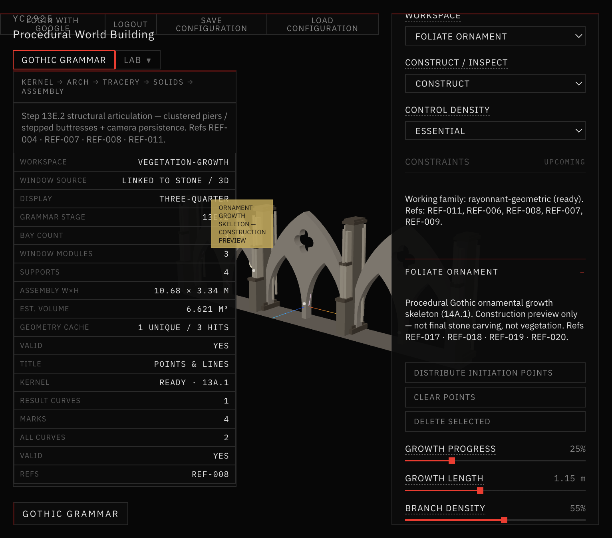
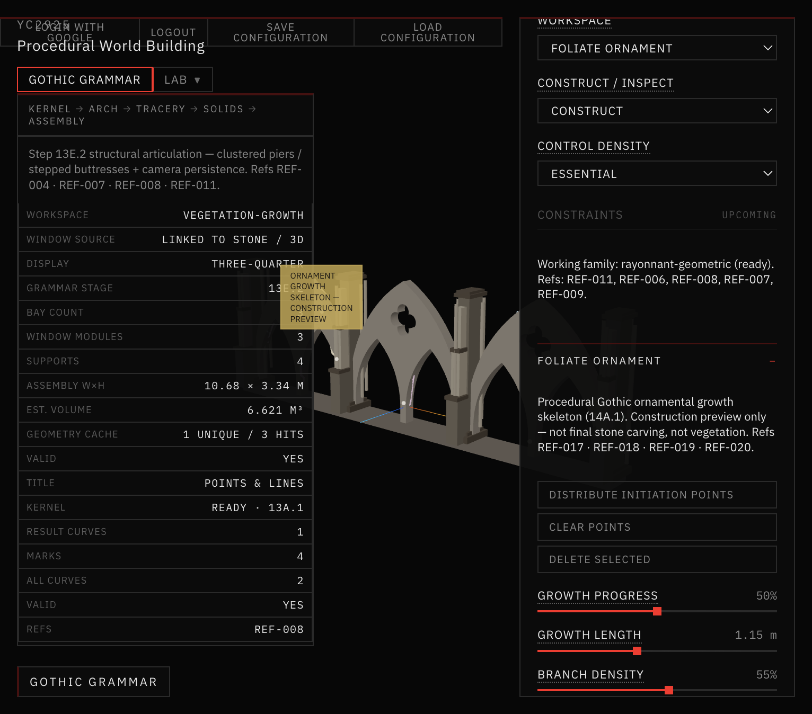
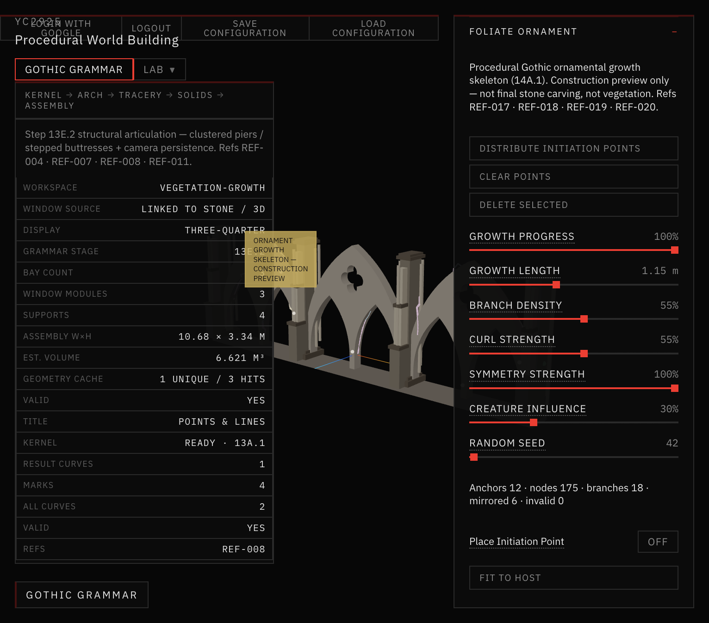
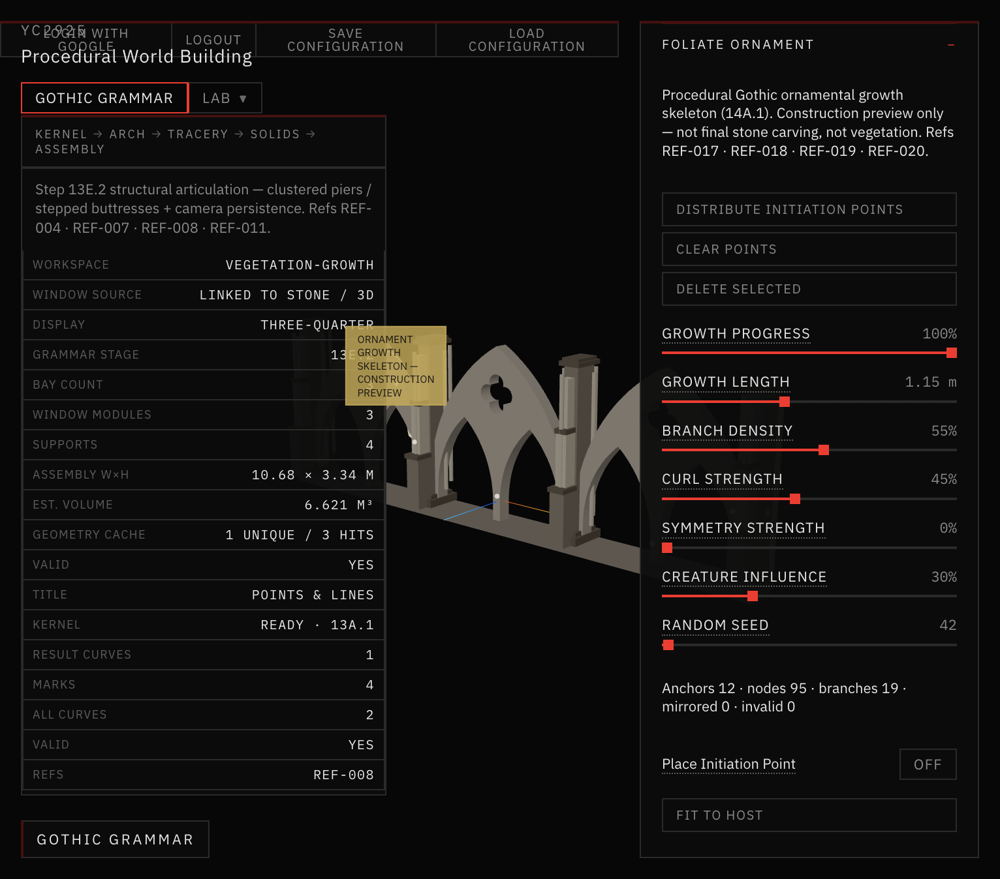
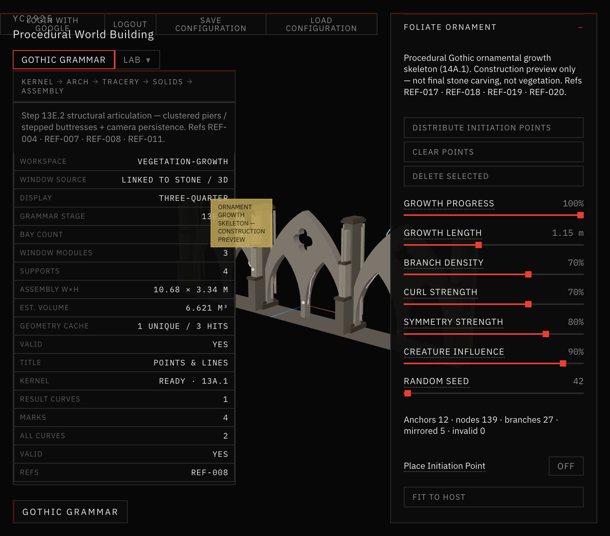
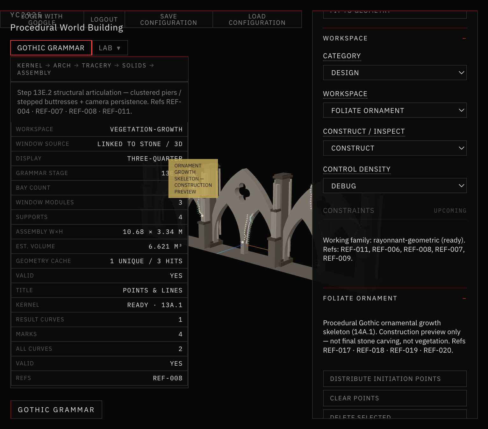

# 43 — Ornamental Growth Skeleton (Step 14A.1)

First functional **procedural Gothic ornamental growth skeleton**.

Growth is a computational method. Output is a **construction preview** for future sculptural stone — not ivy, not final carved solids.

## Workspace

**Design → Foliate Ornament**  
Internal id: `vegetation-growth` (saved-settings compatible)  
Host: Architectural Assembly facade + surface semantics + growth anchors

## Pipeline (this step)

```
Architectural Host (assembly)
→ Ornament Initiation Points (growth anchors)
→ Growth Skeleton (nodes / branches)
→ Progress reveal
→ Construction overlay visualization
```

Not in 14A.1: leaves, relief stone, Booleans, final ornament meshes.

## References

REF-017 · REF-018 · REF-019 · REF-020 (see Docs/42).

## Screenshots



*Empty Foliate Ornament host — no initiation points; clear empty-state message.*



*Growth Progress 0% — initiation anchors only on eligible stone.*



*Growth Progress 25% — primary branches begin.*



*Growth Progress 50% — main ornamental structure emerges.*


*Growth Progress 100% — complete skeleton; Symmetry 100%.*



*Symmetry Strength 100% — mirrored branches across facade centerline.*



*Symmetry Strength 0% — no mirrored branches (mirrored count 0).*



*Creature Influence 90% — denser curling / branching biomorphic variation.*



*Debug density — growth nodes, surface normals, growth directions, attachment anchors.*

## Docs

| File | Contents |
|---|---|
| [GROWTH_GRAMMAR.md](GROWTH_GRAMMAR.md) | Behaviors implemented |
| [DATA_MODEL.md](DATA_MODEL.md) | Node / branch schema |
| [PARAMETERS.md](PARAMETERS.md) | Essential / Advanced / Debug |
| [VALIDATION.md](VALIDATION.md) | `validate:ornament-growth` |

## STOP

Do not implement 14A.2 / 14A.3 from this step.
