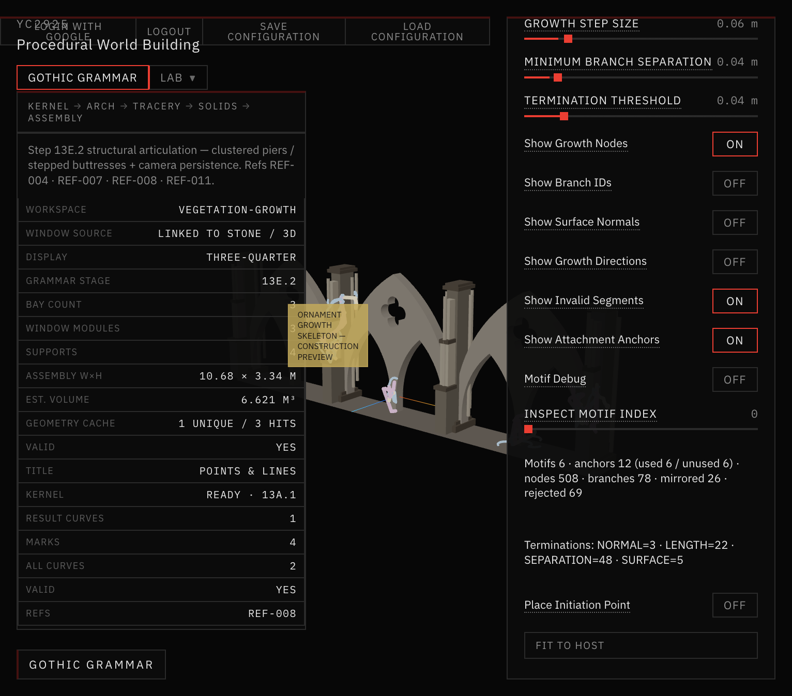
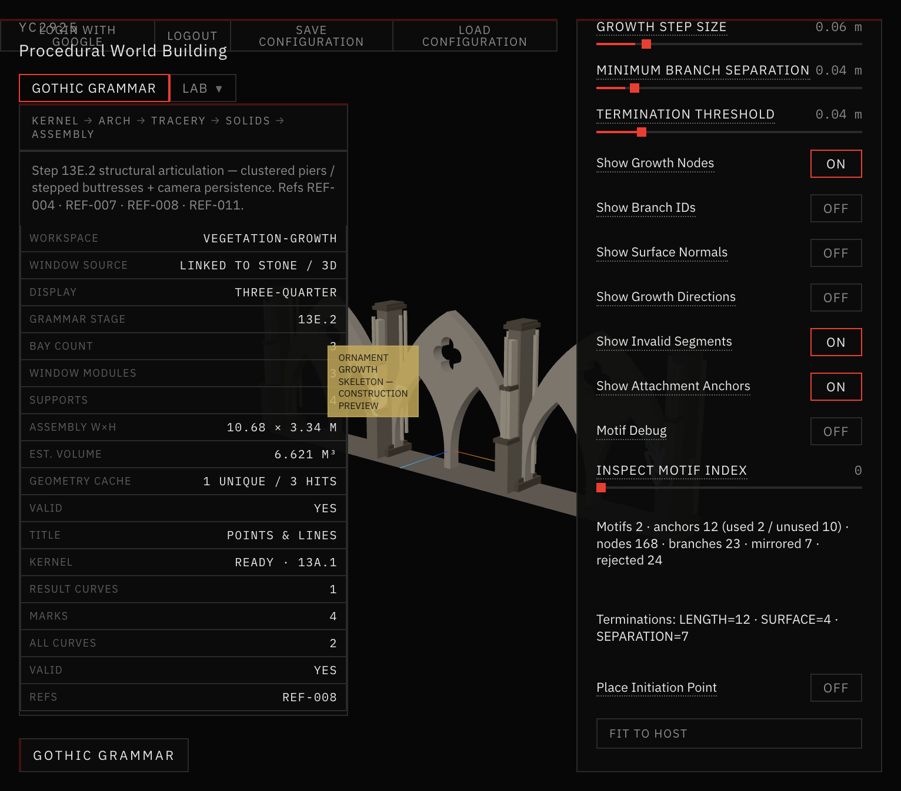
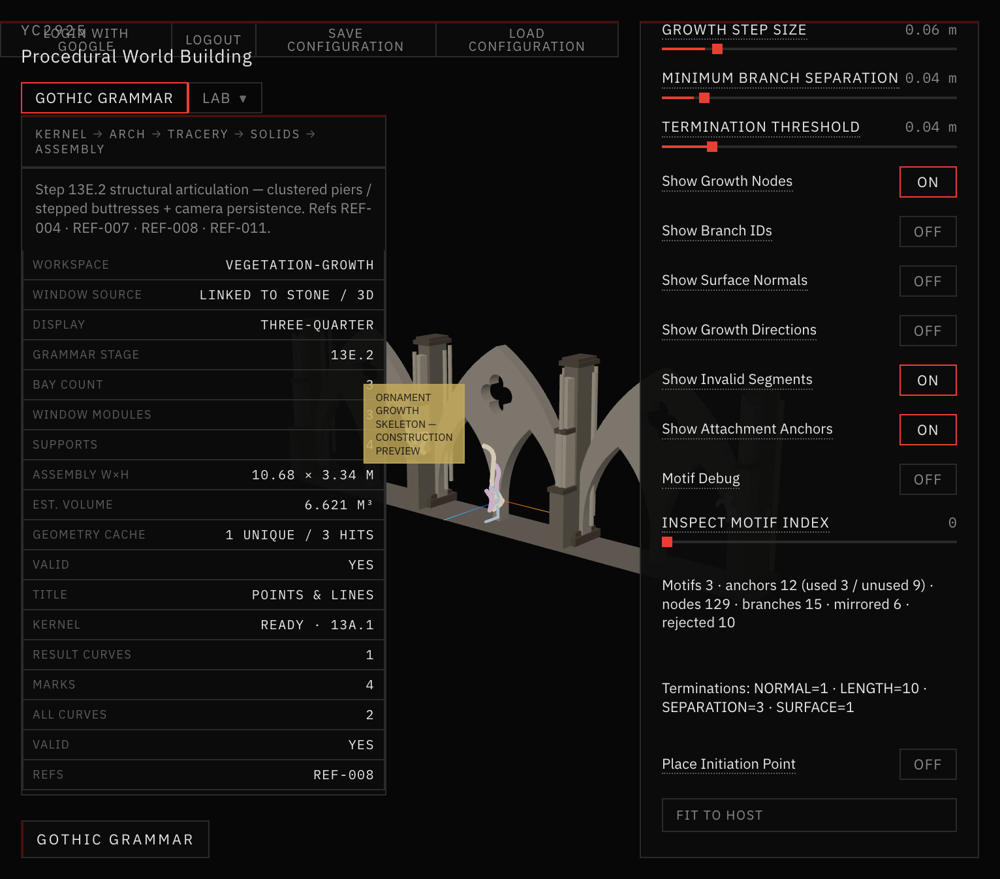
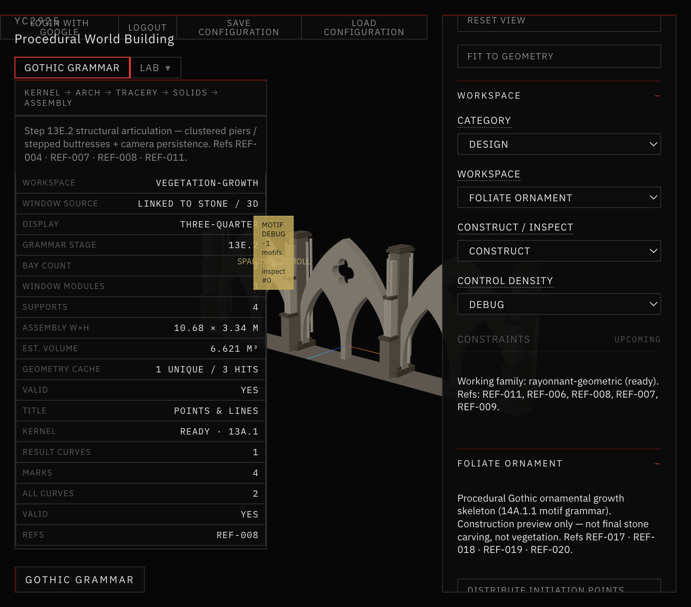

# 44 — Ornament Grammar & Surface Attachment Repair (Step 14A.1.1)

Critical repair of the 14A.1 ornamental growth skeleton. **No stone geometry** in this step.

Growth remains a construction skeleton for future Gothic foliate / grotesque stone carving (REF-017–020). Not vegetation.

## Root causes (14A.1)

| Failure | Cause |
|---|---|
| Sparse growth / unused anchors | Hard cap `maxRoots = 8` + one independent random-walk per seed |
| Antenna / zigzags | Step-wise random walk with weak curl (~0.08 rad/step) |
| Premature death | Global `SEPARATION` occupancy killed most branches early |
| Invisible / floating look | Many paths attached to **back faces** (`n.z = -1`) |
| No Gothic motif reading | No host-region motif grammar — only disconnected paths |

## Repair summary

Replaced random-walk composition with a **motif-based parametric grammar**:

1. Group anchors into architectural hosts (spandrel / pier / shoulder)
2. Generate a primary smooth spine (scroll or crocket lead-in)
3. Spawn hierarchical secondary / tertiary scrolls
4. Apply **motif-local** bilateral symmetry
5. Project every sample onto eligible front-facing stone; reject failures into debug segments (never accepted as ornament)

## Screenshots

*Single spandrel motif with Motif Debug (host label + inspect index).*

*Multi-motif facade composition on Architectural Assembly host.*

*Low Curl Strength — straighter spines / weaker winding.*

*High Curl Strength — stronger scroll winding.*

*Low Branch Density — fewer secondary scrolls.*

*High Branch Density — denser hierarchical offshoots.*

*Symmetry Strength 100% — motif-local mirrored scrolls.*

*Symmetry Strength 0% — no mirror branches.*

*Pier-panel crocket spine motif.*

*Debug: rejected segments, attachment anchors, motif bounds / axes.*

## Docs in this folder

| File | Contents |
|---|---|
| [ROOT_CAUSES.md](ROOT_CAUSES.md) | Diagnosis counts |
| [MOTIF_GRAMMAR.md](MOTIF_GRAMMAR.md) | New grammar |
| [SURFACE_VALIDATION.md](SURFACE_VALIDATION.md) | Attachment rules |
| [PARAMETERS.md](PARAMETERS.md) | Control effects |
| [VALIDATION.md](VALIDATION.md) | Scripts + parity |

## STOP

Do not implement stone solids / Boolean carving from this step.
