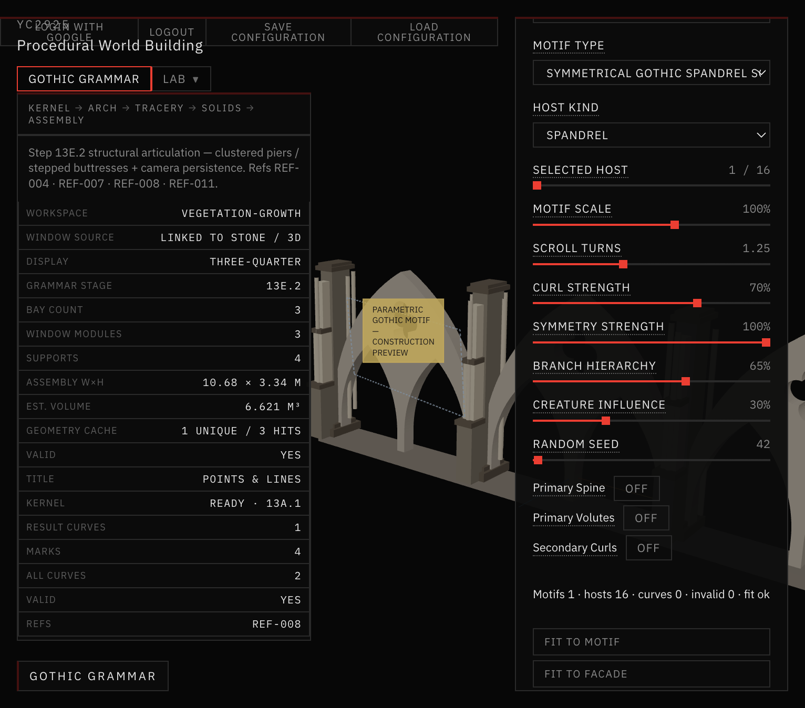
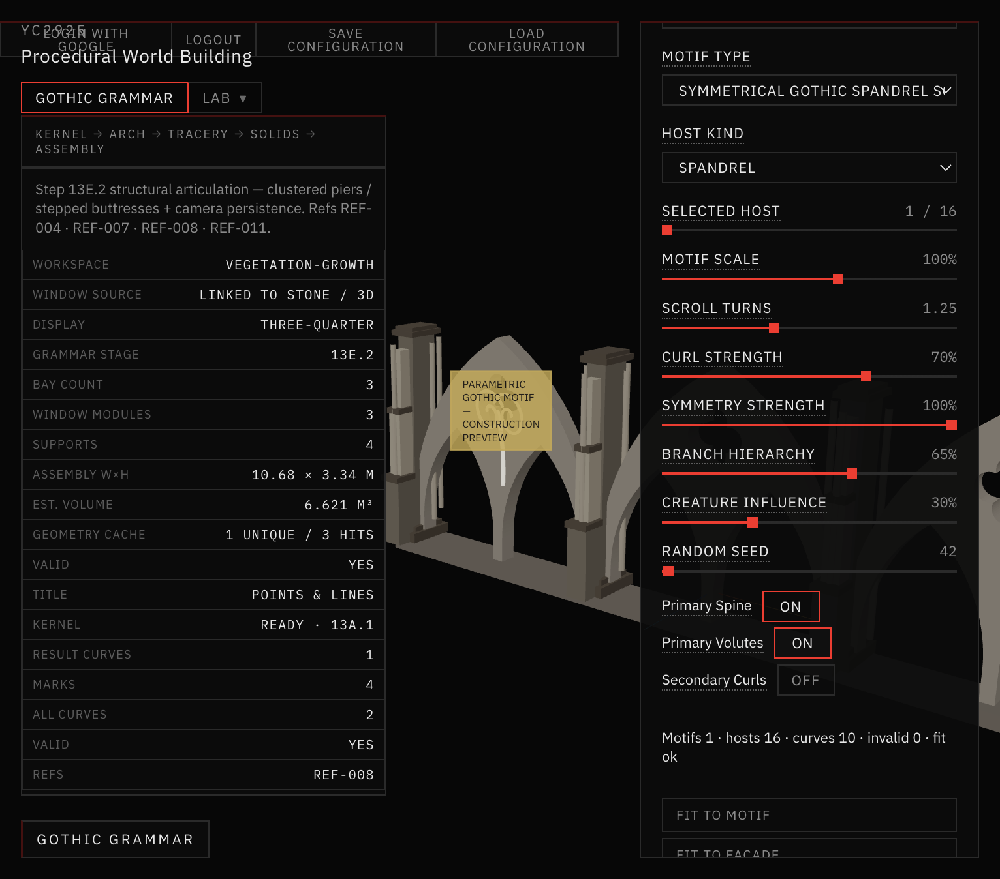
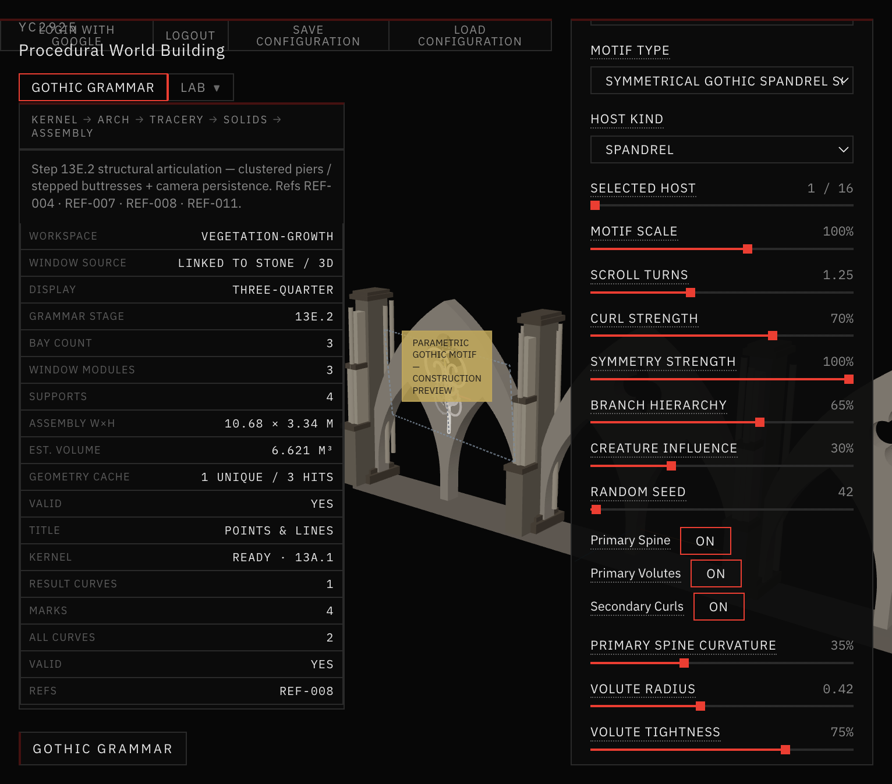
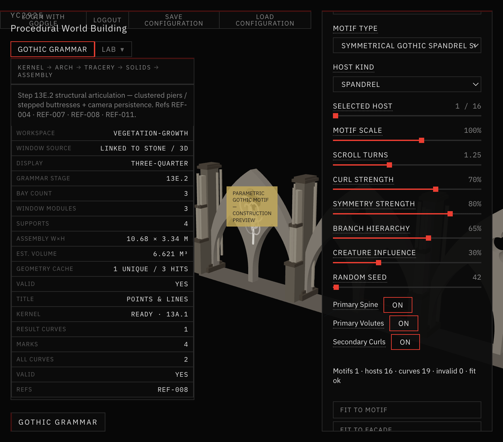
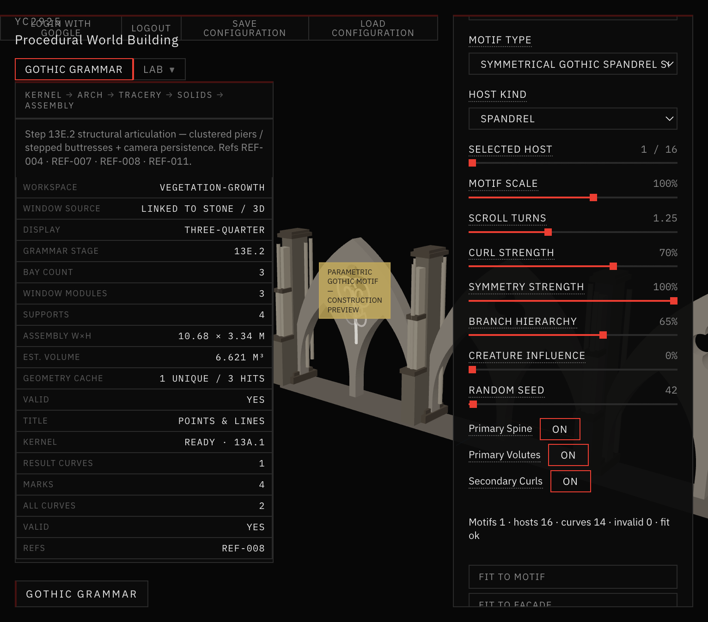
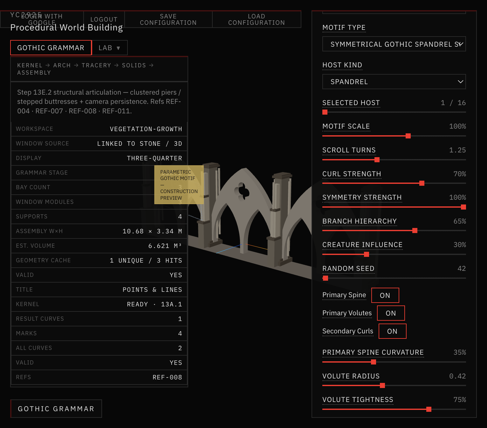
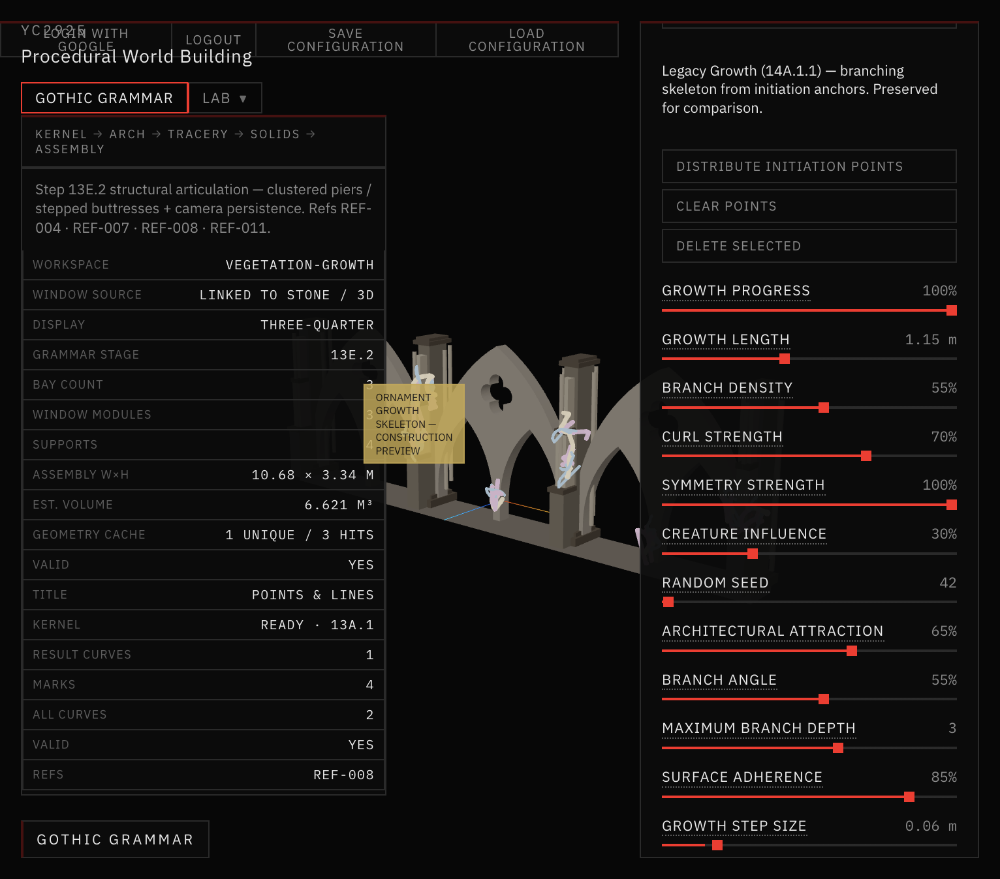

# 45 — Parametric Gothic Motif Laboratory (Step 14A.1.2)

Focused ornamental **composition** lab for one coherent Gothic motif inside an architectural host region.

Construction curves only — **not** final stone solids, **not** vegetation. Refs REF-017 · REF-018 · REF-019 · REF-020.

## Composition modes

| Mode | Behavior |
|---|---|
| **Single Motif** (default) | One selected host (spandrel preferred); unrelated seeds/curves hidden |
| **Full Facade** | Motif grammar on every eligible host |
| **Legacy Growth** | Preserved 14A.1.1 branching skeleton |

## Default motif

**Symmetrical Gothic Spandrel Scroll**

1. Primary ribbed spine  
2. Mirrored primary volutes  
3. Secondary curling branches (local bilateral symmetry)  
4. Optional tertiary tip details under hierarchy / creature influence  

## Screenshots

*Single Motif · spine/volutes/curls off — selected host ready for composition.*

*Primary ribbed spine with construction hierarchy.*

*Spine + mirrored primary Gothic volutes.*

*Secondary curling branches with local mirrors.*

*Full default symmetrical spandrel scroll — Fit to Motif framing.*

*Symmetry Strength 100% — exact local bilateral mirror.*

*Symmetry Strength 80% — soft asymmetry.*

*Creature Influence 0% — traditional Gothic ornamental order.*

*Creature Influence 90% — elongated / skeletal branching (still hierarchical).*

*Debug: host boundary, local axes, clearance zones.*

*Full Facade composition mode — motifs on eligible hosts.*

*Legacy Growth mode — preserved 14A.1.1 skeleton for comparison.*

## Docs in this folder

| File | Contents |
|---|---|
| [MOTIF_GRAMMAR.md](MOTIF_GRAMMAR.md) | Composition grammar & hierarchy |
| [GEOMETRIC_PRIMITIVES.md](GEOMETRIC_PRIMITIVES.md) | Volute / spine / secondary curl |
| [HOST_FITTING.md](HOST_FITTING.md) | Host frames, clearance, symmetry |
| [VALIDATION.md](VALIDATION.md) | Scripts + acceptance |

## STOP

Step 14A.1.2 complete. **Do not** implement stone geometry here.
