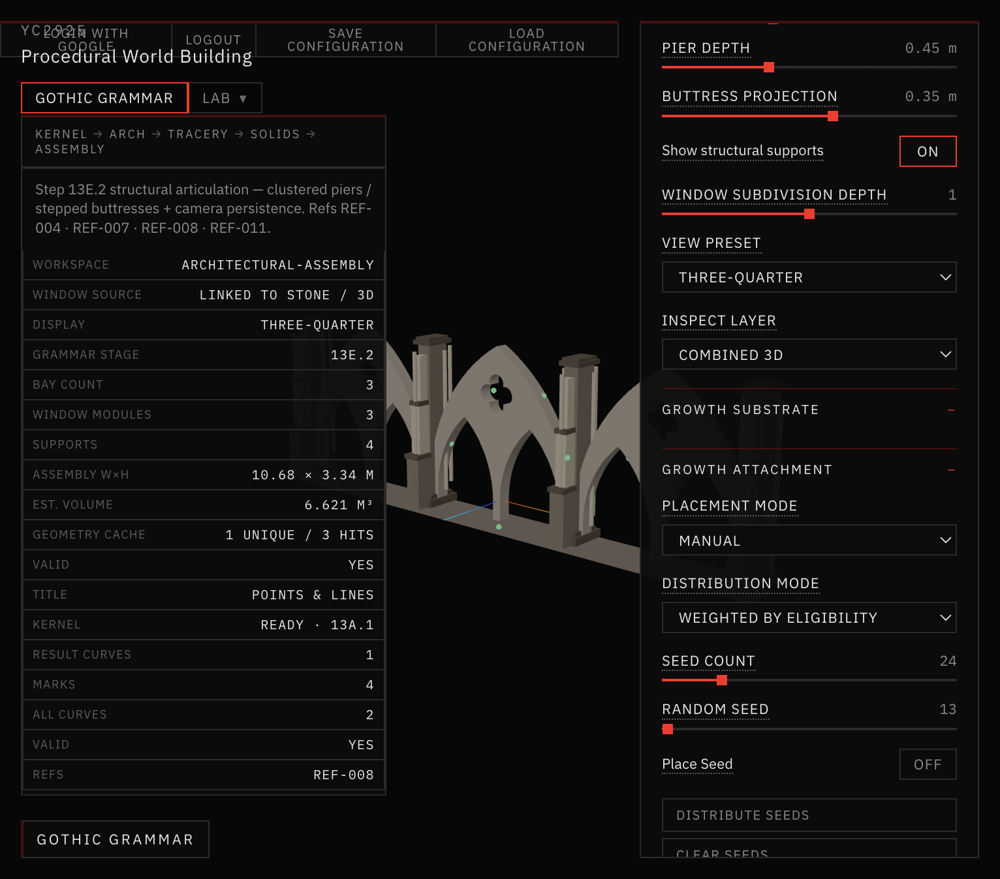
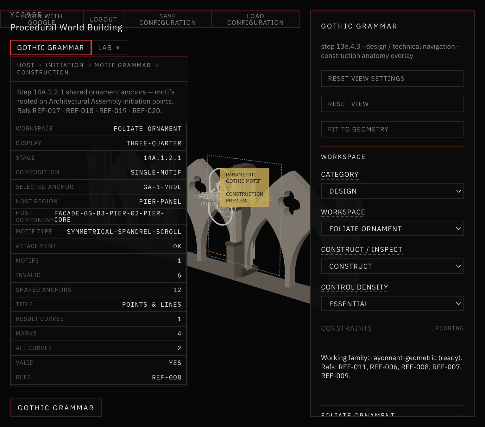
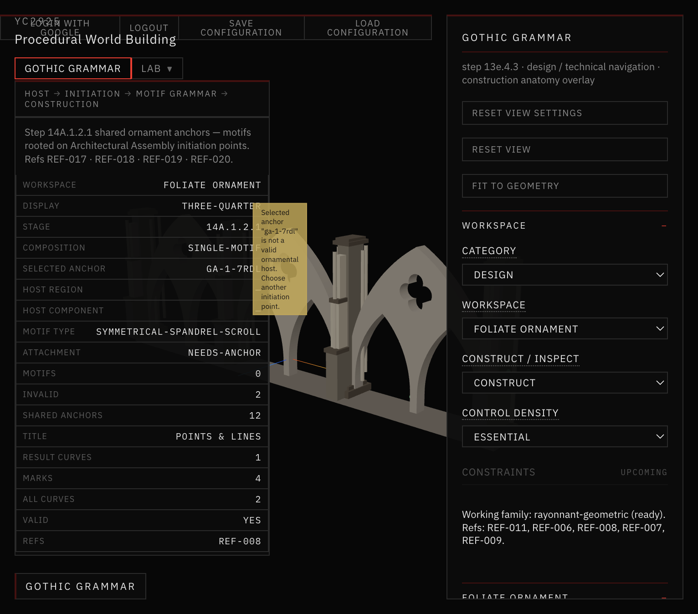
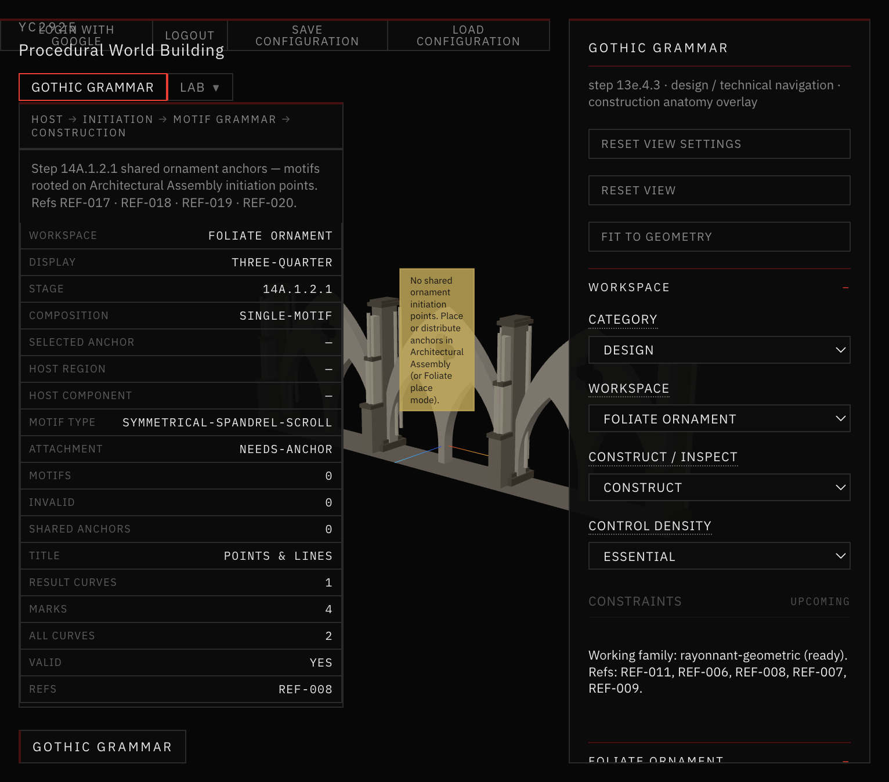

# 46 — Shared Ornament Anchor Integration (Step 14A.1.2.1)

Critical repair: parametric motifs must root on **shared GrowthAttachment initiation points** from Architectural Assembly.

Construction curves only — not stone solids. Refs REF-017 · REF-018 · REF-019 · REF-020.

## Root cause

Step 14A.1.2 `buildParametricMotifs` called `discoverOrnamentHosts(semantics)`, which invented host centers from patch clusters. It never consumed `growthAttachment.anchors`, so motifs floated as independent compositions (often under the quatrefoil) unrelated to placed initiation points.

## Fix summary

| Before | After |
|---|---|
| Independent host discovery | Host frame origin = shared anchor `worldPosition` |
| `selectedHostIndex` | `selectedAnchorId` (shared ID) |
| Full facade = patch clusters | Full facade = one motif per valid shared anchor |
| Hidden seeds in Single Motif | Shared anchors visible + placeable in Foliate |

Pipeline:

```
Architectural Assembly
→ GrowthAttachment anchors (IDs preserved)
→ Foliate Ornament selection
→ Host frame at anchor
→ Parametric motif (spine root = anchor)
```

## Screenshots



*Architectural Assembly — one ornament initiation point placed.*



*Foliate Ornament Single Motif — same shared anchor ID selected.*


*Anchor Link Debug — source anchor and motif root coincide.*



*Motif parameters changed — root stays on the anchor.*


*Full Facade — motifs only at existing valid anchors.*



*After deleting the shared anchor — associated motif disappears.*

## Docs in this folder

| File | Contents |
|---|---|
| [ANCHOR_DATA_FLOW.md](ANCHOR_DATA_FLOW.md) | Authoritative state path |
| [ROOTING_VALIDATION.md](ROOTING_VALIDATION.md) | Root / hierarchy checks |
| [CROSS_WORKSPACE_TESTS.md](CROSS_WORKSPACE_TESTS.md) | Browser + script acceptance |

## STOP

Step 14A.1.2.1 complete. **Do not** implement stone geometry here.
