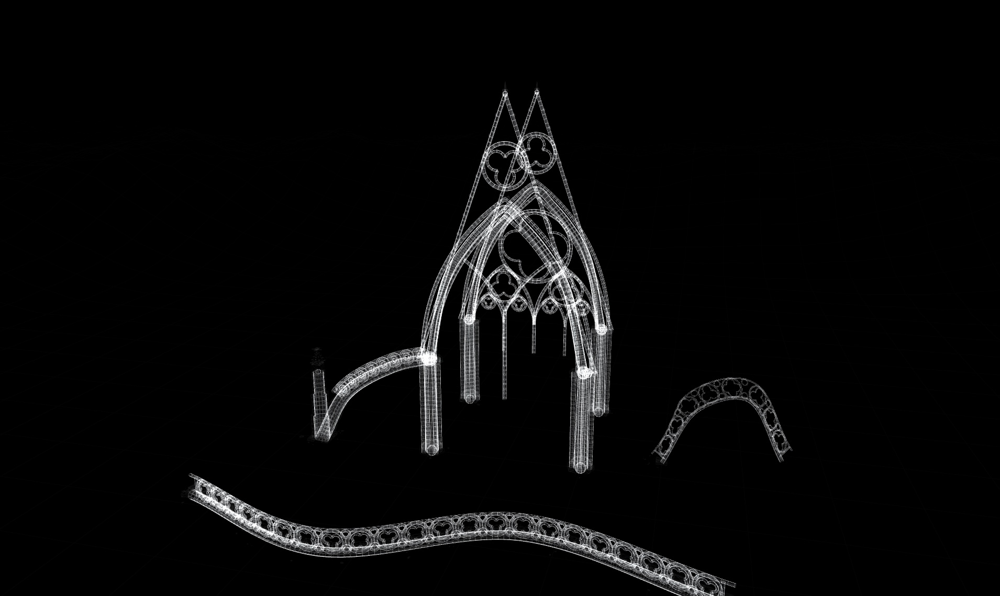
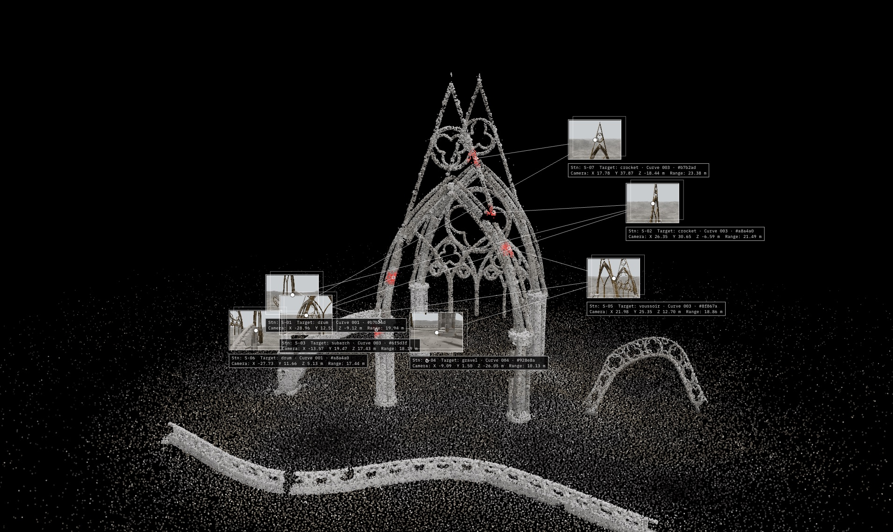
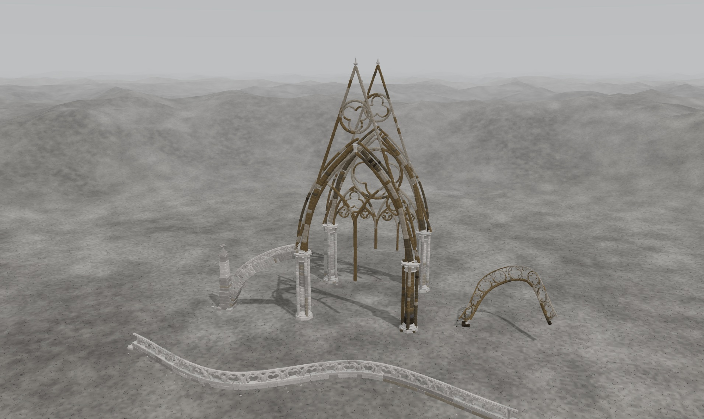

# LITHIC CODE

**Live build: [pwb-yc2925-project-64c07.web.app](https://pwb-yc2925-project-64c07.web.app)**

Lithic Code is a procedural world builder for Gothic architecture, made with React, Three.js and Vite. You draw curves, and **each curve's shape decides what it becomes**. Every curve goes through four stages:

1. **Curves:** you draw the curve in the curve sandbox (Top, Front or Side view). Modes:
   - **Draw:** sketch freehand with a stabilizer.
   - **Edit:** move single points.
   - **Move:** drag whole curves.

   Right-drag pans the board.
2. **Gothic skeleton:** the curve is measured and turned into structure with compass-and-straightedge rules.
   - The measured qualities are its signature: closed or open, rise, reverse bends, symmetry, verticality, winding, corners and roundness.
   - The signature picks one of **24 Gothic typologies**: pointed, cusped, Tudor, ogee/flamboyant, round/plate, rampant and stacked arches; rose, wheel, vesica and spherical-triangle windows; ribbed vaults, chapter house, canopy, cloister and apse; arcades, net tracery, parapet and panel screen; spire and spiral stair.
   - Every arc and tangency is solved exactly.
3. **Lithic formation:** the skeleton is built in carved limestone and sandstone, including voussoirs, drums, keystones, bosses, pinnacles, crockets and grotesques.
4. **World:** the structures stand in a procedural terrain under fog and atmosphere.

Every form comes from explicit mathematical and geometric rules and is controlled by parameters. Nothing is hand-modelled or AI-generated.

In the World tab:
- There are three views:
  - **Solid:** the default carved-stone view.
  - **X-ray:** a wire-mesh view that highlights the most prominent structures.
  - **Point cloud:** a photogrammetry-style survey with survey stations.
- **World & terrain** and **Debug** are separate panels in the top-right row:
  - World & terrain has the terrain, sky and ground controls.
  - Debug shows the rule log, construction geometry and stone conflicts.

The **5 Sample** tab is a separate showcase world, shown in the image above. It has one labelled curve for every Gothic variation, and you can edit it without touching your own world.

The **Lab** menu keeps the earlier studies that led here: noise, terrain, hydraulic and vegetation simulation, voxels, shaders, growth, L-systems, Gothic grammar, ornament and agents.

| X-ray | Point cloud survey | Overcast fog |
|---|---|---|
|  |  |  |

### Latest progress (November 2026)

- **Curve typologies:** a curve signature chooses among 24 typologies, each built from exact arcs and tangencies. Classic keeps the original grammar ([28](Docs/28-curve-typologies/README.md), [variations table](Docs/28-curve-typologies/VARIATIONS.md)).
- **5 Sample tab:** all 30 sample curves and their structures side by side, with labels, a reset, and their own undo and autosave.
- **Debug layers:**
  - Curve → skeleton: rule log and construction geometry.
  - Skeleton → stone: stones coloured by kind or phase, overlap conflicts, timelapse and a stone inspector ([27](Docs/27-debug-layers/README.md)).
- **Curve sandbox:**
  - An editable Side view.
  - A Move mode that drags whole curves.
  - Right-drag panning in every direction.
- **Lithic formation:**
  - The loose pebbles are removed.
  - The sliders are ordered by measured visual impact: formation width, stone size, carving scale, density and wall thickness come first.
- **World look:**
  - An overcast fog sky.
  - A rubble and dust ground with a dark palette option.
  - A terrain grid toggle.
  - An X-ray terrain glow.
  - A point-cloud survey view.
- **Interface:**
  - The World pages share the Lab's style: thin filled sliders, IBM Plex type and a #C21807 accent.
  - Every parameter shows a description on hover.

**Run it locally:** `cd app && npm install && npm run dev`. To run the world checks: `npm run validate:world`.

---

## Table of contents

### Lithic Code: curve-driven Gothic world (current)

- [26 — Curve-driven Gothic world](Docs/26-PIVOT-curve-driven-gothic-world/README.md): session log of the pivot to drawing curves and building the world from them.
  - [Tracery grammar and carved stone](Docs/26-PIVOT-curve-driven-gothic-world/TRACERY_GRAMMAR_AND_CARVED_STONE.md): an exact construction kernel, the shape grammar, carved prototypes and the stone palette.
  - [Point Cloud view: photogrammetry survey](Docs/26-PIVOT-curve-driven-gothic-world/WORLD_SCAN_SURVEY_LOOK.md): stones sampled into points, survey stations that report measured data, and performance budgets.
- [27 — Debug layers](Docs/27-debug-layers/README.md): Class 11 visual debugging. Curve → skeleton: rule log, construction geometry, member types and labels. Skeleton → stone: stones coloured by kind or phase, overlap conflicts with their blockers, per-phase counts and timings, build timelapse and a stone inspector.
- [28 — Curve typologies](Docs/28-curve-typologies/README.md): the curve decides the building. A curve signature (closed, rise, reverse bends, symmetry, verticality, winding) picks one of 24 Gothic typologies: ogee + flamboyant, Tudor + panel, plate, rampant, cusped, stacked elevation, rose, wheel, vesica, spherical triangle, ribbed vault, chapter house, canopy, cloister, apse, arcades, reticulated net, parapet, spire and spiral stair. Classic keeps the Step 47 grammar.
  - [Variations table](Docs/28-curve-typologies/VARIATIONS.md): every structure, the curve qualities that select it, and how it is built. The **5 Sample** tab builds all of them side by side.

### Foundations: noise, terrain and simulation

- [01 — Particles](Docs/01-particles/README.md): a spherical point cloud warped by 3D value noise.
- [02 — Procedural Noise](Docs/02-procedural-noise/README.md): fractal noise types, shaping curves and layered blending for heightmaps.
- [03 — Terrain Generation](Docs/03-terrain-generation/README.md): the heightmap lifted into a 3D mesh with island falloff and smoothing.
- [04 — Hydraulic Simulation](Docs/04-hydraulic-simulation/README.md): grid-based rain, flow, sediment, erosion and deposition.
- [05 — Vegetation Simulation](Docs/05-vegetation-simulation/README.md): growth driven by moisture, slope, elevation and erosion.
- [06 — Voxel Experiments](Docs/06-voxel-experiments/README.md): density fields, caves, CSG, Marching Cubes and chunking.
- [07 — Firebase](Docs/07-firebase/README.md): Google login, saving configurations to Firestore, and public hosting.

### Ornament and growth research

- [08 — Shader Experiments](Docs/08-shaders-experiments/README.md): shading strategies for vegetal ornament on religious façades.
- [09 — Growth Lab](Docs/09-growth-lab/README.md): where ornament emerges and how it travels (splines, particles, vector fields).
- [10 — L-Systems and Levels of Detail](Docs/10-lsystems-lod/README.md): rule-based branching with measured levels of detail.
- [11 — Gothic Architecture](Docs/11-gothic-architecture/README.md): tracery window families (geometric, Rayonnant, Flamboyant) swept into stone.
- [12 — Ornament System](Docs/12-ornament-system/README.md): growth conditions, trails, branching and sculptural integration.
- [13 — Agent Simulation](Docs/13-agent-simulation/README.md): agents on the architectural surface, stigmergy, and ornament built by agents.
- [14 — Architectural Scale](Docs/14-architectural-scale/README.md): a shared metre scale and proportional ornament.
- [15 — Camera LOD](Docs/15-camera-lod/README.md): level of detail by screen size for stone and ornament.

### Gothic grammar

- [16 — Gothic Grammar Foundations](Docs/16-gothic-foundations/README.md): an independent 2D math kernel and pointed-arch construction.
- [17 — Tracery Grammar](Docs/17-tracery-grammar/README.md): lancets, foils, oculi, composed windows and solid/void regions.
- [18 — Procedural Stone & Rayonnant](Docs/18-stone-rayonnant/README.md): tracery extruded into 3D stone, and a hierarchical Rayonnant grammar.
- [19 — Architectural Assemblies](Docs/19-architectural-assemblies/README.md): a multi-bay façade, its articulation, and surface semantics.
- [20 — Growth Attachment](Docs/20-growth-attachment/README.md): surface seeds for growth, placement, and a fix for unstable viewports.
- [21 — Workspace & Construction Anatomy](Docs/21-workspace-construction-anatomy/README.md): Design and Technical navigation with construction-geometry overlays.
  - [Construction data](Docs/21-workspace-construction-anatomy/CONSTRUCTION_DATA.md) · [Navigation structure](Docs/21-workspace-construction-anatomy/NAVIGATION_STRUCTURE.md) · [Overlay controls](Docs/21-workspace-construction-anatomy/OVERLAY_CONTROLS.md) · [Validation](Docs/21-workspace-construction-anatomy/VALIDATION.md)
- [22 — Workspace Rendering Regression](Docs/22-workspace-rendering-regression/README.md): fixing the blank Stone / 3D and Geometry Graph viewports.
  - [Root cause](Docs/22-workspace-rendering-regression/ROOT_CAUSE.md) · [Mode mapping](Docs/22-workspace-rendering-regression/MODE_MAPPING.md) · [Regression tests](Docs/22-workspace-rendering-regression/REGRESSION_TESTS.md)

### Gothic ornament grammar

- [23 — Ornamental Growth Skeleton](Docs/23-ornamental-growth-skeleton/README.md): the first procedural skeleton for ornamental growth.
  - [Data model](Docs/23-ornamental-growth-skeleton/DATA_MODEL.md) · [Growth grammar](Docs/23-ornamental-growth-skeleton/GROWTH_GRAMMAR.md) · [Parameters](Docs/23-ornamental-growth-skeleton/PARAMETERS.md) · [Validation](Docs/23-ornamental-growth-skeleton/VALIDATION.md)
- [24 — Parametric Motif Lab](Docs/24-parametric-motif-lab/README.md): one coherent Gothic motif fitted inside a host region of the architecture.
  - [Geometric primitives](Docs/24-parametric-motif-lab/GEOMETRIC_PRIMITIVES.md) · [Motif grammar](Docs/24-parametric-motif-lab/MOTIF_GRAMMAR.md) · [Host fitting](Docs/24-parametric-motif-lab/HOST_FITTING.md) · [Validation](Docs/24-parametric-motif-lab/VALIDATION.md)
- [25 — Shared Ornament Anchors](Docs/25-shared-ornament-anchors/README.md): motifs rooted on shared growth-attachment points.
  - [Anchor data flow](Docs/25-shared-ornament-anchors/ANCHOR_DATA_FLOW.md) · [Cross-workspace tests](Docs/25-shared-ornament-anchors/CROSS_WORKSPACE_TESTS.md) · [Rooting validation](Docs/25-shared-ornament-anchors/ROOTING_VALIDATION.md)

### Tutorials, notes and references

- Tutorials:
  - [Git & GitHub](Docs/Tutorials/Git%20%26%20Github.md)
  - [Installing React](Docs/Tutorials/Installing%20React.md)
  - [React](Docs/Tutorials/React.md)
  - [Firebase](Docs/Tutorials/Firebase_Tutorial.md)
  - [Introduction to Shaders](Docs/Tutorials/Shaders.md)
  - [Shader Studies](Docs/Tutorials/Shader-Studies.md)
  - [Voxels](Docs/Tutorials/Voxels.md)
- Notes:
  - [Week 4](Docs/Documentation/Week4.md)
  - [Hydraulic simulation analysis (09/09)](Docs/Analysis/Hydraulic%20Simulation%200909.md)
- [Graphic style guide](Docs/style-guide.md): the visual rules for the interface.
- [Study notebook index](Docs/README.md): an overview of the study areas and how the app is organized.
- [Visual references](references/README.md) and [visual direction](references/VISUAL_DIRECTION.md): the reference images (REF-001 to REF-033) that guide every visual decision.
